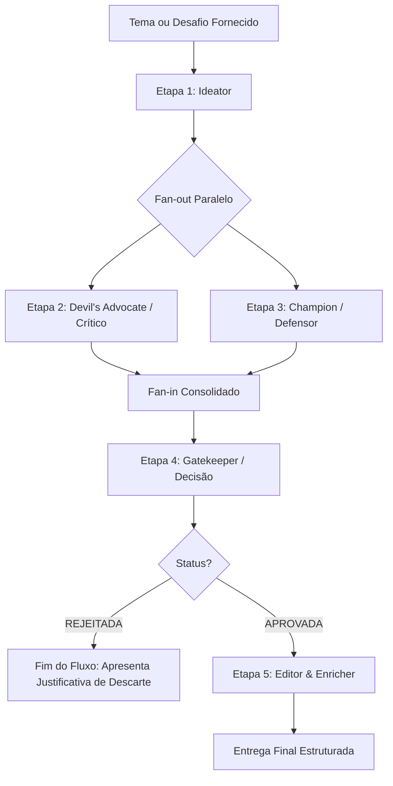

# Idea Generator — Pipeline Multi-Agente de Ideação e Refinamento

Esta skill implementa um fluxo estruturado de ideação e validação conceitual baseado em um **pipeline multi-agente sequencial e paralelo (fan-out/fan-in)**. O objetivo é transformar um tema amplo, desafio de negócio ou dor de usuário em uma solução rigorosamente testada, refinada e pronta para execução.

---

## Quando Acionar Esta Skill

Ative esta skill quando:
- O usuário solicitar **geração de ideias**, **brainstorming** ou **concepção de projetos/produtos**.
- For pedido para criar novos conceitos usando a metodologia de múltiplos papéis ou debate de ideias.
- O usuário pedir para validar uma hipótese através de visões contrárias (crítica vs. defensora) e decisão de aprovação/rejeição.

---

## Arquitetura do Pipeline

O pipeline orquestra 5 papéis/etapas bem definidos:



---

## Instruções de Execução para o Agente

Ao receber o tema ou problema, execute cada etapa em sequência mantendo o rigor dos papéis:

### Etapa 1 — Geração Criativa (`Ideator`)
- **Mentalidade:** Pensamento divergente, arrojado, inovador e livre de autocrítica.
- **Entrada:** O tema, dor ou desafio fornecido pelo usuário.
- **Saída Obrigatória:**
  - **Título da Ideia:** Nome expressivo e memorável.
  - **Problema Resolvido:** A dor real ou oportunidade latente.
  - **Conceito Central:** O que é a solução e como ela opera no cerne.
  - **Proposta de Valor:** O benefício diferencial claro para o público-alvo.

### Etapa 2 e 3 — Análise Paralela (Fan-out)
Execute mentalmente ou em paralelo duas análises antagônicas e extremas sobre a proposta da Etapa 1:

1. **Agente Crítico (`Devil's Advocate`)**
   - **Foco Estrito:** Pontos fracos, riscos técnicos e operacionais, custos ocultos, barreiras regulatórias ou de adoção, dependências frágeis e falhas lógicas do modelo.
   - **Tom:** Cético, questionador e implacável.

2. **Agente Defensor (`Champion`)**
   - **Foco Estrito:** Potencial de mercado, alavancas de escala, diferenciais competitivos (moats), efeitos de rede e os motivos pelos quais a ideia vale a pena ser construída.
   - **Tom:** Otimista pragmático, voltado ao crescimento e viabilidade.

### Etapa 4 — Decisão / Filtragem (`Gatekeeper`)
- **Mentalidade:** Juiz pragmático, neutro e tomador de decisão executiva.
- **Entrada:** A proposta original do `Ideator` + o relatório do `Devil's Advocate` + o relatório do `Champion`.
- **Ação:** Pesar se as oportunidades superam os riscos identificados e se as fraquezas são mitigáveis.
- **Formato Estrito de Saída:**
  ```markdown
  ### ⚖️ Veredito do Gatekeeper
  - **STATUS:** [APROVADA] ou [REJEITADA]
  - **JUSTIFICATIVA:**
    1. [Ponto-chave da decisão]
    2. [Balanço entre riscos vs. oportunidades]
    3. [Condição de viabilidade ou motivo fatal de rejeição]
  ```
- **Regra de Decisão:**
  - Se for **`[REJEITADA]`**: Interrompa imediatamente o pipeline. Não execute a Etapa 5. Explique com clareza os motivos do descarte para o usuário e sugira pivôs ou outros caminhos.
  - Se for **`[APROVADA]`**: Prossiga obrigatoriamente para a Etapa 5.

### Etapa 5 — Saneamento e Enriquecimento (`Editor/Enricher`)
- **Condição:** Executa apenas se o status da Etapa 4 for `[APROVADA]`.
- **Mentalidade:** Arquiteto de soluções sênior e revisor de qualidade.
- **Ação:** Reconstruir e refinar a ideia original, neutralizando ativamente cada fragilidade levantada pelo Crítico e integrando as forças evidenciadas pelo Defensor.
- **Estrutura Final de Apresentação:**
  - 📌 **Título e Resumo Executivo**
  - 🎯 **Conceito Aprimorado e Proposta de Valor Refinada**
  - 🛡️ **Plano de Mitigação dos Riscos Levantados** (como contornar os pontos do Crítico)
  - 🚀 **Próximos Passos Práticos de Execução** (roadmap curto de validação e MVP)

---

## Execução via Terminal (CLI)

Além da ativação direta via chat, a skill conta com um script executável que pode ser chamado diretamente no terminal:

```bash
# Execução direta com um tema específico
python .agents/skills/idea_generator/scripts/pipeline.py --theme "Sistema inteligente de triagem de leads com WhatsApp e CRM"

# Execução em modo interativo
python .agents/skills/idea_generator/scripts/pipeline.py --interactive

# Execução simulada (dry-run/mock) para testes rápidos de fluxo
python .agents/skills/idea_generator/scripts/pipeline.py --theme "Rede de micro-mentorias P2P" --mock
```

Consulte [pipeline.py](./scripts/pipeline.py) para detalhes dos parâmetros suportados.

---

## Referências e Exemplos

- **Exemplo de Ideia Aprovada:** Veja o fluxo completo em [exemplo_aprovada.md](./examples/exemplo_aprovada.md).
- **Exemplo de Ideia Rejeitada:** Veja o corte pelo Gatekeeper em [exemplo_rejeitada.md](./examples/exemplo_rejeitada.md).
- **Especificação Detalhada da Arquitetura:** Veja os contratos de dados em [pipeline_architecture.md](./references/pipeline_architecture.md).
