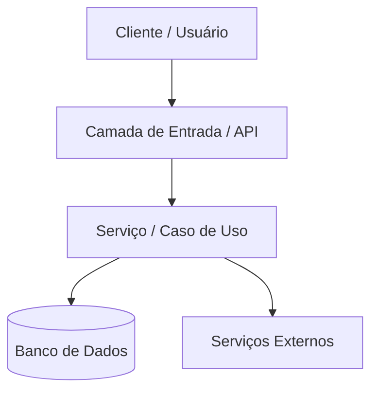

# Templates dos Documentos Globais (`specs/`)

## Template: `specs/SPECS.md`
```markdown
# Especificação Geral do Projeto (SPECS)

## 1. Visão Geral e Propósito
- **Propósito:** [Descrição clara da finalidade e objetivos do software]
- **Problema Resolvido:** [Dores e necessidades endereçadas pelo sistema]
- **Escopo:** [O que está dentro e fora do escopo do projeto]

## 2. Stack Tecnológica
- **Linguagens:** [ex: Python 3.11+, TypeScript 5+]
- **Frameworks Principais:** [ex: FastAPI, Next.js]
- **Bibliotecas Relevantes:** [ex: Pydantic, SQLAlchemy, Pandas]
- **Runtimes & Containers:** [ex: Node.js 20, Docker]
- **Build & Gerenciadores:** [ex: Poetry, npm, Cargo]

## 3. Guia de Inicialização e Execução
### Pré-requisitos
- [Dependência ou ferramenta necessária]

### Passo a Passo
```bash
# Instalação
...

# Execução
...
```

## 4. Padrões de Código e Convenções
- **Estrutura de Pastas:** [Convenção de pastas do projeto]
- **Estilo & Lint:** [ex: Black, Flake8, ESLint, Prettier]
- **Branches & Commits:** [ex: Conventional Commits]
```

---

## Template: `specs/roadmap.md`
```markdown
# Roadmap de Evolução do Projeto

## 1. Status Atual
### Funcionalidades Implementadas
- [x] [Funcionalidade A]
- [x] [Funcionalidade B]

### Pendências Identificadas (TODO / FIXME / Gaps)
- [ ] [TODO encontrado no arquivo X]
- [ ] [Lacuna funcional identificada]

## 2. Linha de Evolução
### Curto Prazo (Estabilidade & Fixes)
- [ ] Correção de débitos técnicos imediatos
- [ ] Cobertura de testes essenciais

### Médio Prazo (Refatoração & Escalabilidade)
- [ ] Otimização de consultas e contratos de dados
- [ ] Desacoplamento de módulos críticos

### Longo Prazo (Novas Features & Inovação)
- [ ] Implementação de novos fluxos de negócio
- [ ] Expansão de integrações
```

---

## Template: `specs/arquitetura.md`
```markdown
# Arquitetura do Sistema

## 1. Padrão Arquitetural
- **Padrão:** [Clean Architecture / Hexagonal / Monolito Modular / Microservices / etc.]
- **Justificativa:** [Como a base de código reflete esse padrão]

## 2. Diagrama Conceitual e Fluxo de Dados


## 3. Decisões Técnicas
- **Persistência:** [Abordagem de banco de dados, ORM, migrações]
- **Mensageria & Filas:** [RabbitMQ, Kafka, SQS ou processamento síncrono]
- **Autenticação & Segurança:** [JWT, OAuth, RBAC]
- **Tratamento de Erros:** [Padronização de exceções e respostas HTTP]
- **Gerenciamento de Estado:** [Stateless, Redis, sessões locais]

## 4. Trade-offs e Débitos Técnicos
- **Trade-off 1:** [Descrição e impacto]
- **Débito Técnico 1:** [Origem e plano de mitigação]
```
