# Arquitetura do Sistema — Discord AI Bot (Antigravity)

**Versão da Arquitetura:** 3.6.0  
**Data da Revisão:** 14 de Novembro de 2026  
**Status:** Aprovado / Em Produção Estável  

---

## 1. Visão Arquitetural de Alto Nível

A arquitetura do **Discord AI Bot (Antigravity)** segue o modelo **Event-Driven Assíncrono com Processamento Modular Desacoplado, Memória Híbrida e Barramento Centralizado de Saída (Outbox Gateway)**. 

O sistema é estruturado em 9 camadas fundamentais:

1. **Camada de Ingestão e Gateway (Discord.py):** Recebe eventos WebSocket da API do Discord Gateway (`on_message`, `on_ready`, `setup_hook`), efetua validação de instância única por lockfile atômico (`.bot.lock`) e despacha mensagens para o orquestrador central.
2. **Camada de Percepção Multimodal (STT & Ingestão Documental):**
   - Transcreve notas de voz e áudios anexos em tempo real com `faster-whisper` (CPU quantizado em `int8` com VAD ativado) sem persistência desnecessária de mídia.
   - Catalogação e pré-processamento de arquivos PDF com `PyMuPDF` (metadados, sumário estruturado TOC e chunking para RAG documental).
3. **Camada de Roteamento, Interceptação e Intenções (Message Handler):**
   - Intercepta comandos com prefixo (`!`) direcionando para o `CommandRegistry` desacoplado em 6 módulos temáticos.
   - Reconhece intenções conversacionais em linguagem natural para alternar modos de voz (`texto`, `audio`, `ambos`) e provedores de IA (`local`, `google`, `gemini-pro`, `auto`).
4. **Camada de Isolamento de Contexto Assíncrono (`ContextVars`):**
   - Rastreamento seguro e isolado por requisição (`user_name`, `user_id`, `channel_id`, `guild_id`, `channel_name`, arquivos e views pendentes), blindando o sistema contra vazamento de dados entre execuções concorrentes no mesmo event loop.
5. **Camada de Conhecimento e Memória em Múltiplos Níveis:**
   - **Histórico Imediato (SQLite WAL):** Buffer relacional cronológico das mensagens mais recentes com persistência de 10 tabelas e modo WAL ativo.
   - **Knowledge Hub Temático (Tópicos & Notas por Canal):** RAG isolado por canal com coleções ChromaDB exclusivas (`topic_notes_{channel_id}`) e modo auto-captura.
   - **Memória Semântica de Longo Prazo do Usuário (ChromaDB):** Coleções vetoriais particionadas (`{user}_memory`) para recuperação de preferências e fatos prévios.
   - **RAG de Documentos PDF (ChromaDB):** Coleções exclusivas por documento (`pdf_{user}_{doc_id}`) para consultas analíticas profundas (`!perguntar_pdf`).
6. **Camada de Raciocínio, Roteamento Híbrido e Function Calling (`llm_client.py`):**
   - **Construção de System Prompt Único:** Consolidação hierárquica (Regras Nucleares + Persona Customizada do Canal + Notas RAG Isoladas + Memória Semântica Geral).
   - **Tool RAG (Dynamic Tool Selection):** Filtragem semântica via similaridade de cosseno de embeddings para enviar apenas as Top-K ferramentas pertinentes à consulta (padrão Top-5, $\ge 0.20$).
   - **Roteamento Híbrido com Alta Disponibilidade:** Comutação automática entre LM Studio local e Google Gemini API Cloud (Flash/Pro) com failover transparente sob timeout ou indisponibilidade local.
   - **Loop de Execução de Ferramentas:** Resolução desacoplada via `ToolRegistry` com sanitização dinâmica de parâmetros e retornos estruturados.
7. **Camada de Componentes de UI Interativa (`ui_components.py`):**
   - Criação e acoplamento de Views interativas (`PaginatorView`, `ConfigMenuView`, `PromptSelectView`, `TopicSelectView`, `PersonaSelectView`, `ModalPromptCreate`) com botões, modais e menus seletores.
8. **Camada de Entrega e Barramento Centralizado Anti-Spam (`message_gateway.py`):**
   - Canal único e centralizado para todo o tráfego de saída do bot.
   - Fila prioritária Dual-Tier (Fast-Path < 100ms para chat e Leaky Bucket com controle de até 4 req/s para workers em background).
   - Deduplicação inteligente por hash SHA-256 (janela deslizante de 60s) e Circuit Breaker contra rajadas.
   - Síntese neural de voz com `edge-tts` (`pt-BR-FranciscaNeural`) e exclusão imediata de áudios temporários em bloco `finally`.
9. **Camada de Governança Multiagente & Controle Versionado (`.agents/`, `AGENTS.md` e `gerencial/`):**
   - Orquestração centralizada sob o `Agent Manager` (`/gerente`), mediando o ecossistema de **16 especialistas ativos** (incluindo `deck_master` e `spec-audit`) com emissão de Ordens de Serviço formais (`gerencial/ordem_servico/OS-NNN`), revisões técnicas (`gerencial/reviews/REV-NNN`), laudos periciais (`gerencial/auditorias/AUD-NNN`) e síntese criativa (`alquimista_ideias/`).
   - Garantia da soberania absoluta do Arquiteto-Chefe humano como autoridade técnica definitiva do projeto.

---

## 2. Diagramas de Arquitetura

> [!TIP]
> Os diagramas esquemáticos visuais de alta resolução estão arquivados na pasta [`arquitetura/`](file:///Users/rodrigomodel/antigravity/discord/SPECs/arquitetura/):
> - **[Visão Geral da Arquitetura Modular (Infográfico)](file:///Users/rodrigomodel/antigravity/discord/SPECs/arquitetura/visao_geral_arquitetura.jpg)**
> - **[Fluxo de Vida do Processamento de Mensagens (Infográfico)](file:///Users/rodrigomodel/antigravity/discord/SPECs/arquitetura/fluxo_processamento_mensagem.jpg)**

### 2.1 Fluxo de Dados Ponta a Ponta (Mermaid)

```mermaid
flowchart TD
    %% Plataforma e Ingestão
    subgraph Discord_Platform [1. Plataforma Discord & Ingestão]
        User([Usuário]) -->|Texto / Áudio / PDF / Comando| GatewayAPI[Discord Gateway API]
        GatewayAPI -->|Event: on_message| SingletonCheck{Lockfile .bot.lock Ativo?}
        SingletonCheck -->|Processo Duplicado| Terminate[Encerra Execução]
        SingletonCheck -->|Instância Única| MsgHandler[message_handler.processar_mensagem]
    end

    %% Percepção Multimodal
    subgraph Multimodal_Ingestion [2. Ingestão Multimodal]
        MsgHandler -->|Possui Anexo PDF?| ParsePDF[pdf_manager.salvar_anexo_pdf\nPyMuPDF: Metadados + TOC]
        ParsePDF --> ConfirmPDF[Confirmação de Catalogação no Chat]
        MsgHandler -->|Possui Áudio / Voz?| TranscribeAudio[voice_manager.baixar_e_transcrever\nfaster-whisper CPU int8 VAD]
        TranscribeAudio --> MergeText[Incorpora Transcrição ao Conteúdo]
    end

    %% Contexto e Roteamento
    subgraph Context_Routing [3. Contexto & Roteador de Intenções]
        MergeText & MsgHandler --> SetContext[context_manager.set_contexto_requisicao\nContextVars: user, channel, guild]
        SetContext --> PrefixCheck{Inicia com '!'?}
        
        PrefixCheck -->|Sim| CmdRegistry[commands.registry.dispatch]
        CmdRegistry --> ExecThematic[Executa Comando nos 6 Módulos Temáticos]
        ExecThematic --> SendOutbox
        
        PrefixCheck -->|Não| NaturalIntent{Detectou Intenção Natural?}
        NaturalIntent -->|Trocar Voz| SetVoice[database.definir_modo_resposta]
        NaturalIntent -->|Trocar Modelo| SetModel[database.definir_preferencia_modelo]
        SetVoice & SetModel --> SendOutbox
    end

    %% Camada de Conhecimento e Memória RAG
    subgraph Knowledge_Memory [4. Conhecimento & Memória RAG]
        NaturalIntent -->|Conversação Normal| ChannelTopicCheck{Canal com Tópico Vinculado?}
        
        ChannelTopicCheck -->|Sim: Canal Temático| TopicRAG[topic_manager.buscar_notas_semanticamente\nChromaDB: topic_notes_channel]
        ChannelTopicCheck -->|Não: Canal Geral| UserMemRAG[vector_db.buscar_memorias_relevantes\nChromaDB: user_memory]
        
        TopicRAG & UserMemRAG --> FetchHistory[database.obter_historico SQLite WAL]
        FetchHistory --> SaveUserMsg[database.salvar_mensagem & ChromaDB]
    end

    %% Raciocínio, Tool RAG e Roteamento Híbrido
    subgraph Reasoning_Engine [5. Motor Cognitivo & Roteamento Híbrido]
        SaveUserMsg --> PersonaCheck[Persona por Canal: Display Name & Avatar]
        PersonaCheck --> BuildPrompt[Monta System Prompt Único:\nBase + Persona Canal + Notas Canal + Memória]
        BuildPrompt --> ToolRAG[tools.tool_filter.filtrar_ferramentas_relevantes\nEmbeddings Cosseno Top-K]
        ToolRAG --> ModelSelect[Resolve Provedor & Modelo:\nOverride Persona vs Preferência Usuário]
        
        ModelSelect --> LLMDispatch[llm_client.gerar_resposta]
        LLMDispatch -->|Provedor Local| LMStudio[LM Studio OpenAI API]
        LLMDispatch -->|Provedor Nuvem / Failover| GeminiCloud[Google Gemini API Flash/Pro]
        
        LMStudio & GeminiCloud --> ToolCallCheck{LLM Solicitou Ferramenta?}
        ToolCallCheck -->|Sim: tool_calls| ToolExec[tools.registry.execute\n11 Módulos de Domínio]
        ToolExec --> AppendTool[Adiciona role: tool ao Contexto]
        AppendTool --> LLMDispatch
        
        ToolCallCheck -->|Não| FinalAnswer[Resposta Consolidada do Assistente]
        FinalAnswer --> SaveAssistantMsg[database.salvar_mensagem & ChromaDB]
    end

    %% Entrega, UI e Barramento Outbox
    subgraph Delivery_Outbox [6. Barramento Central Outbox & Entrega]
        SaveAssistantMsg --> SplitChunks[utils.dividir_mensagem <= 1900 chars]
        SplitChunks --> CheckVoiceMode[database.obter_modo_resposta]
        
        CheckVoiceMode -->|Modo: audio / ambos| TTSNeural[voice_manager.sintetizar_fala_edge\npt-BR-FranciscaNeural]
        CheckVoiceMode -->|Modo: texto / ambos| AttachUI[Acopla discord.ui.View Pendente]
        
        TTSNeural & AttachUI --> WebhookCheck{Canal com Persona Ativa?}
        WebhookCheck -->|Sim| WebhookMasquerade[Webhook Masquerade: Nome + Avatar Custom]
        WebhookCheck -->|Não| SendOutbox[message_gateway.dispatch\nFast-Path Prioritário < 100ms]
        WebhookMasquerade --> SendOutbox
        
        subgraph Outbox_Pipeline [message_gateway Pipeline]
            SendOutbox --> Deduplication{Hash SHA-256 nos últimos 60s?}
            Deduplication -->|Duplicada| DropSpam[Descarte Silencioso Anti-Spam]
            Deduplication -->|Inédita| CircuitBreaker{Circuit Breaker OK?}
            CircuitBreaker -->|Aberto: Rajada| EnqueueBuffer[Enfileira e Adia Envio]
            CircuitBreaker -->|Fechado: Saudável| DeliverDiscord[Envia ao Canal do Discord]
        end
        
        DeliverDiscord --> Cleanup[finally: Remove MP3 Temp & Limpa ContextVars]
    end

    ConfirmPDF --> SendOutbox
```



---

## 3. Topologia e Organização Modular do Código (v3.6.0)

```plaintext
discord/
├── chat_discord.py                 # Ponto de entrada, Discord Client, Lockfile e Loop de Background Tasks
├── message_handler.py              # Orquestrador central de mensagens, transcrição STT, RAG e montagem de prompts
├── message_gateway.py              # Barramento centralizado de saída (Outbox, Anti-Spam, Leaky Bucket e Circuit Breaker)
├── llm_client.py                   # Cliente unificado LLM: LM Studio (Local) e Google Gemini (Cloud) com Failover
├── ui_components.py                # Componentes interativos ricos: Buttons, Menus Suspensos e Modais
│
├── commands/                       # Barramento modularizado de comandos com prefixo (!)
│   ├── registry.py                 # Decorador @register_command e despachante de contexto
│   ├── builtins.py                 # Barrel exporter unificado retrocompatível
│   ├── system_commands.py          # Comandos utilitários, diagnósticos e ajuda em 2 etapas
│   ├── calendar_commands.py        # Comandos da agenda Google Calendar
│   ├── productivity_commands.py    # Comandos de listas, lembretes e digest matinal
│   ├── knowledge_commands.py       # Comandos de PDFs, memória semântica e tópicos
│   ├── web_commands.py             # Comandos de busca web ao vivo e Deep Research
│   └── ai_commands.py              # Comandos de prompts e gerenciamento de personas
│
├── tools/                          # Barramento de ferramentas para a LLM (Function Calling)
│   ├── registry.py                 # Decorador @register_tool, geração de schemas e execução não-bloqueante
│   ├── tool_filter.py              # Tool RAG: vetorização e seleção de ferramentas por similaridade de cosseno
│   ├── calendar_tools.py           # Ferramentas de manipulação do Google Calendar
│   ├── datetime_tools.py           # Ferramentas de data, hora e cálculos matemáticos
│   ├── list_tools.py               # Ferramentas de gestão de listas relacionais
│   ├── pdf_tools.py                # Ferramentas de listagem e disponibilização de PDFs
│   ├── reminder_tools.py           # Ferramentas de agendamento de lembretes ativos
│   ├── settings_tools.py           # Ferramentas de preferências do usuário (áudio e modelos)
│   ├── topic_tools.py              # Ferramentas do Knowledge Hub por canal
│   ├── prompt_tools.py             # Ferramentas de gerenciamento do Prompt Hub
│   ├── persona_tools.py            # Ferramentas de consulta e mutação de personas
│   ├── web_tools.py                # Ferramentas de busca web e extração de páginas
│   └── research_tools.py           # Ferramentas de execução de Deep Research analítico
│
├── database.py                     # SQLite WAL relacional: mensagens, outbox_queue, preferências, notas e prompts
├── vector_db.py                    # ChromaDB: memória semântica vetorial particionada ({user}_memory e tópicos)
├── pdf_manager.py                  # PyMuPDF: armazenamento pessoal isolado, sumários TOC e entrega de anexos
├── pdf_rag_manager.py              # ChromaDB + PyMuPDF: leitura profunda e RAG dedicado de documentos PDF
├── voice_manager.py                # Pipeline unificado de áudio: faster-whisper (STT) e edge-tts (TTS Francisca)
├── topic_manager.py                # Knowledge Hub Temático: canais de anotações e RAG isolado por canal
├── persona_manager.py              # Personas customizáveis e overrides cognitivos por canal
├── persona_evolution_manager.py    # Ciclo adaptativo de metamorfose semanal de personas
├── text_frequency.py               # Extração Bag-of-Words local zero-token de termos frequentes
├── prompt_hub.py                   # Biblioteca de templates de prompt customizáveis com variáveis {var}
├── web_search_manager.py           # Busca web DuckDuckGo e extração de artigos limpos
├── deep_research_manager.py        # Deep Research analítico multi-round com relatórios consolidados
├── google_calendar.py              # Integração bidirecional com Google Calendar API v3 (OAuth 2.0)
├── list_manager.py                 # Listas de compras e tarefas relacionais com caixas de seleção
├── reminder_manager.py             # Lembretes agendados com parser temporal e worker assíncrono
├── digest_manager.py               # Briefing matinal proativo com agenda e tarefas pendentes
├── context_manager.py              # ContextVars para isolamento concorrente e rastreamento de anexos
├── config.py                       # Leitura e resolução de variáveis de ambiente (.env)
└── utils.py                        # Funções utilitárias de divisão de texto (1900 chars), formatação e datas
```

---

## 4. Decisões Arquiteturais Cruciais

### 4.1 Barramento Centralizado Outbox (Anti-Spam & Resiliência)
- **Motivação:** Eliminar chamadas dispersas a `channel.send()` espalhadas pelo código, que causavam risco de banimento por Rate Limit (HTTP 429) e mensagens duplicadas em falhas de rede.
- **Implementação:** Toda saída de mensagens, arquivos e áudios passa obrigatoriamente por `message_gateway.dispatch()`.
- **Garantias:**
  - **Fila Prioritária Dual-Tier:** Prioridade 1 (Alta/Interativa) com Fast-Path (< 100ms) para conversas ativas; Prioridade 2 com Leaky Bucket (taxa máxima de 4 req/s) para workers em segundo plano.
  - **Deduplicação Inteligente:** Hash SHA-256 do payload em janela deslizante de 60 segundos.
  - **Circuit Breaker:** Suspensão temporária automática se um canal tentar emitir mais de 8 mensagens em 10 segundos.

### 4.2 Roteamento Híbrido com Alta Disponibilidade (Local vs Nuvem)
- **Local (LM Studio):** Privacidade total, custo zero e baixa latência para comandos cotidianos e diálogos curtos (`qwen/qwen3.5-9b`).
- **Nuvem (Google Gemini):** Modelos `gemini-1.5-flash` e `gemini-1.5-pro` para raciocínio denso, grandes contextos de livros ou quando o nó local estiver desligado.
- **Failover Transparente:** Em caso de timeout (> 15s) ou indisponibilidade da instância local, a requisição migra automaticamente para o Gemini Flash sem interrupção para o usuário.

### 4.3 Isolamento Temático por Canal (Knowledge Hub & Personas)
- Canais do Discord podem ser vinculados a tópicos de estudo/trabalho (`!topico`).
- Cada canal de tópico possui sua própria coleção isolada no ChromaDB (`topic_notes_{channel_id}`) e histórico isolado no SQLite, eliminando contaminação cognitiva entre projetos.
- Cada canal pode assumir uma Persona especializada (`!persona`), com system prompts, temperaturas e modelos dedicados.

### 4.4 Isolamento de Concorrência via `ContextVar`
- O uso de `contextvars.ContextVar` garante que variáveis contextuais (como autor, canal, IDs e arquivos agendados) permaneçam isoladas por corrotina assíncrona, mesmo com múltiplos usuários conversando simultaneamente no mesmo processo.

### 4.5 Imersão Visual com Webhook Masquerade e Metamorfose Semanal
- **Webhook Masquerade:** Em canais com persona customizada, as respostas são despachadas via webhook nativo do Discord com o nome (`display_name`) e o avatar temático da persona, simulando um agente especialista com presença visual única. Em caso de falta de permissões (`HTTP 403`), um fallback gracioso encapsula a resposta em `discord.Embed`.
- **Metamorfose Semanal Zero-Token:** Personas não travadas (`is_locked = 0`) passam por evolução contínua a cada 7 dias, analisando o vocabulário recente do canal via `text_frequency.py` (Bag-of-Words local sem gastar tokens de inferência) e refinando seu tom adaptativamente.

---

## 5. Fluxo de Vida de uma Mensagem de Usuário

1. **Chegada:** O usuário envia uma mensagem (texto puro, áudio de voz ou arquivo PDF).
2. **Ingestão Sensorial:**
   - Se for áudio, o `faster-whisper` transcreve o áudio para texto em thread pool assíncrona.
   - Se for PDF, o `PyMuPDF` salva o arquivo na pasta dedicada e indexa metadados/sumário.
3. **Interceptação:** O sistema verifica se é comando com `!` ou intenção conversacional natural. Se for comando, despacha nos 6 módulos temáticos e responde via Gateway Outbox.
4. **Resgate de Memória & Base Temática:**
   - Se o canal for um tópico temático, consulta as notas do canal no ChromaDB (`topic_notes_{channel_id}`).
   - Se for canal comum, consulta a memória semântica do usuário (`{user}_memory`).
   - Recupera histórico recente higienizado do SQLite WAL.
5. **Composição Cognitiva:**
   - Monta um único prompt de sistema estrito contendo diretrizes base, persona do canal, notas do canal e memória geral.
   - Seleciona semanticamente as ferramentas úteis via Tool RAG (Top-5 por similaridade de cosseno $\ge 0.20$).
6. **Inferência LLM:** Executa a inferência assíncrona no provedor configurado (LM Studio local com failover para Gemini API), executando ferramentas solicitadas iterativamente.
7. **Entrega Multimodal:** Formata o texto, sintetiza áudio se configurado e despacha tudo pelo `message_gateway`, respeitando prioridades, deduplicação SHA-256 e limites de 1900 caracteres por bloco.

---

## 📋 Matriz de Rastreabilidade & Aderência (Auditada em 2026-11-14)

| ID | Camada / Invariante Arquitetural | Status | Implementação no Código | Notas de Auditoria |
| :---: | :--- | :---: | :--- | :--- |
| **ARQ-01** | Camada 1: Ingestão WebSocket & Lockfile Atômico | 🟢 Aderente | [`discord/chat_discord.py:L20-L85`](file:///Users/rodrigomodel/antigravity/discord/chat_discord.py#L20-L85) | Validação `.bot.lock` e eventos Discord Gateway |
| **ARQ-02** | Camada 2: Ingestão Multimodal STT & PDFs | 🟢 Aderente | [`discord/voice_manager.py:L40-L150`](file:///Users/rodrigomodel/antigravity/discord/voice_manager.py#L40-L150), [`discord/pdf_manager.py`](file:///Users/rodrigomodel/antigravity/discord/pdf_manager.py) | faster-whisper CPU int8 e catalogação PyMuPDF |
| **ARQ-03** | Camada 3: Roteamento & Intenções Conversacionais | 🟢 Aderente | [`discord/message_handler.py:L70-L140`](file:///Users/rodrigomodel/antigravity/discord/message_handler.py#L70-L140) | Roteador de comandos e intenções naturais |
| **ARQ-04** | Camada 4: Isolamento por ContextVars | 🟢 Aderente | [`discord/context_manager.py:L1-L80`](file:///Users/rodrigomodel/antigravity/discord/context_manager.py#L1-L80) | Isolamento atômico de contexto assíncrono |
| **ARQ-05** | Camada 5: Memória Multi-Nível (SQLite WAL + ChromaDB) | 🟢 Aderente | [`discord/database.py:L30-L180`](file:///Users/rodrigomodel/antigravity/discord/database.py#L30-L180), [`discord/vector_db.py`](file:///Users/rodrigomodel/antigravity/discord/vector_db.py) | Buffer WAL e ChromaDB com 3 coleções isoladas |
| **ARQ-06** | Camada 6: Roteamento Híbrido & Tool RAG | 🟢 Aderente | [`discord/llm_client.py:L40-L220`](file:///Users/rodrigomodel/antigravity/discord/llm_client.py#L40-L220), [`discord/tools/registry.py`](file:///Users/rodrigomodel/antigravity/discord/tools/registry.py) | Failover Gemini e Tool RAG Top-5 |
| **ARQ-07** | Camada 7: UI Interativa Buttons, Selects & Modals | 🟢 Aderente | [`discord/ui_components.py:L1-L260`](file:///Users/rodrigomodel/antigravity/discord/ui_components.py#L1-L260) | Views interativas nativas do `discord.ui` |
| **ARQ-08** | Camada 8: Outbox Gateway Anti-Spam & Leaky Bucket | 🟢 Aderente | [`discord/message_gateway.py:L1-L260`](file:///Users/rodrigomodel/antigravity/discord/message_gateway.py#L1-L260) | Fila Dual-Tier, hash 60s e edge-tts |
| **ARQ-09** | Camada 9: Governança Multiagente sob o `/gerente` | 🟢 Aderente | [`.agents/skills/agent_manager/SKILL.md`](file:///Users/rodrigomodel/antigravity/.agents/skills/agent_manager/SKILL.md), [`AGENTS.md`](file:///Users/rodrigomodel/antigravity/AGENTS.md) | 16 especialistas ativos e soberania humana |
| **ARQ-10** | Modularização de Comandos em 6 Módulos | 🟢 Aderente | [`discord/commands/`](file:///Users/rodrigomodel/antigravity/discord/commands/) | 35+ comandos com `@register_command` |
| **ARQ-11** | Modularização de Ferramentas em 11 Módulos | 🟢 Aderente | [`discord/tools/`](file:///Users/rodrigomodel/antigravity/discord/tools/) | 30+ tools com `@register_tool` e retornos tipados |
| **ARQ-12** | Imersão com Webhook Masquerade e Fallback | 🟢 Aderente | [`discord/message_handler.py:L130-L162`](file:///Users/rodrigomodel/antigravity/discord/message_handler.py#L130-L162) | Webhook temático com fallback para Embed |
| **ARQ-13** | Metamorfose Semanal com Bag-of-Words Zero-Token | 🟢 Aderente | [`discord/persona_evolution_manager.py`](file:///Users/rodrigomodel/antigravity/discord/persona_evolution_manager.py), [`discord/text_frequency.py`](file:///Users/rodrigomodel/antigravity/discord/text_frequency.py) | Evolução semanal e análise léxica local |
| **ARQ-14** | Pesquisa Analítica Profunda (Deep Research) | 🟢 Aderente | [`discord/deep_research_manager.py:L1-L220`](file:///Users/rodrigomodel/antigravity/discord/deep_research_manager.py#L1-L220) | Investigação multi-round e relatórios analíticos |
