# Arquitetura do Sistema — Discord AI Bot (Antigravity)

**Versão da Arquitetura:** 3.5.0  
**Data da Revisão:** 22 de Outubro de 2026  
**Status:** Aprovado / Em Produção Estável  

---

## 1. Visão Arquitetural de Alto Nível

A arquitetura do **Discord AI Bot** segue o modelo **Event-Driven Assíncrono com Processamento Modular Desacoplado, Memória Híbrida e Barramento Centralizado de Saída (Outbox Gateway)**. 

O sistema é dividido em 8 camadas fundamentais:

1. **Camada de Ingestão e Gateway (Discord.py):** Recebe eventos WebSocket da API do Discord Gateway (`on_message`, `on_ready`, `setup_hook`), efetua validação de instância única por lockfile atômico (`.bot.lock`) e despacha mensagens para o orquestrador central.
2. **Camada de Percepção Multimodal (STT & Ingestão Documental):**
   - Transcreve notas de voz e áudios anexos em tempo real com `faster-whisper` (CPU quantizado em `int8` com VAD ativado) sem persistência desnecessária de mídia.
   - Catalogação leve instantânea de arquivos PDF com `PyMuPDF` (título, autor, total de páginas e sumário estruturado TOC).
3. **Camada de Roteamento, Interceptação e Intenções (Message Handler):**
   - Intercepta comandos com prefixo (`!`) direcionando para o `CommandRegistry`.
   - Reconhece intenções conversacionais em linguagem natural para alternar modos de voz (`texto`, `audio`, `ambos`) e provedores de IA (`local`, `google`, `gemini-pro`, `auto`).
4. **Camada de Isolamento de Contexto Assíncrono (`ContextVars`):**
   - Rastreamento seguro e isolado por requisição (`user_name`, `user_id`, `channel_id`, `guild_id`, `channel_name`, arquivos e views pendentes), blindando o sistema contra vazamento de dados entre execuções concorrentes no mesmo event loop.
5. **Camada de Conhecimento e Memória em Múltiplos Níveis:**
   - **Histórico Imediato (SQLite WAL):** Buffer relacional cronológico das mensagens mais recentes, com isolamento opcional por canal para canais temáticos.
   - **Knowledge Hub Temático (Tópicos & Notas por Canal):** RAG isolado por canal com coleções ChromaDB exclusivas (`topic_notes_{channel_id}`) e modo auto-captura.
   - **Memória Semântica de Longo Prazo do Usuário (ChromaDB):** Coleções vetoriais particionadas (`{user}_memory`) para recuperação de fatos prévios.
6. **Camada de Raciocínio, Roteamento Híbrido e Function Calling (`llm_client.py`):**
   - **Construção de System Prompt Único:** Consolidação hierárquica (Regras Nucleares + Persona Customizada do Canal + Notas RAG Isoladas + Memória Semântica Geral).
   - **Tool RAG (Dynamic Tool Selection):** Filtragem semântica via similaridade de cosseno de embeddings para enviar apenas as Top-K ferramentas pertinentes à consulta.
   - **Roteamento Híbrido com Alta Disponibilidade:** Comutação automática entre LM Studio local e Google Gemini Cloud (Flash/Pro) com detecção de latência e failover transparente.
   - **Loop de Execução de Ferramentas:** Resolução desacoplada via `ToolRegistry` com sanitização dinâmica de parâmetros alucinados.
7. **Camada de Componentes de UI Interativa (`ui_components.py`):**
   - Criação e acoplamento de Views interativas (`InteractiveListView`, `ReminderActionView`, `PDFChapterSelectView`, `PersonaSelectView`) com botões, modais e menus seletores.
8. **Camada de Entrega e Barramento Centralizado Anti-Spam (`message_gateway.py`):**
   - Canal único e centralizado para todo o tráfego de saída do bot.
   - Fila prioritária Dual-Tier (Fast-Path < 100ms para chat e Leaky Bucket para workers em background).
   - Deduplicação inteligente por hash SHA-256 (janela deslizante de 60s) e Circuit Breaker contra rajadas.
   - Síntese neural de voz com `edge-tts` (`pt-BR-FranciscaNeural`) e exclusão imediata de áudios temporários.

---

## 2. Diagramas de Arquitetura

> [!TIP]
> Os diagramas esquemáticos visuais de alta resolução estão arquivados na pasta [`arquitetura/`](file:///Users/rodrigomodel/antigravity/discord/SPECs/arquitetura/):
> - **[Visão Geral da Arquitetura Modular (Infográfico)](file:///Users/rodrigomodel/antigravity/discord/SPECs/arquitetura/visao_geral_arquitetura.jpg)**
> - **[Fluxo de Vida do Processamento de Mensagens (Infográfico)](file:///Users/rodrigomodel/antigravity/discord/SPECs/arquitetura/fluxo_processamento_mensagem.jpg)**

### 2.1 Fluxo de Dados Ponta a Ponta (Mermaid)

```mermaid
flowchart TD
    %% Plataforma e Ingestão
    subgraph Discord_Platform [1. Plataforma Discord & Ingestão]
        User([Usuário]) -->|Texto / Áudio / PDF / Comando| GatewayAPI[Discord Gateway API]
        GatewayAPI -->|Event: on_message| SingletonCheck{Lockfile .bot.lock Ativo?}
        SingletonCheck -->|Processo Duplicado| Terminate[Encerra Execução]
        SingletonCheck -->|Instância Única| MsgHandler[message_handler.processar_mensagem]
    end

    %% Percepção Multimodal
    subgraph Multimodal_Ingestion [2. Ingestão Multimodal]
        MsgHandler -->|Possui Anexo PDF?| ParsePDF[pdf_manager.pre_processar_pdf\nPyMuPDF: Metadados + TOC]
        ParsePDF --> ConfirmPDF[Confirmação de Catalogação no Chat]
        MsgHandler -->|Possui Áudio / Voz?| TranscribeAudio[audio_manager.baixar_e_transcrever\nfaster-whisper CPU int8 VAD]
        TranscribeAudio --> MergeText[Incorpora Transcrição ao Conteúdo]
    end

    %% Contexto e Roteamento
    subgraph Context_Routing [3. Contexto & Roteador de Intenções]
        MergeText & MsgHandler --> SetContext[context_manager.set_contexto_requisicao\nContextVars: user, channel, guild]
        SetContext --> PrefixCheck{Inicia com '!'?}
        
        PrefixCheck -->|Sim| CmdRegistry[commands.registry.handle_command]
        CmdRegistry --> ExecBuiltin[Executa Comando Builtin]
        ExecBuiltin --> SendOutbox
        
        PrefixCheck -->|Não| NaturalIntent{Detectou Intenção Natural?}
        NaturalIntent -->|Trocar Voz| SetVoice[database.definir_modo_resposta]
        NaturalIntent -->|Trocar Modelo| SetModel[database.definir_preferencia_modelo]
        SetVoice & SetModel --> SendOutbox
    end

    %% Camada de Conhecimento e Memória RAG
    subgraph Knowledge_Memory [4. Conhecimento & Memória RAG]
        NaturalIntent -->|Conversação Normal| ChannelTopicCheck{Canal com Tópico Vinculado?}
        
        ChannelTopicCheck -->|Sim: Canal Temático| TopicRAG[topic_manager.buscar_notas_rag\nChromaDB: topic_notes_channel]
        ChannelTopicCheck -->|Não: Canal Geral| UserMemRAG[vector_db.buscar_memorias_relevantes\nChromaDB: user_memory]
        
        TopicRAG & UserMemRAG --> FetchHistory[database.obter_historico SQLite WAL]
        FetchHistory --> SaveUserMsg[database.salvar_mensagem & ChromaDB]
    end

    %% Raciocínio, Tool RAG e Roteamento Híbrido
    subgraph Reasoning_Engine [5. Motor Cognitivo & Roteamento Híbrido]
        SaveUserMsg --> BuildPrompt[Monta System Prompt Único:\nBase + Persona Canal + Notas Canal + Memória]
        BuildPrompt --> ToolRAG[tools.tool_filter.filtrar_ferramentas_relevantes\nEmbeddings Cosseno Top-K]
        ToolRAG --> ModelSelect[Resolve Provedor & Modelo:\nOverride Persona vs Preferência Usuário]
        
        ModelSelect --> LLMDispatch[llm_client.gerar_resposta]
        LLMDispatch -->|Provedor Local| LMStudio[LM Studio OpenAI API]
        LLMDispatch -->|Provedor Nuvem / Failover| GeminiCloud[Google Gemini API Flash/Pro]
        
        LMStudio & GeminiCloud --> ToolCallCheck{LLM Solicitou Ferramenta?}
        ToolCallCheck -->|Sim: tool_calls| ToolExec[tools.registry.execute\nSanitização de Parâmetros Alucinados]
        ToolExec --> AppendTool[Adiciona role: tool ao Contexto]
        AppendTool --> LLMDispatch
        
        ToolCallCheck -->|Não| FinalAnswer[Resposta Consolidada do Assistente]
        FinalAnswer --> SaveAssistantMsg[database.salvar_mensagem & ChromaDB]
    end

    %% Entrega, UI e Barramento Outbox
    subgraph Delivery_Outbox [6. Barramento Central Outbox & Entrega]
        SaveAssistantMsg --> SplitChunks[utils.dividir_mensagem <= 1900 chars]
        SplitChunks --> CheckVoiceMode[database.obter_modo_resposta]
        
        CheckVoiceMode -->|Modo: audio / ambos| TTSNeural[tts_manager.sintetizar_fala_edge\npt-BR-FranciscaNeural]
        CheckVoiceMode -->|Modo: texto / ambos| AttachUI[Acopla discord.ui.View Pendente]
        
        TTSNeural & AttachUI --> SendOutbox[message_gateway.dispatch\nFast-Path Prioritário < 100ms]
        
        subgraph Outbox_Pipeline [message_gateway Pipeline]
            SendOutbox --> Deduplication{Hash SHA-256 nos últimos 60s?}
            Deduplication -->|Duplicada| DropSpam[Descarte Silencioso Anti-Spam]
            Deduplication -->|Inédita| CircuitBreaker{Circuit Breaker OK?}
            CircuitBreaker -->|Aberto: Rajada| EnqueueBuffer[Enfileira e Adia Envio]
            CircuitBreaker -->|Fechado: Saudável| DeliverDiscord[Envia ao Canal do Discord]
        end
        
        DeliverDiscord --> Cleanup[finally: Remove MP3 Temp & Limpa ContextVars]
    end

    ConfirmPDF --> SendOutbox
```



---

## 3. Topologia e Organização Modular do Código

```plaintext
discord/
├── chat_discord.py          # Ponto de entrada, Discord Client, Lockfile e Loop de Background Tasks
├── message_handler.py       # Orquestrador central de mensagens, transcrição STT, RAG e montagem de prompts
├── message_gateway.py       # Barramento centralizado de saída (Outbox, Anti-Spam, Leaky Bucket e Circuit Breaker)
├── llm_client.py            # Cliente unificado LLM: LM Studio (Local) e Google Gemini (Cloud) com Failover
├── ui_components.py         # Componentes interativos ricos: Buttons, Menus Suspensos e Modais
│
├── commands/                # Barramento de comandos com prefixo (!)
│   ├── registry.py          # Decorador @register_command e despachante de contexto
│   └── builtins.py          # Implementação de todos os comandos built-in
│
├── tools/                   # Barramento de ferramentas para a LLM (Function Calling)
│   ├── registry.py          # Decorador @register_tool, geração de schemas e filtragem de parâmetros
│   └── tool_filter.py       # Tool RAG: vetorização e seleção de ferramentas mais relevantes por similaridade
│
├── database.py              # SQLite relacional: mensagens, outbox_queue, preferências, notas e prompts
├── vector_db.py             # ChromaDB: memória semântica vetorial particionada por usuário
├── pdf_manager.py           # PyMuPDF + ChromaDB: catálogo de livros, sumários TOC, resumos e Book RAG
├── audio_manager.py         # Faster-Whisper: transcrição de notas de voz e áudios anexos (STT)
├── tts_manager.py           # Edge-TTS: síntese neural de voz em português brasileiro (Francisca)
├── topic_manager.py         # Knowledge Hub Temático: canais de anotações e RAG isolado por canal
├── persona_manager.py       # Personas customizáveis e overrides cognitivos por canal
├── prompt_hub.py            # Biblioteca de templates de prompt customizáveis com variáveis e presets
├── web_search_manager.py    # Busca web DuckDuckGo e extração de artigos limpos
├── google_calendar.py       # Integração bidirecional com Google Calendar API v3 (OAuth 2.0)
├── list_manager.py          # Listas de compras e tarefas interativas
├── reminder_manager.py      # Lembretes agendados com parser de linguagem natural e worker ativo
├── digest_manager.py        # Briefing diário matinal proativo com previsão Open-Meteo e agenda
├── context_manager.py       # ContextVars para isolamento concorrente e rastreamento de anexos
├── config.py                # Leitura e resolução de variáveis de ambiente (.env)
└── utils.py                 # Funções utilitárias de divisão de texto, formatação e datas
```

---

## 4. Decisões Arquiteturais Cruciais

### 4.1 Barramento Centralizado Outbox (Anti-Spam & Resiliência)
- **Motivação:** Eliminar chamadas dispersas a `channel.send()` espalhadas pelo código, que causavam risco de banimento por Rate Limit (HTTP 429) e mensagens duplicadas em falhas de rede.
- **Implementação:** Toda saída de mensagens, arquivos e áudios passa obrigatoriamente por `message_gateway.dispatch()`.
- **Garantias:**
  - **Fila Prioritária Dual-Tier:** Prioridade 1 (Alta/Interativa) com Fast-Path (< 100ms) para conversas ativas; Prioridade 2 com Leaky Bucket (1.5s) para workers em segundo plano.
  - **Deduplicação Inteligente:** Hash SHA-256 do payload em janela deslizante de 60 segundos.
  - **Circuit Breaker:** Suspensão temporária automática se um canal tentar emitir mais de 8 mensagens em 10 segundos.

### 4.2 Roteamento Híbrido com Alta Disponibilidade (Local vs Nuvem)
- **Local (LM Studio):** Privacidade total, custo zero e baixa latência para comandos cotidianos e diálogos curtos.
- **Nuvem (Google Gemini):** Modelos `gemini-2.5-flash` e `gemini-2.5-pro` para raciocínio denso, grandes contextos de livros ou quando o nó local estiver desligado.
- **Failover Transparente:** Em caso de timeout (> 15s) ou indisponibilidade da instância local, a requisição migra automaticamente para o Gemini Flash sem interrupção para o usuário.

### 4.3 Isolamento Temático por Canal (Knowledge Hub & Personas)
- Canais do Discord podem ser vinculados a tópicos de estudo/trabalho (`!topico vincular`).
- Cada canal de tópico possui sua própria coleção isolada no ChromaDB (`topic_notes_{channel_id}`) e histórico isolado no SQLite, eliminando contaminação cognitiva entre projetos.
- Cada canal pode assumir uma Persona especializada (`!persona canal aplicar cfo`), com system prompts, temperaturas e modelos dedicados.

### 4.4 Isolamento de Concorrência via `ContextVar`
- O uso de `contextvars.ContextVar` garante que variáveis contextuais (como autor, canal, IDs e arquivos agendados) permaneçam isoladas por corrotina assíncrona, mesmo com múltiplos usuários conversando simultaneamente no mesmo processo.

---

## 5. Fluxo de Vida de uma Mensagem de Usuário

1. **Chegada:** O usuário envia uma mensagem (texto puro, áudio de voz ou arquivo PDF).
2. **Ingestão Sensorial:**
   - Se for áudio, o `faster-whisper` transcreve o áudio para texto em thread separada.
   - Se for PDF, o `PyMuPDF` indexa metadados e sumário preliminar.
3. **Interceptação:** O sistema verifica se é comando com `!` ou comando de voz/modelo por linguagem natural. Se for, executa e responde imediatamente pelo Gateway.
4. **Resgate de Memória & Base Temática:**
   - Se o canal for um tópico temático, consulta as notas do canal no ChromaDB.
   - Se for canal comum, consulta a memória semântica do usuário.
   - Recupera histórico de conversação do SQLite.
5. **Composição Cognitiva:**
   - Monta um único prompt de sistema estrito contendo diretrizes base, persona do canal, notas do canal e memória geral.
   - Seleciona semanticamente as ferramentas úteis via Tool RAG.
6. **Inferência LLM:** Executa a inferência assíncrona no provedor configurado (Local ou Gemini), executando ferramentas solicitadas recursivamente.
7. **Entrega Multimodal:** Formata o texto, sintetiza áudio se solicitado e despacha tudo pelo `message_gateway`, respeitando filas, deduplicações e limites de caracteres.
