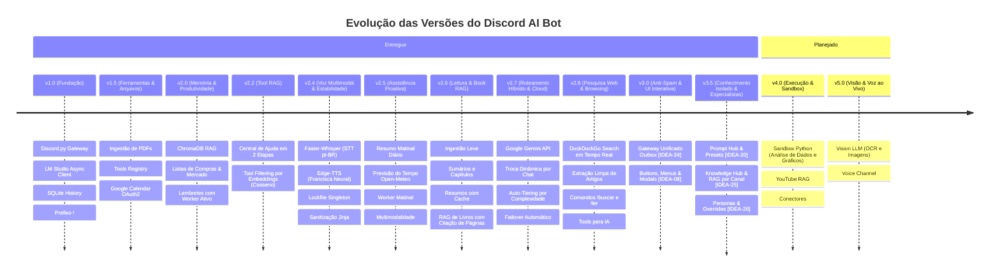

# Roadmap de Desenvolvimento — Discord AI Bot (Antigravity)

**Versão Atual:** 3.5.0  
**Data:** 20 de Outubro de 2026  
**Status do Roadmap:** Em Evolução Contínua  

---

## 1. Visão Geral das Fases do Projeto

O desenvolvimento do **Discord AI Bot** foi estruturado em marcos evolutivos (*milestones*) focados em robustez operacional, desacoplamento e agregação progressiva de capacidades cognitivas e sensoriais.

---

## 2. Histórico de Versões e Marcos Concluídos

### ✅ Versão 1.0.0 — Fundação do Chatbot (Outubro/2026)
- Conexão estável com o Discord Gateway via `discord.py`.
- Integração não-bloqueante com LM Studio local através de `AsyncOpenAI`.
- Persistência básica de histórico de conversação em SQLite (`messages`).
- Roteador modular de comandos com prefixo (`!ping`, `!status`, `!hora`, `!limpar`, `!historico`).
- Divisor inteligente de mensagens no limite estrito de 2000 caracteres do Discord.

### ✅ Versão 1.5.0 — Gestão Documental & Google Calendar
- Ingestão automática de arquivos PDF anexados com armazenamento isolado em `discord/pdf/{user}/`.
- Barramento desacoplado de Function Calling com schema JSON dinâmico (`@register_tool`).
- Integração bidirecional com a API Google Calendar v3 (OAuth2 com renovação de token).
- Comandos e tools para listar, agendar e cancelar compromissos.

### ✅ Versão 2.0.0 — Memória Semântica & Produtividade Diária
- Memória de longo prazo baseada em ChromaDB com coleções particionadas (`{user}_memory`).
- Injeção RAG semântica no prompt da LLM para resgate de fatos e preferências anteriores.
- Módulo completo de Listas de Mercado/Compras com SQLite (CRUD, ticar itens, limpar concluídos).
- Módulo de Lembretes Agendados com parser de linguagem natural relativa/absoluta e worker ativo em segundo plano a cada 10s.

### ✅ Versão 2.2.0 — Redução de Sobrecarga de Contexto & Ajuda Modular
- Divisão da central de ajuda `!ajuda` em duas etapas (Menu geral de blocos temáticos e detalhamento aprofundado por módulo).
- Mecanismo de **Tool Filtering RAG**: vetorização semântica das descrições das ferramentas para envio apenas das Top-K ferramentas mais relevantes por mensagem.

### ✅ Versão 2.4.0 — Multimodalidade de Áudio & Resiliência Crítica
- **Speech-to-Text (STT):** Reconhecimento de notas de voz e áudios enviados no Discord com `faster-whisper` (modelo `base`, quantização `int8`, detecção VAD) com exclusão imediata de arquivos temporários.
- **Text-to-Speech (TTS):** Síntese neural de voz com `edge-tts` (Francisca pt-BR) com suporte a 3 modos de resposta configuráveis (`texto`, `audio`, `ambos`) via comando `!voz` ou linguagem natural.
- **Lockfile de Instância Única:** Eliminação de respostas duplicadas no Discord através de trava de processo `fcntl.flock` (`.bot.lock`).
- **Sanitização Jinja:** Resolução de exceções de templates do LM Studio com consolidação obrigatória de mensagens `system` em uma única mensagem inicial.
- **Filtro de Alucinação de Parâmetros:** Filtragem dinâmica via `inspect.signature` em ferramentas sem `**kwargs`.
- **Modo WAL no SQLite:** Concorrência otimizada com timeout de 30s.

### ✅ Versão 2.5.0 — Assistência Proativa Diária (Morning Digest)
- **Módulo Resumo Matinal Diário (`!digest`):** Consolidação automática da rotina diária às 08:00 (ou horário personalizado).
- **Integração Meteorológica Open-Meteo:** Geocodificação de cidades e busca de condições climáticas em tempo real (WMO weather codes com emojis em pt-BR), livre de chaves de API pagas.
- **Consolidação Multidimensional:** Google Calendar (`google_calendar.py`), Lembretes pendentes do dia (`reminder_manager.py`) e Listas de mercado e tarefas (`list_tools.py`).
- **Resiliência e Fallback Cognitivo:** Síntese acolhedora por LLM com fallback para template markdown estruturado caso a LLM esteja indisponível.
- **Entrega Multimodal Proativa:** Envio de texto, áudio com a voz Francisca ou ambos, respeitando o perfil de cada usuário.
- **Worker Assíncrono com Guarda Anti-Duplicata:** Verificação a cada 30 segundos com registro em banco de dados (`last_sent_date`).
- **Controle Flexível por Chat e Tools:** Suporte a comandos (`!digest agora`, `!digest hora`, `!digest cidade`, `!digest on/off`, `!digest canal`) e tools de Function Calling (`gerar_resumo_matinal`, `configurar_resumo_matinal`).

### ✅ Versão 2.6.0 — Leitura Inteligente & RAG de Livros/PDFs
- **Ingestão Leve Imediata (Fase 1):** Extração ultrarrápida via `PyMuPDF` de título, autor, contagem de páginas e bookmarks de sumário (TOC) no recebimento de qualquer anexo PDF no Discord.
- **Catálogo Estruturado em SQLite:** Criação das tabelas `user_pdf_documents` e `user_pdf_chapters` para navegação modular e persistência de sinopses.
- **Navegação e Resumo de Capítulos (Fase 2):** Comandos `!pdf info`, `!pdf sumario` e `!pdf capitulo` com síntese cognitiva e cache em banco de dados.
- **Conversação com Livros via RAG Vetorial:** Fatiamento com overlap em lotes para embeddings no LM Studio, armazenamento em coleções isoladas do ChromaDB (`pdf_{user}_{doc_id}`) e respostas didáticas com citação explícita de páginas (`[Página X]`).
- **7 Ferramentas Registradas para LLM:** Suporte integral por Function Calling e por comandos prefixados (`!pdf`, `!pdfs`, `!enviar`).
- **Entrega Multimodal:** Resumos e respostas de dúvidas sintetizados por voz neural feminina Francisca pt-BR (`edge-tts`) caso o usuário configure `!voz audio` ou `!voz ambos`.

### ✅ Versão 2.7.0 — Roteamento Híbrido & Provedor Google Gemini Cloud
- **Integração Google Gemini API:** Suporte assíncrono aos modelos `gemini-3.5-flash` e `gemini-3.5-flash` via endpoint OpenAI-compatible.
- **Comando de Gestão `!modelo`:** Alternância dinâmica de provedores (`local`, `google`, `gemini-pro`, `auto`) e cadastro seguro de chave (`!modelo key <chave>`) com exclusão instantânea da mensagem no Discord.
- **Reconhecimento por Linguagem Natural:** O bot compreende solicitações cotidianas de troca de modelo (ex: *"Troque para o modelo do Google"*, *"Volte para o modelo local"*).
- **Roteamento Inteligente Auto-Tiering:** Modo `auto` analisa a intenção e densidade da demanda (tarefas simples e rotina executadas no LM Studio local; análise densa de livros, raciocínio aprofundado e código direcionados para a nuvem).
- **Failover Automático (Alta Disponibilidade):** Redirecionamento suave e transparente para o Gemini Flash em caso de lentidão (> 15s) ou indisponibilidade do nó local.
- **Transparência Cognitiva (Badges):** Identificador visual do provedor e modelo emissor em cada mensagem (`🏠 Local` vs `⚡ Gemini Flash` vs `🧠 Gemini Pro`).

### ✅ Versão 2.8.0 — Pesquisa na Web em Tempo Real & Browsing (Versão Atual)
- **Busca em Tempo Real na Internet (`ddgs` / DuckDuckGo):** Integração com o motor DuckDuckGo sem necessidade de chaves de API pagas, com suporte opcional a Tavily e SearXNG.
- **Extração Limpa de Conteúdo Web (Browsing):** Leitura assíncrona com `httpx` e `BeautifulSoup` que higieniza scripts, estilos, rodapés e anúncios, extraindo o corpo textual de artigos.
- **Comandos de Usuário (`!buscar`, `!ler`):** Comando `!buscar <termo>` para pesquisa imediata com links clicáveis e `!ler <url>` para síntese executiva estruturada pela IA em tópicos.
- **Ferramentas de Function Calling para a LLM:** Tools `buscar_na_web` e `ler_pagina_web` registradas para acionamento autônomo durante qualquer diálogo sobre cotações, clima, notícias ou links.
- **Integração com Tool RAG & Auto-Tiering:** Vetorização e seleção semântica das ferramentas de web; comutação automática para o Gemini Flash ao processar URLs ou pesquisas complexas.

### ✅ Versão 3.0.0 — Barramento Centralizado Anti-Spam (Outbox) & UI Interativa (Buttons, Modals, Menus)
- **Barramento Unificado de Mensagens & Outbox (`message_gateway.py`) [IDEA-24]:**
  - Canal único e centralizado de despacho (`message_gateway.dispatch`) para todo o tráfego de saída do bot (chat, comandos, lembretes e resumo matinal).
  - Fila prioritária assíncrona Dual-Tier: Prioridade 1 (Alta/Interativa) com Fast-Path (< 100ms) para comandos e conversação direta; Prioridade 2 (Background) com cadência controlada por Leaky Bucket (1.5s).
  - Proteção Anti-Spam com deduplicação deslizante baseada em hash SHA-256 (janela de 60s), prevenindo envio repetitivo de payloads idênticos em falhas ou loops.
  - Circuit Breaker Global por canal contra rajadas anômalas (> 8 mensagens em 10 segundos), com represamento temporário e recuperação automática.
  - Persistência e auditoria SQLite na tabela `outbox_queue` com telemetria e comando de controle `!gateway` (`status`, `pausar`, `retomar`, `limpar`).
- **Interface Interativa com Componentes Discord (`ui_components.py`) [IDEA-08]:**
  - **`InteractiveListView`:** Renderização de listas de compras e tarefas (`!lista`) com botões de alternância instantânea (`☐` / `☑`), botão de ação em massa `🧹 Limpar Concluídos`, botão `➕ Novo Item` que dispara formulário nativo em pop-up (`AddItemModal`), e controle de permissões por usuário com timeout automático.
  - **`ReminderActionView`:** Botões de resolução imediata anexados às notificações de lembretes (`✅ Concluído`, `⏱️ +10 min`, `🔁 +1 hora`, `📅 Amanhã`) integrados ao SQLite sem digitação de comandos.
  - **`PDFChapterSelectView`:** Menu suspenso dropdown (`discord.ui.Select`) anexado ao comando `!pdf sumario` para escolha instantânea e resumo automático de capítulos de livros indexados.

### ✅ Versão 3.5.0 — Central de Prompts, Knowledge Hub Temático & Personas Especializadas por Canal
- **Central de Prompts & Templates de IA (`prompt_hub.py`) [IDEA-20]:**
  - Repositório central de prompts reutilizáveis com persistência SQLite na tabela `prompt_templates`.
  - 7 presets oficiais de fábrica integrados: `padrao`, `dev` (Tech Lead), `direto` (Ultra-Conciso), `revisor` (Rígido), `cfo` (Financeiro & ROI), `socrates` (Maiêutico) e `tributarista` (Reforma Tributária CBS/IBS).
  - CRUD completo para o usuário criar, versionar, categorizar e gerenciar seus próprios prompts com os comandos `!prompts` e `!prompt [ver|salvar|remover]`.
  - Tools para LLM: `listar_templates_prompt`, `obter_template_prompt`, `salvar_template_prompt`.
- **Knowledge Hub Temático: Canais de Notas & RAG 100% Isolado (`topic_manager.py`) [IDEA-25]:**
  - Transformação de canais e threads do Discord em bases de conhecimento temáticas (`topic_channels`, `channel_notes`).
  - Coleções ChromaDB multi-tenant rigorosamente isoladas por canal (`topic_notes_{channel_id}`) com higienização estrita de nomes (máximo 63 caracteres).
  - Isolamento de histórico de conversação recente no SQLite por `channel_id`, prevenindo contaminação entre assuntos distintos.
  - Modo Auto-Captura / Modo Livre com identificação inteligente de notas e reação automática com `📝`.
  - Captura sob demanda ao reagir a qualquer mensagem do canal com o emoji `📝`.
  - Busca semântica RAG isolada com citação de notas temáticas e escape explícito via flag `--global`.
  - Comandos dedicados: `!topico [vincular|status|desvincular|modo_livre]`, `!nota [add|buscar|ver|remover|limpar]`, `!notas [#tag]`.
  - Tools para LLM: `adicionar_nota_canal`, `buscar_notas_canal`, `listar_notas_canal`.
- **Personas & Overrides Cognitivos por Canal e Thread (`persona_manager.py`) [IDEA-26]:**
  - Injeção hierárquica e modular de System Prompt por canal na tabela `channel_personas`: Camada 1 (Regras nucleares de segurança e tom) + Camada 2 (Especialidade da persona do canal).
  - Calibração fina de temperatura da LLM (0.0 a 1.0) independente por canal.
  - Overrides de modelo por canal: `local` (LM Studio), `gemini-flash` (Google Gemini 2.5 Flash) ou `gemini-pro` (Google Gemini 2.5 Pro).
  - Aplicação com 1 clique de qualquer preset da Central de Prompts (IDEA-20) direto ao canal (`!persona canal aplicar cfo`).
  - Comandos dedicados: `!persona canal [ver|aplicar|temp|modelo|reset]`.
  - Tools para LLM: `consultar_persona_canal`, `configurar_persona_canal`, `aplicar_preset_persona_canal`.

---

## 3. Próximos Marcos (Roadmap Futuro)

### 🚀 Versão 4.0.0 — Autonomia de Código, Planilhas, Vídeo & Finanças
* **Objetivo:** Permitir cálculos matemáticos, gráficos, análise de dados de planilhas, inteligência de vídeos do YouTube e controle financeiro.
1. **Ambiente Isolado de Execução de Código (Code Sandbox) [IDEA-04]:**
   - Execução controlada de scripts Python para análise de dados, cálculos matemáticos complexos e geração de gráficos (`matplotlib`) entregues como imagem no Discord.
2. **Inteligência e RAG de Vídeos do YouTube [IDEA-12]:**
   - Download de transcrições completas via `youtube-transcript-api` em segundos, geração de sumários executivos com índice de minutagem clicável (`[12:35]`) e conversação RAG com o vídeo.
3. **Analista de Dados Pessoal (CSV/Excel & SQL Dinâmico) [IDEA-22]:**
   - Ingestão de planilhas e arquivos `.csv` com geração de gráficos estatísticos, estatísticas descritivas e consultas em linguagem natural.
4. **Gestão Financeira Pessoal & Controle de Gastos por Chat [IDEA-09]:**
   - Registro instantâneo de gastos e receitas por texto ou áudio (*"Gastei 45 no almoço"*), categorização automática por IA, controle de tetos de orçamento e card financeiro no Resumo Matinal.
5. **Monitor de Preços & Alertas de Promoção (Price Tracker) [IDEA-16]:**
   - Monitoramento de páginas de e-commerce a cada 4 horas com notificação prioritária no Discord quando o preço atingir a meta desejada.

### 🚀 Versão 4.5.0 — Conectores Corporativos, Webhooks, Inbox Zero & Automação Local Antigravity
* **Objetivo:** Conectar o bot ao ecossistema de produtividade, desenvolvimento e comunicação do usuário, incluindo controle remoto do hardware local.
1. **Integração com Notion & Obsidian [IDEA-03]:**
   - Sincronização automática das listas de compras e tarefas com bancos de dados do Notion ou notas Markdown em cofres locais do Obsidian.
2. **Hub de Webhooks & Automações Externas [IDEA-11]:**
   - Servidor HTTP interno assíncrono para receber webhooks do GitHub (alertas de PRs e CI/CD), plataformas de pagamento, ferramentas de monitoramento de servidores e atalhos do iOS/Mac.
3. **Gestão Inteligente de E-mails & Inbox Zero (Gmail / IMAP) [IDEA-19]:**
   - Classificação de e-mails prioritários, filtro de newsletters, alertas de mensagens urgentes e redação de minutas de resposta direto no Discord.
4. **Execução Local Segura de Agentes e Skills via AGY CLI (Antigravity Remote Runner) [IDEA-23]:**
   - Disparo remoto e seguro de subagentes e skills do ecossistema local do Antigravity (`agy skill run`) a partir do Discord, com whitelist estrita, autorização por ID de usuário e confirmação interativa.

### 🚀 Versão 5.0.0 — Áudio Conversacional Imersivo & Voice Channel
* **Objetivo:** Expandir a experiência de áudio para debates multi-voz e participação em chamadas ao vivo.
1. **Modo Podcast & Debate Multi-Voz [IDEA-10]:**
   - Geração de mini-podcasts de 3 a 5 minutos com duas vozes neurais brasileiras complementares (`pt-BR-FranciscaNeural` e `pt-BR-AntonioNeural`) debatendo capítulos de livros, notícias da web e resumos matinais.
2. **Assistente de Voz em Tempo Real no Canal de Áudio (Voice Channel) [IDEA-18]:**
   - O bot entra em canais de voz do Discord (`discord.VoiceChannel`), escuta a fala dos participantes em streaming e responde ao vivo com detecção VAD e suporte a interrupções (*barge-in*).

### 🚀 Versão 5.5.0 — Grafos de Conhecimento, Deep Research & Agentes
* **Objetivo:** Elevar o nível de raciocínio, memória de longo prazo e pesquisa profunda da IA.
1. **Grafo de Conhecimento Pessoal & Graph RAG [IDEA-13]:**
   - Construção de rede de nós e relacionamentos para responder a perguntas relacionais complexas (*multi-hop reasoning*) cruzando livros, conversas e projetos.
2. **Agente Autônomo de Pesquisa Profunda (Deep Research) [IDEA-17]:**
   - Investigação iterativa e multi-fonte na web com redação de dossiês técnicos completos com citações bibliográficas e tabelas comparativas.

### 🚀 Versão 5.5.0 — Hábitos, Aprendizado Ativo & Recuperação Segura
* **Objetivo:** Reforçar a consistência diária, memorização de longo prazo e blindagem de dados.
1. **Rastreador de Hábitos, Hidratação & Saúde Pessoal [IDEA-14]:**
   - Monitoramento de copos de água, treinos, leitura e sono com contadores de sequência (*streaks*) e integração ao Resumo Matinal.
2. **Flashcards & Repetição Espaçada (SM-2 / Anki) [IDEA-15]:**
   - Geração de flashcards mnemônicos a partir de livros e PDFs com rodadas diárias de revisão baseadas no algoritmo SM-2 e exportação para o Anki.
3. **Backup Automático Criptografado & Recuperação (Disaster Recovery) [IDEA-21]:**
   - Snapshots diários e quentes do SQLite e do ChromaDB com criptografia AES-256 e sincronização em nuvem.

### 🚀 Versão 6.0.0 — Visão Computacional Multimodal
* **Objetivo:** Adicionar capacidade de análise visual em tempo real.
1. **Compreensão Visual de Imagens (Vision LLM) [IDEA-05]:**
   - Leitura e extração de dados de fotos de recibos, comprovantes, tabelas, notas fiscais e capturas de tela usando modelos de visão (ex: Qwen2.5-VL / Gemini Vision).
