# Roadmap de Desenvolvimento — Discord AI Bot (Antigravity)

**Versão Atual:** 3.7.5  
**Data:** 14 de Novembro de 2026  
**Status do Roadmap:** Em Evolução Contínua  

---

## 1. Visão Geral das Fases do Projeto

O desenvolvimento do **Discord AI Bot** foi estruturado em marcos evolutivos (*milestones*) focados em robustez operacional, desacoplamento e agregação progressiva de capacidades cognitivas e sensoriais.

```mermaid
timeline
    title Evolução das Versões do Discord AI Bot
    section Entregue
        v1.0 (Fundação) : Discord.py Gateway : LM Studio Async Client : SQLite History : Prefixo !
        v1.5 (Ferramentas & Arquivos) : Ingestão de PDFs : Tools Registry : Google Calendar OAuth2
        v2.0 (Memória & Produtividade) : ChromaDB RAG : Listas de Compras & Mercado : Lembretes com Worker Ativo
        v2.2 (Tool RAG) : Central de Ajuda em 2 Etapas : Tool Filtering por Embeddings (Cosseno)
        v2.4 (Voz Multimodal & Estabilidade) : Faster-Whisper (STT pt-BR) : Edge-TTS (Francisca Neural) : Lockfile Singleton : Sanitização Jinja
        v2.5 (Assistência Proativa) : Resumo Matinal Diário : Previsão do Tempo Open-Meteo : Worker Matinal : Multimodalidade
        v2.6 (Leitura & Book RAG) : Ingestão Leve : Sumários e Capítulos : Resumos com Cache : RAG de Livros com Citação de Páginas
        v2.7 (Roteamento Híbrido & Cloud) : Google Gemini API : Troca Dinâmica por Chat : Auto-Tiering por Complexidade : Failover Automático
        v2.8 (Pesquisa Web & Browsing) : DuckDuckGo Search em Tempo Real : Extração Limpa de Artigos : Comandos !buscar e !ler : Tools para IA
        v3.0 (Anti-Spam & UI Interativa) : Gateway Unificado Outbox [IDEA-24-Legado] : Buttons, Menus & Modals [IDEA-08]
        v3.5 (Conhecimento Isolado & Especialistas) : Prompt Hub & Presets [IDEA-20] : Knowledge Hub & RAG por Canal [IDEA-25] : Personas & Overrides [IDEA-26]
        v3.6 (Governança Multiagente) : Roster 16 Agentes : Agent Manager /gerente : Ordens de Serviço : Auditorias Formais
        v3.7 (Deep Research & AGY Runner) : Deep Research Autônomo [IDEA-17] : AGY Remote Runner Read-Only [IDEA-23] : Help Dinâmico & 6 Módulos
        v3.7.5 (Homologação Forense Total) : Auditoria Spec-Código 100% : 28 Laudos Técnicos : Rastreabilidade Reversa Completa
    section Planejado
        v4.0 (Execução & Sandbox) : Git Worktree Sandbox [IDEA-24] : Sandbox Python (Análise de Dados) [IDEA-04] : YouTube RAG [IDEA-12] : Finanças Pessoais [IDEA-09]
        v4.5 (Conectores Corporativos) : Notion & Obsidian [IDEA-03] : Hub de Webhooks [IDEA-11] : Inbox Zero [IDEA-19]
        v5.0 (Visão & Voz ao Vivo) : Assistente Voice Channel [IDEA-18] : Modo Podcast Multi-Voz [IDEA-10]
        v5.5 (Grafos & Blindagem) : Graph RAG [IDEA-13] : Hábitos [IDEA-14] : SM-2 Flashcards [IDEA-15] : Backup Criptografado [IDEA-21]
        v6.0 (Visão Multimodal) : Vision LLM (OCR e Imagens) [IDEA-05]
```

---

## 2. Histórico de Versões e Marcos Concluídos

### ✅ Versão 1.0.0 — Fundação do Chatbot (Outubro/2026)
- Conexão estável com o Discord Gateway via `discord.py`.
- Integração não-bloqueante com LM Studio local através de `AsyncOpenAI`.
- Persistência básica de histórico de conversação em SQLite (`messages`).
- Roteador modular de comandos com prefixo (`!ping`, `!status`, `!hora`, `!limpar`, `!historico`).
- Divisor inteligente de mensagens no limite estrito de 2000 caracteres do Discord.

### ✅ Versão 1.5.0 — Gestão Documental & Google Calendar
- Ingestão automática de arquivos PDF anexados com armazenamento isolado em `discord/pdf/{user}/`.
- Barramento desacoplado de Function Calling com schema JSON dinâmico (`@register_tool`).
- Integração bidirecional com a API Google Calendar v3 (OAuth2 com renovação de token).
- Comandos e tools para listar, agendar e cancelar compromissos.

### ✅ Versão 2.0.0 — Memória Semântica & Produtividade Diária
- Memória de longo prazo baseada em ChromaDB com coleções particionadas (`{user}_memory`).
- Injeção RAG semântica no prompt da LLM para resgate de fatos e preferências anteriores.
- Módulo completo de Listas de Mercado/Compras com SQLite (CRUD, ticar itens, limpar concluídos).
- Módulo de Lembretes Agendados com parser de linguagem natural relativa/absoluta e worker ativo em segundo plano a cada 10s.

### ✅ Versão 2.2.0 — Redução de Sobrecarga de Contexto & Ajuda Modular
- Divisão da central de ajuda `!ajuda` em duas etapas (Menu geral de blocos temáticos e detalhamento aprofundado por módulo).
- Mecanismo de **Tool Filtering RAG**: vetorização semântica das descrições das ferramentas para envio apenas das Top-K ferramentas mais relevantes por mensagem.

### ✅ Versão 2.4.0 — Multimodalidade de Áudio & Resiliência Crítica
- **Speech-to-Text (STT):** Reconhecimento de notas de voz e áudios enviados no Discord com `faster-whisper` (modelo `base`, quantização `int8`, detecção VAD) com exclusão imediata de arquivos temporários.
- **Text-to-Speech (TTS):** Síntese neural de voz com `edge-tts` (Francisca pt-BR) com suporte a 3 modos de resposta configuráveis (`texto`, `audio`, `ambos`) via comando `!voz` ou linguagem natural.
- **Lockfile de Instância Única:** Eliminação de respostas duplicadas no Discord através de trava de processo `fcntl.flock` (`.bot.lock`).
- **Sanitização Jinja:** Resolução de exceções de templates do LM Studio com consolidação obrigatória de mensagens `system` em uma única mensagem inicial.
- **Filtro de Alucinação de Parâmetros:** Filtragem dinâmica via `inspect.signature` em ferramentas sem `**kwargs`.
- **Modo WAL no SQLite:** Concorrência otimizada com timeout de 30s.

### ✅ Versão 2.5.0 — Assistência Proativa Diária (Morning Digest)
- **Módulo Resumo Matinal Diário (`!digest`):** Consolidação automática da rotina diária às 08:00 (ou horário personalizado).
- **Integração Meteorológica Open-Meteo:** Geocodificação de cidades e busca de condições climáticas em tempo real (WMO weather codes com emojis em pt-BR), livre de chaves de API pagas.
- **Consolidação Multidimensional:** Google Calendar (`google_calendar.py`), Lembretes pendentes do dia (`reminder_manager.py`) e Listas de mercado e tarefas (`list_tools.py`).
- **Resiliência e Fallback Cognitivo:** Síntese acolhedora por LLM com fallback para template markdown estruturado caso a LLM esteja indisponível.
- **Entrega Multimodal Proativa:** Envio de texto, áudio com a voz Francisca ou ambos, respeitando o perfil de cada usuário.
- **Worker Assíncrono com Guarda Anti-Duplicata:** Verificação a cada 30 segundos com registro em banco de dados (`last_sent_date`).
- **Controle Flexível por Chat e Tools:** Suporte a comandos (`!digest agora`, `!digest hora`, `!digest cidade`, `!digest on/off`, `!digest canal`) e tools de Function Calling (`gerar_resumo_matinal`, `configurar_resumo_matinal`).

### ✅ Versão 2.6.0 — Leitura Inteligente & RAG de Livros/PDFs
- **Ingestão Leve Imediata (Fase 1):** Extração ultrarrápida via `PyMuPDF` de título, autor, contagem de páginas e bookmarks de sumário (TOC) no recebimento de qualquer anexo PDF no Discord.
- **Catálogo Estruturado em SQLite:** Criação das tabelas `user_pdf_documents` e `user_pdf_chapters` para navegação modular e persistência de sinopses.
- **Navegação e Resumo de Capítulos (Fase 2):** Comandos `!pdf info`, `!pdf sumario` e `!pdf capitulo` com síntese cognitiva e cache em banco de dados.
- **Conversação com Livros via RAG Vetorial:** Fatiamento com overlap em lotes para embeddings no LM Studio, armazenamento em coleções isoladas do ChromaDB (`pdf_{user}_{doc_id}`) e respostas didáticas com citação explícita de páginas (`[Página X]`).
- **7 Ferramentas Registradas para LLM:** Suporte integral por Function Calling e por comandos prefixados (`!pdf`, `!pdfs`, `!enviar`).
- **Entrega Multimodal:** Resumos e respostas de dúvidas sintetizados por voz neural feminina Francisca pt-BR (`edge-tts`) caso o usuário configure `!voz audio` ou `!voz ambos`.

### ✅ Versão 2.7.0 — Roteamento Híbrido & Provedor Google Gemini Cloud
- **Integração Google Gemini API:** Suporte assíncrono aos modelos `gemini-1.5-flash` e `gemini-1.5-pro` via endpoint OpenAI-compatible.
- **Comando de Gestão `!modelo`:** Alternância dinâmica de provedores (`local`, `google`, `gemini-pro`, `auto`) e cadastro seguro de chave (`!modelo key <chave>`) com exclusão instantânea da mensagem no Discord.
- **Reconhecimento por Linguagem Natural:** O bot compreende solicitações cotidianas de troca de modelo (ex: *"Troque para o modelo do Google"*, *"Volte para o modelo local"*).
- **Roteamento Inteligente Auto-Tiering:** Modo `auto` analisa a intenção e densidade da demanda (tarefas simples e rotina executadas no LM Studio local; análise densa de livros, raciocínio aprofundado e código direcionados para a nuvem).
- **Failover Automático (Alta Disponibilidade):** Redirecionamento suave e transparente para o Gemini Flash em caso de lentidão (> 15s) ou indisponibilidade do nó local.
- **Transparência Cognitiva (Badges):** Identificador visual do provedor e modelo emissor em cada mensagem (`🏠 Local` vs `⚡ Gemini Flash` vs `🧠 Gemini Pro`).

### ✅ Versão 2.8.0 — Pesquisa na Web em Tempo Real & Browsing
- **Busca em Tempo Real na Internet (`ddgs` / DuckDuckGo):** Integração com o motor DuckDuckGo sem necessidade de chaves de API pagas.
- **Extração Limpa de Conteúdo Web (Browsing):** Leitura assíncrona com `aiohttp` e `BeautifulSoup` que higieniza scripts, estilos, rodapés e anúncios, extraindo o corpo textual de artigos.
- **Comandos de Usuário (`!buscar_web`, `!ler`):** Pesquisa imediata com links clicáveis e síntese executiva estruturada pela IA em tópicos.
- **Ferramentas de Function Calling para a LLM:** Tools `pesquisar_na_web` e `ler_pagina_web` registradas para acionamento autônomo durante qualquer diálogo sobre cotações, clima, notícias ou links.
- **Integração com Tool RAG & Auto-Tiering:** Vetorização e seleção semântica das ferramentas de web; comutação automática para o Gemini Flash ao processar URLs ou pesquisas complexas.

### ✅ Versão 3.0.0 — Barramento Centralizado Anti-Spam (Outbox) & UI Interativa (Buttons, Modals, Menus)
- **Barramento Unificado de Mensagens & Outbox (`message_gateway.py`) [IDEA-24]:**
  - Canal único e centralizado de despacho (`message_gateway.dispatch`) para todo o tráfego de saída do bot (chat, comandos, lembretes e resumo matinal).
  - Fila prioritária assíncrona Dual-Tier: Prioridade 1 (Alta/Interativa) com Fast-Path (< 100ms) para comandos e conversação direta; Prioridade 2 (Background) com cadência controlada por Leaky Bucket (taxa máxima de 4 req/s).
  - Proteção Anti-Spam com deduplicação deslizante baseada em hash SHA-256 (janela de 60s), prevenindo envio repetitivo de payloads idênticos em falhas ou loops.
  - Circuit Breaker Global por canal contra rajadas anômalas (> 8 mensagens em 10 segundos), com represamento temporário e recuperação automática.
  - Persistência e auditoria SQLite com telemetria e comando de controle.
- **Interface Interativa com Componentes Discord (`ui_components.py`) [IDEA-08]:**
  - **`PaginatorView`:** Navegação com botões anterior/próximo e indicador de página `1/N`.
  - **`ConfigMenuView`:** Menu suspenso interativo para seleção de modos de resposta e modelos de LLM.
  - **`PromptSelectView`, `TopicSelectView`, `PersonaSelectView`:** Dropdowns dinâmicos para execução com 1 clique.
  - **`ModalPromptCreate`:** Formulário nativo em pop-up para criação de templates com variáveis `{var}`.

### ✅ Versão 3.5.0 — Central de Prompts, Knowledge Hub Temático & Personas Especializadas por Canal
- **Central de Prompts & Templates de IA (`prompt_hub.py`) [IDEA-20]:**
  - Repositório central de prompts reutilizáveis com persistência SQLite na tabela `prompts`.
  - CRUD completo para o usuário criar, versionar e gerenciar templates com variáveis `{var}` via comandos `!prompt`, `!prompts`, `!salvar_prompt`, `!deletar_prompt`, `!executar_prompt`.
- **Knowledge Hub Temático: Canais de Notas & RAG 100% Isolado (`topic_manager.py`) [IDEA-25]:**
  - Transformação de canais e threads do Discord em bases de conhecimento temáticas (`topic_notes`).
  - Coleções ChromaDB multi-tenant rigorosamente isoladas por canal (`topic_notes_{channel_id}`).
  - Comandos dedicados: `!topico`, `!topicos`, `!salvar_topico`, `!limpar_topico`, `!buscar_topico`.
- **Personas & Overrides Cognitivos por Canal e Thread (`persona_manager.py`) [IDEA-26]:**
  - Injeção hierárquica e modular de System Prompt por canal na tabela `channel_personas`.
  - Calibração fina de temperatura da LLM (0.0 a 1.0) e overrides de modelo por canal (`local`, `gemini-flash`, `gemini-pro`).
  - Imersão visual com **Webhook Masquerade** (nome e avatar temáticos) e fallback gracioso para Embeds.
  - Comandos dedicados: `!persona`, `!personas`, `!set_persona`, `!clear_persona`.

### ✅ Versão 3.6.0 — Integração do Ecossistema Multiagente Oficial e Governança Gerencial (Novembro/2026)
- **Submódulo Git Oficial de Agentes (`.agents`):** Integração desacoplada do catálogo de skills e regras multiagente via Git submodule em branch dedicada (`project/antigravity-discord-bot`).
- **Roster & Governança Soberana (`AGENTS.md`):** Formalização do ecossistema de **16 especialistas ativos** divididos em 4 camadas (Engenharia & Produção, Inovação Dialética, Bypasses & Inteligência Forense, Governança & Comunicação Executiva) com soberania irrevogável do Arquiteto-Chefe humano.
- **Orquestração Estratégica via Agent Manager (`/gerente`):** Despacho de Ordens de Serviço formais e sequenciais persistidas compulsoriamente em `gerencial/ordem_servico/OS-{NNN}_{slug}.md`.
- **Rito de Auditorias Documentais & Laudos Periciais (`gerencial/auditorias/`):** Homologação pericial de aderência documental com laudos estruturados, semáforo de risco e checklist de rastreabilidade.
- **Repositório Canônico de Convergência de Ideias (`alquimista_ideias/`):** Persistência compulsória em JSON estrito das ideias sintetizadas pelo Alquimista (`ouro/`, `solidas/`, `medianas/`, `autopsias/`).

### ✅ Versão 3.7.0 — Pesquisa Profunda (Deep Research), AGY Remote Runner & Help Dinâmico (Novembro/2026)
- **Agente Autônomo de Pesquisa Profunda (`deep_research_manager.py`) [IDEA-17]:**
  - Motor analítico que decompõe temas complexos em subconsultas, varre a web em paralelo com controle de concorrência (`asyncio.Semaphore(3)`), raspa e cruza fontes e sintetiza Dossiês Técnicos formais em Markdown anexados ao chat.
  - Comandos dedicados: `!pesquisa_profunda <tema>` e tool `executar_deep_research`.
- **Antigravity Remote Runner em Modo Read-Only (`agy_manager.py`) [IDEA-23]:**
  - Descoberta e inspeção dinâmica de todas as skills locais registradas em `.agents/skills/`.
  - Telemetria de runtime em tempo real (Uptime, Consumo de RAM via `getrusage`, contagem de tarefas assíncronas do loop e contagem de skills).
- **Modularização de Comandos & Help Dinâmico (`registry.py`, 6 módulos de comandos):**
  - Desmembramento em 6 módulos temáticos (`calendar`, `productivity`, `ai`, `knowledge`, `web`, `system`).
  - Anotação `@register_command` com metadados obrigatórios de `category` e `example`.
  - Menu `!ajuda` auto-gerado dinamicamente a partir das categorias do `CommandRegistry`.

### ✅ Versão 3.7.5 — Homologação Forense Completa Spec-Código & Paridade Absoluta (Novembro/2026)
- **100% de Especificações Auditadas e Sincronizadas:**
  - 7 Módulos Internos de Infraestrutura (`MOD-INT-01` a `MOD-INT-07`) homologados.
  - 15 Módulos Visíveis de Funcionalidade (`MOD-VIS-01` a `MOD-VIS-15`) homologados.
  - Macro-especificações [`discord-specs.md`](file:///Users/rodrigomodel/antigravity/discord/SPECs/discord-specs.md) e [`modules-specs.md`](file:///Users/rodrigomodel/antigravity/discord/SPECs/modules-specs.md) elevadas para v3.6.0.
  - Carta Magna Arquitetural [`ARQUITETURA.md`](file:///Users/rodrigomodel/antigravity/discord/SPECs/ARQUITETURA.md) e [`ROADMAP.md`](file:///Users/rodrigomodel/antigravity/discord/SPECs/ROADMAP.md) sincronizados com paridade absoluta.
- **Acervo de 28 Laudos Técnicos Formais (`REV-001` a `REV-028`):** Rastreabilidade reversa cirúrgica implementada em todos os arquivos de documentação com links clicáveis para arquivos e números de linhas.
- **Suíte de 41 Testes Unitários Aprovados:** Validação rigorosa de regressão cobrindo toda a base de código.

---

## 3. Próximos Marcos (Roadmap Futuro)

### 🚀 Versão 4.0.0 — Autonomia de Código, Git Worktree Sandbox, Planilhas & Finanças
* **Objetivo:** Permitir cálculos matemáticos, execução em sandbox isolado, análise de dados de planilhas e controle financeiro.
1. **Execução e Edição de Código via Git Worktree Sandbox [IDEA-24]:**
   - Criação automática de ambientes efêmeros em pasta isolada (`git worktree add ../antigravity-sandbox -b task/agy-xxx`), execução de testes automáticos antes de merge e card interativo no Discord com botões `[Aprovar & Merge]` / `[Descartar]`.
2. **Ambiente Isolado de Execução de Código (Code Sandbox) [IDEA-04]:**
   - Execução controlada de scripts Python para análise de dados, cálculos matemáticos complexos e geração de gráficos (`matplotlib`) entregues como imagem no Discord.
3. **Gestão Financeira Pessoal & Controle de Gastos por Chat [IDEA-09]:**
   - Registro instantâneo de gastos e receitas por texto ou áudio (*"Gastei 45 no almoço"*), categorização automática por IA, parsing de faturas de cartão (PDF/OFX/CSV) via `@data_engineer` e card financeiro no Resumo Matinal.
4. **Inteligência e RAG de Vídeos do YouTube [IDEA-12]:**
   - Download de transcrições completas via `youtube-transcript-api` em segundos, geração de sumários executivos com índice de minutagem clicável (`[12:35]`) e conversação RAG com o vídeo.
5. **Analista de Dados Pessoal (CSV/Excel & SQL Dinâmico) [IDEA-22]:**
   - Ingestão de planilhas e arquivos `.csv` com geração de gráficos estatísticos, estatísticas descritivas e consultas em linguagem natural.
6. **Monitor de Preços & Alertas de Promoção (Price Tracker) [IDEA-16]:**
   - Monitoramento de páginas de e-commerce a cada 4 horas com notificação prioritária no Discord quando o preço atingir a meta desejada.

### 🚀 Versão 4.5.0 — Conectores Corporativos, Webhooks & Inbox Zero
* **Objetivo:** Conectar o bot ao ecossistema de produtividade, desenvolvimento e comunicação do usuário.
1. **Integração com Notion & Obsidian [IDEA-03]:**
   - Sincronização automática das listas de compras e tarefas com bancos de dados do Notion ou notas Markdown em cofres locais do Obsidian.
2. **Hub de Webhooks & Automações Externas [IDEA-11]:**
   - Servidor HTTP interno assíncrono para receber webhooks do GitHub (alertas de PRs e CI/CD), plataformas de pagamento, ferramentas de monitoramento de servidores e atalhos do iOS/Mac.
3. **Gestão Inteligente de E-mails & Inbox Zero (Gmail / IMAP) [IDEA-19]:**
   - Classificação de e-mails prioritários, filtro de newsletters, alertas de mensagens urgentes e redação de minutas de resposta direto no Discord.

### 🚀 Versão 5.0.0 — Áudio Conversacional Imersivo & Voice Channel
* **Objetivo:** Expandir a experiência de áudio para debates multi-voz e participação em chamadas ao vivo.
1. **Modo Podcast & Debate Multi-Voz [IDEA-10]:**
   - Geração de mini-podcasts de 3 a 5 minutos com duas vozes neurais brasileiras complementares (`pt-BR-FranciscaNeural` e `pt-BR-AntonioNeural`) debatendo capítulos de livros, notícias da web e resumos matinais.
2. **Assistente de Voz em Tempo Real no Canal de Áudio (Voice Channel) [IDEA-18]:**
   - O bot entra em canais de voz do Discord (`discord.VoiceChannel`), escuta a fala dos participantes em streaming e responde ao vivo com detecção VAD e suporte a interrupções (*barge-in*).

### 🚀 Versão 5.5.0 — Grafos de Conhecimento, Hábitos & Blindagem
* **Objetivo:** Reforçar a consistência diária, raciocínio relacional e blindagem de dados.
1. **Grafo de Conhecimento Pessoal & Graph RAG [IDEA-13]:**
   - Construção de rede de nós e relacionamentos para responder a perguntas relacionais complexas (*multi-hop reasoning*) cruzando livros, conversas e projetos.
2. **Rastreador de Hábitos, Hidratação & Saúde Pessoal [IDEA-14]:**
   - Monitoramento de copos de água, treinos, leitura e sono com contadores de sequência (*streaks*) e integração ao Resumo Matinal.
3. **Flashcards & Repetição Espaçada (SM-2 / Anki) [IDEA-15]:**
   - Geração de flashcards mnemônicos a partir de livros e PDFs com rodadas diárias de revisão baseadas no algoritmo SM-2 e exportação para o Anki.
4. **Backup Automático Criptografado & Recuperação (Disaster Recovery) [IDEA-21]:**
   - Snapshots diários e quentes do SQLite e do ChromaDB com criptografia AES-256 e sincronização em nuvem.

### 🚀 Versão 6.0.0 — Visão Computacional Multimodal
* **Objetivo:** Adicionar capacidade de análise visual em tempo real.
1. **Compreensão Visual de Imagens (Vision LLM) [IDEA-05]:**
   - Leitura e extração de dados de fotos de recibos, comprovantes, tabelas, notas fiscais e capturas de tela usando modelos de visão (ex: Qwen2.5-VL / Gemini Vision).

---

## 📋 Matriz de Rastreabilidade & Aderência (Auditada em 2026-11-14)

| ID | Marco / Versão | Status | Implementação no Código | Laudo Técnico Associado |
| :---: | :--- | :---: | :--- | :--- |
| **ROA-01** | v1.0.0 / v1.5.0: Fundação, SQLite e Calendar | 🟢 Aderente | [`chat_discord.py`](file:///Users/rodrigomodel/antigravity/discord/chat_discord.py), [`calendar_manager.py`](file:///Users/rodrigomodel/antigravity/discord/calendar_manager.py) | [`REV-011`](file:///Users/rodrigomodel/antigravity/gerencial/reviews/REV-011_auditoria_google_calendar.md) |
| **ROA-02** | v2.0.0: Memória ChromaDB, Listas e Lembretes | 🟢 Aderente | [`vector_db.py`](file:///Users/rodrigomodel/antigravity/discord/vector_db.py), [`list_manager.py`](file:///Users/rodrigomodel/antigravity/discord/list_manager.py) | [`REV-012`](file:///Users/rodrigomodel/antigravity/gerencial/reviews/REV-012_auditoria_listas_e_mercado.md), [`REV-013`](file:///Users/rodrigomodel/antigravity/gerencial/reviews/REV-013_auditoria_lembretes_agendados.md) |
| **ROA-03** | v2.2.0: Tool RAG e Ajuda Modular | 🟢 Aderente | [`discord/tools/tool_filter.py`](file:///Users/rodrigomodel/antigravity/discord/tools/tool_filter.py) | [`REV-006`](file:///Users/rodrigomodel/antigravity/gerencial/reviews/REV-006_auditoria_tool_filtering_rag.md) |
| **ROA-04** | v2.4.0: Áudio faster-whisper e Voz edge-tts | 🟢 Aderente | [`discord/voice_manager.py`](file:///Users/rodrigomodel/antigravity/discord/voice_manager.py) | [`REV-004`](file:///Users/rodrigomodel/antigravity/gerencial/reviews/REV-004_auditoria_pipeline_audio_voz.md), [`REV-016`](file:///Users/rodrigomodel/antigravity/gerencial/reviews/REV-016_auditoria_modo_resposta_e_voz.md) |
| **ROA-05** | v2.5.0: Resumo Matinal Proativo (Digest) | 🟢 Aderente | [`discord/digest_manager.py`](file:///Users/rodrigomodel/antigravity/discord/digest_manager.py) | [`REV-017`](file:///Users/rodrigomodel/antigravity/gerencial/reviews/REV-017_auditoria_resumo_matinal_digest.md) |
| **ROA-06** | v2.6.0: Leitura Inteligente & RAG de PDFs | 🟢 Aderente | [`discord/pdf_rag_manager.py`](file:///Users/rodrigomodel/antigravity/discord/pdf_rag_manager.py) | [`REV-018`](file:///Users/rodrigomodel/antigravity/gerencial/reviews/REV-018_auditoria_leitura_inteligente_rag_pdfs.md) |
| **ROA-07** | v2.7.0: Roteamento Híbrido Google Gemini API | 🟢 Aderente | [`discord/llm_client.py`](file:///Users/rodrigomodel/antigravity/discord/llm_client.py) | [`REV-019`](file:///Users/rodrigomodel/antigravity/gerencial/reviews/REV-019_auditoria_roteamento_hibrido_gemini.md) |
| **ROA-08** | v2.8.0: Pesquisa Web & Browsing ao Vivo | 🟢 Aderente | [`discord/web_search_manager.py`](file:///Users/rodrigomodel/antigravity/discord/web_search_manager.py) | [`REV-020`](file:///Users/rodrigomodel/antigravity/gerencial/reviews/REV-020_auditoria_pesquisa_web_browsing.md) |
| **ROA-09** | v3.0.0: Outbox Gateway e UI Interativa | 🟢 Aderente | [`discord/message_gateway.py`](file:///Users/rodrigomodel/antigravity/discord/message_gateway.py), [`discord/ui_components.py`](file:///Users/rodrigomodel/antigravity/discord/ui_components.py) | [`REV-009`](file:///Users/rodrigomodel/antigravity/gerencial/reviews/REV-009_auditoria_message_gateway_outbox.md), [`REV-021`](file:///Users/rodrigomodel/antigravity/gerencial/reviews/REV-021_auditoria_ui_interativa_buttons_modals.md) |
| **ROA-10** | v3.5.0: Prompt Hub, Knowledge Hub e Personas | 🟢 Aderente | [`prompt_hub.py`](file:///Users/rodrigomodel/antigravity/discord/prompt_hub.py), [`topic_manager.py`](file:///Users/rodrigomodel/antigravity/discord/topic_manager.py), [`persona_manager.py`](file:///Users/rodrigomodel/antigravity/discord/persona_manager.py) | [`REV-022`](file:///Users/rodrigomodel/antigravity/gerencial/reviews/REV-022_auditoria_central_prompts_templates.md), [`REV-023`](file:///Users/rodrigomodel/antigravity/gerencial/reviews/REV-023_auditoria_knowledge_hub_topicos.md), [`REV-024`](file:///Users/rodrigomodel/antigravity/gerencial/reviews/REV-024_auditoria_personas_overrides_canal.md) |
| **ROA-11** | v3.6.0: Governança Multiagente sob o `/gerente` | 🟢 Aderente | [`AGENTS.md`](file:///Users/rodrigomodel/antigravity/AGENTS.md), [`.agents/skills/agent_manager/SKILL.md`](file:///Users/rodrigomodel/antigravity/.agents/skills/agent_manager/SKILL.md) | [`REV-001`](file:///Users/rodrigomodel/antigravity/gerencial/reviews/REV-001_revisao_geral_codigo.md), [`REV-002`](file:///Users/rodrigomodel/antigravity/gerencial/reviews/REV-002_auditoria_visao_geral_arquitetura_v36.md) |
| **ROA-12** | v3.7.0: Deep Research, AGY Runner e Comandos 6 Módulos | 🟢 Aderente | [`deep_research_manager.py`](file:///Users/rodrigomodel/antigravity/discord/deep_research_manager.py), [`commands/`](file:///Users/rodrigomodel/antigravity/discord/commands/) | [`REV-025`](file:///Users/rodrigomodel/antigravity/gerencial/reviews/REV-025_auditoria_discord_specs_geral.md), [`REV-026`](file:///Users/rodrigomodel/antigravity/gerencial/reviews/REV-026_auditoria_modules_specs_detalhada.md) |
| **ROA-13** | v3.7.5: Homologação Forense Completa Spec-Código (100%) | 🟢 Aderente | 45 módulos Python e 22 especificações de módulos auditadas | [`REV-028`](file:///Users/rodrigomodel/antigravity/gerencial/reviews/REV-028_auditoria_roadmap_desenvolvimento.md) |
