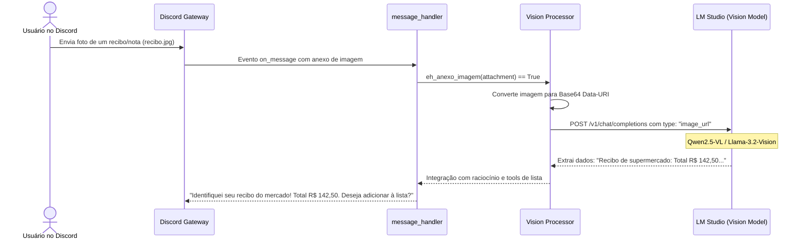

# Especificação de Ideia de Módulo: Visão Computacional & OCR Multimodal

**Código da Proposta:** `IDEA-05`  
**Status:** Proposto / Refinado via `idea_generator` (Prioridade Média-Alta )  
**Impacto:** Permite ao bot "enxergar" imagens, fotos de recibos, documentos escaneados e capturas de tela enviadas no Discord.  

---

## 1. Origem e Validação no Pipeline `idea_generator`

Esta especificação foi submetida e processada pelo pipeline multi-agente da skill **`idea_generator`**:

1. **💡 Geração Criativa (`Ideator`):**
   O módulo IDEA-05 introduz visão computacional multimodal nativa ao Discord AI Bot utilizando modelos locais open-source de ponta (como Qwen2.5-VL-7B-Instruct e Llama-3.2-11B-Vision) via LM Studio. A proposta permite que usuários enviem imagens, notas fiscais, recibos, tabelas em PNG e capturas de tela de erros de código, que são convertidas em Data-URI base64 e injetadas no payload de chat completions. Isso eleva drasticamente a utilidade do bot em ambientes corporativos, de suporte técnico e de finanças pessoais, transformando-o de um assistente puramente textual/auditivo em um agente multicanal completo.

2. **😈 Análise Crítica (`Devil's Advocate`):**
   Do ponto de vista de infraestrutura e segurança, este módulo introduz riscos severos. Primeiro, o consumo de VRAM e o tempo de inferência para modelos de visão locais disparam, podendo causar gargalos ou travamentos no LM Studio se múltiplos usuários enviarem imagens pesadas simultaneamente. Segundo, anexos de imagem não validados abrem vetores de ataque para payloads maliciosos, imagens excessivamente grandes (DoS por estouro de memória), exfiltração de dados sensíveis ou prompt injection indireto contido em imagens (textos escondidos em prints). Terceiro, o suporte a arquivos do Discord precisa ser rigidamente filtrado por tipo MIME e tamanho para evitar estouro de banda e custos desnecessários de processamento.

3. **🏆 Defesa Estratégica (`Champion`):**
   Apesar dos desafios técnicos, a visão multimodal é o diferencial competitivo definitivo para um bot de IA moderno em 2026. A capacidade de auditar recibos, debugar erros de código direto de um print de tela e ler tabelas complexas elimina atritos colossais no fluxo de trabalho dos usuários. Em termos de retenção, o bot passa a ser indispensable em servidores voltados a desenvolvimento de software, finanças e gestão. Além disso, executar isso localmente via LM Studio garante total privacidade de dados sensíveis (como notas fiscais e dados corporativos) comparado a APIs comerciais de terceiros.

4. **⚖️ Veredito do Gatekeeper & Mitigação:**
   * **Status:** `[APROVADA]`
   * **Diretrizes e Condicionantes:** A proposta é APROVADA sob condições estritas de segurança, limitação de recursos e governança de entrada. O alto valor agregado para produtividade supera os riscos operacionais, desde que sejam aplicadas barreiras estritas contra ataques de payload, DoS por arquivos gigantes e injeção de comandos via imagem.

5. **✍️ Síntese do Editor (`Editor/Enricher`):**
   Plano de Mitigação e Execução:
1. Validação de Entrada: Implementar filtros rígidos no handler do Discord para aceitar apenas formatos seguros (PNG, JPEG, WEBP) e limitar o tamanho máximo de arquivo para 5MB antes da conversão Base64.
2. Gerenciamento de Fila e Rate Limiting: Aplicar cooldowns por usuário para envios de imagem e fila de processamento assíncrono para evitar sobrecarga de VRAM no LM Studio.
3. Sanitização de Contexto: Adicionar instruções de sistema defensivas contra prompt injection indireto contido em textos extraídos de imagens.
4. Próximos Passos: Codificar o módulo VL, implementar testes unitários para o processador de anexos e validar a estabilidade do modelo Qwen2.5-VL sob carga concorrente.

---

## 2. Justificativa e Motivação

Atualmente, o bot processa texto e áudio com excelência. No entanto, se o usuário enviar uma foto de uma nota fiscal, uma captura de tela de um erro de programação, uma tabela em formato PNG ou uma foto de uma lista escrita à mão em papel, o bot não consegue extrair ou interpretar o conteúdo visual.

Com a disponibilidade de modelos de visão multimodal no LM Studio (como `Qwen2.5-VL-7B-Instruct`, `Llama-3.2-11B-Vision` ou `MiniCPM-V`), o bot pode passar a analisar imagens com altíssima fidelidade.

---

## 3. Fluxo de Reconhecimento Visual



---

## 4. Casos de Uso Práticos

1. **OCR de Comprovantes e Despesas:**
   O usuário envia a foto de um comprovante Pix ou nota de compras; o bot extrai o valor, a data e o estabelecimento, registrando automaticamente na memória ou em um relatório.
2. **Transcrição de Listas Físicas Manuscritas:**
   O usuário tira foto de uma folha de papel com itens de mercado; a visão multimodal transcreve os itens e a tool `adicionar_item_lista` popula a lista SQLite automaticamente!
3. **Diagnóstico de Telas e Mensagens de Erro:**
   O usuário envia um print de uma tela com mensagem de erro; o bot lê a mensagem de erro da imagem e sugere o comando de correção.

---

## 5. Requisitos Técnicos
* **Extensões Suportadas:** `.jpg`, `.jpeg`, `.png`, `.webp`, `.bmp`.
* **Codificação de Entrada:** Codificação para Base64 em payload OpenAI Vision padrão:
  ```json
  {
    "type": "image_url",
    "image_url": {
      "url": "data:image/jpeg;base64,{base64_data}"
    }
  }
  ```
* **Configuração em `.env`:**
  ```ini
  VISION_ENABLED=true
  VISION_MODEL=qwen/qwen2.5-vl-7b-instruct
  VISION_MAX_IMAGE_SIZE_MB=8
  ```
