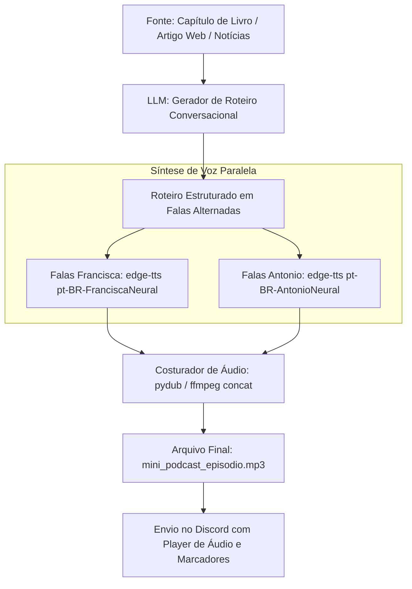

# Especificação de Ideia de Módulo: Modo Podcast & Debate Multi-Voz (Dual-Host Audio Digest)

**Código da Proposta:** `IDEA-10`  
**Status:** Proposto / Refinado via `idea_generator` (Inovação )  
**Impacto:** Transforma capítulos de livros, resumos matinais e notícias da web em um mini-podcast interativo de 3 a 5 minutos narrado por dois apresentadores virtuais.

---

## 1. Origem e Validação no Pipeline `idea_generator`

Esta especificação foi submetida e processada pelo pipeline multi-agente da skill **`idea_generator`**:

1. **💡 Geração Criativa (`Ideator`):**
   O módulo IDEA-10 transforma o consumo passivo de conteúdos densos (livros, artigos, notícias) em uma experiência imersiva de podcast conversacional, utilizando duas vozes neurais brasileiras complementares (Francisca e Antonio via edge-tts). O pipeline processa a fonte através de uma LLM para gerar um roteiro dinâmico com falas alternadas (âncora e co-apresentador curioso), sintetiza o áudio em paralelo e o entrega como um mini-podcast de 3 a 5 minutos diretamente no Discord.

2. **😈 Análise Crítica (`Devil's Advocate`):**
   Riscos técnicos e operacionais severos: 1) Custo e latência de geração: orquestrar chamadas de LLM para roteirização + múltiplos arquivos de áudio via edge-tts geram alto tempo de espera (timeout do Discord de 3 segundos exige uso de defer_deferred e follow-up). 2) Sincronização e sobreposição de áudio: o edge-tts gera arquivos separados por fala que precisam ser concatenados com precisão cirúrgica via ffmpeg para evitar 'gaps' robóticos ou cortes secos. 3) Alucinação da LLM: a IA pode inventar dados ou criar falas incoerentes no formato de debate. 4) Custos de API e limites de taxa (rate limits) da Microsoft Edge TTS se houver picos de uso simultâneo nos servidores do bot.

3. **🏆 Defesa Estratégica (`Champion`):**
   Apesar dos desafios de engenharia, este é o recurso com maior potencial viral ('killer feature') para retenção de usuários no ecossistema do Discord. O formato estilo NotebookLM da Google atrai nativamente a atenção, competindo diretamente com grandes plataformas de áudio e posicionando o bot na vanguarda da IA generativa conversacional em servidores brasileiros. O uso do edge-tts mantém o custo operacional próximo de zero em termos de API de voz, e a complexidade técnica é totalmente superável com filas de processamento assíncronas e cache inteligente de roteiros e áudios frequentes.

4. **⚖️ Veredito do Gatekeeper & Mitigação:**
   * **Status:** `[APROVADA]`
   * **Diretrizes e Condicionantes:** O módulo está APROVADO para desenvolvimento, condicionado estritamente às seguintes diretrizes de segurança e viabilidade: 1) Obrigatório o uso de processamento assíncrono com barra de progresso ou mensagem de status ('Gerando roteiro...' -> 'Sintetizando vozes...') devido ao tempo de execução. 2) Implementação robusta de tratamento de erros no pipeline FFmpeg para concatenação de áudio. 3) Sistema de cache por hash do conteúdo original para evitar reprocessar e regerar áudios de links ou capítulos já solicitados recentemente.

5. **✍️ Síntese do Editor (`Editor/Enricher`):**
   O IDEA-10 foi saneado e estruturado para execução imediata. Plano de mitigação implementado: 1) Arquitetura assíncrona baseada em filas e tarefas em background para contornar os limites de timeout do Discord. 2) Pipeline de concatenação via FFmpeg otimizado para crossfade leve ou silêncio mínimo controlado entre as falas da Francisca e do Antonio. 3) Camada de validação de roteiro na LLM para garantir tom natural e fidelidade à fonte. Próximos passos: Criar o validador de links/fontes, implementar o prompt estruturado de conversação multi-voz e desenvolver o worker de síntese paralela com edge-tts e FFmpeg.

---

## 2. Justificativa e Motivação

Ouvir resumos longos em texto com apenas uma voz sintetizada de forma linear pode soar monótono e cansativo. As pessoas consomem áudio principalmente de forma passiva (enquanto dirigem, treinam ou realizam tarefas domésticas), onde o formato conversacional de **dois apresentadores debatendo um tópico** (estilo *NotebookLM Audio Overview* da Google) é exponencialmente mais dinâmico, didático e agradável.

Como o bot já conta com a biblioteca `edge-tts` instalada e integrada, é possível utilizar duas vozes neurais brasileiras complementares:
- **Apresentador 1 (Voz Feminina):** `pt-BR-FranciscaNeural` (âncora, explicativa e conceitual).
- **Apresentador 2 (Voz Masculina):** `pt-BR-AntonioNeural` (curioso, perspicaz, trazendo analogias e questionamentos).

---

## 3. Arquitetura do Pipeline de Produção de Áudio



---

## 4. Roteiro e Dinâmica Conversacional

A LLM é instruída a gerar um diálogo natural com pequenas hesitações realistas, reações empáticas e ritmo dinâmico:
```text
[Francisca]: "Hoje nós vamos desvendar o que realmente é Graph RAG, e por que tanta gente está falando disso."
[Antonio]: "Pois é, Francisca! Muita gente acha que RAG tradicional com vetores já resolve tudo, mas quando o assunto envolve conectar várias relações complexas... a coisa complica, né?"
[Francisca]: "Exatamente, Antonio! Imagine tentar descobrir a relação entre três empresas e seus sócios apenas buscando blocos de texto isolados..."
```

---

## 5. Comandos de Usuário

- **`!podcast capitulo <arquivo> <numero>`**: Gera o episódio de áudio debatendo o capítulo selecionado de um PDF do usuário.
- **`!podcast tema <assunto>`**: Gera um debate explicativo sobre qualquer tópico conceitual ou técnico.
- **`!podcast web <url>`**: Lê o artigo da internet e transforma em uma mesa redonda em áudio.
- **`!podcast digest`**: Gera o resumo matinal do dia em formato de bate-papo entre os dois apresentadores.

---

## 6. Ferramentas da LLM (Function Calling)

1. `gerar_roteiro_podcast(conteudo_base: str, duracao_minutos: int = 3) -> List[Dict[str, str]]`
2. `renderizar_audio_podcast(dialogos: List[Dict[str, str]]) -> str (caminho do arquivo .mp3)`

---

## 7. Dependências e Configurações em `.env`

```ini
PODCAST_MODULE_ENABLED=true
PODCAST_HOST_A_VOICE=pt-BR-FranciscaNeural
PODCAST_HOST_B_VOICE=pt-BR-AntonioNeural
PODCAST_DEFAULT_DURATION_MINUTES=3
PODCAST_AUDIO_CONCAT_TOOL=pydub # ou ffmpeg
```
