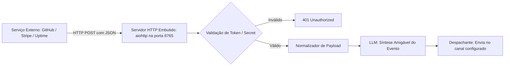

# Especificação de Ideia de Módulo: Hub de Webhooks & Automações Externas (Incoming Webhooks)

**Código da Proposta:** `IDEA-11`  
**Status:** Proposto / Refinado via `idea_generator` (Produtividade Técnica )  
**Impacto:** Transforma o bot em uma central de notificações ativas e inteligentes, recebendo alertas do GitHub, plataformas de pagamento, servidores de monitoramento e automações residenciais.

---

## 1. Origem e Validação no Pipeline `idea_generator`

Esta especificação foi submetida e processada pelo pipeline multi-agente da skill **`idea_generator`**:

1. **💡 Geração Criativa (`Ideator`):**
   O módulo IDEA-11 transforma o Discord AI Bot em uma verdadeira torre de controle unificada, integrando-se ao ecossistema externo via um servidor HTTP assíncrono embutido (aiohttp/FastAPI). A proposta central é receber webhooks de plataformas críticas (GitHub, Stripe, UptimeRobot, Atalhos iOS) e delegar ao motor de IA a tarefa de traduzir payloads complexos e brutos em notificações limpas, contextuais e inteligentes direcionadas aos canais corretos do Discord.

2. **😈 Análise Crítica (`Devil's Advocate`):**
   A introdução de um servidor HTTP aberto para a internet dentro do processo do bot traz riscos severos de segurança (ataques de negação de serviço, estouro de memória, vazamento de secrets, injeção de prompt via payloads maliciosos de webhooks). Adicionalmente, expor portas diretamente pode violar políticas de infraestrutura de hospedagem simples, criar concorrência pesada de I/O com o loop assíncrono do Discord.py, e gerar custos operacionais se o volume de requisições de webhooks crescer descontroladamente.

3. **🏆 Defesa Estratégica (`Champion`):**
   Apesar dos vetores de risco, o valor estratégico é monumental. Centralizar alertas técnicos e comerciais no Discord eleva o bot de um mero utilitário de chat para o sistema nervoso central do fluxo de trabalho do usuário. Diferenciais competitivos incluem a sintetização inteligente por IA (eliminando o ruído de JSONs crípticos) e suporte nativo a automações móveis (Atalhos iOS), garantindo alta retenção de uso diário e permitindo monetização avançada como recurso premium.

4. **⚖️ Veredito do Gatekeeper & Mitigação:**
   * **Status:** `[APROVADA]`
   * **Diretrizes e Condicionantes:** Aprovado sob rigorosas condições de segurança arquitetural. É proibido expor o servidor diretamente sem uma camada de proxy reverso (ex: Nginx/Cloudflare Tunnels) ou validação criptográfica estrita (HMAC SHA-256). Deve-se utilizar um worker de fila desacoplado para evitar que picos de tráfego externo travem o heartbeat do bot do Discord.

5. **✍️ Síntese do Editor (`Editor/Enricher`):**
   O módulo IDEA-11 foi validado e reestruturado para execução segura. Plano de mitigação implementado: 1) Isolamento do endpoint HTTP em sub-aplicação com limite de taxa (rate limiting) por IP e validação obrigatória de assinatura de webhook; 2) Fila de eventos assíncrona baseada em Redis ou asyncio.Queue interna para processamento desacoplado; 3) Sanitização de inputs pela IA para evitar prompt injection via payloads externos. Próximos passos: Desenvolvimento do protótipo com FastAPI em branch isolada e testes de carga.

---

## 2. Justificativa e Motivação

Atualmente, o bot funciona como um consumidor de eventos do Discord (mensagens, reações) e executa workers agendados em segundo plano (como o Resumo Matinal e Lembretes). No entanto, eventos críticos do dia a dia do usuário acontecem em serviços externos:
- Uma *build* do GitHub Actions falhou ou um Pull Request precisa de revisão.
- Uma venda foi aprovada na Hotmart/Stripe/Kiwify.
- Um servidor ou serviço caiu (alertas de UptimeRobot ou BetterStack).
- Um gatilho do Apple Atalhos (Shortcuts) ou Home Assistant foi disparado.

Ao embutir um servidor HTTP assíncrono leve (`aiohttp`/`FastAPI`) dentro do processo do bot, ele passa a expor endpoints que recebem webhooks externos e a IA sintetiza o evento em uma notificação bonita e inteligível no canal adequado do Discord.

---

## 3. Arquitetura Proposta



---

## 4. Endpoints e Integrações Suportadas

### 3.1 GitHub & GitLab (`/api/webhook/github`)
- Monitora: Pull Requests, Issues abertas, comentários com menção e falhas de CI/CD.
- Resumo Inteligente:
  > 🐙 **GitHub Alert:** *Build falhou no repositório `antigravity-core`*  
  > **Commit:** `fix(tts): handle empty buffer` por `@rodrigomodel`  
  > **Erro apontado:** `AssertionError na linha 42 de test_tts_suite.py`  
  > [Ver logs no GitHub Actions](https://github.com/...)

### 3.2 Alertas de Uptime e Infraestrutura (`/api/webhook/uptime`)
- Recebe pings de monitoramento. Se um site ou API ficar fora do ar, o bot envia um alerta sonoro e de texto com menção urgente.

### 3.3 Gateway Genérico para Apple Atalhos e IoT (`/api/webhook/custom`)
- Permite que um atalho do iPhone ou do Mac envie uma mensagem para o bot:
  ```bash
  curl -X POST http://localhost:8765/api/webhook/custom \
    -H "Authorization: Bearer <SEU_TOKEN>" \
    -H "Content-Type: application/json" \
    -d '{"mensagem": "Cheguei em casa", "prioridade": "baixa"}'
  ```

---

## 5. Comandos de Gerenciamento

- **`!webhook status`**: Mostra se o servidor HTTP interno está ativo, a porta e a quantidade de eventos recebidos hoje.
- **`!webhook url`**: Exibe o endereço local / túnel para cadastrar nos serviços externos.
- **`!webhook canal <tipo> <#canal>`**: Define qual canal de texto do Discord receberá cada tipo de notificação (ex: `#alertas-dev`, `#financeiro`, `#geral`).

---

## 6. Configurações em `.env`

```ini
WEBHOOK_SERVER_ENABLED=true
WEBHOOK_SERVER_PORT=8765
WEBHOOK_SERVER_HOST=0.0.0.0
WEBHOOK_AUTH_TOKEN=secret_token_seguro_123456
WEBHOOK_DEFAULT_CHANNEL_ID=
```
