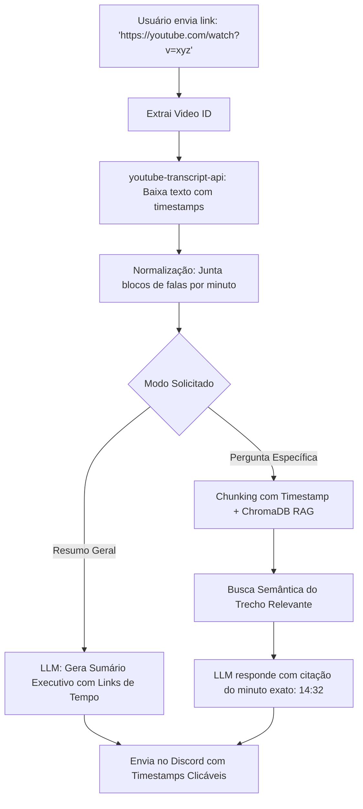

# Especificação de Ideia de Módulo: Inteligência e RAG de Vídeos do YouTube (YouTube Video Summarizer)

**Código da Proposta:** `IDEA-12`  
**Status:** Proposto / Refinado via `idea_generator` (Prioridade Alta )  
**Impacto:** Permite resumir palestras, podcasts, aulas e tutoriais do YouTube em segundos, além de conversar interativamente com o vídeo através de citações de tempo (timestamps).

---

## 1. Origem e Validação no Pipeline `idea_generator`

Esta especificação foi submetida e processada pelo pipeline multi-agente da skill **`idea_generator`**:

1. **💡 Geração Criativa (`Ideator`):**
   Proponho o módulo IDEA-12 focando em extrema eficiência e utilidade imediata. Em vez de focar no processamento pesado de áudio/vídeo, o bot utiliza a extração nativa de legendas via youtube-transcript-api. O fluxo permite que, ao colar um link do YouTube, o bot gere instantaneamente um resumo executivo segmentado com timestamps clicáveis do próprio Discord, e abra uma sessão de RAG contextual onde o usuário pode fazer perguntas diretas sobre o conteúdo do vídeo, recebendo respostas com menção exata ao minuto e segundo em que o assunto foi abordado.

2. **😈 Análise Crítica (`Devil's Advocate`):**
   O Devil's Advocate aponta graves vulnerabilidades operacionais. Primeiro: vídeos sem legendas nativas ou geradas automaticamente causarão falhas abruptas ('TranscriptNotAvailable'). Segundo: transcrições automáticas do YouTube são repletas de erros gramaticais, falta de pontuação e alucinações de fonemas, o que degrada a qualidade do RAG e gera resumos confusos. Terceiro: vídeos extremamente longos (ex: podcasts de 4 horas) geram milhares de tokens, estourando a janela de contexto do LLM e gerando custos desproporcionais de API por requisição. Quarto: limites de taxa (rate limits) do YouTube podem banir o IP do bot se houver muitas requisições simultâneas.

3. **🏆 Defesa Estratégica (`Champion`):**
   O Champion rebate que a fricção zero é a chave de retenção definitiva para comunidades no Discord. Estudantes, desenvolvedores e gamers consomem tutoriais e palestras diariamente e odeiam perder tempo pulando partes irrelevantes. A utilização da youtube-transcript-api elimina custos de infraestrutura de mídia (sem transcodificação de áudio). Para mitigar o tamanho dos vídeos, podemos implementar uma estratégia de chunking baseada em blocos de tempo e um sistema de cache inteligente no banco de dados para nunca processar o mesmo vídeo duas vezes. O ganho de engajamento e utilidade percebida do bot compensa largamente os riscos técnicos.

4. **⚖️ Veredito do Gatekeeper & Mitigação:**
   * **Status:** `[APROVADA]`
   * **Diretrizes e Condicionantes:** O Gatekeeper aprova o módulo sob condições estritas de robustez e tratamento de erros. Condicionantes obrigatórias: 1. Tratamento gracioso para vídeos sem transcrição (informar o usuário claramente e abortar o processo sem crashar). 2. Implementação obrigatória de cache (se o ID do vídeo já foi processado no servidor, reutilizar os dados do banco). 3. Limitação de tamanho de tokens por vídeo (truncar ou resumir em fases se ultrapassar limites seguros do LLM). 4. Sanitização e chunking inteligente da transcrição bruta antes de enviar ao modelo de linguagem.

5. **✍️ Síntese do Editor (`Editor/Enricher`):**
   Síntese executiva do Editor: O módulo IDEA-12 (YouTube RAG & Summarizer) está validado e pronto para implementação controlada. Plano de mitigação de riscos: Integração com a biblioteca `youtube-transcript-api` blindada com blocos try/catch para erros de legenda indisponível; criação de tabela de cache `youtube_transcripts` para evitar requisições repetidas e economizar tokens; pipeline de limpeza textual para remover ruídos das transcrições automáticas; e formatação de saída em embeds ricos do Discord com timestamps em formato de link direto para o minuto do vídeo. Próximos passos: Implementação do parser de URL, criação do serviço de extração de legendas, configuração do prompt de resumo executivo e ativação dos comandos slash correspondentes.

---

## 2. Justificativa e Motivação

O YouTube é o maior repositório de conhecimento técnico, entrevistas e aulas do mundo, mas vídeos longos de 1 a 3 horas exigem um tempo substancial para serem assistidos integralmente. Muitas vezes, o usuário precisa apenas de um conceito específico abordado no minuto 42 de um podcast.

Baixar o arquivo de vídeo/áudio é inviável por consumo de largura de banda e armazenamento. Felizmente, quase todos os vídeos do YouTube contêm **legendas e transcrições automáticas com timestamps precisos**. Usando a biblioteca leve `youtube-transcript-api`, o bot pode baixar a transcrição textual inteira em menos de 2 segundos, sem chaves pagas de API e sem consumir dados pesados.

---

## 3. Arquitetura Proposta



---

## 4. Capacidades e Comandos

### 3.1 `!youtube <link>` (ou `!yt`)
Gera a visão panorâmica do vídeo:
- **Título e Duração Estimada**.
- **Resumo Executivo** (do que se trata a gravação).
- **Índice Temático com Timestamps Clicáveis:**
  - `[02:15]` Introdução e Contexto do Mercado
  - `[14:40]` Demonstração Prática do Algoritmo
  - `[38:10]` Análise de Custos e Erros Comuns
  - `[54:00]` Conclusão e Próximos Passos
*(Clicar no timestamp abre o vídeo exatamente no minuto correspondente)*.

### 3.2 `!yt perguntar <link> <sua dúvida>`
Realiza uma pergunta direta sobre o conteúdo do vídeo. A IA localiza os trechos relevantes na transcrição e responde citando a fala do apresentador:
> *"O palestrante explica aos **[24:15]** que a principal vantagem do Graph RAG sobre RAG tradicional é a preservação de relacionamentos multi-hop entre entidades."*

### 3.3 Integração com Conversação Natural
Sempre que o usuário colar um link do YouTube no chat acompanhado de uma pergunta (*"O que esse vídeo fala sobre a nova placa de vídeo da Nvidia?"*), a IA ativa automaticamente a tool correspondente.

---

## 5. Ferramentas da LLM (Function Calling)

1. `obter_resumo_video_youtube(video_url: str)`: Extrai as legendas e sintetiza os pontos centrais com minutagem.
2. `consultar_conteudo_video_youtube(video_url: str, pergunta: str)`: Realiza busca semântica dentro da transcrição do vídeo para responder dúvidas pontuais.

---

## 6. Dependências e Configurações em `.env`

```ini
YOUTUBE_INTELLIGENCE_ENABLED=true
YOUTUBE_DEFAULT_LANGUAGE=pt,en
YOUTUBE_MAX_TRANSCRIPT_MINUTES=180
```
