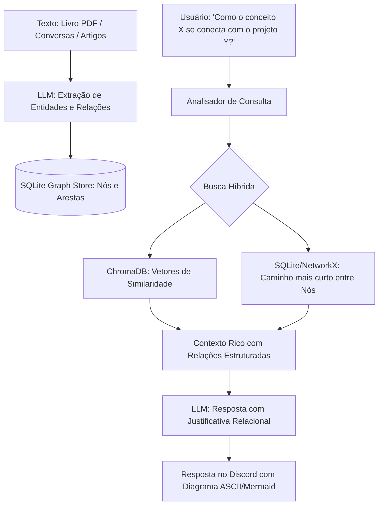

# Especificação de Ideia de Módulo: Grafo de Conhecimento Pessoal & Graph RAG

**Código da Proposta:** `IDEA-13`  
**Status:** Proposto / Refinado via `idea_generator` (Prioridade Alta )  
**Impacto:** Constrói uma rede semântica de entidades e relacionamentos interligados, permitindo inferências lógicas multi-hop que a busca vetorial simples não consegue resolver.

---

## 1. Origem e Validação no Pipeline `idea_generator`

Esta especificação foi submetida e processada pelo pipeline multi-agente da skill **`idea_generator`**:

1. **💡 Geração Criativa (`Ideator`):**
   O módulo IDEA-13 propõe a introdução de um Grafo de Conhecimento Pessoal combinado com Graph RAG. A motivação central é superar as limitações do RAG vetorial tradicional (que falha em consultas multi-hop e relacionais complexas) mapeando documentos, livros, conversas e projetos em nós e arestas (ex: CONECTA_COM, OPÕE_SE_A, DEPENDE_DE). Isso permite que o bot faça inferências lógicas profundas, conectando conceitos dispersos e servindo como uma verdadeira memória de longo prazo estruturada.

2. **😈 Análise Crítica (`Devil's Advocate`):**
   Do ponto de vista de engenharia, a proposta apresenta sérios riscos e gargalos operacionais: 1) Custo e latência proibitivos: Extrair entidades e relações via LLM a cada ingestão de documento ou conversa consome muitos tokens e gera gargalos na API. 2) Manutenção do Grafo: A desambiguação de entidades (ex: 'Python' como linguagem vs. 'Python' como cobra ou projeto interno) é complexa e gera poluição no banco de dados. 3) Escalabilidade do SQLite Graph Store: Bancos relacionais emulando grafos sofrem quedas drásticas de performance em consultas multi-hop profundas (acima de 2 saltos). 4) Alucinação relacional: LLMs frequentemente inventam conexões incorretas entre entidades, corrompendo a integridade da base de conhecimento.

3. **🏆 Defesa Estratégica (`Champion`):**
   Apesar dos desafios técnicos, o Graph RAG é o estado da arte na resolução de problemas complexos de retenção de contexto e personalização de IA. Para um bot de Discord voltado a produtividade e gestão de conhecimento pessoal, ser capaz de responder 'Como a tese do livro X afeta meu projeto atual?' é um diferencial competitivo monumental de retenção de usuários. Se mitigarmos os custos de extração com modelos menores (ex: Llama-3 de 8B ou GPT-4o-mini otimizado) e limitarmos a profundidade dos saltos (max 2-hop), ganhamos um 'segundo cérebro' funcional e altamente rentável em termos de valor percebido.

4. **⚖️ Veredito do Gatekeeper & Mitigação:**
   * **Status:** `[APROVADA]`
   * **Diretrizes e Condicionantes:** Aprovada sob condições estritas de arquitetura e mitigação de custos. Condicionantes obrigatórias: 1) Substituição do SQLite Graph Store por uma solução robusta ou extensão dedicada (como SQLite com índices FTS5 otimizados para tripla, ou migração para um motor leve em memória/disco como NetworkX persistido em JSON para volumes baixos, avaliando KùzuDB se necessário). 2) O pipeline de extração deve rodar em background assíncrono via fila, utilizando modelos de menor custo. 3) Mecanismo rígido de validação de confiança nas arestas extraídas para evitar alucinações no grafo.

5. **✍️ Síntese do Editor (`Editor/Enricher`):**
   O módulo IDEA-13 (Graph RAG Pessoal) foi refinado para equilibrar ambição semântica e viabilidade técnica. Plano de execução: 1) Pipeline de Ingestão Assíncrona: Conversas e documentos longos são processados em background por um modelo otimizado (ex: GPT-4o-mini) para extração JSON estruturada de Entidades e Arestas. 2) Armazenamento Leve: Utilização de KùzuDB ou estrutura otimizada em disco para consultas de grafos sem sobrecarregar o ecossistema. 3) Abordagem Híbrida: Fusão de resultados do ChromaDB (vetorial) com caminhos do Grafo (Graph RAG) antes de enviar o contexto final ao LLM principal. Com essas salvaguardas, o módulo garante alta precisão relacional, controle de custos e resiliência contra alucinações.

---

## 2. Justificativa e Motivação

O RAG vetorial tradicional (ChromaDB) busca blocos de texto por similaridade semântica de cosseno. Embora excelente para encontrar trechos que contenham palavras contextualmente próximas, ele falha em consultas relacionais complexas (*multi-hop reasoning*), como por exemplo:
- *"Quais tecnologias citadas no livro X têm relação com o projeto que discuti na semana passada?"*
- *"Quem são os autores citados no capítulo 3 que defendem uma visão oposta à do autor do capítulo 1?"*

Ao extrair entidades (Pessoas, Tecnologias, Projetos, Conceitos, Empresas) e relacionamentos (`CONECTA_COM`, `TRABALHA_EM`, `OPÕE_SE_A`, `DEPENDE_DE`), o bot cria um **Grafo de Conhecimento Pessoal (Personal Knowledge Graph)**, combinando busca vetorial com navegação em grafos (Graph RAG).

---

## 3. Arquitetura Proposta



---

## 4. Comandos de Usuário

- **`!grafo consultar <entidade>`**: Exibe todas as conexões diretas e indiretas de uma entidade (ex: `!grafo consultar Graph RAG`).
- **`!grafo caminho <origem> <destino>`**: Encontra o caminho relacional mais curto entre dois conceitos ou pessoas.
- **`!grafo mapa [tema]`**: Renderiza um mini-mapa conceitual das ideias centrais registradas.

---

## 5. Ferramentas da LLM (Function Calling)

1. `adicionar_relacao_grafo(origem: str, tipo_relacao: str, destino: str, contexto: str)`
2. `consultar_grafo_conhecimento(entidade: str, profundidade: int = 2)`
3. `buscar_caminho_grafo(origem: str, destino: str)`

---

## 6. Estrutura do Banco de Dados (SQLite)

```sql
CREATE TABLE IF NOT EXISTS graph_nodes (
    id TEXT PRIMARY KEY,
    tipo TEXT NOT NULL, -- Pessoa, Tecnologia, Projeto, Conceito
    descricao TEXT,
    created_at DATETIME DEFAULT CURRENT_TIMESTAMP
);

CREATE TABLE IF NOT EXISTS graph_edges (
    id INTEGER PRIMARY KEY AUTOINCREMENT,
    source_id TEXT NOT NULL,
    target_id TEXT NOT NULL,
    relacao TEXT NOT NULL, -- DEPENDE_DE, CRIOU, TRABALHA_EM, etc.
    peso REAL DEFAULT 1.0,
    contexto TEXT,
    FOREIGN KEY(source_id) REFERENCES graph_nodes(id),
    FOREIGN KEY(target_id) REFERENCES graph_nodes(id)
);
```

---

## 7. Configurações em `.env`

```ini
GRAPH_RAG_ENABLED=true
GRAPH_MAX_DEPTH=2
GRAPH_EXTRACTION_PROVIDER=google # recomendado Gemini Flash para extração rápida
```
