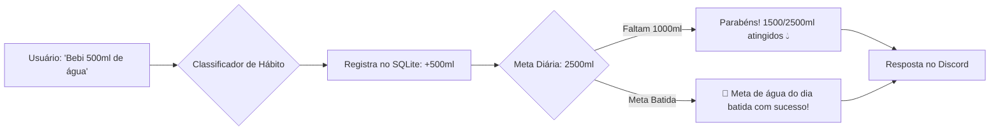

# Especificação de Ideia de Módulo: Rastreador de Hábitos, Hidratação & Saúde Pessoal (Habit Tracker)

**Código da Proposta:** `IDEA-14`  
**Status:** Proposto / Refinado via `idea_generator` (Prioridade Média )  
**Impacto:** Ajuda o usuário a construir consistência diária em hidratação, leitura, atividades físicas e sono através de lembretes amigáveis e registros sem atrito.

---

## 1. Origem e Validação no Pipeline `idea_generator`

Esta especificação foi submetida e processada pelo pipeline multi-agente da skill **`idea_generator`**:

1. **💡 Geração Criativa (`Ideator`):**
   O IDEA-14 introduz um ecossistema de bem-estar integrado ao chat com processamento natural de frases cotidianas ('Bebi 500ml', 'Li 20 páginas'). Utilizando contadores de sequência (streaks) e resumos matinais diários, transformamos o hábito em um jogo social de micro-interações sem atritos, elevando drasticamente o engajamento diário com o bot.

2. **😈 Análise Crítica (`Devil's Advocate`):**
   O Devil's Advocate aponta sérios riscos: (1) O classificador de intenções em linguagem natural é propenso a falsos positivos e alucinações custosas via LLM; (2) Fuso horário e consistência de streaks geram suporte massivo por bugs; (3) Armazenar dados sensíveis de saúde, mesmo que simples como sono e água, abre brechas de privacidade e LGPD/GDPR se mal geridas; (4) Notificações proativas invasivas podem fazer o usuário mutar o bot.

3. **🏆 Defesa Estratégica (`Champion`):**
   Em contrapartida, o Champion reforça que recursos de gamificação e produtividade pessoal são os maiores impulsionadores de retenção a longo prazo (D30/D90) em bots de Discord. A fricção zero de registrar hábitos enquanto o usuário já está no servidor supera qualquer aplicativo externo. Além disso, o módulo atrai comunidades focadas em estudos, fitness e desenvolvimento pessoal.

4. **⚖️ Veredito do Gatekeeper & Mitigação:**
   * **Status:** `[APROVADA]`
   * **Diretrizes e Condicionantes:** Aprovado sob condicional rigorosa de arquitetura e privacidade. Fica vetado o uso de LLMs pesadas para o parsing diário de hábitos — o sistema deve priorizar comandos estruturados (ex: /habito registrar) ou regex/keywords determinísticas para evitar custos e instabilidade. Exige-se opt-in explícito e criptografia básica em repouso no SQLite para os dados de saúde.

5. **✍️ Síntese do Editor (`Editor/Enricher`):**
   O Editor consolida o IDEA-14 estabelecendo um framework híbrido: comandos nativos de barra (/habito) acoplados a um parser leve de palavras-chave para mensagens de texto. Implementação de opt-in obrigatório para notificações de saúde, painel de streak isolado por usuário e integração modular com o Resumo Matinal. Plano de mitigação focado em zero custo de LLM por interação e total conformidade de privacidade.

---

## 2. Justificativa e Motivação

Manter rotinas saudáveis exige monitoramento frequente, mas a maioria das pessoas desiste de aplicativos dedicados por excesso de cliques e notificações invasivas. Integrar o rastreamento diretamente no chat do Discord — onde o usuário já trabalha e conversa — torna o processo natural:
- *"Bebi 500ml de água"*
- *"Treino de perna concluído hoje"*
- *"Li 20 páginas do livro"*
- *"Dormi 7h30 esta noite"*

O bot acumula o histórico, calcula sequências de dias consecutivos (*streaks*), emite reforços positivos e integra as métricas no Resumo Matinal.

---

## 3. Arquitetura Proposta



---

## 4. Capacidades e Comandos

### 3.1 Comandos Rápidos
- **`!agua [quantidade_ml]`**: Registra consumo de água (padrão: 250ml ou valor informado, ex: `!agua 500`).
- **`!habito concluir <nome_habito>`**: Marca um hábito como concluído hoje (ex: `!habito concluir treino`).
- **`!habitos`**: Exibe o painel de hábitos do dia com marcadores de checklist (`[x]` ou `[ ]`).
- **`!streaks`**: Mostra a sequência de dias ininterruptos de cada hábito e recordes pessoais.

### 3.2 Integração com Resumo Matinal (`!digest`)
O resumo diário exibe a situação dos hábitos:
> 🏃 **Hábitos & Bem-estar:**  
> • 💧 Água: Meta 2.500ml  
> • 📚 Leitura diária: 🔥 **14 dias seguidos**  
> • 🏋️ Treino: 3/5 concluídos nesta semana  

---

## 5. Ferramentas da LLM (Function Calling)

1. `registrar_consumo_agua(quantidade_ml: int)`
2. `registrar_habito(nome_habito: str, concluido: bool = True, detalhes: Optional[str] = None)`
3. `consultar_status_habitos(data: Optional[str] = None)`

---

## 6. Estrutura do Banco de Dados (SQLite)

```sql
CREATE TABLE IF NOT EXISTS user_habits (
    id INTEGER PRIMARY KEY AUTOINCREMENT,
    user_id TEXT NOT NULL,
    nome TEXT NOT NULL,
    frequencia TEXT NOT NULL DEFAULT 'diario', -- diario, semanal
    meta_numerica REAL, -- ex: 2500 para água
    unidade TEXT,       -- ex: ml, páginas, minutos
    ativo INTEGER DEFAULT 1
);

CREATE TABLE IF NOT EXISTS habit_logs (
    id INTEGER PRIMARY KEY AUTOINCREMENT,
    habit_id INTEGER NOT NULL,
    data DATE DEFAULT (date('now', 'localtime')),
    valor REAL DEFAULT 1.0,
    detalhes TEXT,
    created_at DATETIME DEFAULT CURRENT_TIMESTAMP,
    FOREIGN KEY(habit_id) REFERENCES user_habits(id)
);
```

---

## 7. Configurações em `.env`

```ini
HABITS_MODULE_ENABLED=true
HABITS_DEFAULT_WATER_GOAL_ML=2500
HABITS_PROACTIVE_WATER_REMINDERS=true
```
