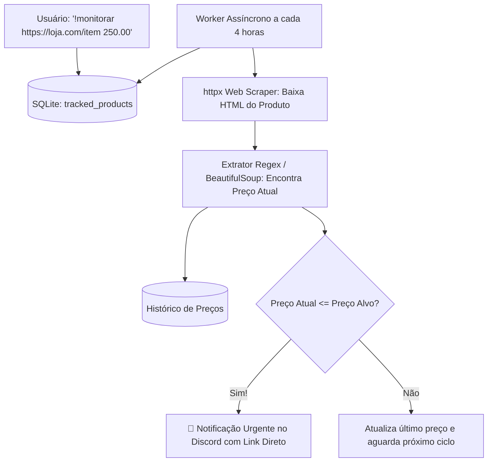

# Especificação de Ideia de Módulo: Monitor de Preços & Alertas de Promoção (Price Tracker)

**Código da Proposta:** `IDEA-16`  
**Status:** Proposto / Refinado via `idea_generator` (Praticidade & Economia )  
**Impacto:** Rastreia preços de produtos em lojas online e notifica o usuário no Discord no momento exato em que o valor atingir o patamar desejado.

---

## 1. Origem e Validação no Pipeline `idea_generator`

Esta especificação foi submetida e processada pelo pipeline multi-agente da skill **`idea_generator`**:

1. **💡 Geração Criativa (`Ideator`):**
   Proponho o módulo IDEA-16 (Monitor de Preços & Alertas de Compra), aproveitando a infraestrutura atual de web scraping (httpx e BeautifulSoup) para transformar o bot do Discord em um sentinela pessoal de e-commerce. O fluxo central permite que o usuário envie um comando simples como '!monitorar [link] [preço_alvo]'. Um worker assíncrono em segundo plano fará varreduras periódicas (ex: a cada 4 horas), comparando o valor atual com o alvo definido e disparando um alerta rico no Discord contendo um gráfico de histórico de preços gerado sob demanda, tudo sem rastreamento de dados de navegação e com total privacidade.

2. **😈 Análise Crítica (`Devil's Advocate`):**
   Do ponto de vista técnico e de infraestrutura, este módulo apresenta riscos severos que podem comprometer todo o bot: 1) Bloqueio de IP (Rate Limiting e Captchas): E-commerces usam Cloudflare e WAFs agressivos. Scrapers simples com httpx e BeautifulSoup vão falhar rapidamente, resultando em bans de IP ou retornos de páginas de bloqueio (HTTP 403/503). 2) Custo Computacional e de Rede: Rodar scraping a cada 4 horas para centenas ou milhares de itens gerará gargalos de I/O e uso excessivo de CPU. 3) Fragilidade de Seletores: Layouts de e-commerce mudam constantemente, quebrando parsers baseados em Regex/BeautifulSoup e gerando falsos positivos ou erros de extração. 4) Responsabilidade Legal e Termos de Serviço (ToS): Scraping automatizado de grandes varejistas pode violar ToS.

3. **🏆 Defesa Estratégica (`Champion`):**
   Apesar dos riscos operacionais evidentes, o valor retentivo e de engajamento do IDEA-16 é monumental. Em servidores do Discord focados em comunidades de ofertas, tecnologia e jogos, um bot que avisa 'o produto que você queria caiu de preço' cria um loop diário de retorno orgânico (DAU). Podemos mitigar a fragilidade técnica utilizando rotinas de rotação de User-Agents, intervalos dinâmicos/aleatórios (jitter) para evitar padrões de bot, e priorizando o suporte a APIs públicas de afiliados (como Amazon PA-API, Buscapé, Lomadee) quando disponíveis, reservando o scraping puro como fallback para lojas menores.

4. **⚖️ Veredito do Gatekeeper & Mitigação:**
   * **Status:** `[APROVADA]`
   * **Diretrizes e Condicionantes:** A proposta foi APROVADA sob condições restritivas de segurança e arquitetura. Condicionantes obrigatórias: 1) Proibição de scraping síncrono ou bloqueante na thread principal do bot; 2) Obrigatoriedade de um sistema de fila com limites estritos (Rate Limiting por domínio) para evitar bans de IP; 3) Tratamento robusto de erros para HTMLs alterados (se o preço não for encontrado, o worker deve notificar os devs silenciosamente em vez de disparar alertas falsos); 4) Limite máximo de itens monitorados por usuário gratuito para evitar abusos.

5. **✍️ Síntese do Editor (`Editor/Enricher`):**
   O módulo IDEA-16 foi saneado e estruturado para execução segura. Plano de mitigação implementado: 1) Arquitetura baseada em Celery/Background Tasks com intervalos assíncronos e jitter de tempo; 2) Camada de extração resiliente com fallbacks de seletores CSS dinâmicos e suporte a regex flexíveis para moedas; 3) Persistência local em SQLite estruturada em tabelas separadas para produtos rastreados e logs de histórico de preços; 4) Integração visual no Discord utilizando embeds interativos com mini-gráficos de variação gerados via biblioteca leve (ex: matplotlib headless ou quickchart.io). Próximos passos: Criar o schema do banco de dados, implementar o worker de varredura com headers realistas e submeter para testes em ambiente controlado.

---

## 2. Justificativa e Motivação

Muitos usuários aguardam promoções de livros, periféricos, cursos ou eletrônicos, mas perdem oportunidades relâmpago por não checarem as páginas de e-commerce diariamente. Ferramentas comerciais de alerta de preço geralmente exigem instalação de extensões pesadas no navegador que coletam dados de navegação privada.

Aproveitando o módulo de web browsing recém-implementado (`httpx` e `BeautifulSoup`), o bot pode atuar como um sentinela silencioso: o usuário envia o link do produto no Discord com o preço-alvo, e o bot verifica a página em intervalos regulares sem violar a privacidade do navegador.

---

## 3. Arquitetura Proposta



---

## 4. Comandos de Usuário

- **`!monitorar <url> <preco_desejado>`**: Inicia o rastreamento de um produto.
- **`!precos`**: Lista todos os produtos atualmente monitorados com o preço inicial, menor preço registrado e preço atual.
- **`!desmonitorar <id_ou_termo>`**: Remove o produto da fila de verificação.
- **`!historico_preco <id>`**: Exibe um mini-gráfico em texto com a variação do valor nos últimos 30 dias.

---

## 5. Ferramentas da LLM (Function Calling)

1. `adicionar_monitoramento_preco(url: str, preco_alvo: float, nome_produto: Optional[str] = None)`
2. `listar_produtos_monitorados()`
3. `remover_monitoramento_preco(produto_id: int)`

---

## 6. Estrutura do Banco de Dados (SQLite)

```sql
CREATE TABLE IF NOT EXISTS tracked_products (
    id INTEGER PRIMARY KEY AUTOINCREMENT,
    user_id TEXT NOT NULL,
    nome TEXT NOT NULL,
    url TEXT NOT NULL,
    preco_inicial REAL NOT NULL,
    preco_alvo REAL NOT NULL,
    ultimo_preco REAL NOT NULL,
    moeda TEXT DEFAULT 'BRL',
    ativo INTEGER DEFAULT 1,
    ultimo_check DATETIME,
    created_at DATETIME DEFAULT CURRENT_TIMESTAMP
);

CREATE TABLE IF NOT EXISTS price_history (
    id INTEGER PRIMARY KEY AUTOINCREMENT,
    product_id INTEGER NOT NULL,
    preco REAL NOT NULL,
    timestamp DATETIME DEFAULT CURRENT_TIMESTAMP,
    FOREIGN KEY(product_id) REFERENCES tracked_products(id)
);
```

---

## 7. Configurações em `.env`

```ini
PRICE_TRACKER_ENABLED=true
PRICE_TRACKER_CHECK_INTERVAL_HOURS=4
PRICE_TRACKER_USER_AGENT=Mozilla/5.0 ...
```
