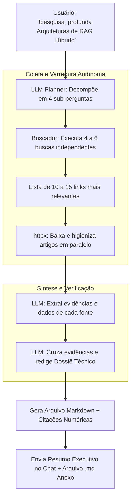

# Especificação de Ideia de Módulo: Agente Autônomo de Pesquisa Profunda (Deep Research)

**Código da Proposta:** `IDEA-17`  
**Status:** Proposto / Refinado via `idea_generator` (Prioridade Alta )  
**Impacto:** Conduz investigações exaustivas na internet sobre temas complexos, cruzando múltiplas fontes para gerar dossiês executivos completos e estruturados.

---

## 1. Origem e Validação no Pipeline `idea_generator`

Esta especificação foi submetida e processada pelo pipeline multi-agente da skill **`idea_generator`**:

1. **💡 Geração Criativa (`Ideator`):**
   O módulo IDEA-17 introduz um Agente Autônomo de Pesquisa Profunda (Deep Research) no Discord AI Bot. A proposta é elevar o bot de um assistente de respostas rápidas para um analista de inteligência autônomo. Através de um comando como '!pesquisa_profunda', o LLM assume um papel de Planner, decompõe o tema central em sub-perguntas, executa múltiplas varreduras na web em paralelo, raspa o conteúdo de dezenas de páginas, valida cruzadamente as fontes, sintetiza as informações e entrega um relatório técnico exaustivo com citações formais e estruturação executiva.

2. **😈 Análise Crítica (`Devil's Advocate`):**
   Sob a ótica do Devil's Advocate, a arquitetura proposta apresenta riscos severos: 1) Custo de API exorbitante (múltiplas chamadas de LLM para planejamento, dezenas de buscas web e leituras de páginas completas geram tokens massivos por execução); 2) Gargalos de performance e timeout do Discord (o bot tem limites estritos de resposta, exigindo um sistema assíncrono robusto com atualizações por Webhook ou DM); 3) Vulnerabilidade a bloqueios de scraping (sites com Cloudflare, paywalls ou bot-detection invalidarão a raspagem via httpx simples); 4) Poluição informacional e alucinação em cascata (se fontes primárias forem lixo ou viesadas, o relatório final amplificará esses erros com uma falsa aura de autoridade acadêmica/técnica).

3. **🏆 Defesa Estratégica (`Champion`):**
   Apesar dos riscos técnicos, o Champion argumenta que este é o recurso definitivo para retenção de usuários enterprise e comunidades técnicas de alto nível (desenvolvedores, pesquisadores, analistas de mercado). O IDEA-17 posiciona o Discord AI Bot na vanguarda da geração atual de IA, competindo diretamente com ferramentas proprietárias pagas (Perplexity Pro, OpenAI Deep Research). Do ponto de vista de monetização e valor percebido, um único relatório de Deep Research bem-sucedido justifica o custo operacional do bot por meses, transformando-o de um brinquedo de chat em uma ferramenta de produtividade indispensável.

4. **⚖️ Veredito do Gatekeeper & Mitigação:**
   * **Status:** `[APROVADA]`
   * **Diretrizes e Condicionantes:** O módulo está APROVADO com condicionantes estritas de engenharia e segurança. Condições obrigatórias: 1) Arquitetura estritamente assíncrona baseada em fila de tarefas (ex: Redis/Celery ou background tasks) com notificações via DM ou Thread dedicada para evitar timeouts do Discord; 2) Limitação rígida de orçamento/tokens por usuário e por dia para prevenir ataques de negação de serviço financeira; 3) Uso de serviços de busca e scraping resilientes (APIs comerciais de busca e fallback para Jina Reader ou Browserless em vez de scraping ingênuo via httpx); 4) Inclusão obrigatória de um disclaimer de limite de IA e seção de limitações de fontes no relatório final.

5. **✍️ Síntese do Editor (`Editor/Enricher`):**
   Síntese executiva do Editor: O IDEA-17 (Agente de Pesquisa Profunda) é formalmente aprovado para implementação sob um plano de mitigação focado em resiliência e controle de custos. Plano de Ação: 1) Implementar motor de fila assíncrona para entregas via Threads privadas no Discord; 2) Integrar APIs de busca estruturada e leitores de URL robustos com tratamento de paywalls e anti-bot; 3) Criar mecanismo de controle de cota (rate-limiting) estrito por usuário para proteger o orçamento de API; 4) Desenvolver o prompt de síntese com validação cruzada de fontes e formatação em Markdown executivo. Próximos passos: prototipagem do loop de planejamento recursivo e testes de carga e custo por query.

---

## 2. Justificativa e Motivação

Pesquisas pontuais na web (como o `!buscar`) retornam pequenos resumos úteis para fatos imediatos, mas são inadequadas quando o usuário precisa tomar decisões técnicas ou estratégicas de alto impacto (ex: *"Qual a arquitetura recomendada para hospedar LLMs locais em nós Mac Studio M2 vs instâncias Nvidia H100?"*).

Inspirado nos motores de *Deep Research* (Gemini Deep Research, OpenAI Deep Research e Perplexity), este módulo adiciona um fluxo autônomo multi-iteração: a IA planeja a pesquisa, divide-a em sub-perguntas, lê dezenas de páginas em paralelo, descarta fontes duplicadas ou contraditórias e redige um documento técnico minucioso com citações formais.

---

## 3. Arquitetura do Fluxo de Deep Research



---

## 4. Comandos de Usuário

- **`!pesquisa_profunda <tema ou pergunta complexa>`**: Inicia o processo de pesquisa autônoma em segundo plano (com atualizações de progresso no chat).
- **`!pesquisas`**: Lista relatórios de pesquisa já concluídos com opção de download.

---

## 5. Estrutura do Dossiê Técnico Entregue

1. **Sumário Executivo e Principais Conclusões**
2. **Contexto e Estado da Arte**
3. **Análise Comparativa / Tabela Técnica de Prós e Contras**
4. **Armadilhas Comuns e Pontos de Atenção**
5. **Recomendações Práticas Acionáveis**
6. **Referências Bibliográficas com Links de Origem**

---

## 6. Ferramentas da LLM (Function Calling)

1. `iniciar_pesquisa_profunda(tema: str, profundidade: str = "media")`
2. `planejar_subconsultas_pesquisa(tema: str) -> List[str]`
3. `sintetizar_dossie_pesquisa(conteudos_coletados: List[Dict[str, str]])`

---

## 7. Configurações em `.env`

```ini
DEEP_RESEARCH_ENABLED=true
DEEP_RESEARCH_MAX_SOURCES=10
DEEP_RESEARCH_TIMEOUT_MINUTES=5
DEEP_RESEARCH_MODEL=gemini-3.5-flash # ideal por janela de contexto ampla
```
