# Especificação de Ideia de Módulo: Assistente de Voz em Tempo Real no Canal de Áudio (Discord Voice Channel)

**Código da Proposta:** `IDEA-18`  
**Status:** Proposto / Refinado via `idea_generator` (Inovação & Experiência Imersiva )  
**Impacto:** Permite que o bot entre em canais de voz do Discord (`Voice Channels`) e converse por voz ao vivo com latência ultrabaixa.

---

## 1. Origem e Validação no Pipeline `idea_generator`

Esta especificação foi submetida e processada pelo pipeline multi-agente da skill **`idea_generator`**:

1. **💡 Geração Criativa (`Ideator`):**
   O módulo IDEA-18 transforma radicalmente o Discord AI Bot de um assistente puramente baseado em chat de texto e arquivos estáticos em um companheiro imersivo de voz em tempo real. Utilizando conexões de áudio UDP nativas do Discord, Silero VAD para detecção precisa de atividade de fala, transcrição otimizada (faster-whisper), LLMs de baixíssima latência (Gemini Flash ou local) e edge-tts, o bot passa a operar diretamente nos canais de voz. A proposta de valor central é a experiência 'hands-free' com suporte a interrupções (barge-in), permitindo que o usuário converse fluidamente enquanto joga, programa ou estuda, elevando o engajamento e a percepção de inteligência do bot a um patamar corporativo e de vanguarda.

2. **😈 Análise Crítica (`Devil's Advocate`):**
   Sob a ótica do Devil's Advocate, a arquitetura proposta esbarra em barreiras técnicas severas e riscos operacionais críticos: 1) Latência de ponta a ponta: somando decodificação Opus, VAD, Whisper, inferência LLM e TTS, manter uma conversa fluida abaixo de 800ms é extremamente desafiador e propenso a engasgos. 2) Custo de infraestrutura: streaming de áudio bidirecional simultâneo em múltiplos servidores consome banda de rede massiva e poder de CPU/GPU considerável para inferência de áudio contínua (WebRTC/Opus e Whisper). 3) Concorrência de áudio e barge-in: gerenciar interrupções sem que o bot continue falando por cima do usuário exige um controle refinado de buffer e cancelamento de eco/interrupção no cliente Discord. 4) Custos de API e gargalos de rate limit em escala.

3. **🏆 Defesa Estratégica (`Champion`):**
   Apesar dos desafios de engenharia, o Champion destaca que o IDEA-18 é o divisor de águas definitivo para a retenção e monetização do bot. Enquanto a concorrência se limita a interações de texto ou comandos slash estáticos, um assistente de voz nativo em canais de Discord posiciona o projeto na vanguarda dos agentes de IA conversacionais. O valor percebido de um copiloto de voz em sessões de jogos em grupo ou reuniões de desenvolvimento é incomparável, abrindo portas imediatas para planos premium (monetização por minutos de voz ou modelos de voz customizados). Os custos de infraestrutura podem ser mitigados com dimensionamento inteligente e auto-desconexão de canais inativos.

4. **⚖️ Veredito do Gatekeeper & Mitigação:**
   * **Status:** `[APROVADA]`
   * **Diretrizes e Condicionantes:** O módulo é formalmente APROVADO para desenvolvimento, condicionado estritamente à implementação de salvaguardas de recursos e arquitetura tolerante a falhas. Condicionantes obrigatórias: 1) Limite rigoroso de concorrência por servidor e por bot para evitar esgotamento de CPU/Banda. 2) Implementação obrigatória de timeout de inatividade (auto-leave após X minutos sem fala para poupar recursos). 3) Validação estrita do pipeline de barge-in com cancelamento imediato de buffers de áudio pendentes no player do Discord. 4) Monitoramento ativo de latência (p99) para o ciclo completo VAD-LLM-TTS.

5. **✍️ Síntese do Editor (`Editor/Enricher`):**
   Síntese executiva e plano de mitigação: O IDEA-18 será incorporado como a joia da coroa da experiência imersiva do bot. Plano de mitigação de riscos: 1) Otimização de pipeline assíncrono utilizando filas em memória (asyncio) para separar o recebimento de pacotes Opus, processamento de VAD e chamada ao LLM. 2) Adição de métricas automáticas de consumo de banda e CPU por canal de voz ativo. 3) Mecanismo de 'Graceful Degradation' que avisa o usuário caso a latência da API de TTS/LLM ultrapasse o limiar aceitável. Próximos passos: prototipagem do ciclo básico de entrada em canal de voz, integração com Silero VAD e testes de carga de streaming bidirecional.

---

## 2. Justificativa e Motivação

Atualmente, o suporte a áudio opera em modelo assíncrono de mensagens: o usuário grava um áudio e envia como anexo no chat de texto, o bot transcreve e devolve um arquivo `.mp3`. 

Com a evolução das tecnologias de áudio já integradas ao projeto (`faster-whisper` e `edge-tts`), o passo evolutivo definitivo é o bot ingressar diretamente no canal de voz do Discord do usuário (`discord.VoiceChannel`). Isso permite conversas ao vivo mãos-livres (*hands-free*) enquanto o usuário programa, joga, dirige ou estuda, transformando o bot em um copiloto de voz em tempo real.

---

## 3. Arquitetura de Streaming de Áudio Bidirecional

```mermaid
flowchart LR
    UserMic[Usuário fala no Canal de Voz] --> DiscordGateway[Discord Voice Gateway / UDP]
    DiscordGateway --> AudioSink[Buffer PCM / Opus Decoder]
    AudioSink --> VAD[Silero VAD: Detecção de Início e Fim da Fala]
    VAD --> WhisperStream[faster-whisper: Transcrição em Streaming]
    
    WhisperStream --> FastLLM[Google Gemini 3.5 Flash / LM Studio Local]
    FastLLM --> EdgeTTSStream[edge-tts: Síntese de Voz Francisca]
    EdgeTTSStream --> AudioSource[Discord AudioSource: Reproduz Áudio na Call]
    AudioSource --> DiscordGateway
```



---

## 4. Comandos de Usuário

- **`!conectar`** (ou `!entrar`, `!call`): Faz o bot entrar imediatamente no canal de voz em que o autor da mensagem está conectado.
- **`!desconectar`** (ou `!sair`, `!tchau`): Faz o bot se despedir por voz e sair da sala.
- **`!mudo`**: Pausa temporariamente a escuta do bot sem que ele precise sair da sala.

---

## 5. Dinâmica Conversacional e VAD (Voice Activity Detection)

- O bot utiliza **Silero VAD** ou detecção de energia para saber exatamente quando o usuário parou de falar (pausa de 600ms a 800ms).
- Ao detectar o silêncio, a frase é transcrita e enviada imediatamente para a LLM com instruções de respostas curtas (1 a 2 frases faladas).
- Se o usuário começar a falar enquanto o bot está respondendo (*barge-in / interrupção*), o bot interrompe a fala imediatamente para ouvir a nova intervenção.

---

## 6. Dependências Técnicas

- `PyNaCl` (binding de libsodium para criptografia de áudio do Discord).
- `libopus` (codec nativo de áudio para compressão e descompressão em tempo real).
- `soundfile` e `numpy` para manipulação de streams PCM.

---

## 7. Configurações em `.env`

```ini
VOICE_CHANNEL_ASSISTANT_ENABLED=true
VOICE_CHANNEL_SILENCE_TIMEOUT_SECONDS=600 # Sai da sala após 10min de silêncio
VOICE_BARGE_IN_ENABLED=true               # Permite interromper a fala do bot
VOICE_STREAM_LANGUAGE=pt
```
