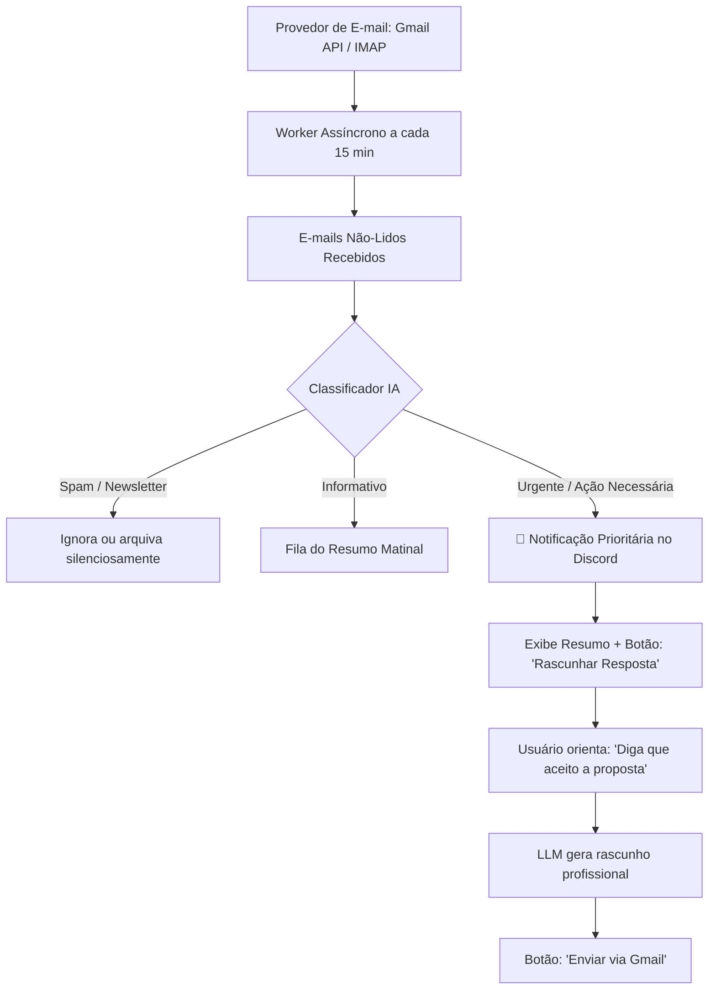

# Especificação de Ideia de Módulo: Gestão Inteligente de E-mails & Inbox Zero (Gmail / IMAP)

**Código da Proposta:** `IDEA-19`  
**Status:** Proposto / Refinado via `idea_generator` (Produtividade Executiva )  
**Impacto:** Conecta o bot à caixa de entrada do usuário para filtrar e resumir mensagens prioritárias, descartar spams e redigir rascunhos de resposta diretamente pelo Discord.

---

## 1. Origem e Validação no Pipeline `idea_generator`

Esta especificação foi submetida e processada pelo pipeline multi-agente da skill **`idea_generator`**:

1. **💡 Geração Criativa (`Ideator`):**
   O módulo IDEA-19 transforma o bot do Discord em um assistente executivo focado em produtividade e Inbox Zero. Utilizando a infraestrutura OAuth2 já validada pelo Google Calendar, o sistema realiza varreduras periódicas (polling ou webhooks) via Gmail API / IMAP, classifica os e-mails com IA (separando ruído, newsletters e urgências), entrega resumos contextualizados diretamente no Discord e permite criar rascunhos de resposta em um clique, eliminando a ansiedade da caixa de entrada.

2. **😈 Análise Crítica (`Devil's Advocate`):**
   Grandes riscos operacionais e de segurança. A leitura e gravação em caixas de e-mail expõem o bot a vazamentos de dados sensíveis (PII, credenciais, segredos corporativos) armazenados no histórico de mensagens do Discord se houver vazamento de canais. Há também o risco de alucinação da IA ao redigir respostas automáticas comprometedoras em nome do usuário. O custo de tokens de LLM para processar longas threads de e-mail em escala pode estourar o orçamento, além de gargalos de performance e rate limits agressivos da API do Gmail se o polling for mal configurado.

3. **🏆 Defesa Estratégica (`Champion`):**
   Esta é a feature matadora definitiva para elevar o bot de um simples utilitário de chat para um agente de produtividade indispensável no dia a dia de executivos e desenvolvedores. A reutilização do OAuth2 do Google Calendar reduz drasticamente o atrito de implementação. O apelo de retenção é altíssimo: usuários que centralizam sua gestão diária de prioridades no Discord reduzem a necessidade de alternar contextos ('context switching'), tornando o bot o hub central de seu trabalho diário.

4. **⚖️ Veredito do Gatekeeper & Mitigação:**
   * **Status:** `[APROVADA]`
   * **Diretrizes e Condicionantes:** Aprovado sob rigorosas condições de segurança e privacidade. O módulo possui altíssimo valor estratégico e alavanca componentes já existentes. Condicionantes obrigatórias: 1) Proibição absoluta de envio automático de e-mails (apenas criação de rascunhos 'Drafts' na API do Gmail); 2) Isolação estrita das interações em canais DM (Direct Message) ou threads privadas por usuário, nunca em canais públicos do Discord; 3) Implementação estrita de escopos OAuth mínimos necessários e mascaramento de dados sensíveis antes do envio para o LLM.

5. **✍️ Síntese do Editor (`Editor/Enricher`):**
   O módulo IDEA-19 foi validado e estruturado para execução segura. Plano de Mitigação: O worker assíncrono processará apenas metadados e trechos curtos em canais privados (DMs). A IA atuará estritamente como triadora e geradora de rascunhos via Gmail Drafts API, exigindo confirmação manual e final do usuário na interface do próprio e-mail ou via botão auditado no Discord. Próximos passos: Implementar escopos do Gmail no fluxo OAuth2 existente, construir o worker de varredura com cache local para evitar rate limits e desenvolver a interface de interação segura em DM.

---

## 2. Justificativa e Motivação

Profissionais recebem dezenas ou centenas de e-mails diariamente, dos quais mais de 80% são notificações automáticas, newsletters e mensagens de baixa relevância. Abrir a caixa de entrada várias vezes ao dia fragmenta o foco e gera estresse (*Inbox Anxiety*).

Como o bot já possui a infraestrutura de autenticação Google OAuth2 configurada (`credentials.json` e `token.json` do Google Calendar), expandir as permissões para o Gmail (ou suporte a IMAP genérico) permite que a IA atue como uma secretária executiva: ela lê a caixa de entrada, identifica o que é genuinamente urgente, resume os tópicos centrais e prepara minutas de resposta para aprovação em um clique.

---

## 3. Arquitetura Proposta



---

## 4. Comandos de Usuário

- **`!emails [limite]`**: Exibe os e-mails prioritários não-lidos com remetente, assunto e resumo executivo de 1 frase.
- **`!email ler <id>`**: Exibe o conteúdo completo decodificado e sem poluição de tags HTML.
- **`!email responder <id> <suas orientações>`**: Gera uma resposta polida e envia ou salva na pasta de Rascunhos do Gmail.
- **`!email arquivar <id>`**: Marca o e-mail como lido e arquiva.

---

## 5. Ferramentas da LLM (Function Calling)

1. `listar_emails_prioritarios(max_resultados: int = 5) -> List[Dict[str, str]]`
2. `ler_conteudo_email(email_id: str) -> Dict[str, Any]`
3. `criar_rascunho_resposta(email_id: str, texto_resposta: str)`
4. `enviar_email(destinatario: str, assunto: str, corpo: str)`

---

## 6. Configurações em `.env`

```ini
EMAIL_INTEGRATION_ENABLED=true
EMAIL_PROVIDER=gmail # ou imap
GMAIL_CREDENTIALS_FILE=discord/credentials.json
GMAIL_TOKEN_FILE=discord/token.json
EMAIL_POLL_INTERVAL_MINUTES=15
EMAIL_FILTER_NEWSLETTERS=true
```
