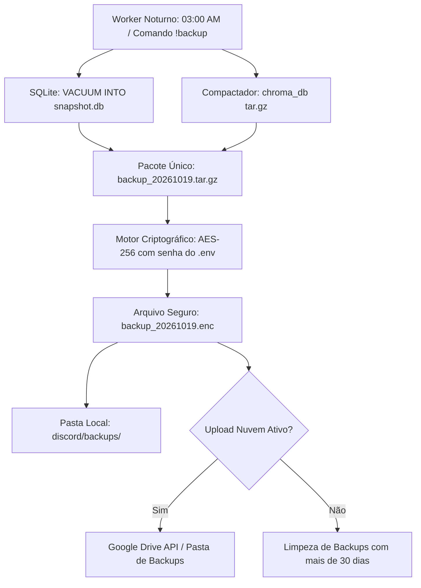

# Especificação de Ideia de Módulo: Backup Automático Criptografado & Recuperação (Disaster Recovery)

**Código da Proposta:** `IDEA-21`  
**Status:** Proposto / Refinado via `idea_generator` (Resiliência & Segurança )  
**Impacto:** Protege todo o conhecimento acumulado (banco SQLite, vetores ChromaDB e catálogo de PDFs) com snapshots diários compactados e criptografados.

---

## 1. Origem e Validação no Pipeline `idea_generator`

Esta especificação foi submetida e processada pelo pipeline multi-agente da skill **`idea_generator`**:

1. **💡 Geração Criativa (`Ideator`):**
   O módulo IDEA-21 introduz uma rotina silenciosa de 'Hot Backup' que assegura a integridade total do ecossistema do bot do Discord. Utilizando 'VACUUM INTO' para o SQLite e compactação de diretórios para o ChromaDB, o sistema gera snapshots diários automatizados às 03:00 AM, aplica criptografia ponta a ponta (AES-256 / Fernet) utilizando chaves isoladas do ambiente (.env) e realiza o upload opcional para a nuvem (Google Drive), garantindo resiliência operacional absoluta contra falhas catastróficas de hardware.

2. **😈 Análise Crítica (`Devil's Advocate`):**
   Riscos críticos identificados: 1) O uso de 'VACUUM INTO' em bancos SQLite muito grandes pode causar picos de I/O em disco e estouro de memória temporária. 2) A compactação síncrona do ChromaDB (milhares de arquivos pequenos) pode travar a thread principal se não executada em background worker assíncrono. 3) Gerenciamento de credenciais do Google Drive mal configurado pode expor tokens de acesso. 4) Falta de testes automatizados de restauração (Drill de Disaster Recovery), criando uma falsa sensação de segurança ('Schrödinger's backup').

3. **🏆 Defesa Estratégica (`Champion`):**
   Apesar dos riscos, a retenção rotativa de 7 dias combinada com criptografia forte é um diferencial competitivo massivo para bots corporativos ou de comunidades avançadas que não podem perder histórico de conhecimento vetorial (ChromaDB). O impacto na retenção de usuários é direto: a confiança de que os dados estão blindados contra corrupção e desastres posiciona o bot como um produto de nível enterprise. O custo computacional noturno (03:00 AM) é perfeitamente tolerável pelo baixo tráfego.

4. **⚖️ Veredito do Gatekeeper & Mitigação:**
   * **Status:** `[APROVADA]`
   * **Diretrizes e Condicionantes:** Aprovado sob rigorosas condições técnicas. Prós superam os contras pela criticidade de dados vetoriais acumulados. Condicionantes obrigatórias: 1) Execução estrita em ThreadPoolExecutor separada para evitar bloqueio do asyncio loop. 2) Implementação de um comando de teste de integridade ('!verify_backup'). 3) Rotação automática estrita para apagar arquivos locais com mais de 7 dias e evitar estouro de armazenamento do host.

5. **✍️ Síntese do Editor (`Editor/Enricher`):**
   O IDEA-21 foi saneado e promovido à especificação final de produção. O plano de mitigação inclui: isolamento da rotina de I/O intensiva em workers assíncronos, validação obrigatória da integridade do arquivo compactado antes da aplicação da criptografia AES-256 (Fernet), logs detalhados de auditoria de sucesso/falha enviados a um canal de administração privado no Discord, e documentação clara para o procedimento manual de restore em caso de falha crítica.

---

## 2. Justificativa e Motivação

À medida que o bot evolui, ele acumula dados vitais: memórias de longo prazo no ChromaDB, registros de compromissos, listas de compras, histórico conversacional, catálogo de livros e preferências individuais. Uma pane de hardware, corrupção de partição ou exclusão acidental causaria uma perda irreparável da base de conhecimento.

Este módulo implementa uma rotina silenciosa de **Backup Quente (*Hot Backup*)**:
1. Executa snapshot não-bloqueante do SQLite via comando oficial `VACUUM INTO`.
2. Compacta o banco de dados e os índices do ChromaDB.
3. Criptografa o arquivo com criptografia de ponta a ponta (`AES-256 / Fernet`).
4. Armazena localmente em pasta isolada ou faz upload automático para o Google Drive.

---

## 3. Arquitetura do Ciclo de Backup



---

## 4. Comandos de Usuário

- **`!backup agora`**: Dispara manualmente a criação imediata de um ponto de restauração.
- **`!backup listar`**: Mostra os últimos 5 backups criados com data, tamanho do arquivo e status de integridade.
- **`!backup restaurar <data>`**: Restaura o estado do banco e dos vetores para uma data específica (requer confirmação de segurança com código PIN).

---

## 5. Política de Retenção e Segurança

- **Rotação Automática:** Mantém os últimos 7 backups diários, os últimos 4 backups semanais e os últimos 3 backups mensais (*Grandfather-Father-Son*).
- **Sem Interrupção do Bot:** Utiliza as APIs assíncronas e snapshots do SQLite sem derrubar o bot do Discord nem travar respostas de chat.
- **Criptografia Forte:** Mesmo que o arquivo de backup seja exposto ou vazado, nenhuma conversa ou memória poderá ser lida sem a chave `BACKUP_ENCRYPTION_KEY`.

---

## 6. Ferramentas da LLM (Function Calling)

1. `gerar_ponto_restauracao_backup()`
2. `verificar_integridade_backups()`

---

## 7. Configurações em `.env`

```ini
BACKUP_ENABLED=true
BACKUP_SCHEDULE_CRON=0 3 * * * # Todo dia às 03:00 da manhã
BACKUP_STORAGE_DIR=discord/backups/
BACKUP_ENCRYPTION_KEY=sua_chave_fernet_secreta_base64
BACKUP_RETENTION_DAYS=30
BACKUP_UPLOAD_GOOGLE_DRIVE=false
```
