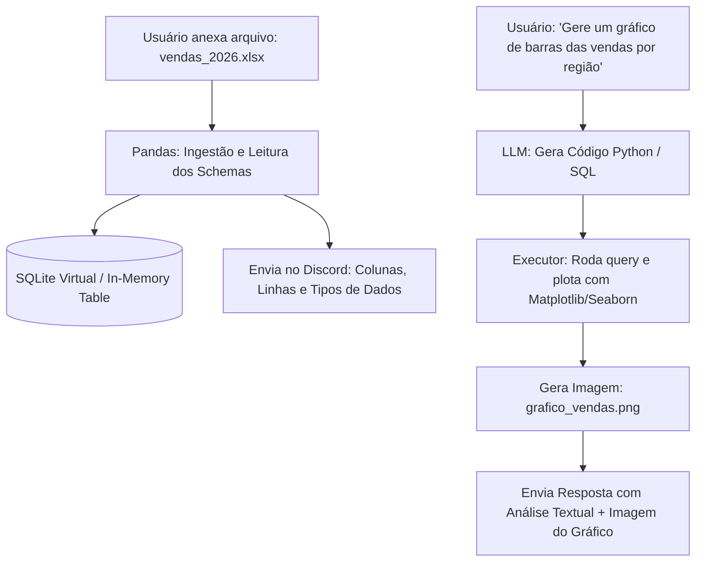

# Especificação de Ideia de Módulo: Analista de Dados Pessoal (Ingestão de CSV/Excel, SQL Dinâmico e Gráficos)

**Código da Proposta:** `IDEA-22`  
**Status:** Proposto / Refinado via `idea_generator` (Produtividade & Inteligência de Negócios )  
**Impacto:** Permite anexar arquivos `.csv` e planilhas `.xlsx` no Discord para fazer perguntas analíticas em linguagem natural e gerar gráficos estatísticos automaticamente.

---

## 1. Origem e Validação no Pipeline `idea_generator`

Esta especificação foi submetida e processada pelo pipeline multi-agente da skill **`idea_generator`**:

1. **💡 Geração Criativa (`Ideator`):**
   O módulo IDEA-22 transforma o Discord em um Business Intelligence interativo e sob demanda. Através da ingestão de arquivos CSV e XLSX, a IA utiliza um banco de dados em memória (DuckDB/SQLite) combinado com motores de visualização (como Matplotlib/Plotly) para permitir que qualquer usuário interaja com dados tabulares estruturados usando linguagem natural. A proposta de valor central é eliminar a fricção da análise tradicional de planilhas: o usuário arrasta o arquivo, faz uma pergunta de negócios ou pede um gráfico e recebe a resposta imediata, democratizando a tomada de decisão baseada em dados dentro da comunidade do Discord.

2. **😈 Análise Crítica (`Devil's Advocate`):**
   Do ponto de vista técnico e de segurança, o IDEA-22 apresenta riscos severos. Primeiro: vazamento de dados e conformidade com LGPD/GDPR — servidores do Discord podem ser públicos ou semi-públicos, e usuários podem fazer upload acidental de PII (dados pessoais identificáveis) ou dados financeiros confidenciais. Segundo: estouro de memória (OOM) e ataques de negação de serviço (DoS) via arquivos massivos (ex: CSVs maliciosos de 2GB com linhas infinitas ou arquivos zipados com bombas de descompressão). Terceiro: execução de código malicioso via injeção de SQL através de prompts maliciosos (SQLi em linguagem natural) ou vulnerabilidades na interpretação de fórmulas/macros legadas em arquivos .xlsx (XXE/vulnerabilidades de parser). Quarto: custos de infraestrutura para processamento pesado em memória e renderização gráfica.

3. **🏆 Defesa Estratégica (`Champion`):**
   Apesar dos riscos, o IDEA-22 é uma alavanca formidável de retenção e monetização (perfeito para planos Premium/Enterprise do Bot). Ferramentas de BI tradicionais exigem cadastros, curvas de aprendizado e licenças caras. Trazer essa capacidade para o ecossistema do chat onde o usuário já trabalha gera um 'aha moment' imediato. Servidores corporativos, comunidades de cripto, analistas financeiros e criadores de conteúdo usam o Discord intensamente e carecem de ferramentas rápidas de análise ad-hoc. Com o isolamento correto de recursos, este módulo pode se tornar o principal vetor de conversão para assinaturas pagas do bot.

4. **⚖️ Veredito do Gatekeeper & Mitigação:**
   * **Status:** `[APROVADA]`
   * **Diretrizes e Condicionantes:** Aprovado sob condições estritas de segurança e arquitetura. Prós: alto valor percebido, utilidade prática inegável, excelente diferencial competitivo. Contras: riscos severos de vazamento de dados, estouro de memória e injeção. Condicionantes obrigatórias: 1) Limite estrito de tamanho de arquivo (ex: máximo de 10MB ou 100.000 linhas); 2) Processamento estritamente isolado em containers efêmeros (sandboxing) ou bancos de dados em memória voláteis com autodestruição imediata pós-sessão; 3) Aviso obrigatório de LGPD/Privacidade no primeiro upload de cada usuário; 4) Uso de DuckDB (altamente otimizado para analítica) em vez de SQLite puro; 5) Validação rigorosa de prompts para evitar SQL Injection via linguagem natural.

5. **✍️ Síntese do Editor (`Editor/Enricher`):**
   Síntese executiva do Editor: O módulo IDEA-22 passa a ser estruturado sob a alcunha de 'Personal Data Analyst'. Plano de mitigação implementado: 1) Camada de Limpeza e Sanitização que remove macros e dados binários perigosos de arquivos XLSX antes do parsing; 2) Motor baseado em DuckDB com limite de consumo de RAM por query e timeout rígido de 5 segundos; 3) Política de retenção zero (os arquivos e tabelas temporárias são apagados da memória imediatamente após a entrega do gráfico/resposta ou após 15 minutos de inatividade); 4) Resposta padrão com aviso de privacidade e opção para exclusão imediata dos metadados. Próximos passos: prototipagem do parser seguro com DuckDB/Pandas e testes de estresse de memória com arquivos limites.

---

## 2. Justificativa e Motivação

Planilhas continuam sendo o formato universal de troca de dados no mundo dos negócios (vendas, orçamentos, métricas de marketing, cadastros de clientes). No entanto, manipular tabelas dinâmicas, escrever fórmulas `PROCV`/`XLOOKUP` e desenhar gráficos no Excel consome tempo precioso.

Ao permitir que o usuário simplesmente arraste uma planilha para o chat do Discord e faça perguntas em linguagem natural — *"Qual foi o produto com maior margem no segundo trimestre?"* ou *"Plote um gráfico de linhas do faturamento mensal"* —, a IA carrega os dados no SQLite/Pandas, executa a consulta analítica e devolve a resposta acompanhada do gráfico pronto em imagem de alta resolução.

---

## 3. Arquitetura Proposta



---

## 4. Capacidades e Comandos

### 3.1 Ingestão Automática por Anexo
- Ao receber qualquer arquivo `.csv` ou `.xlsx`, o bot faz a leitura e responde imediatamente:
  > 📊 **Planilha Carregada:** `vendas_2026.xlsx`  
  > • **Linhas:** 1.420 | **Colunas (5):** `data`, `cliente`, `regiao`, `produto`, `valor_total`  
  > *Você já pode me fazer perguntas sobre esta tabela ou pedir gráficos!*

### 3.2 Comandos com Prefixo
- **`!dados tabelas`**: Lista as tabelas e planilhas ativas prontas para consulta.
- **`!dados esquema <tabela>`**: Exibe o dicionário de dados (colunas, tipos e valores únicos).
- **`!grafico <instrução>`**: Atalho direto para renderização visual (ex: `!grafico pizza da distribuição de vendas por região`).

---

## 5. Ferramentas da LLM (Function Calling)

1. `consultar_dados_planilha_sql(tabela: str, query_sql: str) -> List[Dict[str, Any]]`
2. `gerar_grafico_estatistico(tabela: str, tipo_grafico: str, coluna_x: str, coluna_y: str, titulo: str) -> str (caminho da imagem)`
3. `obter_estatisticas_descritivas(tabela: str, coluna: str) -> Dict[str, float]`

---

## 6. Medidas de Segurança

- **Ambiente Restrito:** Consultas executadas apenas em modo `SELECT` contra o banco em memória (sem permissão de `DROP`, `DELETE` ou comandos do sistema operacional).
- **Limpeza Automática:** Tabelas em memória e gráficos temporários são descartados após 24 horas de inatividade.

---

## 7. Configurações em `.env`

```ini
DATA_ANALYST_ENABLED=true
DATA_MAX_FILE_SIZE_MB=25
DATA_CHART_STYLE=seaborn-v0_8-darkgrid
DATA_CHART_DPI=150
```
