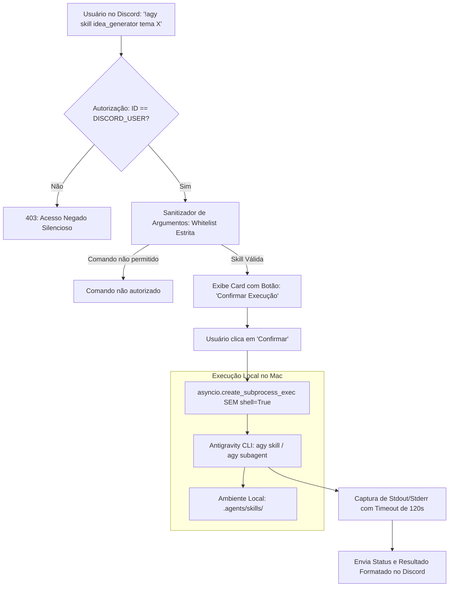

# Especificação de Ideia de Módulo: Execução Local Segura de Agentes e Skills via AGY CLI (Antigravity Remote Runner)

**Código da Proposta:** `IDEA-23`  
**Status:** Proposto / Refinado via `idea_generator` (Prioridade Alta)  
**Impacto:** Permite disparar skills locais e subagentes do Google Antigravity através do Discord a partir de qualquer dispositivo móvel, com blindagem estrita contra injeção de comandos.

---

## 1. Origem e Validação no Pipeline `idea_generator`

Esta especificação foi submetida e processada pelo pipeline multi-agente da skill **`idea_generator`**:

1. **💡 Geração Criativa (`Ideator`):** Concebeu a ponte entre a onipresença do Discord e o poder do hardware local, transformando o bot em um controle remoto para o ecossistema `agy` (Antigravity CLI).
2. **😈 Análise Crítica (`Devil's Advocate`):** Apontou que a execução de comandos de terminal livres criaria um risco crítico de Execução Remota de Código (RCE), vulnerabilidade a *Prompt Injection* e instabilidade caso comandos travassem o terminal.
3. **🏆 Defesa Estratégica (`Champion`):** Destacou a eficiência do modelo *Bring Your Own Hardware* (BYOH), a eliminação de túneis complexos de SSH/VPN e a comodidade de disparar automações pesadas enquanto o usuário está longe do computador.
4. **⚖️ Veredito do Gatekeeper & Mitigação:** A proposta inicial de comandos arbitrários de shell foi **lapidada** para proibir expressamente `shell=True`, exigindo **whitelisting rigoroso de skills**, autorização estrita por ID de usuário (`DISCORD_USER`) e confirmação interativa de segurança.

---

## 2. Arquitetura Segura Proposta



---

## 3. Diretrizes de Blindagem e Segurança (Hardening)

Para garantir segurança absoluta contra vazamentos ou ataques remotos:
1. **Sem Execução Arbitrária de Shell:** O bot **nunca** executa comandos livres como `rm`, `curl`, `bash`, `python -c` ou qualquer string passada pelo chat.
2. **Whitelist Estrita de Subcomandos do `agy`:** Apenas subcomandos explicitamente permitidos podem ser invocados:
   - `agy skill list` (lista skills instaladas no workspace).
   - `agy skill run <nome_da_skill> [argumentos_sanitizados]` (executa uma skill homologada).
   - `agy status` (verifica o estado dos agentes e tarefas).
3. **Isolamento de Processo (`shell=False`):** As chamadas utilizam `asyncio.create_subprocess_exec("agy", *args_list)`, impedindo encadeamentos de comandos (`&&`, `;`, `|`).
4. **Verificação de Identidade Inegociável:** O comando só responde se `str(message.author.id) == str(DISCORD_USER)`. Qualquer outro membro do servidor recebe uma mensagem de recusa.
5. **Timeout com *Graceful Kill*:** Se a skill ou agente demorar mais de 120 segundos sem retorno, o processo filho é encerrado com `SIGTERM` para evitar travamento de recursos no Mac.

---

## 4. Comandos de Usuário no Discord

- **`!agy skills`**: Lista as skills disponíveis na pasta `.agents/skills/` do workspace com suas descrições.
- **`!agy executar <skill> [argumentos]`** (ou `!agy run`): Dispara a execução da skill no ambiente local e transmite o progresso no Discord.
  *Exemplo:* `!agy executar idea_generator Plataforma de micro-cursos de culinária`
- **`!agy status`**: Verifica tarefas em segundo plano e uso de recursos do Antigravity.
- **`!agy abortar`**: Envia sinal de interrupção para qualquer processo `agy` em execução disparado pelo bot.

---

## 5. Ferramentas da LLM (Function Calling)

1. `listar_skills_antigravity_locais() -> List[Dict[str, str]]`: Consulta as skills registradas em `.agents/skills/`.
2. `disparar_execucao_agy_skill(nome_skill: str, parametros: str) -> Dict[str, Any]`: Executa a skill validada em subprocesso seguro e retorna o relatório estruturado.

---

## 6. Configurações em `.env`

```ini
# Habilita o executor remoto do Antigravity CLI
AGY_REMOTE_RUNNER_ENABLED=true
AGY_CLI_BINARY_PATH=/Users/rodrigomodel/.gemini/antigravity-ide/bin/agy # ou agy no PATH
AGY_ALLOWED_SKILLS=idea_generator,hello-world
AGY_EXECUTION_TIMEOUT_SECONDS=120
AGY_REQUIRE_BUTTON_CONFIRMATION=true
```
