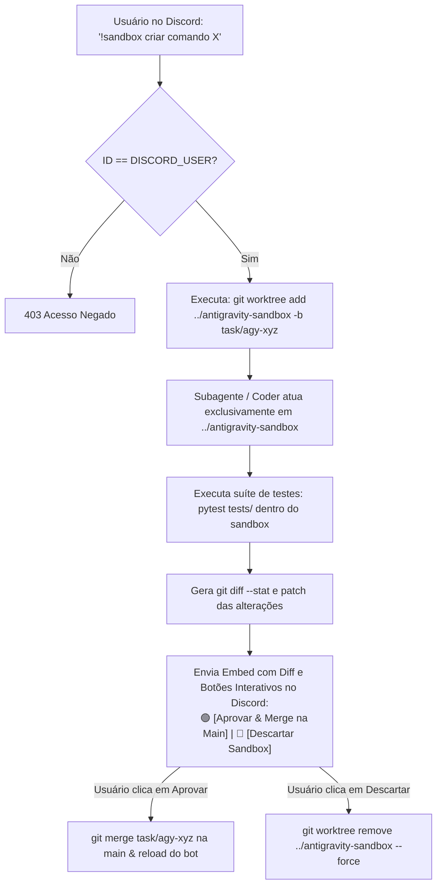

# Especificação de Ideia de Módulo: Execução e Edição de Código via Git Worktree Sandbox

**Código da Proposta:** `IDEA-24`  
**Status:** Proposto / Planejado (Prioridade Alta)  
**Impacto:** Permite disparar tarefas de codificação e geração de features pelo Discord com isolamento total em um sandbox `git worktree`, testes automáticos prévios e aprovação humana interativa antes de qualquer merge na branch principal.

---

## 1. Origem e Validação Arquitetural

Desacoplada da `IDEA-23` por diretriz soberana do Arquiteto-Chefe:
- **Problema:** Permitir que agentes alterem arquivos diretamente no diretório do bot em execução cria risco iminente de corrupção de código, travamento do loop de eventos ou modificações não auditadas.
- **Solução Arquitetural:** Empregar o recurso nativo `git worktree` para criar cópias de trabalho efêmeras e isoladas em outra pasta (ex: `../antigravity-sandbox/`), associadas a uma branch descartável (`task/agy-<uuid>`).

---

## 2. Fluxo do Sandbox Git Worktree

---

## 3. Diretrizes de Segurança & Blast Radius

1. **Isolamento Físico de Diretório:** O processo de codificação roda apontando seu working directory para `../antigravity-sandbox/`.
2. **Proteção de Segredos:** O arquivo `.env` com tokens reais nunca é comitado nem exposto no diff enviado ao Discord.
3. **Invariante de Testes:** Se a suíte de testes quebrar dentro do sandbox, o botão de merge é bloqueado e o erro é reportado.
4. **Decisão Humana Soberana:** Nenhum código do sandbox é mesclado na branch `main` sem o clique confirmatório do Arquiteto-Chefe.
