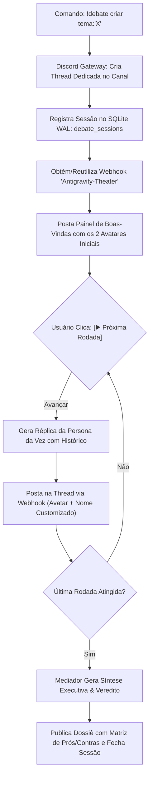

# Especificação de Ideia de Módulo: Arena Dialética Multiagente em Threads do Discord

**Código da Proposta:** `IDEA-30`  
**Status:** Proposto / Refinado via `/brainstorm` (Prioridade Alta)  
**Impacto:** Permite instanciar duelos dialéticos e debates argumentativos estruturados entre duas ou mais personas dentro de uma Thread do Discord, utilizando Webhooks com avatares e nomes personalizados, controle passo a passo via botões interativos e síntese executiva final de apoio à tomada de decisão.

---

## 1. Origem e Validação no Pipeline Dialético

Esta especificação foi concebida e refinada pela Mesa de Discussão Multiagente:
1. **Identificação da Dor:** Solidão e lentidão na tomada de decisões técnicas, de produto ou de arquitetura por parte de desenvolvedores solo e tech leads.
2. **Mitigações de Red Team (`/critic`):** Prevenção de estouro de limites do Discord (evitando criar múltiplos webhooks por canal e prevenindo botões zumbis por timeout) e blindagem contra *model drift* (subserviência das LLMs que concordam precocemente).
3. **Solução Pragmática (`/hacker`):** Uso de um único Webhook reutilizável no canal pai com override dinâmico de `username` e `avatar_url` por postagem na Thread, aliado a Views persistentes (`timeout=None`) no SQLite WAL.
4. **Alavancagem de Negócio (`/impact`):** Transformação do Discord em uma Banca de Consultoria Técnica Instantânea onde o usuário assiste a argumentos de alto nível antes de decidir.
5. **Ergonomia Visual (`/ux_designer`):** Condução assistida passo a passo via botões `[▶️ Próxima Rodada]`, `[✍️ Injetar Opinião]` (Modal nativo) e `[🛑 Encerrar & Sintetizar]`. Padrão imediato com duas personas consolidadas: 🏛️ Arquiteto Sênior e 💻 Hacker Pragmático.

---

## 2. Justificativa e Motivação

O ecossistema dispõe de um módulo de personas ([`MOD-VIS-15`](file:///Users/rodrigomodel/antigravity/discord/SPECs/modulos_visiveis/15_PERSONAS_E_OVERRIDES_POR_CANAL.md)), mas sua operação era até então estritamente isolada e reativa a comandos individuais. A `IDEA-30` eleva essa capacidade ao permitir que duas personas colidam argumentos em tempo real sobre um tema proposto, acelerando a ideação e fornecendo ao Arquiteto-Chefe visões contrastantes sobre qualquer dilema de engenharia.

---

## 3. Arquitetura Proposta & Ciclo de Vida da Sessão



---

## 4. Esquema de Dados (SQLite WAL)

Tabela `debate_sessions` gerida em `discord/database.py`:

```sql
CREATE TABLE IF NOT EXISTS debate_sessions (
    id TEXT PRIMARY KEY, -- UUID da sessão
    thread_id TEXT NOT NULL UNIQUE,
    guild_id TEXT NOT NULL,
    channel_id TEXT NOT NULL,
    creator_id TEXT NOT NULL,
    topic TEXT NOT NULL,
    persona_a TEXT NOT NULL DEFAULT 'Arquiteto',
    persona_b TEXT NOT NULL DEFAULT 'Hacker',
    current_round INTEGER NOT NULL DEFAULT 0,
    max_rounds INTEGER NOT NULL DEFAULT 3,
    status TEXT NOT NULL DEFAULT 'IN_PROGRESS', -- 'IN_PROGRESS', 'PAUSED', 'COMPLETED'
    created_at TIMESTAMP DEFAULT CURRENT_TIMESTAMP,
    updated_at TIMESTAMP DEFAULT CURRENT_TIMESTAMP
);

CREATE TABLE IF NOT EXISTS debate_messages (
    id INTEGER PRIMARY KEY AUTOINCREMENT,
    session_id TEXT NOT NULL,
    speaker_persona TEXT NOT NULL,
    round_number INTEGER NOT NULL,
    content TEXT NOT NULL,
    created_at TIMESTAMP DEFAULT CURRENT_TIMESTAMP,
    FOREIGN KEY (session_id) REFERENCES debate_sessions(id) ON DELETE CASCADE
);

CREATE INDEX IF NOT EXISTS idx_debate_thread ON debate_sessions(thread_id);
```

---

## 5. Comandos e Ferramentas Propostas

### Comandos de Chat (Prefixo `!`)
* `!debate criar tema:"..." [personas:A,B] [rodadas:3]`: Abre uma nova Thread e inicializa o debate com os avatares padrão (Arquiteto e Hacker) ou personalizados.
* `!debate listar`: Exibe os debates em andamento ou recentemente concluídos no servidor.
* `!debate encerrar`: Força a finalização imediata do debate na Thread atual e aciona a síntese executiva.

### Componentes de Interface (`discord.ui`)
* `DebateControlView`: View persistente com botões `[▶️ Próxima Rodada]`, `[✍️ Injetar Opinião]` e `[🛑 Encerrar & Sintetizar]`.
* `InjectOpinionModal`: Modal para o usuário enviar diretrizes intermediárias para os debatedores.

### Ferramentas da LLM (*Function Calling*)
* `iniciar_arena_dialetica(tema: str, persona_a: str, persona_b: str, rodadas: int = 3) -> dict`: Permite à IA abrir autonomamente uma Thread de debate quando o usuário solicitar confronto de ideias.
