# Especificação de Ideia de Módulo: Análise Inteligente, Sumarização e RAG de Livros/PDFs

**Código da Proposta:** `IDEA-06`  
**Status:** ✅ **ENTREGUE / EM PRODUÇÃO (v2.6.0)**  
**Módulo Oficial:** Veja a especificação ativa em [`../modulos_visiveis/09_LEITURA_INTELIGENTE_E_RAG_PDFS.md`](file:///Users/rodrigomodel/antigravity/discord/SPECs/modulos_visiveis/09_LEITURA_INTELIGENTE_E_RAG_PDFS.md)  
**Impacto:** Converte o armazenamento passivo de PDFs em um ecossistema ativo de leitura assistida, extração de metadados, navegação por capítulos e conversação com livros via RAG vetorial.  

---

## 1. Justificativa e Motivação

Atualmente, o módulo de PDFs (`modulos_visiveis/05_ARQUIVOS_E_PDFS.md`) opera prioritariamente como um repositório de arquivos: salva os PDFs enviados pelo usuário em `pdf/{user}/`, lista os nomes salvos (`!pdfs`) e disponibiliza o arquivo de volta quando solicitado (`!enviar`).

No entanto, livros, manuais e artigos técnicos contêm dezenas ou centenas de páginas que não cabem na janela de contexto de modelos locais de linguagem (como Qwen 9B ou Llama 8B). Para tornar esses documentos úteis, o bot necessita de inteligência analítica dividida em duas etapas:
1. **Pré-processamento rápido na recepção do arquivo:** Leitura de metadados (autor, título, páginas) e detecção da estrutura de seções/capítulos sem sobrecarregar a CPU.
2. **Processamento e síntese sob demanda:** Geração de resumos de capítulos selecionados e indexação semântica no ChromaDB para conversação interativa (*chat com o livro* via RAG).

---

## 2. Arquitetura do Módulo em Duas Fases

```mermaid
flowchart TD
    subgraph Fase 1: Recepção e Pré-Processamento Leve
        Upload[Usuário anexa arquivo PDF no Discord] --> SaveDisk[Salva em discord/pdf/user/livro.pdf]
        SaveDisk --> PyMuPDF[Extração Leve via PyMuPDF / fitz]
        PyMuPDF --> MetaExtract[Coleta: Título, Autor, Páginas, Sumário TOC]
        PyMuPDF --> IntroSample[Lê primeiras 2-3 páginas para Sinopse Inicial]
        MetaExtract & IntroSample --> SaveSQLite[(SQLite: user_pdf_documents)]
        SaveSQLite --> ConfirmDiscord[Bot confirma: 'PDF recebido! 250 páginas, 12 capítulos identificados']
    end

    subgraph Fase 2: Processamento e Consulta Sob Demanda
        UserAction{Usuário solicita ação}
        
        UserAction -->|!pdf info / metadados| ReadMeta[Lê SQLite e exibe dados da obra]
        UserAction -->|!pdf sumario / capitulos| ReadTOC[Exibe árvore de capítulos e páginas]
        
        UserAction -->|!pdf capitulo N| ChapterSummary[Extrai páginas do Capítulo N]
        ChapterSummary --> LLMSummarize[LLM sintetiza pontos-chave do capítulo]
        LLMSummarize --> OutputChapter[Exibe resumo do capítulo no Discord / Áudio]
        
        UserAction -->|!pdf indexar ou perguntar| CheckIndexed{Já está no RAG?}
        CheckIndexed -->|Não| ChunkAndEmbed[Divide em Chunks de 800 tokens + Embeddings LM Studio]
        ChunkAndEmbed --> ChromaPDF[(ChromaDB: Coleção pdf_user_doc)]
        CheckIndexed -->|Sim| SearchChroma[Busca Semântica no Livro via Cosseno]
        ChromaPDF --> SearchChroma
        SearchChroma --> RAGPrompt[Injeta trechos mais relevantes + Citação de Páginas]
        RAGPrompt --> LLMResponse[LLM responde dúvidas com precisão sobre o livro]
    end
```



---

## 3. Funcionalidades Detalhadas

### 3.1 Fase 1: Pré-Processamento na Ingestão (Imediato)
Ao receber um PDF anexado no Discord:
* **Extração Instantânea de Metadados:**
  * Nome do arquivo, título do documento (dos metadados PDF ou da primeira página).
  * Autor / Criador (se presente).
  * Contagem total de páginas e tamanho do arquivo.
* **Detecção Estrutural (Sumário / TOC):**
  * Extração de bookmarks nativos (*Table of Contents* do PDF) mapeando `Capítulo -> Página Inicial`.
  * Caso não haja bookmarks embutidos, aplicação de heurística rápida nas primeiras páginas procurando linhas com padrões (*"Capítulo 1"*, *"Sumário"*, *"Seção"*).
* **Persistência Estruturada:**
  * Os dados são gravados no SQLite na tabela `user_pdf_documents` e os capítulos na tabela `user_pdf_chapters`.
  * Nenhum embedding pesado é gerado nesta fase, mantendo o recebimento do arquivo rápido e econômico em termos de computação.

---

### 3.2 Fase 2: Consultas Estruturadas & Sumarização de Capítulos
O usuário pode navegar na obra progressivamente:
* **Metadados e Visão Geral:** O bot apresenta uma ficha catalográfica elegante com autor, total de páginas, data e uma sinopse preliminar gerada a partir da introdução.
* **Sumário Navegável:** Exibe a lista de capítulos identificados com suas respectivas páginas de início e término.
* **Resumo por Capítulo:** Quando o usuário pede *"resuma o capítulo 3"* ou *"do que fala o capítulo sobre variáveis?"*:
  1. O sistema localiza o intervalo de páginas daquele capítulo (ex: páginas 45 a 68).
  2. Extrai o texto contido estritamente naquele intervalo.
  3. Envia para a LLM com um prompt focado em extrair: *tese principal*, *argumentos-chave*, *exemplos práticos* e *conclusão*.
  4. Permite envio multimodal (texto no Discord ou narração em áudio pela voz Francisca).

---

### 3.3 Fase 3: RAG Vetorial Dedicado por Livro (*Chat com o Livro*)
Para responder a perguntas livres e profundas sobre qualquer trecho do documento:
* **Vetorização Sob Demanda:**
  * Disparada quando o usuário usa `!pdf indexar <livro>` ou quando formula uma pergunta sobre um livro ainda não indexado.
  * O texto completo do PDF é dividido em blocos (*chunks*) de 600 a 800 tokens com sobreposição (*overlap*) de 100 tokens.
  * Cada chunk recebe metadados: `{pagina: int, capitulo: str, arquivo: str}`.
  * Vetores gravados em coleção dedicada no ChromaDB (ex: `{user}_pdf_{doc_id}`).
* **Recuperação e Geração Aumentada (RAG):**
  * A pergunta do usuário é convertida em embedding pelo LM Studio.
  * Busca vetorial recupera os top 3 a 5 trechos com maior similaridade de cosseno.
  * O prompt instrui o modelo a responder estritamente com base nos trechos recuperados, **citando as páginas de onde as respostas foram extraídas** (ex: *"[Página 54]"*).

---

## 4. Comandos Propostos (`!pdf`)

| Comando | Parâmetros | Descrição |
|---|---|---|
| `!pdf info` | `<nome_arquivo>` | Exibe ficha técnica: título, autor, páginas e resumo inicial. |
| `!pdf sumario` | `<nome_arquivo>` | Lista os capítulos ou seções detectados com suas páginas. |
| `!pdf capitulo` | `<nome_arquivo> <numero_ou_nome>` | Gera um resumo detalhado do capítulo solicitado. |
| `!pdf indexar` | `<nome_arquivo>` | Realiza a ingestão completa do livro no RAG vetorial (ChromaDB). |
| `!pdf perguntar` | `<nome_arquivo> <pergunta>` | Realiza busca semântica no livro e responde com citações de página. |
| `!pdf status` | *(nenhum)* | Exibe todos os PDFs do usuário e indica quais já estão indexados no RAG. |

---

## 5. Ferramentas da LLM Propostas (*Function Calling*)

Para permitir conversação natural sem comandos rígidos:

| Ferramenta | Parâmetros | Descrição |
|---|---|---|
| `consultar_metadados_pdf` | `arquivo: str` | Retorna metadados catalográficos e sinopse inicial da obra. |
| `obter_sumario_pdf` | `arquivo: str` | Retorna a estrutura de capítulos e divisão de seções do PDF. |
| `resumir_capitulo_pdf` | `arquivo: str`, `capitulo: str` | Extrai as páginas do capítulo e gera uma síntese dos pontos centrais. |
| `indexar_pdf_rag` | `arquivo: str` | Prepara e vetoriza o PDF no ChromaDB para consultas semânticas. |
| `consultar_conteudo_pdf_rag` | `arquivo: str`, `pergunta: str`, `capitulo: Optional[str]` | Realiza busca vetorial no conteúdo do livro e responde à pergunta com citação de páginas. |

---

## 6. Modelagem de Dados no SQLite

```sql
-- Tabela principal de documentos PDF catalogados
CREATE TABLE IF NOT EXISTS user_pdf_documents (
    id INTEGER PRIMARY KEY AUTOINCREMENT,
    user_id TEXT NOT NULL,
    filename TEXT NOT NULL,
    filepath TEXT NOT NULL,
    title TEXT,
    author TEXT,
    total_pages INTEGER DEFAULT 0,
    short_summary TEXT,
    is_indexed INTEGER DEFAULT 0,
    created_at DATETIME DEFAULT CURRENT_TIMESTAMP,
    UNIQUE(user_id, filename)
);

-- Tabela de capítulos e estrutura do livro
CREATE TABLE IF NOT EXISTS user_pdf_chapters (
    id INTEGER PRIMARY KEY AUTOINCREMENT,
    doc_id INTEGER NOT NULL,
    chapter_index INTEGER NOT NULL,
    title TEXT NOT NULL,
    start_page INTEGER NOT NULL,
    end_page INTEGER NOT NULL,
    summary TEXT,
    FOREIGN KEY(doc_id) REFERENCES user_pdf_documents(id) ON DELETE CASCADE
);
```

---

## 7. Tecnologias Recomendadas
* **Leitura e Extração de Texto:** `PyMuPDF` (`fitz`) — alta velocidade em C++, extração precisa de bookmarks/TOC e extração de texto por página sem travamentos.
* **Segmentação (*Chunking*):** Divisão lógica com contagem de tokens compatível com modelos Qwen.
* **Armazenamento Vetorial:** `ChromaDB` (já presente na arquitetura do bot).
* **Embeddings:** LM Studio endpoint compatível com OpenAI (já integrado via `vector_db.py`).
