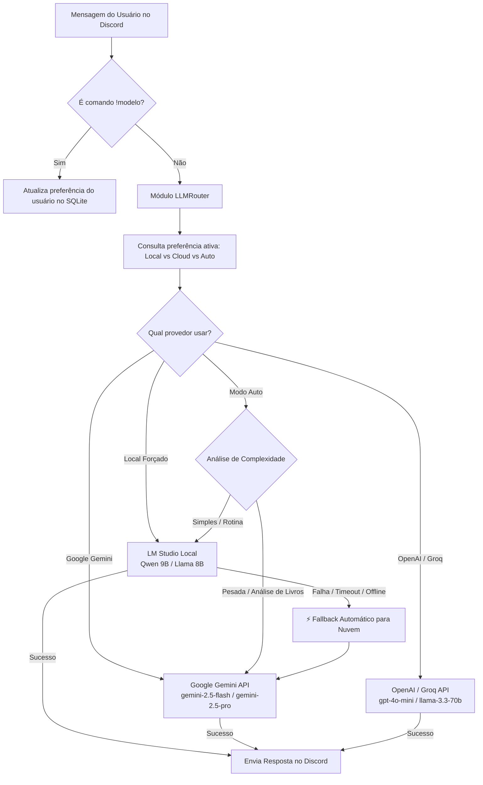

# Especificação de Ideia de Módulo: Roteamento Híbrido de LLMs & Provedores Cloud (Google Gemini / OpenAI / Groq)

**Código da Proposta:** `IDEA-07`  
**Status:** ✅ **ENTREGUE / EM PRODUÇÃO (v2.7.0)**  
**Módulo Oficial:** Veja a especificação ativa em [`../modulos_visiveis/10_ROTEAMENTO_HIBRIDO_E_GOOGLE_GEMINI.md`](file:///Users/rodrigomodel/antigravity/discord/SPECs/modulos_visiveis/10_ROTEAMENTO_HIBRIDO_E_GOOGLE_GEMINI.md)  
**Impacto:** Permite ao usuário alternar dinamicamente entre modelos locais (LM Studio) e APIs de alta capacidade em nuvem (Google Gemini), resolvendo limitações de hardware local, viabilizando tarefas pesadas (análise densa de livros, raciocínio avançado) e garantindo alta disponibilidade com fallback automático.


---

## 1. Justificativa e Motivação

Atualmente, o **Discord AI Bot** opera de forma 100% ancorada no **LM Studio local** (`http://localhost:1234/v1`), utilizando um modelo de 8B a 9B parâmetros (ex: `Qwen 2.5 7B/9B` ou `Llama 3 8B`). 

Embora essa abordagem local seja excelente para **privacidade, independência de internet e ausência de custos**, ela apresenta limitações inerentes de hardware doméstico:
1. **Sobrecarga em Tarefas Cognitivas Densas:** Livros de centenas de páginas, fatiamento massivo de texto, análises comparativas e raciocínio lógico em múltiplas etapas exigem capacidade computacional que modelos menores locais têm dificuldade de sustentar sem degradação na qualidade ou lentidão.
2. **Gargalo de Concorrência Local:** Conforme observado na prática, se o modelo local estiver processando uma geração longa ou se uma ferramenta requisitar processamento adicional, o servidor local pode enfileirar requisições e atingir limites de timeout (`ReadTimeout`), levando a mensagens de interrupção e retentativas em loop.
3. **Janela de Contexto Limitada por VRAM:** Enquanto modelos locais normalmente operam com janelas de contexto entre 8K e 32K tokens devido ao consumo de memória de vídeo, APIs modernas em nuvem como o **Google Gemini** oferecem janelas de contexto de **1 milhão a 2 milhões de tokens**, permitindo absorver livros e manuais completos de uma só vez.

A introdução de uma **Arquitetura Híbrida de Modelos** viabiliza o melhor dos dois mundos:
* **Dia a Dia (Local):** Chat informal, tarefas rotineiras, marcação de compromissos na agenda, lembretes rápidos e listas de mercado executados com privacidade e custo zero no LM Studio.
* **Tarefas Pesadas / Complexas (Cloud API - Google Gemini):** Perguntas profundas sobre livros e artigos inteiros, depuração de códigos complexos, resumos analíticos densos ou quando o usuário desejar uma resposta rápida e sofisticada através da API do Google.

---

## 2. Arquitetura do Roteador Híbrido de LLMs



---

## 3. Modos de Operação

O sistema deve disponibilizar três estratégias flexíveis de roteamento:

### 3.1 Modo Manual (Comando de Troca Dinâmica)
O usuário pode alternar explicitamente o provedor ativo a qualquer instante via chat:
* `!modelo`: Exibe o modelo e provedor atualmente selecionado para o usuário, latência média e cota estimada.
* `!modelo local`: Define o modelo padrão como o LM Studio local (`qwen/qwen3.5-9b`).
* `!modelo google` ou `!modelo gemini`: Ativa o modelo **Google Gemini 2.5 Flash** (rápido, tier gratuito com alta quota).
* `!modelo gemini-pro`: Ativa o modelo **Google Gemini 2.5 Pro** para tarefas de raciocínio avançado.
* `!modelo groq` / `!modelo openai`: Ativa provedores opcionais compatíveis.
* `!modelo auto`: Ativa o roteamento inteligente automático com base na intenção.

### 3.2 Modo Roteamento Inteligente (Auto-Tiering por Complexidade)
Quando em modo `auto`, o bot analisa heuristicamente a mensagem recebida e direciona a requisição:
| Tipo de Demanda | Provedor Selecionado | Justificativa |
| :--- | :--- | :--- |
| **Saudações, conversa casual, hora, ping** | 🏠 **LM Studio Local** | Baixo custo, rapidez, privacidade. |
| **Lembretes, listas de compras, agenda Google** | 🏠 **LM Studio Local** | Chamadas de ferramentas simples e estruturadas. |
| **Perguntas densas sobre livros (`!pdf perguntar`)** | ☁️ **Google Gemini Flash** | Contexto amplo, busca precisa, zero fila de CPU. |
| **Resumos longos de capítulos técnicos** | ☁️ **Google Gemini Pro** | Alta fidelidade conceitual e coerência textual. |
| **Análise de código ou raciocínio matemático complexo** | ☁️ **Google Gemini Pro** | Menor propensão a alucinações técnicas. |

### 3.3 Modo Alta Disponibilidade (Failover Automático)
Se o usuário estiver utilizando o modelo local e o LM Studio estiver **fechado, sem resposta ou com timeout superior a 15 segundos**, o bot não quebra a experiência do usuário com mensagens de erro. Em vez disso:
1. Registra no log um aviso de degradação temporária do nó local.
2. Encaminha a requisição instantaneamente para o **Google Gemini Flash**.
3. Adiciona uma sutil nota informativa de rodapé na resposta:  
   *`⚡ Resposta processada via Google Gemini (LM Studio local temporariamente indisponível).`*

---

## 4. Integração Técnica com a API do Google Gemini

O Google Gemini é o parceiro em nuvem ideal para esta arquitetura devido a quatro diferenciais fundamentais:
1. **Tier Gratuito Generoso:** A API do Google AI Studio oferece cotas gratuitas robustas (ex: 15 requisições por minuto no Gemini Flash), eliminando barreiras de custo para uso pessoal diário.
2. **Janela de Contexto Gigante (1M a 2M tokens):** Permite injetar centenas de páginas de PDFs diretamente no prompt para análises holísticas sem depender exclusivamente de segmentação rígida de chunks.
3. **Function Calling Nativo e Confiável:** Suporte completo à especificação padrão de ferramentas já utilizada no bot (`tools/registry.py`), com execução precisa de parâmetros e sem loops de repetição.
4. **Duas Vias de Integração Possíveis:**
   - **Via SDK Oficial:** `google-genai` (cliente Python moderno e oficial do Google).
   - **Via Endpoint OpenAI-Compatível:** `https://generativelanguage.googleapis.com/v1beta/openai/` com autenticação por chave de API (reutilizando a infraestrutura assíncrona já construída em `AsyncOpenAI`).

---

## 5. Estrutura de Banco de Dados Proposta

Tabela dedicada no SQLite (`chat_memory.db`) para persistir as preferências individuais de modelo por usuário:

```sql
CREATE TABLE IF NOT EXISTS user_model_preferences (
    user_id TEXT PRIMARY KEY,
    user_name TEXT NOT NULL,
    provider TEXT NOT NULL DEFAULT 'local',       -- 'local', 'google', 'openai', 'groq', 'auto'
    model_name TEXT NOT NULL DEFAULT 'qwen/qwen3.5-9b',
    temperature REAL DEFAULT 0.7,
    auto_failover INTEGER DEFAULT 1,              -- 1 = fallback ativado se local falhar
    updated_at TIMESTAMP DEFAULT CURRENT_TIMESTAMP
);
```

---

## 6. Brainstorm de Ideias Adicionais & Inovações

A introdução de múltiplos provedores abre portas para inovações adicionais no bot:

### 💡 Ideia A: "Big Book Deep Search" (Análise Completa sem Fragmentação)
* **Conceito:** Enquanto o ChromaDB realiza busca vetorial por pedaços (chunks) de 900 caracteres, documentos de até 300 páginas cabem integralmente dentro da janela de 1 milhão de tokens do Gemini.
* **Aplicação:** Permitir um comando `!pdf analisar_completo <livro> <pergunta>`, onde o texto integral da obra é enviado ao Gemini para localizar conexões sutis entre capítulos distantes que o RAG fragmentado clássico não captura.

### 💡 Ideia B: Reconhecimento de Troca por Linguagem Natural
* **Conceito:** O usuário não precisa lembrar da sintaxe exata do comando `!modelo`.
* **Exemplos no chat:**
  - *"Troque para o modelo do Google"* -> ativa Gemini.
  - *"Quero voltar para o modelo local"* -> ativa LM Studio.
  - *"Responda esta pergunta usando o Gemini Pro:"* -> ativa o modelo Pro exclusivamente para aquela mensagem.

### 💡 Ideia C: Indicador Visual Sutil de Provedor
* **Conceito:** Pequeno emoji de identificação no cabeçalho ou rodapé da mensagem para transparência cognitiva:
  - 🏠 `[Local: Qwen 9B]`
  - ⚡ `[Cloud: Gemini 2.5 Flash]`
  - 🧠 `[Cloud: Gemini 2.5 Pro]`

### 💡 Ideia D: Gestão de Quotas e Modo Econômico
* **Conceito:** Contador local de tokens e requisições para APIs em nuvem.
* **Aplicação:** Se o usuário atingir 80% do limite diário do tier gratuito da Google API, o bot avisa e sugere migrar temporariamente as mensagens simples de volta para o LM Studio local.

### 💡 Ideia E: Multimodalidade Real Direta (Imagens + PDFs Nativos)
* **Conceito:** O Google Gemini aceita envio direto de arquivos binários (imagens JPEG/PNG e PDFs completos).
* **Aplicação:** Quando o usuário enviar uma foto ou gráfico no Discord, o bot pode repassar a imagem diretamente ao Gemini Vision para interpretação instantânea sem depender de OCR local pesado.

---

## 7. Variáveis de Ambiente Necessárias (`.env`)

```ini
# Provedor padrão inicial (local, google, groq, auto)
DEFAULT_LLM_PROVIDER=local

# Google Gemini API (Obtida gratuitamente em https://aistudio.google.com/)
GEMINI_API_KEY=AIzaSy...
GEMINI_FLASH_MODEL=gemini-2.5-flash
GEMINI_PRO_MODEL=gemini-2.5-pro

# (Opcional) Provedores Secundários
GROQ_API_KEY=gsk_...
GROQ_MODEL=llama-3.3-70b-versatile
OPENAI_API_KEY=sk-...
OPENAI_MODEL=gpt-4o-mini

# Configuração de Fallback
ENABLE_AUTO_FAILOVER=true
LOCAL_TIMEOUT_FAILOVER_SECONDS=15.0
```

---

## 8. Roteiro de Implementação Sugerido

1. **Fase 1 (Estrutura Base e Provedor Google):**
   - Criação da classe `LLMRouter` e abstração de provedores em `discord/providers/`.
   - Implementação do cliente assíncrono para o Google Gemini (via OpenAI-compatible endpoint ou SDK `google-genai`).
2. **Fase 2 (Comandos do Usuário e Persistência):**
   - Implementação da tabela `user_model_preferences` no SQLite.
   - Adição do comando `!modelo` e subcomandos (`local`, `google`, `gemini-pro`, `status`, `auto`).
3. **Fase 3 (Failover Automático e Resiliência):**
   - Interceptação de timeouts e erros de conexão no LM Studio com redirecionamento suave para a nuvem.
4. **Fase 4 (Recursos Avançados):**
   - Roteamento semântico por complexidade e suporte a consultas diretas de contexto massivo em PDFs.
