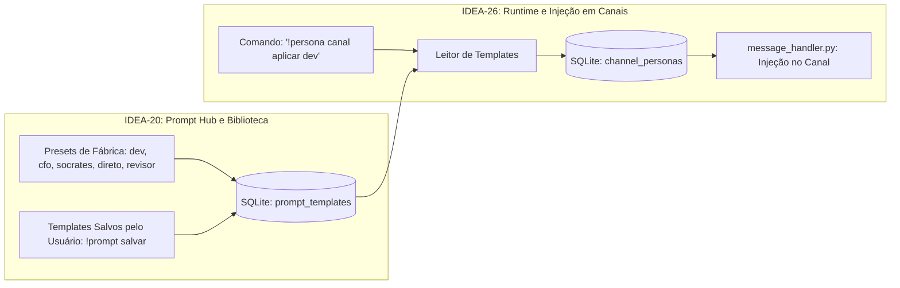

# Especificação de Ideia de Módulo: Central de Prompts & Catálogo de Templates Reutilizáveis (Prompt Hub & Presets)

**Código da Proposta:** `IDEA-20`  
**Status:** Proposto / Refinado via `idea_generator` (Catálogo de Prompts & Engenharia de Contexto)  
**Impacto:** Fornece um repositório centralizado e versionado de templates de prompts, estilos cognitivos e diretrizes reutilizáveis (Presets: `dev`, `cfo`, `direto`, `revisor`, `socrates`, `tributarista`), servindo como biblioteca de referência para alimentar os canais especializados gerenciados pela `IDEA-26`.

---

## 1. Origem e Validação no Pipeline `idea_generator`

Esta especificação foi reavaliada e saneada pelo pipeline multi-agente da skill **`idea_generator`** em conjunto com a **`IDEA-26`**, eliminando sobreposições e conflitos de competência:

1. **💡 Geração Criativa (`Ideator`):**
   A proposta original da IDEA-20 introduzia personas associadas ao perfil de usuário (`user_personas`). Contudo, em um ambiente centrado em canais temáticos (onde o bot opera em múltiplos canais simultâneos), uma persona global de usuário gera conflitos severos de contexto ao transitar entre salas (ex: o usuário fala no canal de código e depois no canal contábil). A solução ideal desacopla as responsabilidades: a **IDEA-20 especializa-se puramente como o Catálogo Central de Prompts & Templates (Prompt Hub)**, enquanto a **IDEA-26 assume com exclusividade a injeção em runtime por canal**.

2. **😈 Análise Crítica (`Devil's Advocate`):**
   O Devil's Advocate apontou que manter duas mecânicas ativas de runtime (uma no nível do usuário e outra no nível do canal) causava ambiguidade extrema: qual persona prevalece? Se o usuário ativa `!persona dev` e entra num canal `#cbs`, o bot responde como programador ou tributarista? Além disso, duplicava tabelas no SQLite (`user_personas` vs `channel_personas`) e inflava a complexidade do `message_handler.py`.

3. **🏆 Defesa Estratégica (`Champion`):**
   O Champion demonstrou que retirar a competência de injeção de runtime da IDEA-20 e concentrá-la na IDEA-26 elimina 100% dos conflitos:
   - A **IDEA-20** torna-se o repositório organizado de engenharia de prompt do sistema: guarda os presets oficiais de fábrica (`dev`, `cfo`, `direto`, etc.) e permite que o usuário salve e gerencie templates de prompt com tags e descrições.
   - A **IDEA-26** é o motor de execução que consome esses templates da IDEA-20 e os aplica nos canais do Discord com um comando simples (`!persona canal aplicar dev`).

4. **⚖️ Veredito do Gatekeeper & Mitigação:**
   * **Status:** `[APROVADA - ESCOPO SANEADO]`
   * **Diretrizes e Condicionantes:**
     1. **Remoção de Competência de Runtime:** A IDEA-20 não injeta mais personas em tempo de execução no `message_handler.py` nem altera o estado global do usuário.
     2. **Foco em Biblioteca de Templates:** Toda persona ou instrução customizada criada na IDEA-20 é salva como um *template reutilizável* na tabela `prompt_templates`.
     3. **Integração com IDEA-26:** A IDEA-26 torna-se o único cliente de injeção dos templates da IDEA-20 nos canais e threads.

5. **✍️ Síntese do Editor (`Editor/Enricher`):**
   Síntese executiva: A IDEA-20 deixa de competir com o escopo de canais e assume o papel de biblioteca central de prompts (*Prompt Hub*). O módulo fornecerá presets de fábrica prontos para uso, persistência de templates customizados no SQLite (`prompt_templates`) e ferramentas de CRUD (`!prompt salvar`, `!prompt ver`, `!prompts`), que são instantaneamente importáveis para qualquer canal temático via `!persona canal aplicar <template>`.

---

## 2. Justificativa e Motivação

Sem um catálogo estruturado, prompts de alta qualidade se perdem no histórico de conversas ou exigem que o usuário copie e cole blocos de texto repetidas vezes no Discord.

Ao transformar a **IDEA-20** em uma **Central de Templates de Prompts**:
1. **Padronização e Qualidade:** O usuário conta com presets refinados de fábrica para diferentes necessidades (código limpo, revisão gramatical, concisão telegráfica, análise financeira).
2. **Reutilização Desacoplada:** O usuário cria um template uma única vez (ex: `prompt salvar tributario_cbs "Você é um auditor..."`) e pode aplicá-lo em qualquer canal via `IDEA-26` ou utilizá-lo em scripts e automações futuras.
3. **Zero Conflito de Runtime:** O bot mantém seu comportamento estável e previsível, sem alternâncias invisíveis de personalidade no meio de conversas em canais compartilhados.

---

## 3. Arquitetura da Central de Prompts (Catálogo $\rightarrow$ Runtime)



---

## 4. Presets Oficiais Embutidos no Catálogo

A Central de Prompts já vem de fábrica com 6 templates testados e calibrados:

1. **`padrao` (Assistente Pessoal):** Equilibrado, educado, bem-humorado, prestativo e com respostas naturais.
2. **`dev` (Tech Lead & Arquiteto Python):** Código conciso, tipado, assíncrono, melhores práticas e foco técnico sem introduções desnecessárias.
3. **`direto` (Modo Ultra-Consciso):** Respostas em tópicos rápidos, máximo 3 frases, telegráfico, sem enrolação ou saudações.
4. **`revisor` (Editor Textual Sênior):** Análise rígida de gramática, coesão, clareza, tom e sugestões de estilo persuasivo.
5. **`cfo` (Consultor Financeiro & Estratégico):** Focado em ROI, custos, sustentabilidade de negócios, controle de riscos e projeções.
6. **`socrates` (Filósofo Maiêutico):** Não entrega respostas mastigadas; formula perguntas reflexivas para guiar o usuário na resolução do seu próprio problema.

---

## 5. Interface de Comandos no Discord (`!prompt`)

| Comando | Parâmetros | Descrição |
|---|---|---|
| `!prompts` | `[categoria]` | Lista todos os templates disponíveis no catálogo (oficiais e do usuário). |
| `!prompt ver` | `<nome>` | Exibe o texto completo e metadados de um template específico. |
| `!prompt salvar` | `<nome> <texto>` | Cria ou atualiza um template de prompt pessoal na biblioteca SQLite. |
| `!prompt remover`| `<nome>` | Exclui um template customizado (presets oficiais são protegidos contra deleção). |

---

## 6. Ferramentas da LLM (Function Calling)

1. **`listar_templates_prompt(categoria: Optional[str] = None) -> list[dict]`**
   - Retorna os nomes e descrições dos templates disponíveis no catálogo.
2. **`obter_template_prompt(nome_template: str) -> dict`**
   - Retorna o texto completo do prompt correspondente para inspeção ou cópia.
3. **`salvar_template_prompt(nome: str, descricao: str, prompt_text: str) -> dict`**
   - Permite à IA registrar prompts criados interativamente na biblioteca do usuário.

---

## 7. Modelagem do Banco de Dados (SQLite)

```sql
CREATE TABLE IF NOT EXISTS prompt_templates (
    id TEXT PRIMARY KEY, -- Slug identificador único (ex: 'dev', 'cfo', 'meu_tributarista')
    user_id TEXT, -- ID do autor (ou NULL para presets oficiais de fábrica)
    nome TEXT NOT NULL,
    descricao TEXT,
    template_text TEXT NOT NULL,
    categoria TEXT DEFAULT 'geral', -- 'programacao', 'negocios', 'escrita', 'estudos'
    temperatura_sugerida REAL DEFAULT 0.7,
    is_builtin BOOLEAN DEFAULT 0, -- 1 para presets de fábrica (somente leitura)
    created_at DATETIME DEFAULT CURRENT_TIMESTAMP,
    updated_at DATETIME DEFAULT CURRENT_TIMESTAMP
);

CREATE INDEX IF NOT EXISTS idx_prompt_templates_categoria ON prompt_templates(categoria);
```

---

## 8. Integração Transparente com a IDEA-26

Quando o usuário desejar transformar um canal em um especialista utilizando um template da biblioteca da `IDEA-20`, basta usar o comando da `IDEA-26`:
```
!persona canal aplicar dev
!persona canal aplicar cfo
!persona canal aplicar meu_tributarista
```
A `IDEA-26` busca o template no banco `prompt_templates` da `IDEA-20` e o grava na tabela `channel_personas` daquele canal com um único clique.

---

## 9. Roteiro de Implementação e Entregáveis

- [ ] **Módulo `prompt_hub.py`:**
  - Carga inicial dos 6 presets de fábrica na tabela `prompt_templates`.
  - Métodos CRUD no SQLite para templates do usuário.
- [ ] **Comandos Discord (`commands/prompt_commands.py`):**
  - Implementação de `!prompts`, `!prompt ver`, `!prompt salvar` e `!prompt remover`.
- [ ] **Exportação para `IDEA-26`:**
  - Função utilitária `prompt_hub.get_template(slug)` consumida pelo módulo de personas por canal.

---

## 10. Registro de Pipeline e Metadados

- **Arquivo de Log do Pipeline:** `discord/SPECs/SPECS_IDEIAS/.pipeline_logs/IDEA-20.json`
- **Autor/Proponente:** Usuário do ecossistema Antigravity & Assistente Antigravity (DeepMind)
- **Data de Refinamento:** 20 de Outubro de 2026
- **Alinhamento com Roadmap:** Marco na **Versão 5.0.0** em conjunto com a `IDEA-26`.
