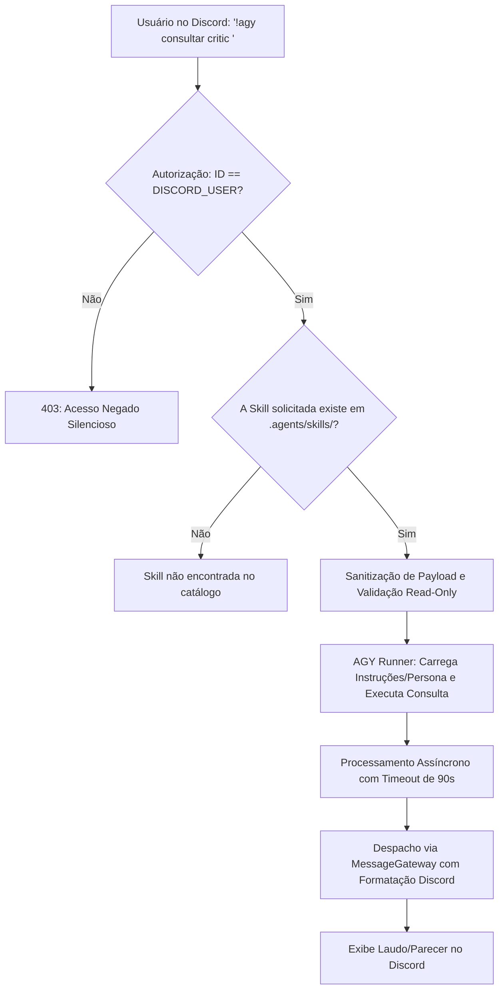

# Especificação de Ideia de Módulo: Execução Local Segura de Agentes e Skills via AGY (Modo Leitura & Consulta)

**Código da Proposta:** `IDEA-23`  
**Status:** Implementado (OS-007)  
**Impacto:** Permite inspecionar, auditar e disparar consultas/análises com as skills e agentes locais do Google Antigravity através do Discord a partir de qualquer dispositivo, com blindagem estrita e execução exclusivamente em modo de Leitura (Read-Only).

> ⚠️ **Desacoplamento Arquitetural:**  
> O modo de **Edição e Implementação de Código** foi desacoplado para a [`IDEA-24`](file:///Users/rodrigomodel/antigravity/discord/SPECs/SPECS_IDEIAS/24_AGY_CODE_SANDBOX_WORKTREE.md) (Git Worktree Sandbox com Aprovação Humana). A presente IDEA-23 restringe-se estritamente à leitura, inspeção, telemetria e consultas consultivas.

---

## 1. Origem e Validação no Pipeline `idea_generator`

Esta especificação foi submetida e refinada pelo pipeline multiagente e pelo Arquiteto-Chefe:

1. **💡 Geração Criativa (`Ideator`):** Concebeu a ponte entre a onipresença do Discord e o poder do hardware local, transformando o bot em um centro de comando para inspecionar e interagir com o ecossistema de agentes e skills locais.
2. **😈 Análise Crítica (`Devil's Advocate`):** Apontou que a execução de comandos com capacidade de alteração de código ou shell arbitrário geraria riscos críticos de RCE (Remote Code Execution) e instabilidade do bot em tempo de execução.
3. **🏆 Defesa Estratégica (`Champion`):** Destacou a utilidade de consultar laudos do `/critic`, pareceres do `/architect` ou divergências do `/oraculo` diretamente pelo celular no Discord.
4. **⚖️ Veredito do Gatekeeper & Mitigação:** Aprovada em **modo estritamente Read-Only** (sem permissão de escrita em código). Toda alteração de código em disco é expressamente vetada e delegada ao sandbox da IDEA-24.

---

## 2. Arquitetura Segura Proposta (Read-Only)

---

## 3. Diretrizes de Blindagem e Segurança (Hardening)

1. **Zero Escrita em Código de Produção:** Nenhuma operação de escrita, modificação ou deleção de arquivos `.py` é permitida através desta especificação.
2. **Whitelist Estrita de Operações:** Apenas consultas a skills registradas em `.agents/skills/` e verificação de telemetria/status local.
3. **Isolamento de Processo (`shell=False`):** Qualquer invocação externa de CLI utiliza estritamente `asyncio.create_subprocess_exec` sem `shell=True`.
4. **Verificação de Identidade Inegociável:** Responde exclusivamente se `str(message.author.id) == str(DISCORD_USER)`.
5. **Timeout com *Graceful Kill*:** Se a consulta ultrapassar 90 segundos sem resposta, a tarefa é abortada com emissão de log de timeout.

---

## 4. Comandos de Usuário no Discord

- **`!agy skills`** (aliases: `!skills_locais`, `!agentes`): Lista todas as skills e agentes disponíveis em `.agents/skills/` com nome e descrição.
- **`!agy info <skill>`**: Exibe o manifesto detalhado, regras e escopo da skill solicitada.
- **`!agy status`**: Exibe o status do runtime local, memória, CPU, tarefas assíncronas e disponibilidade de modelos.
- **`!agy consultar <skill> <pergunta/tema>`** (aliases: `!consultar_skill`, `!perguntar_agente`): Consulta a perspectiva da skill ou agente especialista sobre um tema analítico.

---

## 5. Ferramentas da LLM (Function Calling)

1. `listar_skills_antigravity() -> Dict[str, Any]`: Retorna a lista canônica de skills locais instaladas.
2. `consultar_skill_antigravity(nome_skill: str, consulta: str) -> Dict[str, Any]`: Executa uma consulta analítica no modo read-only com a persona e diretrizes da skill solicitada.
