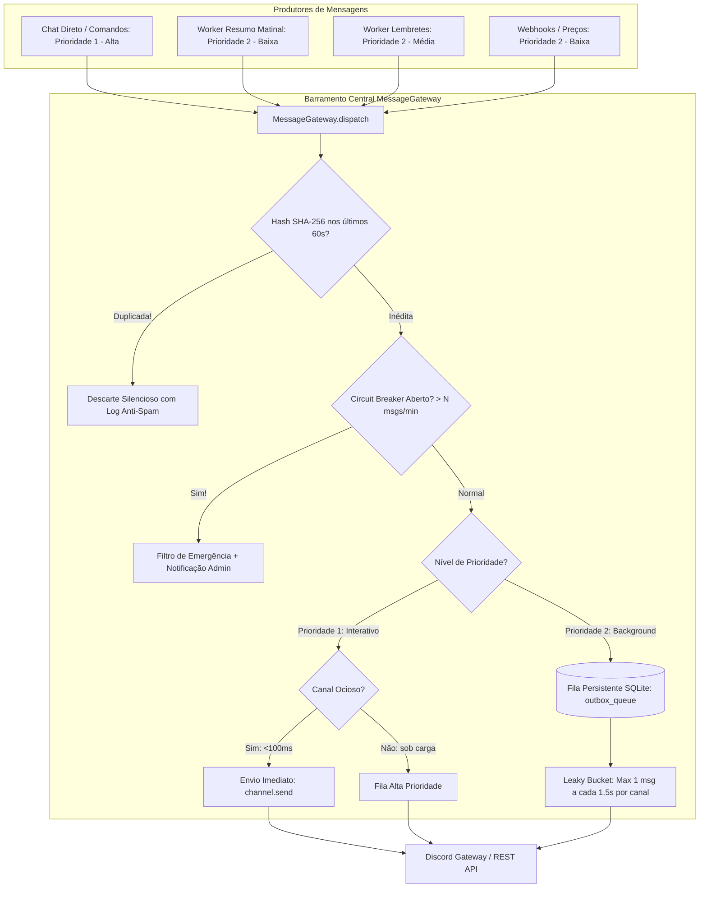

# Especificação de Ideia de Módulo: Barramento Central de Mensagens, Fila Outbox e Controle Anti-Spam (Unified Message Gateway)

**Código da Proposta:** `IDEA-24`  
**Status:** ✅ **ENTREGUE / EM PRODUÇÃO (v3.0.0)**  
**Impacto:** Elimina chamadas dispersas a `channel.send()`, centralizando todo o tráfego de saída do bot em um barramento único com controle de cadência (Leaky Bucket), deduplicação inteligente e disjuntor contra rajadas (Circuit Breaker).

---

## 1. Origem e Validação no Pipeline `idea_generator`

Esta especificação foi submetida e processada pelo pipeline multi-agente da skill **`idea_generator`**:

1. **💡 Geração Criativa (`Ideator`):**
   O módulo proposto introduz um Unified Message Gateway & Anti-Spam Outbox. O conceito central elimina o acoplamento de chamadas diretas como `channel.send()` e centraliza toda a saída de dados em um barramento assíncrono único. A solução incorpora filas com priorização, algoritmo Token/Leaky Bucket para controle rigoroso de cadência, janela de debounce com hash SHA-256 para deduplicação em 60 segundos e um Circuit Breaker Global para mitigação de rajadas anômalas.

2. **😈 Análise Crítica (`Devil's Advocate`):**
   O Devil's Advocate aponta sérios riscos operacionais e de latência. Introduzir uma fila assíncrona intermediária para interações síncronas do usuário (comandos e chat direto) pode inflar a latência percebida, transformando respostas instantâneas em experiências lentas se a fila estiver sob carga de workers em background. Além disso, falhas na persistência do Outbox (armazenamento volátil em memória via `asyncio.Queue`) podem resultar em perda de mensagens críticas durante um crash abrupto do processo do bot. Há também complexidade na gestão de concorrência distribuída caso o bot escale horizontalmente em múltiplas instâncias.

3. **🏆 Defesa Estratégica (`Champion`):**
   Em contrapartida, o Champion destaca que a ausência atual de um barramento é um ponto único de falha que ameaça a existência do bot na plataforma Discord através de banimentos por Rate Limit (HTTP 429). A centralização garante estabilidade a longo prazo, conformidade com os Terms of Service da API do Discord e previne a degradação da experiência do usuário final causada por relatórios em background que colidem com conversas ativas. A priorização de mensagens (Prioridade 1 para chat direto e Prioridade 2 para workers) mitiga o problema de latência percebida para o usuário.

4. **⚖️ Veredito do Gatekeeper & Mitigação:**
   * **Status:** `[APROVADA]`
   * **Diretrizes e Condicionantes:** O Gatekeeper aprova a proposta sob condições estritas de arquitetura: 1) O barramento deve garantir latência inferior a 100ms para mensagens de Prioridade 1 (respostas diretas), implementando um *Fast-Path* que bypassa filas pesadas se o canal estiver ocioso; 2) O armazenamento da Outbox deve possuir suporte a persistência leve (SQLite local em tabela `outbox_messages`) para evitar perda de dados em restarts; 3) O mecanismo de Circuit Breaker deve registrar alertas e notificar os administradores imediatamente caso o limiar de rajada seja acionado.

5. **✍️ Síntese do Editor (`Editor/Enricher`):**
   Síntese executiva do Editor: O Unified Message Gateway será implementado com restrição estrita de acesso (regra de linting proibindo `channel.send()` direto nos módulos de negócio). A arquitetura utilizará uma fila dual-tier (Prioridade 1 interativa com fast-path e Prioridade 2 em background com algoritmo Leaky Bucket). A deduplicação usará hash SHA-256 com janela deslizante de 60 segundos e persistência em banco local SQLite para resiliência a quedas do processo. Plano de mitigação de latência validado através de bypass imediato para canais sem concorrência ativa.

---

## 2. Justificativa e Motivação

Atualmente, qualquer módulo do sistema (respostas de chat, resumos matinais diários, disparos de lembretes, monitor de preços, webhooks ou relatórios de erros) possui autorização para invocar diretamente `await canal.send(...)` ou `await usuario.send(...)`.

Essa arquitetura descentralizada cria vulnerabilidades operacionais graves:
1. **Rajadas Descontroladas por Concorrência:** Conforme verificado no incidente do resumo matinal, reconexões de rede combinadas com múltiplos loops assíncronos podem disparar dezenas de mensagens simultâneas para o mesmo canal em poucos segundos.
2. **Risco de Banimento por Rate Limit (HTTP 429):** A API do Discord impõe limites rígidos de envio por canal (~5 mensagens a cada 5 segundos). Disparos múltiplos sem controle de cadência ativam bloqueios temporários que, se recorrentes, levam à suspensão do token ou banimento do bot.
3. **Falta de Idempotência e Deduplicação:** Módulos que entram em loop ou retentativas geram mensagens idênticas repetidas, poluindo os canais e sobrecarregando a experiência do usuário.
4. **Perda de Rastreabilidade e Auditoria:** Não existe um ponto centralizado onde se possa pausar o envio de mensagens, inspecionar a taxa de saída ou aplicar políticas globais de privacidade.

---

## 3. Arquitetura Proposta (Dual-Tier Outbox Gateway)



---

## 4. Componentes Técnicos e Regras de Negócio

### 4.1 Fila Dual-Tier (Priorização Inteligente)
- **Prioridade 1 (Interativa / Chat Direto):**
  - Respostas do bot a mensagens do usuário, comandos `!ping`, `!ajuda`, `!modelo`.
  - Passa pelo *Fast-Path*: se o canal não estiver sob rate-limit ativo, é despachada em `< 100ms` sem reter o usuário.
- **Prioridade 2 (Background / Assíncrona):**
  - Resumos matinais, lembretes vencidos, alertas de preço, sincronizações e relatórios.
  - Submetida ao algoritmo *Leaky Bucket*, garantindo cadência espaçada (mínimo de 1.5 segundos entre mensagens para o mesmo canal).

### 4.2 Deduplicação por Hash SHA-256 (Sliding Window)
- Cada mensagem recebida no gateway tem seu conteúdo e destinatário transformados em um hash SHA-256 (`hash(channel_id + str(conteudo) + str(anexo))`).
- Se um hash idêntico for submetido para o mesmo destinatário dentro da janela deslizante (ex: 60 segundos), a mensagem é **sumariamente descartada**, evitando que bugs de concorrência disparem 50 resumos idênticos.

### 4.3 Circuit Breaker Global (Disjuntor de Emergência)
- Monitora a velocidade de despacho para cada canal.
- Se um canal receber mais de **8 mensagens em uma janela de 10 segundos**:
  1. O *Circuit Breaker* é acionado (`STATE: OPEN`).
  2. Todas as mensagens subsequentes de Prioridade 2 são represadas ou consolidadas.
  3. Um alerta é gerado no log e o administrador recebe um aviso de anomalia.
  4. O disjuntor retorna gradualmente ao estado normal após 30 segundos de calmaria (`HALF-OPEN` $\rightarrow$ `CLOSED`).

### 4.4 Persistência em SQLite (`outbox_queue`)
- Mensagens de background são registradas em uma tabela leve no SQLite antes do envio:
  ```sql
  CREATE TABLE IF NOT EXISTS outbox_queue (
      id TEXT PRIMARY KEY,
      channel_id TEXT NOT NULL,
      user_id TEXT,
      priority INTEGER NOT NULL DEFAULT 2,
      content TEXT,
      attachment_path TEXT,
      content_hash TEXT NOT NULL,
      status TEXT NOT NULL DEFAULT 'pending', -- pending, sent, failed, discarded
      created_at DATETIME DEFAULT CURRENT_TIMESTAMP
  );
  ```
- Caso o processo do bot caia, ao reiniciar ele retoma os envios pendentes sem duplicar os já entregues.

---

## 5. Interface de Gestão no Discord

Comandos de controle exclusivo para o administrador do bot (`DISCORD_USER`):

- **`!gateway status`**: Exibe o estado atual da fila outbox, mensagens enviadas no último minuto, taxa de vazão e status do Circuit Breaker.
- **`!gateway pausar`**: Pausa temporariamente o envio de mensagens de background (mantendo apenas chat interativo).
- **`!gateway retomar`**: Reativa o despacho normal da fila de background.
- **`!gateway limpar`**: Purga mensagens antigas ou represadas na fila.

---

## 6. Ferramentas da LLM (Function Calling)

1. `consultar_status_gateway() -> Dict[str, Any]`: Permite à IA inspecionar a saúde do barramento de envio e reportar taxas de mensagens e eventuais bloqueios.
2. `ajustar_vazao_gateway(mensagens_por_segundo: float) -> bool`: Configura dinamicamente a cadência do despachante.

---

## 7. Configurações em `.env`

```ini
# Habilita o Gateway Unificado de Despacho Outbox
MESSAGE_GATEWAY_ENABLED=true

# Cadência máxima do Leaky Bucket (segundos entre envios no mesmo canal)
GATEWAY_LEAKY_BUCKET_INTERVAL_SEC=1.5

# Janela de deduplicação por Hash SHA-256 (segundos)
GATEWAY_DEBOUNCE_WINDOW_SEC=60

# Limiar do Circuit Breaker (máximo de mensagens por canal em 10 segundos)
GATEWAY_CIRCUIT_BREAKER_MAX_MSGS=8
GATEWAY_CIRCUIT_BREAKER_COOLDOWN_SEC=30

# Persistência em SQLite para proteção contra crashes
GATEWAY_PERSISTENCE_ENABLED=true
```
