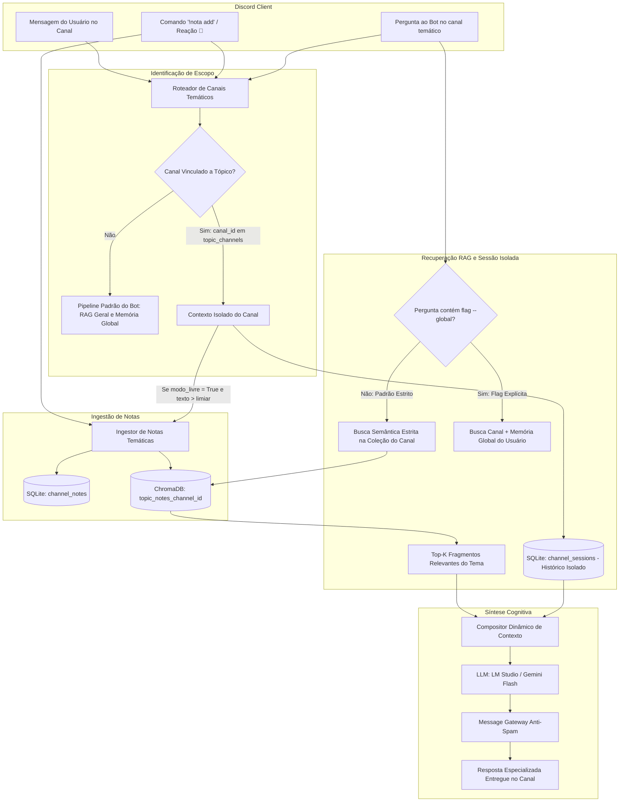

# Especificação de Ideia de Módulo: Knowledge Hub Temático & RAG Isolado por Canal (Second Brain Vectorial)

**Código da Proposta:** `IDEA-25`  
**Status:** Proposto / Refinado via `idea_generator` (Prioridade Alta — Gestão de Conhecimento & RAG Especializado)  
**Impacto:** Transforma canais e threads do Discord em bancos de notas temáticos e "Second Brains" especializados (ex: `#bot-discord`, `#cbs`, `#ppcf`, `#anotacoes-gerais`), com captura ágil (`!nota add`), busca semântica RAG 100% isolada por canal (sem contaminação cruzada com a memória global do usuário) e memória de sessão de diálogo restrita ao canal.

---

## 1. Origem e Validação no Pipeline `idea_generator`

Esta especificação foi submetida, decomposta e validada pelo pipeline multi-agente da skill **`idea_generator`**:

1. **💡 Geração Criativa (`Ideator`):**
   O módulo proposto introduz um Knowledge Hub Temático descentralizado no Discord. Permite ao usuário vincular canais ou threads a temas específicos (ex: `bot do discord`, `cbs`, `ppcf`, `anotações gerais`). Nesses canais, o usuário registra ideias e notas de forma rápida (livre ou via `!nota add`). Quando o usuário faz perguntas dentro do canal, o sistema aciona uma busca RAG semântica isolada que consulta estritamente a base de conhecimento daquele tema, ignorando o RAG geral e pessoal do usuário para evitar contaminação cruzada.

2. **😈 Análise Crítica (`Devil's Advocate`):**
   O Devil's Advocate apontou riscos de acoplamento caso funcionalidades de notas fossem misturadas com customização comportamental da LLM (personas), além de riscos de poluição semântica no banco vetorial caso mensagens comuns fossem indexadas como notas. Também destacou o risco de dispersão de coleções no ChromaDB caso o particionamento não fosse padronizado.

3. **🏆 Defesa Estratégica (`Champion`):**
   O Champion demonstrou o enorme ganho ao separar este módulo em um núcleo puro de conhecimento: 1) Eliminação completa de "alucinações cruzadas" no RAG pessoal (o bot nunca misturará regras tributárias com código de software ou compras de mercado); 2) Fricção zero de captura diária no Discord (desktop e mobile); 3) Arquitetura limpa e desacoplada, pronta para interoperar com a `IDEA-26` (Personas por Canal).

4. **⚖️ Veredito do Gatekeeper & Mitigação:**
   * **Status:** `[APROVADA - MÓDULO FOCADO]`
   * **Diretrizes e Condicionantes:** O Gatekeeper aprovou a decomposição em duas implementações independentes: a `IDEA-25` fica 100% dedicada ao armazenamento e RAG isolado de notas, enquanto a gestão de personas por canal é delegada para a `IDEA-26`. Condicionantes técnicas: modo explícito de captura por padrão (`!nota add` ou reação `📝`), integridade relacional no SQLite com espelhamento 1:1 no ChromaDB e suporte a flag opcional `--global` para permitir consulta cruzada quando explicitamente desejado.

5. **✍️ Síntese do Editor (`Editor/Enricher`):**
   Síntese executiva do Editor: O Knowledge Hub Temático será desenvolvido com arquitetura particionada em dois níveis (SQLite para persistência transacional de notas e tópicos, e ChromaDB para coleções vetoriais isoladas `topic_notes_{channel_id}`). Incluirá suíte de comandos unificados (`!topico`, `!nota add`, `!notas`, `!nota buscar`, `!nota remover`), proteção anti-ruído na vetorização, isolamento estrito de memória de sessão e RAG semântico de nicho.

---

## 2. Justificativa e Motivação

Atualmente, o assistente possui dois repositórios centrais de dados:
1. **Lembretes e Listas:** Entidades pontuais orientadas a prazos ou tarefas de mercado.
2. **Memória de Longo Prazo Geral (`{user}_memory` no ChromaDB):** Um pool único compartilhado onde todo fato conversado com o usuário é armazenado.

Essa arquitetura descentralizada sem isolamento por contexto gera dores críticas:
1. **Contaminação Cruzada de Contexto (Context Bleed):** Ao discutir temas complexos de trabalho (ex: reforma tributária `CBS`, arquitetura de software de um `bot discord` ou planejamento financeiro `PPCF`), uma pergunta feita ao RAG costuma trazer fragmentos desconexos de listas de compras, lembretes pessoais de saúde ou conversas de outros projetos, diluindo a atenção e relevância da LLM.
2. **Fricção de Captura de Ideias (Second Brain disperso):** O usuário tem ideias rápidas ou notas no dia a dia. Se não houver um canal dedicado e direto no Discord, as anotações acabam perdidas em blocos de notas do celular ou DMs esquecidas.

A **IDEA-25** resolve essas dores criando **Canais Temáticos de Conhecimento** no Discord com **RAG e Memória de Sessão estritamente isolados**.

---

## 3. Arquitetura do Sistema



---

## 4. Componentes Técnicos e Regras de Negócio

### 4.1 Vinculação de Canal a um Tópico (`topic_channels`)
- Qualquer canal de texto ou thread do Discord pode ser vinculada a um tópico temático:
  ```
  !topico vincular cbs "Reforma Tributária e Contabilidade CBS/IBS"
  !topico vincular bot_discord "Arquitetura e Desenvolvimento do Discord AI Bot"
  !topico vincular ppcf "Planejamento e Gestão Financeira Pessoal"
  ```
- O bot armazena essa associação no SQLite. A partir desse momento, todas as interações no canal herdam o escopo isolado daquele tópico.

### 4.2 Ingestão de Notas e Proteção Anti-Ruído
Para evitar que conversas casuais poluam o banco vetorial com lixo semântico, o módulo opera em dois modos:
1. **Modo Explícito (Padrão e Recomendado):**
   - Notas são adicionadas via comando: `!nota add <conteúdo> [#tag1] [#tag2]`.
   - Ou reagindo com o emoji `📝` a qualquer mensagem relevante enviada anteriormente no canal.
2. **Modo Bloco de Notas Livre (`modo_livre = True`):**
   - Ativável por canal via `!topico modo_livre on`.
   - Toda mensagem comum enviada pelo usuário que não seja um comando e contenha mais de 15 caracteres é automaticamente categorizada e indexada como nota.
   - Mensagens terminadas em `?` ou com tom interrogativo são tratadas como **perguntas ao RAG**, gerando resposta da IA em vez de ingestão.

### 4.3 Isolamento Estrito do RAG Vetorial (ChromaDB Multi-Tenancy)
- Cada canal temático cria uma coleção dedicada e exclusiva no ChromaDB com o nome:
  `topic_notes_{channel_id}`
- Ao formular uma pergunta à IA dentro do canal temático:
  - O sistema busca **apenas** na coleção `topic_notes_{channel_id}`.
  - A coleção pessoal do usuário (`{user}_memory`) e outras coleções de livros/PDFs são **completamente ignoradas**.
  - **Flag de Escape (`--global`):** Caso o usuário deseje explicitamente cruzar dados do projeto com lembretes ou informações gerais da sua vida pessoal, basta incluir a flag na consulta:
    `Como o cronograma do CBS se encaixa na minha agenda desta semana? --global`

### 4.4 Memória de Diálogo Isolada por Canal
- As mensagens de conversa recente (últimas 10-20 interações) utilizadas para manter o fluxo conversacional são filtradas estritamente por `channel_id`.
- A conversa travada em um canal de projeto não vaza para DMs nem interfere no contexto de outros canais.

### 4.5 Interoperabilidade com IDEA-26 (Personas por Canal)
- A `IDEA-25` foca na gestão de dados e RAG. Quando a `IDEA-26` estiver implementada, o compositador de prompt no `message_handler.py` injetará automaticamente a persona configurada para aquele canal, criando a estação de trabalho temática completa.

---

## 5. Interface de Comandos no Discord

### 5.1 Gestão de Tópicos e Canais
| Comando | Parâmetros | Descrição |
|---|---|---|
| `!topico vincular` | `<slug> <descrição>` | Vincula o canal atual a um tópico temático de notas. |
| `!topico status` | *(nenhum)* | Exibe o tópico vinculado, total de notas e estatísticas do canal. |
| `!topico desvincular` | *(nenhum)* | Remove o vínculo do canal atual com o tópico (mantendo os dados preservados). |
| `!topico modo_livre` | `[on\|off]` | Alterna entre o modo explícito (`!nota add`) e o modo captura automática livre. |

### 5.2 Adição e Gestão de Notas
| Comando | Parâmetros | Descrição |
|---|---|---|
| `!nota add` | `<conteúdo> [#tags]` | Registra uma nova nota/ideia no tópico do canal e vetoriza no ChromaDB. |
| `!notas` | `[#tag] [limite]` | Lista as notas recentes salvas no canal atual com paginação e botões interativos. |
| `!nota buscar` | `<termo ou pergunta>` | Realiza busca semântica (RAG) exclusiva nas notas do canal atual. |
| `!nota ver` | `<id_nota>` | Exibe o conteúdo completo e metadados de uma nota específica. |
| `!nota remover` | `<id_nota>` | Remove uma nota do banco relacional e da coleção vetorial do ChromaDB. |
| `!nota limpar` | `confirmar` | Expurga todas as notas associadas ao tópico do canal atual. |

---

## 6. Ferramentas da LLM (Function Calling)

Para permitir que a IA interaja autonomamente com o banco de notas do canal:

1. **`adicionar_nota_canal(conteudo: str, tags: list[str]) -> dict`**
   - Registra uma nova nota no tópico do canal em que o diálogo está acontecendo.
2. **`buscar_notas_canal(consulta_semantica: str, top_k: int = 4) -> list[dict]`**
   - Executa busca semântica restrita à coleção ChromaDB do canal atual.
3. **`listar_notas_canal(tag_filtro: Optional[str] = None, limite: int = 10) -> list[dict]`**
   - Recupera a lista cronológica das últimas notas indexadas no canal.

---

## 7. Modelagem do Banco de Dados

### 7.1 SQLite (`chat_memory.db`)

```sql
-- 1. Canais e Vínculos de Tópicos
CREATE TABLE IF NOT EXISTS topic_channels (
    channel_id TEXT PRIMARY KEY,
    topic_slug TEXT NOT NULL,
    topic_name TEXT NOT NULL,
    description TEXT,
    auto_capture_mode BOOLEAN NOT NULL DEFAULT 0, -- 0 = Apenas !nota add/emoji, 1 = Livre
    created_at DATETIME DEFAULT CURRENT_TIMESTAMP,
    updated_at DATETIME DEFAULT CURRENT_TIMESTAMP
);

-- 2. Tabela Relacional de Notas Temáticas
CREATE TABLE IF NOT EXISTS channel_notes (
    id TEXT PRIMARY KEY, -- UUID v4
    channel_id TEXT NOT NULL,
    topic_slug TEXT NOT NULL,
    user_id TEXT NOT NULL,
    content TEXT NOT NULL,
    tags TEXT, -- JSON Array: ["#ideia", "#bug", "#arquitetura"]
    source_message_id TEXT, -- ID da mensagem original no Discord
    created_at DATETIME DEFAULT CURRENT_TIMESTAMP,
    updated_at DATETIME DEFAULT CURRENT_TIMESTAMP,
    FOREIGN KEY (channel_id) REFERENCES topic_channels(channel_id) ON DELETE CASCADE
);

CREATE INDEX IF NOT EXISTS idx_channel_notes_topic ON channel_notes(topic_slug, channel_id);
CREATE INDEX IF NOT EXISTS idx_channel_notes_created ON channel_notes(created_at DESC);
```

### 7.2 ChromaDB (Coleções Vetoriais Isoladas)
- **Nome da Coleção:** `topic_notes_{channel_id}`
- **Embedding Model:** O mesmo padrão do sistema (`LM_STUDIO_EMBEDDING_MODEL` ou fallback configurado).
- **Metadados do Vetor:**
  ```json
  {
    "note_id": "uuid-v4",
    "channel_id": "1234567890",
    "topic_slug": "cbs",
    "user_id": "9876543210",
    "tags": "cbs, reforma, legislacao",
    "created_at": "2026-10-20T10:30:00Z"
  }
  ```

---

## 8. Roteiro de Implementação e Entregáveis

- [ ] **Módulo `topic_manager.py`:**
  - Gerenciamento de criação de tópicos, vinculação de canais e CRUD no SQLite.
- [ ] **Módulo `topic_rag.py` (ou expansão de `vector_db.py`):**
  - Isolamento de coleções ChromaDB particionadas por canal (`topic_notes_{channel_id}`).
  - Ingestão atômica de notas e sincronização entre SQLite e ChromaDB.
  - Recuperação semântica com reranking leve e filtragem por tags.
- [ ] **Comandos Discord (`commands/topic_commands.py`):**
  - Implementação dos comandos `!topico`, `!nota` e `!notas`.
  - Listeners de reações (emoji `📝` adiciona mensagem à base de notas).
- [ ] **Integração no Fluxo de Mensagens (`message_handler.py`):**
  - Redirecionamento da busca RAG para a coleção temática ao invés da memória pessoal geral.
  - Suporte à flag `--global` na mensagem do usuário.
- [ ] **Interface Visual Interativa (`ui_components.py`):**
  - Visualização de notas com botões de paginação, filtro por tag e modal para inclusão rápida de notas.

---

## 9. Registro de Pipeline e Metadados

- **Arquivo de Log do Pipeline:** `discord/SPECs/SPECS_IDEIAS/.pipeline_logs/IDEA-25.json`
- **Autor/Proponente:** Usuário do ecossistema Antigravity & Assistente Antigravity (DeepMind)
- **Data de Aprovação no Pipeline:** 20 de Outubro de 2026
- **Alinhamento com Roadmap:** Marco na **Versão 4.0.0** (Knowledge Hubs & Inteligência Temática).
