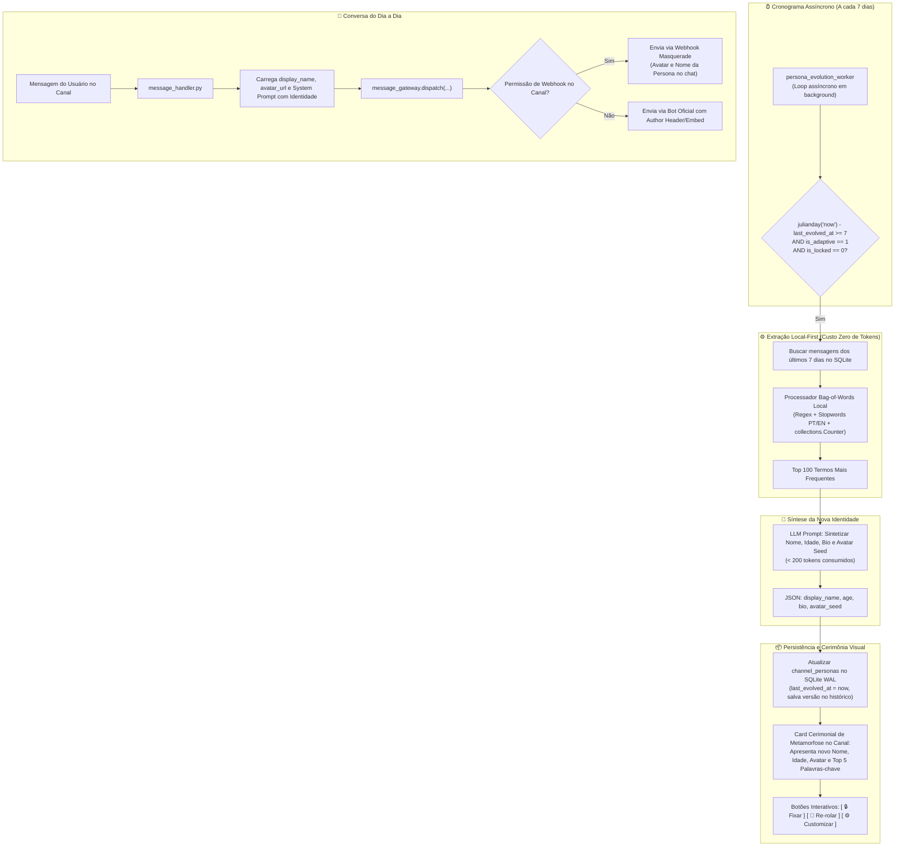

# Especificação de Ideia de Módulo: Identidade Multimodal de Personas & Metamorfose Semanal Adaptativa

**Código da Proposta:** `IDEA-27`  
**Status:** Implementada (100% Concluída — Onda 1 e Onda 2)  
**Validação:** Aprovado via Brainstorm Dialético (`BRN-26110801` / `ALQ-26110801` - Classificação: **OURO PURO 9.44**)  
**Impacto:** Concede rosto, nome, idade e biografia às personas de canal (`IDEA-26`), despachando mensagens de forma polimórfica via Webhook (ou Embed) com identidade visual individualizada. Inclui o motor de **Metamorfose Semanal Autônoma**: a cada 7 dias, a persona de canais não-bloqueados absorve o zeitgeist das conversas através de um analisador local de *Bag-of-Words* (Top 100 termos, zero tokens de leitura e sem custos de nuvem), transmutando seu arquétipo visual e comportamental em uma cerimônia comunitária interativa.

---

## 1. Origem e Validação Arquitetural

Esta especificação consolida a convergência do pipeline de ideação multi-agente (`/brainstorm`) entre as teses do Oráculo, a crítica de segurança do Advogado do Diabo, os atalhos de engenharia do Hacker Pragmático, as heurísticas ergonômicas de UX e as diretrizes do Arquiteto-Chefe:

1. **Problema Central:**  
   As personas de canal da `IDEA-26` operavam puramente como modificadores de texto no backend. No chat do Discord, todas as mensagens continuavam saindo pela mesma "boca" e com o mesmo avatar cinzento do bot central. Além disso, a configuração manual constante gerava fadiga de adoção, enquanto avatares estáticos não refletiam a evolução cultural do servidor.

2. **A Solução Arquitetural:**  
   - **Camada Visual Polimórfica:** Emprego de Webhooks gerenciados por canal para despachar mensagens com `username` e `avatar_url` específicos da persona daquele canal, contornando os rate limits globais do Discord (`bot.user.edit`). Fallback defensivo para Author Header em Embed quando o bot não possuir permissão de webhook.
   - **Metamorfose Semanal (Ciclo Circadiano de 7 Dias):** Rotina assíncrona que verifica canais adaptativos a cada 7 dias e sintetiza um novo arquétipo coerente.
   - **Extração Semântica Local (Bag-of-Words em Python Puro):** Para blindar custos de contexto e garantir privacidade total, o histórico de 7 dias é analisado localmente com `collections.Counter` e regex, extraindo as 100 palavras mais representativas (sem stopwords). Apenas esses termos agregados são enviados à LLM, custando menos de 200 tokens.
   - **Soberania do Operador (`Lock Soberano`):** Botão `[🔒 Fixar Persona]` e controle `is_locked = 1` no banco, impedindo mutações não desejadas.

---

## 2. Topologia do Sistema & Fluxo de Dados



---

## 3. Modelo de Dados Relacional (SQLite WAL)

A tabela existente `channel_personas` é expandida com colunas dedicadas à identidade multimodal e ao ciclo de evolução adaptativa:

```sql
-- Migration para suporte à IDEA-27
ALTER TABLE channel_personas ADD COLUMN display_name TEXT DEFAULT NULL;
ALTER TABLE channel_personas ADD COLUMN avatar_url TEXT DEFAULT NULL;
ALTER TABLE channel_personas ADD COLUMN avatar_seed TEXT DEFAULT NULL;
ALTER TABLE channel_personas ADD COLUMN age TEXT DEFAULT NULL;
ALTER TABLE channel_personas ADD COLUMN bio TEXT DEFAULT NULL;
ALTER TABLE channel_personas ADD COLUMN is_adaptive INTEGER DEFAULT 1; -- 1: evolui semanalmente se não travado
ALTER TABLE channel_personas ADD COLUMN is_locked INTEGER DEFAULT 0;   -- 1: fixado pelo operador (soberano)
ALTER TABLE channel_personas ADD COLUMN last_evolved_at TIMESTAMP DEFAULT CURRENT_TIMESTAMP;
ALTER TABLE channel_personas ADD COLUMN evolution_history_json TEXT DEFAULT '[]'; -- armazena até 5 avatares passados
```

---

## 4. Algoritmo de Extração de Frequência Semântica (Local-First)

Módulo utilitário desacoplado em `text_frequency.py` que opera sem qualquer dependência externa ou modelos pesados:

```python
import re
from collections import Counter
from typing import List, Tuple

STOPWORDS_PT_EN = {
    # Artigos e preposições PT
    "de", "a", "o", "que", "e", "do", "da", "em", "um", "para", "com", "nao", "uma", "os", "no", 
    "se", "na", "por", "mais", "as", "dos", "como", "mas", "foi", "ao", "ele", "das", "tem", 
    "aqui", "esse", "isso", "pra", "voce", "bot", "mesmo", "meu", "sua", "nos", "ja", "vai",
    # Pronomes e auxiliares EN
    "the", "and", "to", "of", "a", "in", "is", "that", "for", "it", "as", "was", "with", "on"
}

def extrair_top_palavras_canal(mensagens: List[str], top_n: int = 100) -> List[Tuple[str, int]]:
    """Extrai as palavras mais frequentes ignorando ruído, URLs e stopwords em memória."""
    texto_combinado = " ".join(mensagens).lower()
    
    # Remove links, menções e comandos
    texto_limpo = re.sub(r"https?://\S+|<!?@\d+>|!\w+", " ", texto_combinado)
    
    # Captura palavras com 3 ou mais caracteres alfanuméricos
    palavras = re.findall(r"\b[a-záéíóúâêîôûãõç]{3,}\b", texto_limpo)
    filtradas = [p for p in palavras if p not in STOPWORDS_PT_EN]
    
    return Counter(filtradas).most_common(top_n)
```

---

## 5. Protocolo de Despacho Visual & Webhook Masquerade

Para contornar os rate limits globais do Discord sem criar latência:

1. **Gestão de Webhook por Canal:**  
   O bot consulta a lista de webhooks do canal. Se existir um webhook com nome `Antigravity Dispatcher`, armazena o webhook em cache em memória. Caso não exista e o bot tenha a permissão `manage_webhooks`, cria o webhook.
2. **Envio Polimórfico:**  
   Quando o bot for emitir a resposta:
   ```python
   avatar_final = persona.get("avatar_url") or f"https://api.dicebear.com/7.x/bottts/png?seed={persona.get('avatar_seed', 'default')}"
   
   if webhook_disponivel:
       await webhook.send(
           content=texto_resposta,
           username=persona.get("display_name") or "Antigravity Assistant",
           avatar_url=avatar_final
       )
   else:
       embed = discord.Embed(description=texto_resposta)
       embed.set_author(name=f"{persona.get('display_name')} ({persona.get('age')})", icon_url=avatar_final)
       await channel.send(embed=embed)
   ```

---

## 6. Comandos e Interações de Interface (UI/UX)

- `!persona avatar <url>` — Define manualmente o avatar do canal.
- `!persona identidade <nome> | <idade> | <bio>` — Atualiza metadados biográficos diretamente.
- `!persona editar` — Abre o **Discord Modal** nativo no chat com campos para Nome, Idade, Bio e Avatar.
- `!persona fixar` ou `!persona travar` — Ativa `is_locked = 1`, congelando o perfil atual e desativando a metamorfose automática.
- `!persona destravar` — Permite que o canal volte a se metamorfosear a cada 7 dias.
- `!persona metamorfose` — Força manualmente a avaliação do Bag-of-Words e antecipa a transmutação semanal.

---

## 7. Diretrizes de Segurança, Riscos & Blast Radius

1. **Proteção Contra Injeção Maliciosa via Chat:**  
   O prompt de síntese da metamorfose semanal trata as palavras-chave estritamente como *dados de frequência estatística*, instruindo a LLM a nunca interpretar comandos contidos nos termos como instruções de sistema.
2. **Precedência Soberana:**  
   Se um usuário definir qualquer campo manualmente (`display_name` ou `avatar_url`), o motor de evolução semanal marca automaticamente `is_locked = 1` a menos que o usuário declare explicitamente o modo adaptativo.
3. **Resiliência de Links de Avatar:**  
   Nunca depende unicamente de URLs externas coladas pelo usuário. O sistema sempre armazena o `avatar_seed` para gerar avatares procedurais consistentes caso a URL quebre.
4. **Isolamento de Concorrência:**  
   A rotina de evolução semanal executa em corrotina desacoplada no `asyncio.to_thread` para o cálculo de palavras, sem bloquear o loop de eventos do Discord.

