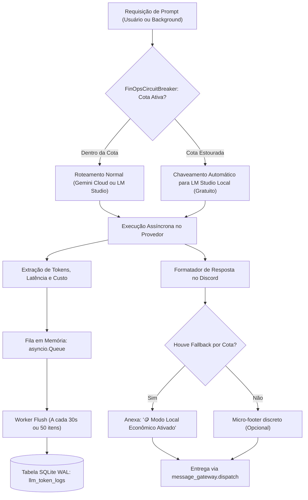

# Especificação de Ideia de Módulo: FinOps, Telemetria de Tokens & Observabilidade de Custos LLM

**Código da Proposta:** `IDEA-28`  
**Status:** Implementado em Produção ([MOD-VIS-18](file:///Users/rodrigomodel/antigravity/discord/SPECs/modulos_visiveis/18_FINOPS_E_TELEMETRIA_DE_TOKENS.md))  
**Impacto:** Permite monitorar em tempo real o consumo de tokens (prompt, completion), latência, custos financeiros acumulados (Cloud vs Local) e aplicar cotas com chaveamento transparente (fallback gracioso) para o LM Studio local.

---

## 1. Origem e Validação no Pipeline Dialético

Esta especificação foi concebida e refinada pela Mesa de Discussão Multiagente:
1. **Identificação da Dor:** Falta de visibilidade dos custos cumulativos de chamadas à nuvem (Gemini API) versus hardware local (LM Studio), com risco de estouro acidental de orçamento em loops de Function Calling ou tarefas pesadas de background.
2. **Mitigações de Red Team (`/critic`):** Isolamento estrito entre chamadas interativas de usuários e tarefas de background do sistema (`user_id='SYSTEM_BACKGROUND'`), evitando que automações como Pesquisa Profunda ou Digest Matinal zerem a cota diária dos membros.
3. **Solução Pragmática (`/hacker`):** Coleta de telemetria sem overhead via metadados nativos de `usage` dos SDKs, buffer assíncrono em memória (`asyncio.Queue`) com gravação em lote (`executemany`) a cada 30 segundos no SQLite WAL.
4. **Alavancagem de Negócio (`/impact`):** Least-Cost Routing com Failover Econômico Inteligente — demonstração do ROI da infraestrutura local com métricas de "Economia Gerada por Computação Local".
5. **Ergonomia Visual (`/ux_designer`):** Rodapés sutis com consumo de tokens e painel interativo `!finops` com barras ASCII segmentadas e badges transparentes de chaveamento.

---

## 2. Justificativa e Motivação

O projeto opera sob uma arquitetura de roteamento híbrido ([`MOD-VIS-10`](file:///Users/rodrigomodel/antigravity/discord/SPECs/modulos_visiveis/10_ROTEAMENTO_HIBRIDO_E_GOOGLE_GEMINI.md)). Sem uma camada de FinOps e contabilidade determinística de tokens:
- O Arquiteto-Chefe não possui visão consolidada do custo financeiro diário e mensal.
- Não há proteção preventiva contra rajadas de consultas ou loops de prompts que excedam limites de API.
- Chamadas de background executadas fora do horário comercial podem consumir quotas essenciais sem rastreamento granular.

---

## 3. Arquitetura Proposta & Fluxo de Roteamento



---

## 4. Esquema de Dados (SQLite WAL)

Tabela `llm_token_logs` gerida em `discord/database.py`:

```sql
CREATE TABLE IF NOT EXISTS llm_token_logs (
    id INTEGER PRIMARY KEY AUTOINCREMENT,
    user_id TEXT NOT NULL,
    channel_id TEXT NOT NULL,
    model TEXT NOT NULL,
    prompt_tokens INTEGER NOT NULL,
    completion_tokens INTEGER NOT NULL,
    total_tokens INTEGER NOT NULL,
    latency_ms INTEGER NOT NULL,
    cost_usd REAL NOT NULL,
    is_local INTEGER NOT NULL DEFAULT 0,
    origin_type TEXT NOT NULL DEFAULT 'INTERACTIVE', -- 'INTERACTIVE' ou 'BACKGROUND'
    is_fallback INTEGER NOT NULL DEFAULT 0,
    created_at TIMESTAMP DEFAULT CURRENT_TIMESTAMP
);

CREATE INDEX IF NOT EXISTS idx_token_logs_user ON llm_token_logs(user_id, created_at);
CREATE INDEX IF NOT EXISTS idx_token_logs_origin ON llm_token_logs(origin_type, created_at);
```

---

## 5. Comandos e Ferramentas Propostas

### Comandos de Chat (Prefixo `!`)
* `!finops`: Exibe o painel consolidado do dia e dos últimos 30 dias com barras ASCII segmentadas (Interativo vs Background).
* `!finops cotas`: Consulta o saldo restante da cota diária do usuário e do sistema.
* `!finops modelos`: Exibe o ranking de modelos mais utilizados e a economia estimada gerada pelo LM Studio.
* `!finops reset <usuario>`: *(Apenas Arquiteto-Chefe)* Reseta manualmente o contador diário de um usuário.

### Ferramentas da LLM (*Function Calling*)
* `consultar_metricas_finops(periodo: str = "hoje") -> dict`: Permite à IA responder perguntas sobre gastos e saúde da infraestrutura.
