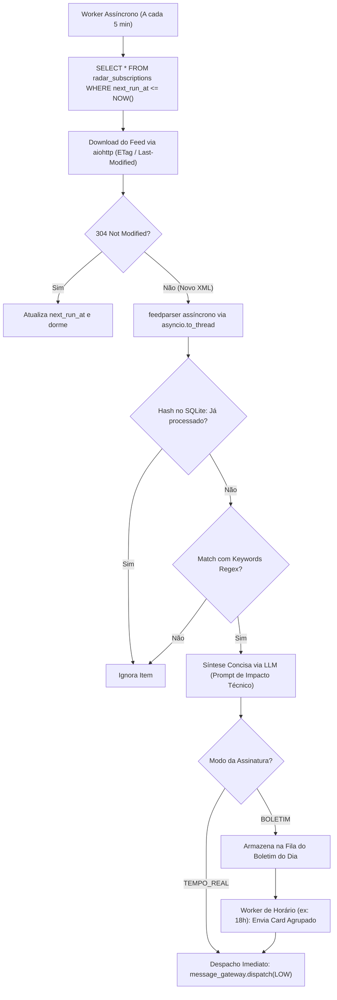

# Especificação de Ideia de Módulo: Radar Autônomo de RSS, ArXiv & Curadoria de Feeds Técnicos

**Código da Proposta:** `IDEA-29`  
**Status:** Implementado em Produção ([MOD-VIS-19](file:///Users/rodrigomodel/antigravity/discord/SPECs/modulos_visiveis/19_RADAR_AUTONOMO_DE_FEEDS.md))  
**Impacto:** Transforma o bot em uma central proativa de inteligência tecnológica contínua, monitorando releases de repositórios do GitHub e papers científicos do ArXiv, sintetizando novidades relevantes e distribuindo em tempo real ou boletins nos canais temáticos do Knowledge Hub.

---

## 1. Origem e Validação no Pipeline Dialético

Esta especificação foi concebida e refinada pela Mesa de Discussão Multiagente:
1. **Identificação da Dor:** Dificuldade do desenvolvedor/usuário de acompanhar o ritmo alucinante de novos papers no ArXiv e novas versões de bibliotecas open-source no GitHub sem ser soterrado por ruído e newsletters não lidas.
2. **Mitigações de Red Team (`/critic`):** Prevenção contra rate limits severos da API REST do GitHub através de feeds Atom nativos públicos (`releases.atom`), proteção contra injeção de prompt em resumos de artigos hostis e controle contra flood de mensagens nos canais.
3. **Solução Pragmática (`/hacker`):** Poller assíncrono com loop único e agendamento granular no SQLite WAL (`next_run_at`), cache HTTP condicional (ETag / Last-Modified com retorno `304 Not Modified`), e filtragem em duas etapas: Regex local pré-LLM (custo zero) $\rightarrow$ Síntese via LLM somente para aprovados.
4. **Alavancagem de Negócio (`/impact`):** Criação de um radar de inteligência de P&D proprietário dentro do Discord, convertendo o bot em um curador analítico de novidades que relaciona os achados diretamente com a arquitetura do projeto.
5. **Ergonomia Visual (`/ux_designer`):** Suporte a modo duplo: notificações cirúrgicas em **Tempo Real** para alertas críticos e **Boletins Consolidados** (Digests matinais/vespertinos) com Rich Embeds de alta densidade e botões de ação rápida.

---

## 2. Justificativa e Motivação

O ecossistema já possui módulos de gestão de conhecimento ([`MOD-VIS-14`](file:///Users/rodrigomodel/antigravity/discord/SPECs/modulos_visiveis/14_KNOWLEDGE_HUB_E_TOPICOS_POR_CANAL.md)) e agentes de pesquisa profunda sob demanda ([`MOD-VIS-16`](file:///Users/rodrigomodel/antigravity/discord/SPECs/modulos_visiveis/16_PESQUISA_PROFUNDA_DEEP_RESEARCH.md)). No entanto, o sistema carecia de um **agente de ingestão autônomo passivo/proativo** que trouxesse insights externos sem depender de comandos manuais contínuos do usuário.

---

## 3. Arquitetura Proposta & Pipeline de Ingestão



---

## 4. Esquema de Dados (SQLite WAL)

Tabelas gerenciadas em `discord/database.py`:

```sql
CREATE TABLE IF NOT EXISTS radar_subscriptions (
    id INTEGER PRIMARY KEY AUTOINCREMENT,
    user_id TEXT NOT NULL,
    channel_id TEXT NOT NULL,
    source_type TEXT NOT NULL, -- 'GITHUB', 'ARXIV', 'RSS'
    source_url TEXT NOT NULL,
    keywords_regex TEXT,
    mode TEXT NOT NULL DEFAULT 'DIGEST', -- 'REALTIME' ou 'DIGEST'
    digest_time TEXT DEFAULT '18:00',
    etag TEXT,
    last_modified TEXT,
    next_run_at TIMESTAMP NOT NULL,
    ativo INTEGER NOT NULL DEFAULT 1,
    created_at TIMESTAMP DEFAULT CURRENT_TIMESTAMP
);

CREATE TABLE IF NOT EXISTS radar_seen_items (
    item_hash TEXT PRIMARY KEY, -- SHA256(source_url + item_id)
    subscription_id INTEGER NOT NULL,
    title TEXT NOT NULL,
    link TEXT NOT NULL,
    processed_at TIMESTAMP DEFAULT CURRENT_TIMESTAMP,
    FOREIGN KEY (subscription_id) REFERENCES radar_subscriptions(id) ON DELETE CASCADE
);

CREATE INDEX IF NOT EXISTS idx_radar_next_run ON radar_subscriptions(next_run_at, ativo);
```

---

## 5. Comandos e Ferramentas Propostas

### Comandos de Chat (Prefixo `!`)
* `!radar assinar <url_ou_chave> [--tempo-real | --boletim HH:MM] [--filtro "keywords"] [--canal #nome]`: Cria uma nova assinatura de feed monitorado.
* `!radar listar`: Exibe um Embed com todas as assinaturas ativas, periodicidade e próximo ciclo.
* `!radar remover <id>`: Remove uma assinatura ativa.
* `!radar agora [id]`: Força a checagem e síntese imediata de um feed ou de todos.
* `!radar boletim`: Força o envio imediato da edição acumulada do dia.

### Ferramentas da LLM (*Function Calling*)
* `pesquisar_novidades_radar(termo: str, limite: int = 5) -> dict`: Permite à IA consultar artigos e releases já capturados pelo radar para responder a dúvidas do usuário.
