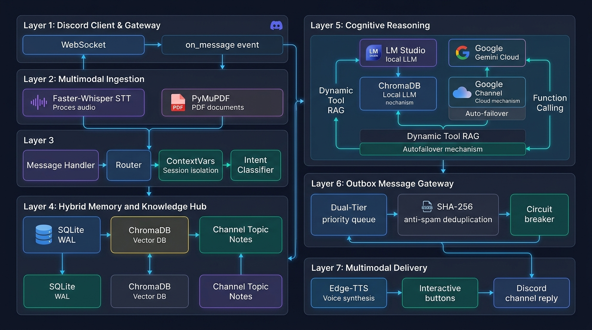
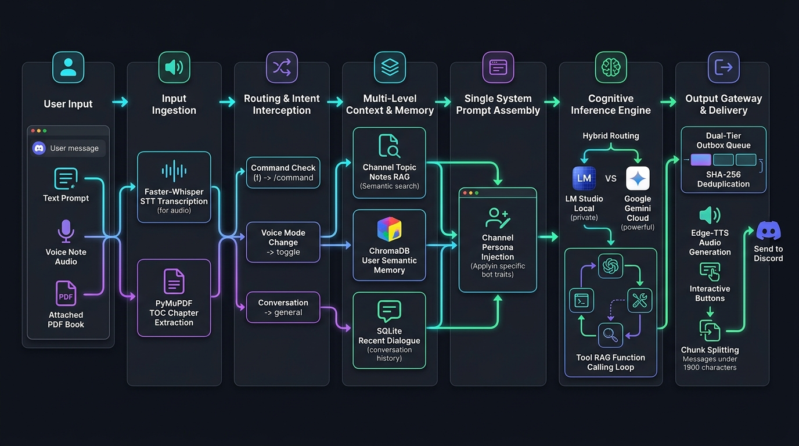

# Diagramas de Arquitetura — Discord AI Bot

Este diretório contém os diagramas visuais de arquitetura do **Discord AI Bot (Antigravity v3.5.0)**, detalhando os subsistemas, a interconexão de módulos e a jornada de processamento de ponta a ponta de uma mensagem.

---

## 1. Visão Geral da Arquitetura e Interconexão Modular

O diagrama a seguir sintetiza a topologia dos módulos do sistema divididos em suas 7 camadas principais:

### Camadas Representadas:
1. **Layer 1 — Discord Client & Gateway:** Conexão WebSocket assíncrona e captura de eventos `on_message`.
2. **Layer 2 — Ingestão Multimodal:** Transcrição em tempo real via Faster-Whisper (STT) e extração de estrutura TOC de PDFs via PyMuPDF.
3. **Layer 3 — Roteador & Contexto:** `message_handler`, interceptação de comandos e isolamento assíncrono com `ContextVars`.
4. **Layer 4 — Memória Híbrida & Base de Conhecimento:** Histórico relacional em SQLite (WAL), memória semântica do usuário em ChromaDB e coleções isoladas de notas por canal (Knowledge Hub).
5. **Layer 5 — Raciocínio Cognitivo & Roteamento Híbrido:** Inferência comutável entre LM Studio (Local) e Google Gemini Cloud (Nuvem), com Dynamic Tool RAG e ciclo autônomo de Function Calling.
6. **Layer 6 — Barramento Outbox (Message Gateway):** Fila prioritária Dual-Tier, deduplicação anti-spam com SHA-256 e Circuit Breaker.
7. **Layer 7 — Entrega Multimodal:** Síntese neural de voz com Edge-TTS (`pt-BR-FranciscaNeural`), views interativas (`discord.ui.View`) e envio particionado ao Discord.

---

## 2. Fluxo Detalhado do Processamento de Mensagens

O diagrama a seguir ilustra a esteira completa percorrida por qualquer dado de entrada do usuário até a entrega final:

### Etapas da Jornada:
1. **User Input:** Mensagem de texto, áudio de voz ou anexo PDF enviado pelo usuário.
2. **Input Ingestion:** Extração multimodal (Whisper CPU int8 VAD ou catalogação de metadados de PDF).
3. **Routing & Intent Interception:** Identificação de comandos `!`, comandos por voz ou conversação contínua.
4. **Multi-Level Context & Memory:** Resgate de notas do canal no ChromaDB, memórias gerais do usuário e histórico recente no SQLite.
5. **Single System Prompt Assembly:** Consolidação hierárquica estrita (Regras Nucleares + Persona do Canal + Contexto RAG) em uma única mensagem `system`.
6. **Cognitive Inference Engine:** Roteamento híbrido (Local vs Nuvem), seleção de ferramentas (Tool RAG) e execução recursiva de tools.
7. **Output Gateway & Delivery:** Fila do Outbox com deduplicação SHA-256, geração de áudio Edge-TTS, divisão em blocos <= 1900 caracteres e despacho ao canal.
