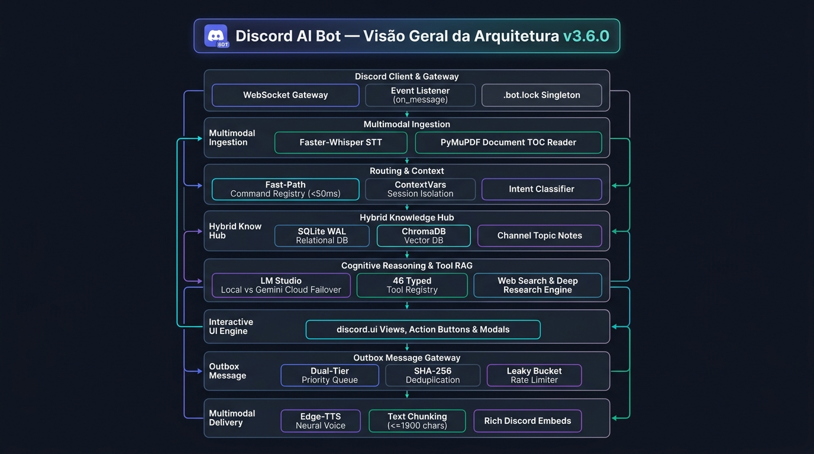

# Diagramas de Arquitetura — Discord AI Bot

Este diretório contém os diagramas visuais e infográficos de arquitetura do **Discord AI Bot (Antigravity)**, detalhando os subsistemas, a interconexão de módulos e a esteira de processamento de ponta a ponta de uma mensagem.

---

## 1. Visão Geral da Arquitetura e Interconexão Modular (v3.6.0 Atualizada)

O diagrama a seguir sintetiza a topologia dos módulos do sistema consolidada na versão **v3.6.0**, incorporando o desacoplamento de comandos rápidos, a esteira de componentes de UI e o ferramental expandido de pesquisa:

### Camadas Representadas (v3.6.0):
1. **Layer 1 — Discord Client & Gateway:** Conexão WebSocket assíncrona, lockfile de instância única (`.bot.lock`) e captura de eventos `on_message`.
2. **Layer 2 — Ingestão Multimodal:** Transcrição em tempo real via Faster-Whisper (STT CPU int8 VAD) e catalogação estruturada TOC de PDFs com PyMuPDF.
3. **Layer 3 — Roteador & Contexto Assíncrono:** Interceptação imediata de comandos prefixados (`!`) via `CommandRegistry` (Fast-Path <50ms sem LLM), isolamento estrito de corrotinas com `ContextVars` (`context_manager.py`) e classificador de intenções naturais.
4. **Layer 4 — Memória Híbrida & Knowledge Hub:** Histórico relacional ACID em SQLite (modo WAL), coleções semânticas de longo prazo do usuário no ChromaDB e coleções temáticas isoladas de notas por canal (`topic_notes_{channel_id}`).
5. **Layer 5 — Raciocínio Cognitivo & Roteamento Híbrido:** Inferência comutada entre LM Studio (Local/Privado) e Google Gemini Cloud (Failover/Flash/Pro), com Dynamic Tool RAG por similaridade de cosseno, ciclo autônomo de Function Calling (46 ferramentas) e módulo de Pesquisa Web / Deep Research.
6. **Layer 6 — Motor de UI Interativa:** Renderização de Views com botões, seletores dinâmicos e modais (`ui_components.py` / `discord.ui`).
7. **Layer 7 — Barramento Outbox (Message Gateway):** Fila prioritária Dual-Tier, algoritmo Leaky Bucket com proteção anti-ban, deduplicação anti-spam por hash SHA-256 e Circuit Breaker.
8. **Layer 8 — Entrega Multimodal:** Síntese neural de voz com Edge-TTS, divisão em blocos seguros (<= 1900 caracteres) e formatação rica com Rich Embeds.

---

## 2. Histórico & Diagrama de Fluxo de Mensagens (v3.5.0 Legado)

Para referência histórica da versão v3.5.0:

- **[Fluxo de Processamento de Mensagem (v3.5.0)](fluxo_processamento_mensagem.jpg)**
- **[Visão Geral da Arquitetura Legada (v3.5.0)](visao_geral_arquitetura.jpg)**

> ℹ️ **Nota de Auditoria Arquitetural (OS-013 - 11/11/2026):**  
> Os diagramas legados de outubro/2026 continuam válidos no conceito central de memória dual e outbox, porém foram complementados pela v3.6.0 com a formalização do **Fast-Path desacoplado** (comandos determinísticos sem custo de LLM), suporte nativo a **Pesquisa Web & Deep Research**, componentes interativos de UI (`discord.ui`) e camada de governança do ecossistema de 15 agentes.
