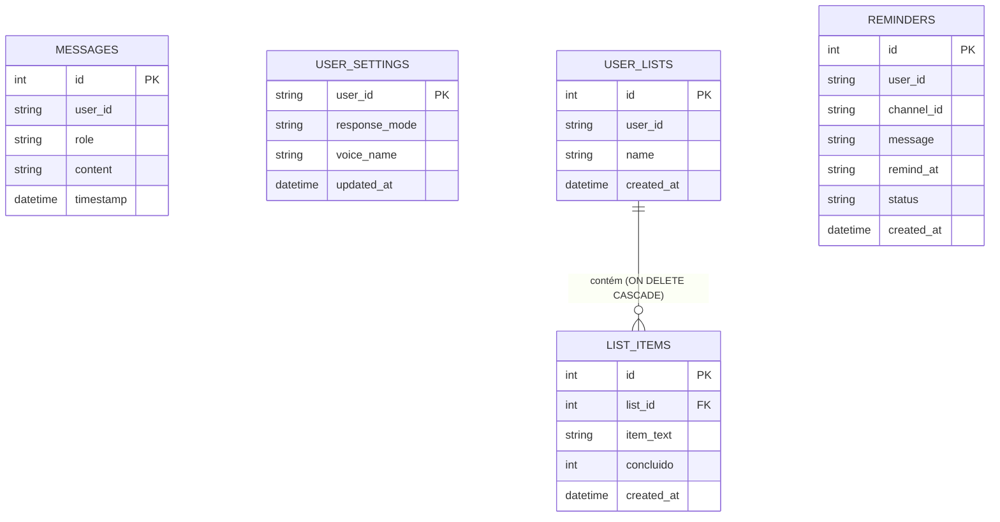

# Especificação Técnica Interna: Banco de Dados Relacional (SQLite)

**Código do Módulo:** `MOD-INT-01`  
**Escopo:** Camada de Persistência Relacional, Modo WAL, Schemas de Tabelas, Índices e Concorrência Segura  
**Arquivos de Implementação:** [`database.py`](file:///Users/rodrigomodel/antigravity/discord/database.py), [`list_manager.py`](file:///Users/rodrigomodel/antigravity/discord/list_manager.py), [`reminder_manager.py`](file:///Users/rodrigomodel/antigravity/discord/reminder_manager.py)  

---

## 1. Arquitetura e Estratégia de Concorrência

O **SQLite** opera como a espinha dorsal de persistência estruturada do bot. Por se tratar de uma aplicação orientada a eventos assíncronos (`asyncio`) onde tarefas concorrentes (como o worker de lembretes e os handlers de mensagens recebidas) podem tentar ler e gravar dados simultaneamente, aplicam-se as seguintes diretrizes arquiteturais:

### 1.1 Write-Ahead Logging (WAL Mode)
Ao inicializar o banco através de `init_db()`, executa-se obrigatoriamente:
```sql
PRAGMA journal_mode = WAL;
```
**Vantagens do Modo WAL:**
- Leituras e escritas não bloqueiam umas às outras. Leitores continuam acessando o banco mesmo enquanto uma transação de escrita está em andamento.
- Operações de commit tornam-se significativamente mais rápidas, gravando em um arquivo `.db-wal` contíguo.

### 1.2 Conexões Isoladas com Timeout Ampliado
Cada operação abre e fecha sua própria conexão através da função auxiliar:
```python
def _get_connection(db_path: Optional[str] = None) -> sqlite3.Connection:
    caminho = _get_db_path(db_path)
    return sqlite3.connect(caminho, timeout=30.0)
```
O parâmetro `timeout=30.0` instrui o driver SQLite a aguardar até 30 segundos pelo destravamento da base antes de levantar `OperationalError: database is locked`, mitigando travamentos sob rajadas de mensagens.

---

## 2. Esquemas das Tabelas (*Schemas DDL*)

O banco `chat_memory.db` é composto por 5 tabelas especializadas:



### 2.1 Tabela `messages` (Histórico Conversacional Imediato)
```sql
CREATE TABLE IF NOT EXISTS messages (
    id INTEGER PRIMARY KEY AUTOINCREMENT,
    user_id TEXT NOT NULL,
    role TEXT NOT NULL, -- 'user' ou 'assistant'
    content TEXT NOT NULL,
    timestamp DATETIME DEFAULT CURRENT_TIMESTAMP
);
CREATE INDEX IF NOT EXISTS idx_messages_user_id ON messages (user_id, id DESC);
```
* **Lógica de Concatenação:** Se o usuário enviar duas mensagens consecutivas antes da resposta do assistente (ex: duas mensagens de texto curtas ou um áudio seguido de texto), a função `salvar_mensagem` concatena o novo conteúdo ao registro anterior com duas quebras de linha (`\n\n`), reduzindo a fragmentação da pilha de contexto.
* **Garantia de Início por `user`:** O método `obter_historico()` localiza o primeiro elemento de papel `user` e descarta mensagens soltas de `assistant` anteriores, atendendo às regras de API de chat.

### 2.2 Tabela `user_settings` (Preferências de Usuário)
```sql
CREATE TABLE IF NOT EXISTS user_settings (
    user_id TEXT PRIMARY KEY,
    response_mode TEXT NOT NULL DEFAULT 'texto', -- 'texto', 'audio' ou 'ambos'
    voice_name TEXT NOT NULL DEFAULT 'pt-BR-FranciscaNeural',
    updated_at DATETIME DEFAULT CURRENT_TIMESTAMP
);
```

### 2.3 Tabelas `user_lists` e `list_items` (Listas de Mercado & Tarefas)
```sql
CREATE TABLE IF NOT EXISTS user_lists (
    id INTEGER PRIMARY KEY AUTOINCREMENT,
    user_id TEXT NOT NULL,
    name TEXT NOT NULL,
    created_at DATETIME DEFAULT CURRENT_TIMESTAMP,
    UNIQUE(user_id, name)
);

CREATE TABLE IF NOT EXISTS list_items (
    id INTEGER PRIMARY KEY AUTOINCREMENT,
    list_id INTEGER NOT NULL REFERENCES user_lists(id) ON DELETE CASCADE,
    item_text TEXT NOT NULL,
    concluido INTEGER NOT NULL DEFAULT 0, -- 0 para pendente, 1 para concluído
    created_at DATETIME DEFAULT CURRENT_TIMESTAMP
);

CREATE INDEX IF NOT EXISTS idx_user_lists_user_name ON user_lists (user_id, name);
CREATE INDEX IF NOT EXISTS idx_list_items_list_id ON list_items (list_id, concluido);
```

### 2.4 Tabela `reminders` (Lembretes e Avisos Programados)
```sql
CREATE TABLE IF NOT EXISTS reminders (
    id INTEGER PRIMARY KEY AUTOINCREMENT,
    user_id TEXT NOT NULL,
    channel_id TEXT NOT NULL,
    message TEXT NOT NULL,
    remind_at TEXT NOT NULL, -- Timestamp ISO 8601 ou YYYY-MM-DD HH:MM:SS
    status TEXT NOT NULL DEFAULT 'pendente', -- 'pendente', 'disparado', 'cancelado', 'falha_envio'
    created_at DATETIME DEFAULT CURRENT_TIMESTAMP
);

CREATE INDEX IF NOT EXISTS idx_reminders_status_time ON reminders (status, remind_at);
CREATE INDEX IF NOT EXISTS idx_reminders_user ON reminders (user_id, status);
```

---

## 3. Políticas de Manutenção e Retenção

1. **`limpar_historico(user_id)`:** Executa `DELETE FROM messages WHERE user_id = ?`, liberando o histórico imediato sob demanda do comando `!limpar`.
2. **Defesa em Profundidade na Exclusão de Listas:** Mesmo com `ON DELETE CASCADE` declarado no SQLite, a rotina `excluir_lista()` executa explicitamente a deleção em `list_items` antes de remover em `user_lists`, prevenindo registros órfãos caso um driver SQLite externo opere com `PRAGMA foreign_keys = OFF`.
