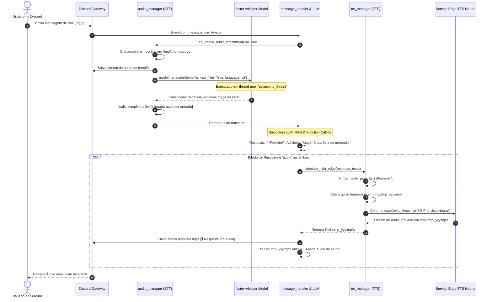

# Especificação Técnica Interna: Pipeline de Áudio & Voz (STT e TTS)

**Código do Módulo:** `MOD-INT-02`  
**Escopo:** Ciclo Completo de Fala: Speech-to-Text (faster-whisper), Limpeza de Markdown, Text-to-Speech (edge-tts) e Gestão Rígida de Arquivos Temporários  
**Arquivos de Implementação:** [`audio_manager.py`](file:///Users/rodrigomodel/antigravity/discord/audio_manager.py), [`tts_manager.py`](file:///Users/rodrigomodel/antigravity/discord/tts_manager.py), [`message_handler.py`](file:///Users/rodrigomodel/antigravity/discord/message_handler.py)  

---

## 1. Visão Geral do Ciclo Bidirecional de Áudio

O bot possui capacidade de comunicação bidirecional por voz. Isso significa que ele é capaz de:
1. **Ouvir:** Receber notas de voz ou arquivos de áudio gravados pelo usuário no Discord, transcrevê-los para texto em português de forma instantânea e alimentar o motor de processamento como se fosse uma mensagem digitada.
2. **Falar:** Converter a resposta textual gerada pela LLM em um arquivo de áudio narrado com voz neural humana em português brasileiro (`pt-BR-FranciscaNeural`) e entregá-lo no canal.



---

## 2. Ingestão e Transcrição: Speech-to-Text (STT)

### 2.1 Identificação de Mensagens de Voz no Discord
O método `eh_anexo_audio(attachment)` utiliza 3 critérios hierárquicos:
1. **Flag Nativa do Discord:** `attachment.is_voice_message()` (para mensagens gravadas pelo microfone nativo do aplicativo Discord Mobile/Desktop).
2. **MIME Type:** Validação de `content_type` contendo `audio/`, `ogg`, `opus`, `mp3`, `wav`.
3. **Extensão do Arquivo:** Extensões de áudio suportadas: `.ogg`, `.mp3`, `.wav`, `.m4a`, `.aac`, `.flac`, `.opus`, `.wma`, `.webm`.

### 2.2 Compatibilidade PyAV (av >= 14)
Versões recentes do PyAV descontinuaram o argumento `metadata_errors`. Para evitar exceções de descontinuidade no `faster-whisper`, o módulo aplica um shim transparente no topo de `audio_manager.py`:
```python
try:
    import av
    _orig_av_open = av.open
    def _compat_av_open(*args, **kwargs):
        kwargs.pop("metadata_errors", None)
        return _orig_av_open(*args, **kwargs)
    av.open = _compat_av_open
except Exception as _e_av:
    logger.debug("Shim de PyAV não aplicado: %s", _e_av)
```

### 2.3 Modelo Faster-Whisper e Configurações
O motor utiliza o `faster-whisper`, uma implementação reescrita do Whisper da OpenAI utilizando CTranslate2, sendo até 4x mais rápida e com consumo reduzido de memória:
* **Tamanho do Modelo:** `base` (excelente trade-off entre acurácia em português e latência < 1s).
* **Quantização:** `compute_type="int8"` em CPU, minimizando o impacto na memória RAM.
* **Filtro VAD (Voice Activity Detection):** `vad_filter=True` ativado, ignorando ruídos de fundo e trechos de silêncio antes e depois da fala.
* **Thread Offloading:** A inferência é executada via `await asyncio.to_thread(transcrever_arquivo_audio, temp_path, idioma)`, garantindo que o heartbeat do bot não seja afetado durante a decodificação do áudio.

---

## 3. Síntese de Fala Neural: Text-to-Speech (TTS)

### 3.1 Sanitização Textual para Fala (`limpar_texto_para_tts`)
Modelos de LLM frequentemente formatam suas respostas utilizando sintaxe Markdown rica (negritos `**`, itálicos `*`, títulos `#`, códigos ` ``` `, URLs `https://...` e menções do Discord `<@123>`).
Se esses caracteres fossem passados diretamente ao sintetizador de voz, a narração leria os símbolos literais (ex: *"asterisco asterisco Perfeito asterisco asterisco"*).

A função `limpar_texto_para_tts()` executa uma higienização rigorosa via expressões regulares:
1. **Blocos de Código:** Substituídos pela menção falada *"código omitido no áudio"*.
2. **Links Markdown `[texto](url)`:** Converte para apenas *"texto"*.
3. **URLs puras:** Substituídas pela palavra falada *"link"*.
4. **Menções do Discord:** Remove IDs numéricos `<@123456>` e substitui IDs de canais `<#123456>` por *"canal"*.
5. **Marcadores Markdown:** Remove `**`, `__`, `~~`, `` ` ``, `#`, `•`, `-`, `>`.
6. **Controle de Tamanho:** Trunca textos excessivamente longos em ~2000 caracteres para evitar timeouts e garantir respostas orais objetivas.

### 3.2 Motor Edge-TTS
A síntese utiliza a biblioteca `edge-tts`, conectando-se diretamente aos servidores do Microsoft Edge Neural TTS:
* **Voz Padrão:** `pt-BR-FranciscaNeural` (voz feminina expressiva e natural em português do Brasil).
* **Formato de Saída:** Arquivo de áudio MP3 de alta fidelidade.
* **Fallback Gracioso:** Se o serviço de TTS retornar qualquer erro de rede, o bot registra um aviso no log e efetua fallback enviando a resposta em texto convencional, garantindo que o usuário nunca fique sem retorno.

---

## 4. Política Crítica de Destruição de Arquivos Temporários

Tanto na entrada (STT) quanto na saída (TTS), arquivos no disco do sistema operacional são manipulados. Para prevenir esgotamento de inodes e vazamento de espaço em disco no servidor, **a exclusão em bloco `finally:` é obrigatória em todas as rotinas**:

```python
temp_path = None
try:
    with tempfile.NamedTemporaryFile(suffix=".mp3", delete=False) as tmp:
        temp_path = Path(tmp.name)
    # Geração ou download do áudio...
    await communicate.save(str(temp_path))
    await channel.send(file=discord.File(str(temp_path), filename="resposta.mp3"))
finally:
    if temp_path and temp_path.exists():
        temp_path.unlink()  # Destrói o arquivo do sistema operacional imediatamente
```
Isso garante 100% de integridade e limpeza do ambiente mesmo em caso de cancelamento da tarefa ou erro de rede.
