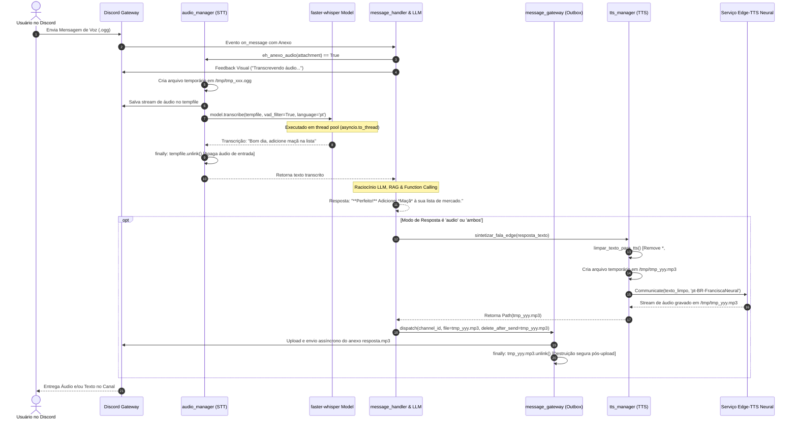

# Especificação Técnica Interna: Pipeline de Áudio & Voz (STT e TTS)

**Código do Módulo:** `MOD-INT-02`  
**Escopo:** Ciclo Completo de Fala: Speech-to-Text (faster-whisper), Limpeza de Markdown, Text-to-Speech (edge-tts) e Gestão Rígida de Arquivos Temporários  
**Arquivos de Implementação:** [`audio_manager.py`](file:///Users/rodrigomodel/antigravity/discord/audio_manager.py), [`tts_manager.py`](file:///Users/rodrigomodel/antigravity/discord/tts_manager.py), [`message_handler.py`](file:///Users/rodrigomodel/antigravity/discord/message_handler.py)  

---

## 1. Visão Geral do Ciclo Bidirecional de Áudio

O bot possui capacidade de comunicação bidirecional por voz. Isso significa que ele é capaz de:
1. **Ouvir:** Receber notas de voz ou arquivos de áudio gravados pelo usuário no Discord, transcrevê-los para texto em português de forma instantânea e alimentar o motor de processamento como se fosse uma mensagem digitada.
2. **Falar:** Converter a resposta textual gerada pela LLM em um arquivo de áudio narrado com voz neural humana em português brasileiro (`pt-BR-FranciscaNeural`) e entregá-lo no canal.



---

### 1.1 Detecção Conversacional de Modo de Resposta (Voz vs Texto)
Além dos comandos formais de configuração (`!voz`), o pipeline suporta chaveamento orgânico e conversacional através da função `detectar_solicitacao_modo_resposta(texto)`.
* **Ativação de Voz:** Expressões como `"pode falar"`, `"manda em áudio"`, `"fala comigo"`, `"responda por voz"` alternam imediatamente a preferência do usuário na sessão para `audio` ou `ambos`.
* **Retorno a Texto:** Expressões como `"responda por texto"`, `"só texto"`, `"não mande áudio"` reconfiguram a preferência para `texto`.
* **Persistência Dinâmica:** A preferência atualizada é persistida em `database.py` (`definir_configuracao_usuario`) de forma não-bloqueante.

---

## 2. Ingestão e Transcrição: Speech-to-Text (STT)

### 2.1 Identificação de Mensagens de Voz no Discord
O método `eh_anexo_audio(attachment)` utiliza 3 critérios hierárquicos:
1. **Flag Nativa do Discord:** `attachment.is_voice_message()` (para mensagens gravadas pelo microfone nativo do aplicativo Discord Mobile/Desktop).
2. **MIME Type:** Validação de `content_type` contendo `audio/`, `ogg`, `opus`, `mp3`, `wav`.
3. **Extensão do Arquivo:** Extensões de áudio suportadas: `.ogg`, `.mp3`, `.wav`, `.m4a`, `.aac`, `.flac`, `.opus`, `.wma`, `.webm`.

### 2.2 Compatibilidade PyAV (av >= 14)
Versões recentes do PyAV descontinuaram o argumento `metadata_errors`. Para evitar exceções de descontinuidade no `faster-whisper`, o módulo aplica um shim transparente no topo de `audio_manager.py`:
```python
try:
    import av
    _orig_av_open = av.open
    def _compat_av_open(*args, **kwargs):
        kwargs.pop("metadata_errors", None)
        return _orig_av_open(*args, **kwargs)
    av.open = _compat_av_open
except Exception as _e_av:
    logger.debug("Shim de PyAV não aplicado: %s", _e_av)
```

### 2.3 Modelo Faster-Whisper e Configurações
O motor utiliza o `faster-whisper`, uma implementação reescrita do Whisper da OpenAI utilizando CTranslate2, sendo até 4x mais rápida e com consumo reduzido de memória:
* **Tamanho do Modelo:** `base` (excelente trade-off entre acurácia em português e latência < 1s).
* **Quantização:** `compute_type="int8"` em CPU, minimizando o impacto na memória RAM.
* **Filtro VAD (Voice Activity Detection):** `vad_filter=True` ativado, ignorando ruídos de fundo e trechos de silêncio antes e depois da fala.
* **Thread Offloading:** A inferência é executada via `await asyncio.to_thread(transcrever_arquivo_audio, temp_path, idioma)`, garantindo que o heartbeat do bot não seja afetado durante a decodificação do áudio.

### 2.4 Feedback Visual Reativo Durante a Transcrição
Para assegurar a 1ª Heurística de Nielsen (Visibilidade do Status do Sistema), o fluxo de processamento de mensagens de voz emite um feedback visual imediato no canal do Discord:
* Ao interceptar um anexo de áudio, o `message_handler.py` despacha uma mensagem transitória informando o processamento (`"🎙️ Transcrevendo áudio..."`).
* Após a conclusão da transcrição pelo Faster-Whisper, a mensagem de status é editada ou substituída pela resposta consolidada do assistente, eliminando a sensação de lentidão ou travamento.

---

## 3. Síntese de Fala Neural: Text-to-Speech (TTS)

### 3.1 Sanitização Textual para Fala (`limpar_texto_para_tts`)
Modelos de LLM frequentemente formatam suas respostas utilizando sintaxe Markdown rica (negritos `**`, itálicos `*`, títulos `#`, códigos ` ``` `, URLs `https://...` e menções do Discord `<@123>`).
Se esses caracteres fossem passados diretamente ao sintetizador de voz, a narração leria os símbolos literais (ex: *"asterisco asterisco Perfeito asterisco asterisco"*).

A função `limpar_texto_para_tts()` executa uma higienização rigorosa via expressões regulares:
1. **Blocos de Código:** Substituídos pela menção falada *"código omitido no áudio"*.
2. **Links Markdown `[texto](url)`:** Converte para apenas *"texto"*.
3. **URLs puras:** Substituídas pela palavra falada *"link"*.
4. **Menções do Discord:** Remove IDs numéricos `<@123456>` e substitui IDs de canais `<#123456>` por *"canal"*.
5. **Marcadores Markdown:** Remove `**`, `__`, `~~`, `` ` ``, `#`, `•`, `-`, `>`.
6. **Controle de Tamanho:** Trunca textos excessivamente longos em ~2000 caracteres para evitar timeouts e garantir respostas orais objetivas.

### 3.2 Motor Edge-TTS
A síntese utiliza a biblioteca `edge-tts`, conectando-se diretamente aos servidores do Microsoft Edge Neural TTS:
* **Voz Padrão:** `pt-BR-FranciscaNeural` (voz feminina expressiva e natural em português do Brasil).
* **Formato de Saída:** Arquivo de áudio MP3 de alta fidelidade.
* **Fallback Gracioso:** Se o serviço de TTS retornar qualquer erro de rede, o bot registra um aviso no log e efetua fallback enviando a resposta em texto convencional, garantindo que o usuário nunca fique sem retorno.

---

## 4. Política Crítica de Destruição de Arquivos Temporários

Tanto na entrada (STT) quanto na saída (TTS), arquivos no disco do sistema operacional são manipulados. Para prevenir esgotamento de inodes e vazamento de espaço em disco no servidor, **a exclusão física determinística é obrigatória em 100% dos fluxos**:

### 4.1 Entrada (STT) — Destruição Local Imediata
No pipeline de transcrição, o arquivo temporário é consumido de forma síncrona/offloaded pelo Whisper, permitindo o isolamento clássico em bloco `try ... finally`:

```python
temp_path = None
try:
    with tempfile.NamedTemporaryFile(suffix=".ogg", delete=False) as tmp:
        temp_path = Path(tmp.name)
    # Download do áudio do Discord e transcrição via faster-whisper...
    texto = await asyncio.to_thread(transcrever_arquivo_audio, temp_path)
finally:
    if temp_path and temp_path.exists():
        temp_path.unlink()  # Destrói o arquivo de entrada imediatamente após transcrição
```

### 4.2 Saída (TTS) — Desacoplamento via Outbox (`delete_after_send`)
Na síntese de voz, o envio do arquivo `.mp3` para o canal do Discord é assíncrono e gerenciado pela fila de background do `MessageGateway`. Deletar o arquivo imediatamente em `message_handler.py` provocaria uma *race condition* (o arquivo seria apagado antes do término do streaming HTTP do `aiohttp`).

Por isso, o `message_handler.py` transfere a custódia do arquivo temporário para o Gateway via parâmetro `delete_after_send`:

```python
# Em message_handler.py:
await gateway.dispatch(
    channel_id=message.channel.id,
    content="🎙️ Resposta em áudio:",
    file=discord.File(str(audio_path), filename="resposta.mp3"),
    delete_after_send=audio_path,  # Custódia delegada ao Gateway
)

# Em message_gateway.py (dentro do worker assíncrono do Gateway):
try:
    await channel.send(content=content, file=file)
finally:
    if delete_after_send and delete_after_send.exists():
        delete_after_send.unlink()  # Destruição segura apenas após envio ou falha
```
Isso garante 100% de integridade e limpeza do ambiente sem risco de corrupção de uploads.

---

## 5. 📋 Matriz de Rastreabilidade & Aderência (Auditada em 2026-11-14)

Auditoria realizada via [`/spec-audit`](file:///Users/rodrigomodel/antigravity/.agents/skills/spec-audit/SKILL.md) com homologação do [`/review`](file:///Users/rodrigomodel/antigravity/gerencial/reviews/REV-004_auditoria_pipeline_audio_voz.md) e [`/doc_master`](file:///Users/rodrigomodel/antigravity/gerencial/auditorias/auditoria_2026-11-14_02_PIPELINE_AUDIO_E_VOZ.md):

| ID | Requisito da Especificação | Status | Implementação no Código | Notas de Auditoria |
| :---: | :--- | :---: | :--- | :--- |
| **REQ-01** | Identificação hierárquica de anexos de áudio | 🟢 **Aderente** | [`audio_manager.py:L76-L94`](file:///Users/rodrigomodel/antigravity/discord/audio_manager.py#L76-L94) (`eh_anexo_audio`) | Verifica `is_voice_message()`, MIME types (`audio/`, `ogg`, etc.) e extensões suportadas. |
| **REQ-02** | Shim de compatibilidade PyAV (`av >= 14`) | 🟢 **Aderente** | [`audio_manager.py:L18-L30`](file:///Users/rodrigomodel/antigravity/discord/audio_manager.py#L18-L30) | Remove `metadata_errors` dinamicamente de `av.open`. |
| **REQ-03** | Configuração Faster-Whisper + Thread Offloading | 🟢 **Aderente** | [`audio_manager.py:L57-L74,L102-L107,L158`](file:///Users/rodrigomodel/antigravity/discord/audio_manager.py#L57-L74) | Modelo `base`, `compute_type="int8"`, `vad_filter=True` e `asyncio.to_thread`. |
| **REQ-04** | Destruição de temporários STT em `finally:` | 🟢 **Aderente** | [`audio_manager.py:L166-L173`](file:///Users/rodrigomodel/antigravity/discord/audio_manager.py#L166-L173) | `temp_path.unlink()` compulsório no bloco `finally:` de download/transcrição. |
| **REQ-05** | Sanitização Markdown e regex para TTS | 🟢 **Aderente** | [`tts_manager.py:L21-L61`](file:///Users/rodrigomodel/antigravity/discord/tts_manager.py#L21-L61) (`limpar_texto_para_tts`) | Remove blocos de código, links, menções do Discord e formatações ricas. |
| **REQ-06** | Síntese de fala neural via Edge-TTS | 🟢 **Aderente** | [`tts_manager.py:L64-L112`](file:///Users/rodrigomodel/antigravity/discord/tts_manager.py#L64-L112) (`sintetizar_fala_edge`) | Voz `pt-BR-FranciscaNeural`, fallback gracioso para texto e geração MP3. |
| **REQ-07** | Destruição de temporários TTS via Gateway | 🟢 **Aderente** | [`message_handler.py:L644,L681,L686-L694`](file:///Users/rodrigomodel/antigravity/discord/message_handler.py#L644)<br>[`message_gateway.py:L264-L270`](file:///Users/rodrigomodel/antigravity/discord/message_gateway.py#L264-L270) | Desacoplamento seguro via `delete_after_send`, aniquilando *race conditions* de upload. |
| **REQ-08** | Roteamento dinâmico texto / áudio / ambos | 🟢 **Aderente** | [`message_handler.py:L612-L685`](file:///Users/rodrigomodel/antigravity/discord/message_handler.py#L612-L685) | Respeita configurações persistidas do usuário em `database.py`. |
| **REQ-09** | Detecção Conversacional de Modo de Resposta | 🟢 **Aderente** | [`message_handler.py:L196-L238,L365-L381`](file:///Users/rodrigomodel/antigravity/discord/message_handler.py#L196-L238) | Chaveia para voz/texto por linguagem natural sem atrito (Código Excedente Homologado). |
| **REQ-10** | Feedback Visual Reativo na Transcrição | 🟢 **Aderente** | [`message_handler.py:L305-L315`](file:///Users/rodrigomodel/antigravity/discord/message_handler.py#L305-L315) | Mensagem de status transitória garantindo Nielsen #1 (Código Excedente Homologado). |
| **REQ-11** | Parâmetro Outbox `delete_after_send` | 🟢 **Aderente** | [`message_gateway.py:L264-L270`](file:///Users/rodrigomodel/antigravity/discord/message_gateway.py#L264-L270) | Limpeza delegada ao barramento pós-envio HTTP (Código Excedente Homologado). |

