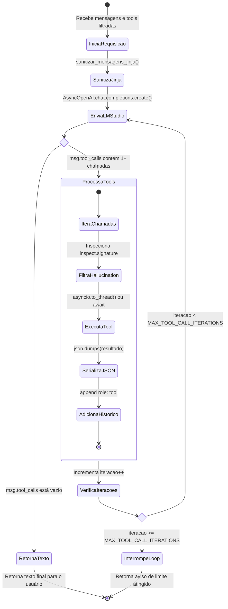

# Especificação Técnica Interna: Motor LLM & Function Calling

**Código do Módulo:** `MOD-INT-03`  
**Escopo:** Cliente Híbrido Assíncrono (LM Studio Local + Google Gemini Cloud Failover), Ciclo de Execução de Tools, Sanitização de Templates Jinja e Contratos Tipados  
**Arquivos de Implementação:** [`llm_client.py`](file:///Users/rodrigomodel/antigravity/discord/llm_client.py), [`tools/registry.py`](file:///Users/rodrigomodel/antigravity/discord/tools/registry.py)  

---

## 1. Visão Geral e Arquitetura do Cliente LLM

A comunicação com os modelos de linguagem é centralizada na classe `LLMClient`. Ela opera como um cliente híbrido assíncrono que integra o servidor local do **LM Studio** (`http://localhost:1234/v1`) com suporte nativo a endpoints em nuvem como o **Google Gemini API** (`gemini-2.5-flash` e `gemini-2.5-pro`), utilizando o SDK oficial `openai.AsyncOpenAI`.

### 1.1 Parâmetros Operacionais Padronizados
* **`base_url`:** `LM_STUDIO_URL` (default: `"http://localhost:1234/v1"`).
* **`model`:** `MODELO_LLM` (default: `"qwen/qwen3.5-9b"`).
* **`temperature`:** `0.7` (equilíbrio ideal entre precisão factual nas tools e naturalidade expressiva).
* **`timeout`:** `60.0` segundos por requisição HTTP.
* **`max_iterations`:** `5` iterações de chamadas de tools por mensagem (prevenção de looping infinito).

### 1.2 Roteamento Híbrido, Auto-Failover e Classificação de Demanda
Para assegurar disponibilidade contínua e viabilizar tarefas pesadas sem sobrecarregar o hardware local, o cliente implementa os mecanismos da [proposta `IDEA-07`](file:///Users/rodrigomodel/antigravity/discord/SPECs/SPECS_IDEIAS_IMPLEMENTADAS/07_ROTEAMENTO_HIBRIDO_E_PROVEDORES_CLOUD_LLM.md) e do [`Módulo Visível 10`](file:///Users/rodrigomodel/antigravity/discord/SPECs/modulos_visiveis/10_ROTEAMENTO_HIBRIDO_E_GOOGLE_GEMINI.md):
1. **Auto-Failover de Alta Disponibilidade:** O cliente monitora o LM Studio local com timeout rápido (`LOCAL_TIMEOUT_FAILOVER_SECONDS`). Se o servidor local estiver offline, sem memória ou travar, o método `gerar_resposta()` ativa o transbordo automático (*fallback*) para o Google Gemini Flash, mantendo o serviço do bot ininterrupto.
2. **Classificação Heurística de Demanda (`classificar_complexidade_demanda`):** No modo `auto`, a mensagem é analisada antes do envio:
   - Demandas de rotina (saudações, hora, listas, lembretes) são direcionadas ao LM Studio local;
   - Demandas analíticas ou densas (leitura de livros/PDFs, código complexo, links web ou mensagens > 350 caracteres) são despachadas para o Google Gemini Flash/Pro.
3. **Identificação Visual Transparente (Badges):** Cada resposta gerada recebe a identificação clara de sua origem: `🏠 [LM Studio: ...]`, `⚡ [Google Gemini: ...]` ou `⚡ [Google Gemini: ... | Auto-Failover]`.

---

## 2. Sanitização Defensiva para Templates Jinja (`sanitizar_mensagens_jinja`)

### 2.1 O Problema dos Modelos Modernos no LM Studio
Modelos de última geração (famílias Qwen 2.5/3.5, Mistral Instruct, Llama 3) incorporam chat templates Jinja compilados nos arquivos `tokenizer_config.json`. Nesses templates, há uma validação estrita:
```jinja

    
        
            {{- raise_exception('System message must be at the beginning.') }}
        
    

```
Se a lista de mensagens contiver **mais de uma mensagem de sistema** (por exemplo, o system prompt base + um bloco RAG de memórias do ChromaDB) ou uma mensagem `system` em qualquer posição que não seja a primeira (`index 0`), o LM Studio rejeita a requisição com erro HTTP 400/500 (`Jinja Exception`).

### 2.2 A Solução de Sanitização
Antes de repassar qualquer payload para a API, a função `sanitizar_mensagens_jinja()` normaliza a estrutura:
1. Extrai todo o conteúdo de qualquer mensagem com `role == "system"`.
2. Concatena todos os conteúdos em **uma única mensagem de sistema consolidada**.
3. Posiciona essa mensagem única rigorosamente no índice 0.
4. Preserva todas as mensagens subsequentes (`user`, `assistant`, `tool`).

```python
def sanitizar_mensagens_jinja(mensagens: List[Any]) -> List[Any]:
    system_partes = []
    outras_mensagens = []
    for msg in mensagens:
        role = msg.get("role") if isinstance(msg, dict) else getattr(msg, "role", None)
        content = msg.get("content") if isinstance(msg, dict) else getattr(msg, "content", None)
        if role == "system":
            if content and str(content).strip():
                system_partes.append(str(content).strip())
        else:
            outras_mensagens.append(msg)

    mensagens_finais = []
    if system_partes:
        mensagens_finais.append({"role": "system", "content": "\n\n".join(system_partes)})
    mensagens_finais.extend(outras_mensagens)
    return mensagens_finais
```

### 2.3 Higienização de Badges Visuais Repetidos (`sanitizar_badges_repetidos`)
Modelos autorregressivos expostos a histórico conversacional com identificadores de provedor tendem a imitar o cabeçalho no corpo gerado.
Para evitar poluição visual com badges duplicados (`🏠 [LM Studio: ...]`, `⚡ [Google Gemini: ...]`), a função `sanitizar_badges_repetidos(texto)` aplica limpeza defensiva com expressão regular antes de retornar a resposta ao usuário:

```python
def sanitizar_badges_repetidos(texto: str) -> str:
    if not texto:
        return ""
    padrao = r"^(?:[\s\n]*[`⚡🏠🧠\s]*\[(?:Google Gemini|LM Studio)[^\]]+\][`\s]*)+"
    return re.sub(padrao, "", texto, flags=re.MULTILINE).strip()
```

---

## 3. Ciclo de Orquestração de Ferramentas (*Tool Calling Loop*)

O método `gerar_resposta()` implementa o loop autônomo de resolução de chamadas de ferramentas:



### 3.1 Blindagem Contra Alucinação de Parâmetros pela LLM
Modelos de linguagem frequentemente geram argumentos adicionais não declarados (ex: passar `{"user_id": 123, "confirmacao": true}` para uma função que só aceita `nome_lista`).
No `ToolRegistry.execute()`, o código inspeciona a assinatura da função:
```python
sig = inspect.signature(tool.func)
tem_varkw = any(p.kind == inspect.Parameter.VAR_KEYWORD for p in sig.parameters.values())
if not tem_varkw:
    # Remove qualquer parâmetro inventado pela LLM que a função Python não declare
    args_sanitizados = {k: v for k, v in args_dict.items() if k in sig.parameters}
else:
    args_sanitizados = args_dict
```
Isso impede que a execução falhe com `TypeError: func() got an unexpected keyword argument` e garante que a ferramenta execute perfeitamente.

### 3.2 Contrato Canônico de Retorno das Ferramentas

Todas as funções registradas como ferramentas de Function Calling (`@register_tool`) devem retornar compulsoriamente uma estrutura tipada em formato de dicionário padronizado:

```python
{
    "sucesso": bool,            # True se a operação ocorreu com êxito; False caso contrário
    "dados": Any,               # Payload estruturado com os dados retornados (dict, list, str)
    "erro": Optional[str]       # Mensagem descritiva de erro ou None em caso de sucesso
}
```

**Benefícios Arquiteturais:**
1. **Consistência Cognitiva para a LLM:** O modelo recebe sempre a mesma convenção sintática, facilitando a interpretação determinística de falhas e sucessos.
2. **Tratamento Defensivo:** Erros de infraestrutura, validação ou APIs externas nunca explodem exceções não tratadas no loop assíncrono; são encapsulados em `{"sucesso": False, "erro": "...", "dados": None}` para que a LLM explique o ocorrido com naturalidade ao usuário.

### 3.3 API de Introspecção do Catálogo (`get_registered_names`)
O registro expõe o método `get_registered_names() -> List[str]`, permitindo ao motor de Tool RAG semântico, aos comandos de diagnóstico de terminal e aos testes automatizados inspecionar dinamicamente o catálogo de ferramentas carregadas no runtime.

---

## 4. 📋 Matriz de Rastreabilidade & Aderência (Auditada em 2026-11-14)

Auditoria realizada via [`/spec-audit`](file:///Users/rodrigomodel/antigravity/.agents/skills/spec-audit/SKILL.md) com homologação do [`/review`](file:///Users/rodrigomodel/antigravity/gerencial/reviews/REV-005_auditoria_llm_client_tools.md) e [`/doc_master`](file:///Users/rodrigomodel/antigravity/gerencial/auditorias/auditoria_2026-11-14_03_LLM_CLIENT_E_TOOL_CALLING.md):

| ID | Requisito da Especificação | Status | Implementação no Código | Notas de Auditoria |
| :---: | :--- | :---: | :--- | :--- |
| **REQ-01** | Parâmetros operacionais padronizados do LLM | 🟢 **Aderente** | [`llm_client.py:L117-L128,L189`](file:///Users/rodrigomodel/antigravity/discord/llm_client.py#L117-L128) | Consome `LM_STUDIO_URL`, `MODELO_LLM`, `temperature=0.7`, `timeout=60.0s` e `max_iterations=5`. |
| **REQ-02** | Sanitização defensiva para templates Jinja | 🟢 **Aderente** | [`llm_client.py:L42-L74`](file:///Users/rodrigomodel/antigravity/discord/llm_client.py#L42-L74) (`sanitizar_mensagens_jinja`) | Normaliza mensagens `system` em bloco único no índice 0. |
| **REQ-03** | Ciclo de orquestração de ferramentas (Loop) | 🟢 **Aderente** | [`llm_client.py:L175-L226`](file:///Users/rodrigomodel/antigravity/discord/llm_client.py#L175-L226) (`_executar_loop_completions`) | Loop com limite de 5 iterações, `tools` e resolução assíncrona. |
| **REQ-04** | Blindagem contra alucinação de argumentos | 🟢 **Aderente** | [`tools/registry.py:L150-L156`](file:///Users/rodrigomodel/antigravity/discord/tools/registry.py#L150-L156) (`ToolRegistry.execute`) | Descarta chaves inexistentes em `sig.parameters` se não houver `**kwargs`. |
| **REQ-05** | Offloading assíncrono de tools síncronas | 🟢 **Aderente** | [`tools/registry.py:L158-L163`](file:///Users/rodrigomodel/antigravity/discord/tools/registry.py#L158-L163) (`ToolRegistry.execute`) | Executa síncronas via `asyncio.to_thread` preservando heartbeat do Discord. |
| **REQ-06** | Schema automático e registro decorado | 🟢 **Aderente** | [`tools/registry.py:L29-L116`](file:///Users/rodrigomodel/antigravity/discord/tools/registry.py#L29-L116) (`@register_tool`) | Inferência de tipos tipada e exportação `get_schemas()`. |
| **REQ-07** | Contrato canônico de retorno das ferramentas | 🟢 **Aderente** | [`tools/registry.py:L164-L215`](file:///Users/rodrigomodel/antigravity/discord/tools/registry.py#L164-L215) (`ToolRegistry.execute`) | Normaliza compulsoriamente em `{"sucesso": bool, "dados": Any, "erro": str}`. |
| **REQ-08** | Roteamento híbrido e auto-failover | 🟢 **Aderente** | [`llm_client.py:L77-L112,L129-L174,L228-L355`](file:///Users/rodrigomodel/antigravity/discord/llm_client.py#L77-L112) | Google Gemini API + Failover automático sob indisponibilidade do nó local. |
| **REQ-09** | Higienização de badges visuais repetidos | 🟢 **Aderente** | [`llm_client.py:L34-L40,L287,L317,L345`](file:///Users/rodrigomodel/antigravity/discord/llm_client.py#L34-L40) (`sanitizar_badges_repetidos`) | Remove regex de badges redundantes simulados pela LLM. |
| **REQ-10** | Introspecção do catálogo de ferramentas | 🟢 **Aderente** | [`tools/registry.py:L216-L219`](file:///Users/rodrigomodel/antigravity/discord/tools/registry.py#L216-L219) (`get_registered_names`) | API limpa para inspeção das ferramentas carregadas no runtime. |

