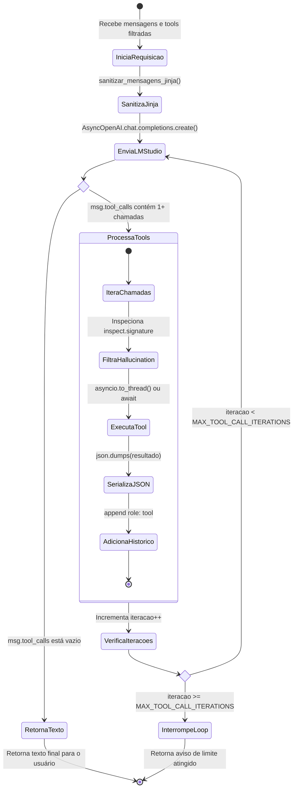

# Especificação Técnica Interna: Motor LLM & Function Calling

**Código do Módulo:** `MOD-INT-03`  
**Escopo:** Integração Assíncrona com LM Studio, Ciclo de Execução de Tools e Sanitização de Templates Jinja  
**Arquivos de Implementação:** [`llm_client.py`](file:///Users/rodrigomodel/antigravity/discord/llm_client.py), [`tools/registry.py`](file:///Users/rodrigomodel/antigravity/discord/tools/registry.py)  

---

## 1. Visão Geral e Arquitetura do Cliente LLM

A comunicação com o modelo de linguagem é centralizada na classe `LLMClient`. Ela utiliza o SDK oficial `openai.AsyncOpenAI` configurado para apontar para o servidor local do **LM Studio** (`http://localhost:1234/v1`), preservando compatibilidade com qualquer endpoint compatível com o padrão OpenAI Chat Completions (ex: vLLM, Ollama, OpenAI oficial).

### 1.1 Parâmetros Operacionais Padronizados
* **`base_url`:** `LM_STUDIO_URL` (default: `"http://localhost:1234/v1"`).
* **`model`:** `MODELO_LLM` (default: `"qwen/qwen3.5-9b"`).
* **`temperature`:** `0.7` (equilíbrio ideal entre precisão factual nas tools e naturalidade expressiva).
* **`timeout`:** `60.0` segundos por requisição HTTP.
* **`max_iterations`:** `5` iterações de chamadas de tools por mensagem (prevenção de looping infinito).

---

## 2. Sanitização Defensiva para Templates Jinja (`sanitizar_mensagens_jinja`)

### 2.1 O Problema dos Modelos Modernos no LM Studio
Modelos de última geração (famílias Qwen 2.5/3.5, Mistral Instruct, Llama 3) incorporam chat templates Jinja compilados nos arquivos `tokenizer_config.json`. Nesses templates, há uma validação estrita:
```jinja

    
        
            {{- raise_exception('System message must be at the beginning.') }}
        
    

```
Se a lista de mensagens contiver **mais de uma mensagem de sistema** (por exemplo, o system prompt base + um bloco RAG de memórias do ChromaDB) ou uma mensagem `system` em qualquer posição que não seja a primeira (`index 0`), o LM Studio rejeita a requisição com erro HTTP 400/500 (`Jinja Exception`).

### 2.2 A Solução de Sanitização
Antes de repassar qualquer payload para a API, a função `sanitizar_mensagens_jinja()` normaliza a estrutura:
1. Extrai todo o conteúdo de qualquer mensagem com `role == "system"`.
2. Concatena todos os conteúdos em **uma única mensagem de sistema consolidada**.
3. Posiciona essa mensagem única rigorosamente no índice 0.
4. Preserva todas as mensagens subsequentes (`user`, `assistant`, `tool`).

```python
def sanitizar_mensagens_jinja(mensagens: List[Any]) -> List[Any]:
    system_partes = []
    outras_mensagens = []
    for msg in mensagens:
        role = msg.get("role") if isinstance(msg, dict) else getattr(msg, "role", None)
        content = msg.get("content") if isinstance(msg, dict) else getattr(msg, "content", None)
        if role == "system":
            if content and str(content).strip():
                system_partes.append(str(content).strip())
        else:
            outras_mensagens.append(msg)

    mensagens_finais = []
    if system_partes:
        mensagens_finais.append({"role": "system", "content": "\n\n".join(system_partes)})
    mensagens_finais.extend(outras_mensagens)
    return mensagens_finais
```

---

## 3. Ciclo de Orquestração de Ferramentas (*Tool Calling Loop*)

O método `gerar_resposta()` implementa o loop autônomo de resolução de chamadas de ferramentas:



### 3.1 Blindagem Contra Alucinação de Parâmetros pela LLM
Modelos de linguagem frequentemente geram argumentos adicionais não declarados (ex: passar `{"user_id": 123, "confirmacao": true}` para uma função que só aceita `nome_lista`).
No `ToolRegistry.execute()`, o código inspeciona a assinatura da função:
```python
sig = inspect.signature(tool.func)
tem_varkw = any(p.kind == inspect.Parameter.VAR_KEYWORD for p in sig.parameters.values())
if not tem_varkw:
    # Remove qualquer parâmetro inventado pela LLM que a função Python não declare
    args_sanitizados = {k: v for k, v in args_dict.items() if k in sig.parameters}
else:
    args_sanitizados = args_dict
```
Isso impede que a execução falhe com `TypeError: func() got an unexpected keyword argument` e garante que a ferramenta execute perfeitamente.
