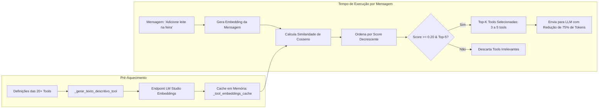

# Especificação Técnica Interna: Filtragem Semântica de Ferramentas (Tool RAG)

**Código do Módulo:** `MOD-INT-04`  
**Escopo:** Seleção Dinâmica de Ferramentas via Similaridade Vetorial de Cosseno e Redução de Sobrecarga de Contexto  
**Arquivos de Implementação:** [`tools/tool_filter.py`](file:///Users/rodrigomodel/antigravity/discord/tools/tool_filter.py), [`tools/registry.py`](file:///Users/rodrigomodel/antigravity/discord/tools/registry.py)  

---

## 1. O Desafio da Sobrecarga de Contexto (*Context Bloat*)

À medida que o bot expandiu seu ecossistema para mais de 20 ferramentas integradas (agenda Google, listas, lembretes, PDFs, controle de áudio, memória, fusos horários), enviar a especificação JSON completa de todas as ferramentas em todas as mensagens gerava dois problemas críticos:
1. **Consumo Excessivo de Tokens de Entrada:** Cada esquema de ferramenta consome entre 150 e 300 tokens. Enviar 20 ferramentas representa ~4.000 tokens apenas em definições de tools em cada requisição.
2. **Degradação de Raciocínio da LLM:** Modelos menores (ex: 7B a 9B parâmetros) sofrem de dispersão de atenção quando expostos a um catálogo massivo de funções irrelevantes para a intenção imediata do usuário.

---

## 2. Solução Arquitetural: Tool RAG

O módulo **Tool Filtering RAG** trata o catálogo de ferramentas como uma base de conhecimento pesquisável. Antes de chamar a LLM, o sistema analisa a mensagem do usuário, calcula a relevância semântica de cada ferramenta registrada e entrega para o modelo apenas as ferramentas mais prováveis de serem necessárias.



---

## 3. Componentes Matemáticos e Algoritmo

### 3.1 Geração de Texto Descritivo para Vetorização
Para maximizar a precisão semântica na busca, o texto vetorizado de cada ferramenta incorpora tanto o nome e a descrição funcional quanto os nomes dos parâmetros declarados:
```python
def _gerar_texto_descritivo_tool(tool: ToolDefinition) -> str:
    partes = [f"Ferramenta '{tool.name}': {tool.description}"]
    params = tool.parameters.get("properties", {})
    if params:
        partes.append(f"Parâmetros: {', '.join(params.keys())}")
    return " ".join(partes)
```

### 3.2 Similaridade de Cosseno entre Vetores Densos
A proximidade entre o vetor da mensagem do usuário ($u$) e o vetor da ferramenta ($v$) é calculada por:
$$\text{Sim}(u, v) = \frac{u \cdot v}{\|u\| \|v\|} = \frac{\sum_{i=1}^n u_i v_i}{\sqrt{\sum_{i=1}^n u_i^2} \sqrt{\sum_{i=1}^n v_i^2}}$$

### 3.3 Critérios de Filtragem e Limiares
* **`TOOL_FILTER_TOP_K` (default: 5):** Limite máximo de ferramentas enviadas por requisição.
* **`TOOL_FILTER_MIN_SIMILARITY` (default: 0.20):** Pontuação mínima para que uma ferramenta seja considerada minimamente relevante.
* **Conversa Casual:** Se nenhuma ferramenta atingir o limiar de 0.20 (ex: para mensagens como *"Oi, tudo bem?"* ou *"Bom dia!"*), a lista de tools é enviada vazia (`tools=[]`), impedindo chamadas espúrias de ferramentas em diálogos simples e economizando 100% dos tokens de schemas.

---

## 4. Política de Fallback de Resiliência

Caso o endpoint de embeddings do LM Studio esteja temporariamente instável ou falhe ao gerar o vetor da mensagem do usuário, o sistema ativa imediatamente a contingência automática:
```python
if not query_vec:
    logger.warning("Falha no embedding da query. Ativando fallback com catálogo completo.")
    return registry.get_schemas()
```
Dessa forma, o bot garante que o usuário nunca seja prejudicado caso o serviço de vetorização sofra oscilações.
