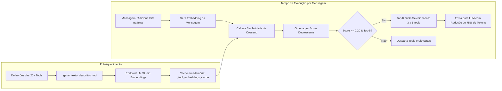

# Especificação Técnica Interna: Filtragem Semântica de Ferramentas (Tool RAG)

**Código do Módulo:** `MOD-INT-04`  
**Escopo:** Seleção Dinâmica de Ferramentas via Similaridade Vetorial de Cosseno e Redução de Sobrecarga de Contexto  
**Arquivos de Implementação:** [`tools/tool_filter.py`](file:///Users/rodrigomodel/antigravity/discord/tools/tool_filter.py), [`tools/registry.py`](file:///Users/rodrigomodel/antigravity/discord/tools/registry.py)  

---

## 1. O Desafio da Sobrecarga de Contexto (*Context Bloat*)

À medida que o bot expandiu seu ecossistema para mais de 20 ferramentas integradas (agenda Google, listas, lembretes, PDFs, controle de áudio, memória, fusos horários), enviar a especificação JSON completa de todas as ferramentas em todas as mensagens gerava dois problemas críticos:
1. **Consumo Excessivo de Tokens de Entrada:** Cada esquema de ferramenta consome entre 150 e 300 tokens. Enviar 20 ferramentas representa ~4.000 tokens apenas em definições de tools em cada requisição.
2. **Degradação de Raciocínio da LLM:** Modelos menores (ex: 7B a 9B parâmetros) sofrem de dispersão de atenção quando expostos a um catálogo massivo de funções irrelevantes para a intenção imediata do usuário.

---

## 2. Solução Arquitetural: Tool RAG

O módulo **Tool Filtering RAG** trata o catálogo de ferramentas como uma base de conhecimento pesquisável. Antes de chamar a LLM, o sistema analisa a mensagem do usuário, calcula a relevância semântica de cada ferramenta registrada e entrega para o modelo apenas as ferramentas mais prováveis de serem necessárias.



---

## 3. Componentes Matemáticos e Algoritmo

### 3.1 Geração de Texto Descritivo para Vetorização
Para maximizar a precisão semântica na busca, o texto vetorizado de cada ferramenta incorpora tanto o nome e a descrição funcional quanto os nomes dos parâmetros declarados:
```python
def _gerar_texto_descritivo_tool(tool: ToolDefinition) -> str:
    partes = [f"Ferramenta '{tool.name}': {tool.description}"]
    params = tool.parameters.get("properties", {})
    if params:
        partes.append(f"Parâmetros: {', '.join(params.keys())}")
    return " ".join(partes)
```

### 3.2 Similaridade de Cosseno entre Vetores Densos
A proximidade entre o vetor da mensagem do usuário ($u$) e o vetor da ferramenta ($v$) é calculada por:
$$\text{Sim}(u, v) = \frac{u \cdot v}{\|u\| \|v\|} = \frac{\sum_{i=1}^n u_i v_i}{\sqrt{\sum_{i=1}^n u_i^2} \sqrt{\sum_{i=1}^n v_i^2}}$$

### 3.3 Critérios de Filtragem e Limiares
* **`TOOL_FILTER_TOP_K` (default: 5):** Limite máximo de ferramentas enviadas por requisição.
* **`TOOL_FILTER_MIN_SIMILARITY` (default: 0.20):** Pontuação mínima para que uma ferramenta seja considerada minimamente relevante.
* **Conversa Casual:** Se nenhuma ferramenta atingir o limiar de 0.20 (ex: para mensagens como *"Oi, tudo bem?"* ou *"Bom dia!"*), a lista de tools é enviada vazia (`tools=[]`), impedindo chamadas espúrias de ferramentas em diálogos simples e economizando 100% dos tokens de schemas.

### 3.4 Sincronização de Cache Concorrente e Recarregamento a Quente
Para prevenir o fenômeno de *cache stampede* (múltiplas requisições simultâneas ao ligar o bot disparando chamadas paralelas de vetorização para as 20+ ferramentas no LM Studio), o cache é protegido com um `asyncio.Lock()`:
```python
_tool_embeddings_cache: Dict[str, List[float]] = {}
_cache_lock = asyncio.Lock()

async def inicializar_cache_ferramentas(force_reload: bool = False) -> None:
    async with _cache_lock:
        for tool in registry._tools.values():
            if force_reload or tool.name not in _tool_embeddings_cache:
                texto = _gerar_texto_descritivo_tool(tool)
                vetor = await gerar_embedding(texto)
                if vetor:
                    _tool_embeddings_cache[tool.name] = vetor
```
O parâmetro `force_reload=True` viabiliza a invalidação controlada a quente quando novas ferramentas forem carregadas dinamicamente no runtime.

---

## 4. Políticas de Resiliência e Circuit Breaker

### 4.1 Chave Mestre Operacional (`TOOL_FILTER_ENABLED`)
Definida em `config.py`, atua como chave mestre e mecanismo de contingência operacional:
```python
if not TOOL_FILTER_ENABLED:
    return registry.get_schemas()
```
Permite desativar a filtragem semântica a qualquer momento (para testes de carga, depuração ou indisponibilidade temporária de modelos de embedding) sem alterar a lógica da aplicação.

### 4.2 Fallback Gracioso sob Falha de Embedding
Caso o endpoint de embeddings do LM Studio esteja temporariamente instável ou falhe ao gerar o vetor da mensagem do usuário, o sistema ativa imediatamente a contingência automática:
```python
if not query_vec:
    logger.warning("Falha no embedding da query. Ativando fallback com catálogo completo.")
    return registry.get_schemas()
```
Dessa forma, o bot garante que o usuário nunca seja prejudicado caso o serviço de vetorização sofra oscilações.

---

## 5. 📋 Matriz de Rastreabilidade & Aderência (Auditada em 2026-11-14)

Auditoria realizada via [`/spec-audit`](file:///Users/rodrigomodel/antigravity/.agents/skills/spec-audit/SKILL.md) com homologação do [`/review`](file:///Users/rodrigomodel/antigravity/gerencial/reviews/REV-006_auditoria_tool_filtering_rag.md) e [`/doc_master`](file:///Users/rodrigomodel/antigravity/gerencial/auditorias/auditoria_2026-11-14_04_TOOL_FILTERING_RAG.md):

| ID | Requisito da Especificação | Status | Implementação no Código | Notas de Auditoria |
| :---: | :--- | :---: | :--- | :--- |
| **REQ-01** | Cálculo de similaridade de cosseno | 🟢 **Aderente** | [`tool_filter.py:L28-L35`](file:///Users/rodrigomodel/antigravity/discord/tools/tool_filter.py#L28-L35) (`similaridade_cosseno`) | Proteção estrita contra divisão por zero (`norm1 == 0.0 or norm2 == 0.0 -> 0.0`). |
| **REQ-02** | Geração de texto descritivo com parâmetros | 🟢 **Aderente** | [`tool_filter.py:L38-L49`](file:///Users/rodrigomodel/antigravity/discord/tools/tool_filter.py#L38-L49) (`_gerar_texto_descritivo_tool`) | Concatena nome, descrição e nomes de parâmetros de `tool.parameters`. |
| **REQ-03** | Cache em memória de embeddings das tools | 🟢 **Aderente** | [`tool_filter.py:L24,L51-L69`](file:///Users/rodrigomodel/antigravity/discord/tools/tool_filter.py#L24) (`_tool_embeddings_cache`) | Cache indexado pelo nome da tool aquecido via `inicializar_cache_ferramentas`. |
| **REQ-04** | Seleção dinâmica Top-K com limiar mínimo | 🟢 **Aderente** | [`tool_filter.py:L90-L128`](file:///Users/rodrigomodel/antigravity/discord/tools/tool_filter.py#L90-L128) (`filtrar_ferramentas_relevantes`) | Ranqueamento ordenado por score com cortes `TOOL_FILTER_TOP_K` (5) e `TOOL_FILTER_MIN_SIMILARITY` (0.20). |
| **REQ-05** | Proteção de contexto zero para conversa casual | 🟢 **Aderente** | [`tool_filter.py:L129-L137`](file:///Users/rodrigomodel/antigravity/discord/tools/tool_filter.py#L129-L137) | Retorna `tools=[]` se nenhum score >= 0.20, economizando 100% de tokens de schemas. |
| **REQ-06** | Fallback sob falha na vetorização da query | 🟢 **Aderente** | [`tool_filter.py:L99-L104`](file:///Users/rodrigomodel/antigravity/discord/tools/tool_filter.py#L99-L104) | Se `gerar_embedding(query)` falhar, retorna `registry.get_schemas()` integral. |
| **REQ-07** | Chave mestre operacional `TOOL_FILTER_ENABLED` | 🟢 **Aderente** | [`tool_filter.py:L14,L83-L84`](file:///Users/rodrigomodel/antigravity/discord/tools/tool_filter.py#L14) | Circuit breaker via flag central para desativação imediata sem alterar código. |
| **REQ-08** | Bloqueio concorrente anti-stampede e reload | 🟢 **Aderente** | [`tool_filter.py:L25,L51-L69`](file:///Users/rodrigomodel/antigravity/discord/tools/tool_filter.py#L25) (`_cache_lock`) | Sincronização via `asyncio.Lock()` e suporte a recarga a quente (`force_reload`). |

