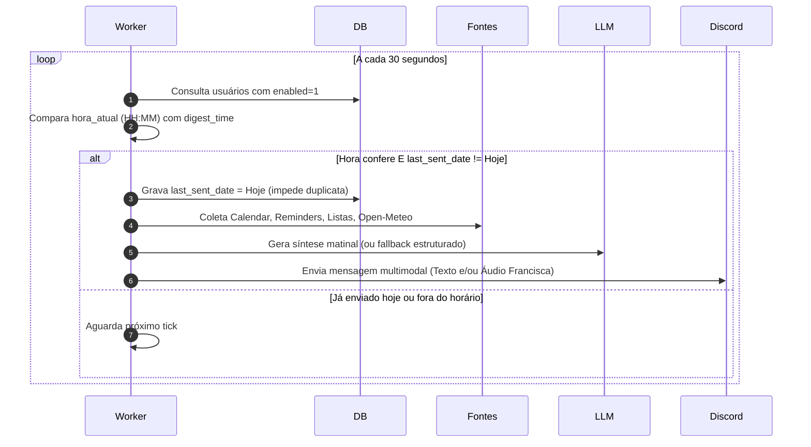

# Especificação do Módulo: Resumo Matinal Diário (Morning Digest)

**Código do Módulo:** `MOD-VIS-08`  
**Escopo:** Assistente Matinal Proativo Diário, Consolidação de Agenda, Lembretes, Listas e Clima em Tempo Real, Síntese Cognitiva e Multimodal (Texto + Áudio Francisca)  
**Arquivos de Implementação:** [`digest_manager.py`](file:///Users/rodrigomodel/antigravity/discord/digest_manager.py), [`tools/digest_tools.py`](file:///Users/rodrigomodel/antigravity/discord/tools/digest_tools.py), [`commands/builtins.py`](file:///Users/rodrigomodel/antigravity/discord/commands/builtins.py), [`chat_discord.py`](file:///Users/rodrigomodel/antigravity/discord/chat_discord.py), [`database.py`](file:///Users/rodrigomodel/antigravity/discord/database.py)  

---

## 1. Descrição e Finalidade

O módulo **Resumo Matinal Diário (Morning Digest)** eleva o bot de um assistente puramente reativo para um assistente proativo de alto padrão. Todos os dias, em horário configurado pelo usuário (padrão: `08:00`), o bot acorda em segundo plano, consolida as tarefas, lembretes, compromissos na agenda do Google e previsão meteorológica ao vivo, e entrega um briefing matinal completo.

O envio respeita as preferências de resposta do usuário configuradas no módulo `!voz` (Texto, Áudio narrado pela voz neural feminina `pt-BR-FranciscaNeural` via Edge-TTS, ou ambos simultaneamente).

---

## 2. Fontes de Dados Consolidadas

No momento da geração do digest, o sistema realiza uma coleta assíncrona paralela e resiliente:

1. **Google Calendar (`google_calendar.py`):** Busca todos os compromissos agendados para o dia de hoje (`dias_a_frente=1`). Se a autenticação estiver inativa ou não houver eventos, trata amigavelmente sem interromper o processo.
2. **Lembretes Agendados (`reminder_manager.py`):** Coleta todos os lembretes com status `pendente` agendados para o dia atual.
3. **Listas e Mercado (`list_tools.py`):** Analisa todas as listas do usuário (ex: Mercado, Compras, Tarefas) e extrai os itens pendentes que ainda não foram marcados como concluídos.
4. **Previsão do Tempo em Tempo Real (Open-Meteo API):**
   - Geocodificação automática da cidade configurada pelo usuário (ex: `Curitiba`, `São Paulo`, `Canela`).
   - Consulta a temperatura atual e o código meteorológico WMO em tempo real sem necessidade de chaves de API pagas.
   - Tradução do código WMO para condições humanas em português com emojis (ex: Céu limpo ☀️, Parcialmente nublado 🌤️, Chuva fraca 🌦️).

---

## 3. Comandos Disponíveis (`!`)

O módulo disponibiliza o prefixo `!digest` (com aliases `!resumo`, `!matinal`, `!dia`):

| Comando | Descrição | Exemplo |
|---|---|---|
| `!digest` | Mostra as configurações ativas de resumo matinal do usuário. | `!digest` |
| `!digest agora` | Dispara e envia o resumo matinal imediatamente no canal atual. | `!digest agora` |
| `!digest hora <HH:MM>` | Altera o horário diário programado de envio. | `!digest hora 07:30` |
| `!digest cidade <Nome>` | Define a cidade padrão para a previsão do tempo. | `!digest cidade Curitiba` |
| `!digest canal` | Define o canal atual como o destino padrão dos envios diários. | `!digest canal` |
| `!digest on` | Ativa o agendamento automático diário. | `!digest on` |
| `!digest off` | Pausa temporariamente o agendamento diário. | `!digest off` |

---

## 4. Integração Cognitiva e Fallback Resiliente

1. **Geração por LLM (Modo Primário):**
   - Os dados consolidados em JSON são enviados ao `llm_client.gerar_resposta`.
   - Um prompt do sistema instrui a LLM a assumir a personalidade de assistente pessoal acolhedor, conciso, pontual e encorajador.
2. **Fallback Estruturado Automático (Modo Resiliente):**
   - Se a LLM local (LM Studio / Ollama) estiver offline ou com timeout, o `digest_manager.gerar_texto_fallback_digest` gera instantaneamente um Markdown limpo e bem diagramado com todos os dados coletados, garantindo 100% de confiabilidade na entrega diária.

---

## 5. Ferramentas da LLM (*Function Calling*)

O assistente pode consultar, disparar ou configurar o resumo matinal através de linguagem natural no chat:

| Ferramenta | Parâmetros | Descrição |
|---|---|---|
| `gerar_resumo_matinal` | `cidade: Optional[str]` | Coleta agenda, lembretes, listas e clima e gera o briefing matinal consolidado. |
| `configurar_resumo_matinal` | `horario: Optional[str]`, `cidade: Optional[str]`, `ativado: Optional[bool]` | Configura preferências de horário, cidade e ativação do resumo diário. |

---

## 6. Arquitetura do Worker em Segundo Plano

O ciclo do resumo matinal roda continuamente no `chat_discord.py` através da rotina `iniciar_worker_digest(client)`:



### Prevenção Rigorosa de Disparos Duplicados:
A coluna `last_sent_date` armazena a data `YYYY-MM-DD` do último envio. O envio só ocorre quando `last_sent_date != data_atual`, garantindo que reinicializações do bot ou verificações sucessivas no mesmo minuto não gerem mensagens repetidas.

---

## 7. Persistência de Dados (SQLite)

As preferências são persistidas na tabela `user_digest_settings`:

```sql
CREATE TABLE IF NOT EXISTS user_digest_settings (
    user_id TEXT PRIMARY KEY,
    enabled INTEGER DEFAULT 1,
    time TEXT DEFAULT '08:00',
    channel_id TEXT,
    city TEXT DEFAULT 'Curitiba',
    last_sent_date TEXT DEFAULT '',
    updated_at DATETIME DEFAULT CURRENT_TIMESTAMP
);
```
