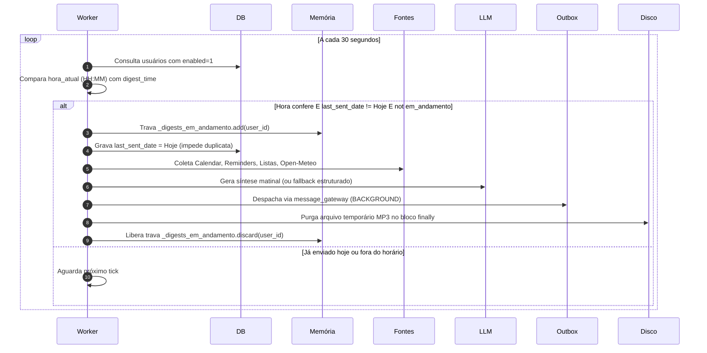

# Especificação do Módulo: Resumo Matinal Diário (Morning Digest)

**Código do Módulo:** `MOD-VIS-08`  
**Escopo:** Assistente Matinal Proativo Diário, Consolidação de Agenda, Lembretes, Listas e Clima em Tempo Real, Síntese Cognitiva e Multimodal (Texto + Áudio Francisca)  
**Arquivos de Implementação:** 
- [`digest_manager.py`](file:///Users/rodrigomodel/antigravity/discord/digest_manager.py)
- [`commands/system_commands.py`](file:///Users/rodrigomodel/antigravity/discord/commands/system_commands.py)
- [`tools/digest_tools.py`](file:///Users/rodrigomodel/antigravity/discord/tools/digest_tools.py)
- [`chat_discord.py`](file:///Users/rodrigomodel/antigravity/discord/chat_discord.py)
- [`message_gateway.py`](file:///Users/rodrigomodel/antigravity/discord/message_gateway.py)

---

## 1. Descrição e Finalidade

O módulo **Resumo Matinal Diário (Morning Digest)** eleva o bot de um assistente puramente reativo para um assistente proativo de alto padrão. Todos os dias, em horário configurado pelo usuário (padrão: `08:00`), o bot acorda em segundo plano, consolida as tarefas, lembretes, compromissos na agenda do Google e previsão meteorológica ao vivo, e entrega um briefing matinal completo.

O envio respeita as preferências de resposta do usuário configuradas no módulo `!voz` (Texto, Áudio narrado pela voz neural feminina `pt-BR-FranciscaNeural` via Edge-TTS, ou ambos simultaneamente).

---

## 2. Fontes de Dados Consolidadas

No momento da geração do digest, o sistema realiza uma coleta assíncrona paralela e resiliente:

1. **Google Calendar (`google_calendar.py`):** Busca todos os compromissos agendados para o dia de hoje (`dias_a_frente=1`). Se a autenticação estiver inativa ou não houver eventos, trata amigavelmente sem interromper o processo.
2. **Lembretes Agendados (`reminder_manager.py`):** Coleta todos os lembretes com status `pendente` agendados para o dia atual no SQLite.
3. **Listas e Mercado (`list_manager.py`):** Analisa todas as listas do usuário (ex: Mercado, Compras, Tarefas) e extrai os itens pendentes que ainda não foram marcados como concluídos.
4. **Previsão do Tempo em Tempo Real (Open-Meteo API):**
   - Geocodificação automática com suporte à desambiguação de cidades e estados brasileiros (`normalizar_cidade_busca` e `BRAZIL_UFS`).
   - Consulta temperatura atual, sensação térmica e código meteorológico WMO em tempo real sem necessidade de chaves pagas.
   - Tradução de códigos WMO para descrições humanizadas em português com emojis (`WMO_WEATHER_CODES`).

---

## 3. Comandos Disponíveis (`!`)

Todos os comandos são registrados em [`commands/system_commands.py`](file:///Users/rodrigomodel/antigravity/discord/commands/system_commands.py) sob o prefixo `!digest` (com aliases `!resumo`, `!matinal`, `!dia`):

| Comando | Descrição | Exemplo |
|---|---|---|
| `!digest` | Mostra as configurações ativas de resumo matinal do usuário e diagnósticos. | `!digest` |
| `!digest agora` | Dispara e envia o resumo matinal imediatamente no canal atual. | `!digest agora` |
| `!digest hora <HH:MM>` | Altera o horário diário programado de envio (formato 24h). | `!digest hora 07:30` |
| `!digest cidade <Nome>` | Define a cidade padrão para a previsão do tempo (aceita formato Cidade/UF). | `!digest cidade Curitiba` |
| `!digest canal` | Define o canal atual como o destino padrão dos envios diários. | `!digest canal` |
| `!digest on` | Ativa o agendamento automático diário. | `!digest on` |
| `!digest off` | Pausa temporariamente o agendamento diário. | `!digest off` |

---

## 4. Integração Cognitiva e Fallback Resiliente

1. **Geração por LLM (Modo Primário):**
   - Os dados consolidados em JSON são enviados ao `llm_client.gerar_resposta`.
   - Um prompt do sistema instrui a LLM a assumir a personalidade de assistente pessoal acolhedor, conciso, pontual e encorajador.
2. **Fallback Estruturado Automático (Modo Resiliente):**
   - Se a LLM local (LM Studio / Ollama) estiver offline ou com timeout, a função `gerar_texto_fallback_digest` gera instantaneamente um Markdown limpo e bem diagramado com todos os dados coletados, garantindo 100% de confiabilidade na entrega diária.

---

## 5. Ferramentas da LLM (*Function Calling*)

Registradas em [`tools/digest_tools.py`](file:///Users/rodrigomodel/antigravity/discord/tools/digest_tools.py), retornando o formato canônico `{"sucesso": bool, "dados": Any, "erro": Optional[str]}`:

| Ferramenta | Parâmetros | Descrição |
|---|---|---|
| `gerar_resumo_matinal` | `cidade: Optional[str]` | Coleta agenda, lembretes, listas e clima e gera o briefing matinal consolidado. |
| `configurar_resumo_matinal` | `horario: Optional[str]`, `cidade: Optional[str]`, `ativado: Optional[bool]` | Configura preferências de horário, cidade e ativação do resumo diário. |

---

## 6. Arquitetura do Worker em Segundo Plano & Anti-Double Delivery

O ciclo do resumo matinal roda continuamente no `chat_discord.py` através da rotina `iniciar_worker_digest(client)`:



### Prevenção Rigorosa de Disparos Duplicados:
1. **Blindagem no SQLite:** A coluna `last_sent_date` armazena a data `YYYY-MM-DD` do último envio. O envio só ocorre quando `last_sent_date != data_atual`.
2. **Blindagem Concorrente em Memória:** O conjunto `_digests_em_andamento: set[str]` impede colisões entre disparos manuais (`!digest agora`) e o worker agendado para o mesmo usuário.

---

## 7. Persistência de Dados (SQLite)

As preferências são persistidas na tabela `user_digest_settings`:

```sql
CREATE TABLE IF NOT EXISTS user_digest_settings (
    user_id TEXT PRIMARY KEY,
    enabled INTEGER NOT NULL DEFAULT 1,
    time TEXT NOT NULL DEFAULT '08:00',
    channel_id TEXT DEFAULT NULL,
    city TEXT NOT NULL DEFAULT 'Curitiba',
    last_sent_date TEXT DEFAULT NULL,
    updated_at DATETIME DEFAULT CURRENT_TIMESTAMP
);
```

---

## 8. 📋 Matriz de Rastreabilidade & Aderência (Auditada em 2026-11-14)

Auditoria realizada via [`/spec-audit`](file:///Users/rodrigomodel/antigravity/.agents/skills/spec-audit/SKILL.md) com homologação do [`/review`](file:///Users/rodrigomodel/antigravity/gerencial/reviews/REV-017_auditoria_resumo_matinal_digest.md) e [`/doc_master`](file:///Users/rodrigomodel/antigravity/gerencial/auditorias/auditoria_2026-11-14_08_RESUMO_MATINAL_DIGEST.md):

| ID | Requisito da Especificação | Status | Implementação no Código | Linhas & Símbolos Auditados |
| :--- | :--- | :---: | :--- | :--- |
| **REQ-01** | Coleta de eventos do Google Calendar | 🟢 Aderente | [`digest_manager.py`](file:///Users/rodrigomodel/antigravity/discord/digest_manager.py#L303-L322) | `coletar_dados_dia()` |
| **REQ-02** | Coleta de lembretes pendentes do dia no SQLite | 🟢 Aderente | [`digest_manager.py`](file:///Users/rodrigomodel/antigravity/discord/digest_manager.py#L324-L346) | `coletar_dados_dia()` |
| **REQ-03** | Coleta de itens pendentes em listas do usuário | 🟢 Aderente | [`digest_manager.py`](file:///Users/rodrigomodel/antigravity/discord/digest_manager.py#L348-L364) | `coletar_dados_dia()` |
| **REQ-04** | Previsão do tempo Open-Meteo com códigos WMO | 🟢 Aderente | [`digest_manager.py`](file:///Users/rodrigomodel/antigravity/discord/digest_manager.py#L208-L293) | `obter_previsao_tempo()` |
| **REQ-05** | Síntese de texto via LLM com prompt acolhedor | 🟢 Aderente | [`digest_manager.py`](file:///Users/rodrigomodel/antigravity/discord/digest_manager.py#L428-L469) | `gerar_resumo_matinal_texto()` |
| **REQ-06** | Fallback estruturado automático em Markdown | 🟢 Aderente | [`digest_manager.py`](file:///Users/rodrigomodel/antigravity/discord/digest_manager.py#L380-L426) | `gerar_texto_fallback_digest()` |
| **REQ-07** | Comando `!digest` e subcomandos | 🟢 Aderente | [`system_commands.py`](file:///Users/rodrigomodel/antigravity/discord/commands/system_commands.py#L606-L685) | `cmd_digest` (L606-685) |
| **REQ-08** | Tool LLM `gerar_resumo_matinal` | 🟢 Aderente | [`digest_tools.py`](file:///Users/rodrigomodel/antigravity/discord/tools/digest_tools.py#L16-L40) | `tool_gerar_resumo_matinal` |
| **REQ-09** | Tool LLM `configurar_resumo_matinal` | 🟢 Aderente | [`digest_tools.py`](file:///Users/rodrigomodel/antigravity/discord/tools/digest_tools.py#L42-L69) | `tool_configurar_resumo_matinal` |
| **REQ-10** | Worker assíncrono perpétuo a cada 30 segundos | 🟢 Aderente | [`digest_manager.py`](file:///Users/rodrigomodel/antigravity/discord/digest_manager.py#L600-L640) | `iniciar_worker_digest()` |
| **REQ-11** | Prevenção de duplicidade com `last_sent_date` | 🟢 Aderente | [`digest_manager.py`](file:///Users/rodrigomodel/antigravity/discord/digest_manager.py#L627-L635) | `registrar_envio_digest()` |
| **REQ-12** | Tabela SQLite `user_digest_settings` | 🟢 Aderente | [`digest_manager.py`](file:///Users/rodrigomodel/antigravity/discord/digest_manager.py#L59-L77) | `init_digest_db()` |
| **REQ-13** | Entrega multimodal respeitando `!voz` | 🟢 Aderente | [`digest_manager.py`](file:///Users/rodrigomodel/antigravity/discord/digest_manager.py#L548-L582) | `enviar_resumo_matinal()` |
| **REQ-14** | Desambiguação de UFs brasileiras (`BRAZIL_UFS`) *(Scope Creep Incorporado)* | 🟢 Aderente | [`digest_manager.py`](file:///Users/rodrigomodel/antigravity/discord/digest_manager.py#L188-L245) | `normalizar_cidade_busca()` |
| **REQ-15** | Trava de concorrência em memória `_digests_em_andamento` *(Scope Creep Incorporado)* | 🟢 Aderente | [`digest_manager.py`](file:///Users/rodrigomodel/antigravity/discord/digest_manager.py#L472-L491) | Trava anti-corrida |
| **REQ-16** | Despacho via Outbox Gateway (`BACKGROUND`) *(Scope Creep Incorporado)* | 🟢 Aderente | [`digest_manager.py`](file:///Users/rodrigomodel/antigravity/discord/digest_manager.py#L551-L581) | `message_gateway.dispatch()` |
| **REQ-17** | Purga de áudio temporário no bloco `finally` *(Scope Creep Incorporado)* | 🟢 Aderente | [`digest_manager.py`](file:///Users/rodrigomodel/antigravity/discord/digest_manager.py#L588-L598) | Limpeza garantida de disco |
