# Especificação do Módulo: Leitura Inteligente, Sumarização e RAG de Livros/PDFs

**Código do Módulo:** `MOD-VIS-09`  
**Escopo:** Ingestão Estruturada, Metadados Catalográficos, Sumários Navegáveis, Resumos por Capítulo com Cache, Indexação Vetorial Dedicada no ChromaDB e Conversação RAG com Citação de Páginas  
**Arquivos de Implementação:** [`pdf_manager.py`](file:///Users/rodrigomodel/antigravity/discord/pdf_manager.py), [`tools/pdf_tools.py`](file:///Users/rodrigomodel/antigravity/discord/tools/pdf_tools.py), [`commands/builtins.py`](file:///Users/rodrigomodel/antigravity/discord/commands/builtins.py), [`message_handler.py`](file:///Users/rodrigomodel/antigravity/discord/message_handler.py), [`database.py`](file:///Users/rodrigomodel/antigravity/discord/database.py)  

---

## 1. Descrição e Finalidade

O módulo de **Leitura Inteligente, Sumarização e RAG de Livros/PDFs** transforma o assistente em um tutor intelectual e leitor analítico capaz de processar livros e documentos técnicos longos de dezenas ou centenas de páginas.

O sistema divide o ciclo de vida do documento em duas fases computacionais bem delineadas:
1. **Fase 1 (Ingestão Leve Imediata):** Ao receber o arquivo no Discord, extrai metadados essenciais (autor, título, contagem de páginas), detecta o sumário/TOC com capítulos e captura uma sinopse preliminar, gravando no SQLite em frações de segundo sem sobrecarga de CPU.
2. **Fase 2 (Processamento Sob Demanda):** Apenas quando requisitado pelo usuário, o sistema realiza resumos profundos de capítulos específicos (com cache automático para evitar reprocessamentos) ou fatia e vetoriza o texto no ChromaDB para possibilitar conversação livre (*chat com a obra*) com citação exata das páginas de onde as respostas foram extraídas.

---

## 2. Arquitetura Operacional do Pipeline

```mermaid
flowchart TD
    subgraph Fase 1: Recepção e Catalogação Instantânea
        Upload[Usuário envia PDF no Discord] --> SaveDisk[Salva em discord/pdf/user/]
        SaveDisk --> PyMuPDF[PyMuPDF / fitz]
        PyMuPDF --> MetaExtract[Coleta: Título, Autor, Páginas, Bookmarks/TOC]
        PyMuPDF --> SampleIntro[Extrai primeiras 2-3 páginas para Sinopse]
        MetaExtract & SampleIntro --> SaveSQLite[(SQLite: user_pdf_documents & user_pdf_chapters)]
        SaveSQLite --> ConfirmMsg[Bot confirma no chat com metadados e atalhos]
    end

    subgraph Fase 2: Navegação e Consultas Sob Demanda
        UserCmd{Comando do Usuário}
        UserCmd -->|!pdf info| ShowMeta[Exibe ficha catalográfica e sinopse]
        UserCmd -->|!pdf sumario| ShowTOC[Exibe lista de seções com páginas de início/fim]
        UserCmd -->|!pdf capitulo N| ChapterExec[Extrai texto do capítulo N]
        ChapterExec --> CheckCache{Resumo em cache no SQLite?}
        CheckCache -->|Sim| ReturnCached[Retorna resumo instantâneo]
        CheckCache -->|Não| LLMSummarize[LLM sintetiza pontos-chave e salva em cache]
        ReturnCached & LLMSummarize --> ChapterOutput[Exibe no Discord + Áudio Francisca se configurado]
        
        UserCmd -->|!pdf indexar| Vectorize[Gera embeddings dos blocos da obra em lotes de 16]
        Vectorize --> ChromaStore[(ChromaDB: Coleção pdf_user_docId)]
        ChromaStore --> MarkIndexed[Atualiza is_indexed = 1 no SQLite]
        
        UserCmd -->|!pdf perguntar| RAGSearch[Busca Semântica no ChromaDB do Livro]
        ChromaStore --> RAGSearch
        RAGSearch --> InjectContext[Injeta Top Chunks com Tags de Página]
        InjectContext --> LLMAnswer[LLM formula resposta didática com citações: Página X]
        LLMAnswer --> RAGOutput[Entrega no Discord com lista de páginas consultadas]
    end
```



---

## 3. Comandos Disponíveis (`!pdf`)

| Comando | Parâmetros | Descrição |
|---|---|---|
| `!pdf` ou `!pdf status` | *(nenhum)* | Lista todos os PDFs salvos do usuário, número de páginas e status no RAG. |
| `!pdf info` | `<arquivo>` | Ficha catalográfica completa: autor, total de páginas, tamanho e sinopse inicial. |
| `!pdf sumario` | `<arquivo>` | Lista todos os capítulos e seções mapeados com suas páginas de início e término. |
| `!pdf capitulo` | `<arquivo> <número_ou_nome>` | Gera resumo detalhado dos pontos-chave do capítulo (suporta áudio com Francisca). |
| `!pdf indexar` | `<arquivo>` | Fatiamento e vetorização da obra no ChromaDB para habilitar conversação interativa. |
| `!pdf perguntar` | `<arquivo> <dúvida>` | Busca semântica (RAG) no livro com resposta fundamentada e citação de páginas. |
| `!pdfs` | *(nenhum)* | Listagem rápida dos arquivos salvos na pasta pessoal. |
| `!enviar` | `<arquivo>` | Devolve o arquivo físico do PDF como anexo para download no Discord. |

---

## 4. Ferramentas da LLM (*Function Calling*)

O assistente conversa livremente sobre o conteúdo dos documentos através de 7 ferramentas integradas:

| Ferramenta | Parâmetros | Descrição |
|---|---|---|
| `listar_meus_pdfs` | *(nenhum)* | Consulta a lista de PDFs disponíveis na pasta pessoal com status de RAG. |
| `disponibilizar_pdf_usuario` | `nome_arquivo: str` | Localiza e agenda o envio físico do arquivo PDF no chat do Discord. |
| `consultar_metadados_pdf` | `arquivo: str` | Retorna metadados catalográficos e sinopse preliminar da obra. |
| `obter_sumario_pdf` | `arquivo: str` | Retorna a árvore de capítulos e páginas correspondentes do documento. |
| `resumir_capitulo_pdf` | `arquivo: str`, `capitulo: str` | Sintetiza tese, conceitos e conclusões de um capítulo solicitado. |
| `indexar_pdf_rag` | `arquivo: str` | Vetoriza o documento no ChromaDB para permitir perguntas semânticas. |
| `consultar_conteudo_pdf_rag` | `arquivo: str`, `pergunta: str` | Realiza busca vetorial na obra e responde à pergunta com citação de páginas. |

---

## 5. Estrutura de Dados e Persistência

### 5.1 Tabelas no SQLite (`chat_memory.db`)

```sql
CREATE TABLE IF NOT EXISTS user_pdf_documents (
    id INTEGER PRIMARY KEY AUTOINCREMENT,
    user_id TEXT NOT NULL,
    user_name TEXT NOT NULL DEFAULT '',
    filename TEXT NOT NULL,
    filepath TEXT NOT NULL,
    title TEXT,
    author TEXT,
    total_pages INTEGER DEFAULT 0,
    file_size_bytes INTEGER DEFAULT 0,
    short_summary TEXT,
    is_indexed INTEGER DEFAULT 0,
    created_at DATETIME DEFAULT CURRENT_TIMESTAMP,
    updated_at DATETIME DEFAULT CURRENT_TIMESTAMP,
    UNIQUE(user_id, filename)
);

CREATE TABLE IF NOT EXISTS user_pdf_chapters (
    id INTEGER PRIMARY KEY AUTOINCREMENT,
    doc_id INTEGER NOT NULL,
    chapter_index INTEGER NOT NULL,
    level INTEGER DEFAULT 1,
    title TEXT NOT NULL,
    start_page INTEGER NOT NULL,
    end_page INTEGER NOT NULL,
    summary TEXT,
    FOREIGN KEY(doc_id) REFERENCES user_pdf_documents(id) ON DELETE CASCADE
);
```

### 5.2 Coleções no ChromaDB
Cada livro possui uma coleção vetorial isolada nomeada deterministicamente:
`pdf_{sanitizar_nome_usuario(user)}_{doc_id}` (com limite estrito de 63 caracteres alfanuméricos).

Cada chunk é enriquecido com metadados estruturados:
```json
{
    "pagina": "13",
    "capitulo": "Ele pode lembrar, RAG com Memória",
    "arquivo": "rag-versao-final.pdf",
    "doc_id": "1"
}
```

---

## 6. Otimizações de Desempenho e Multimodalidade

1. **Execução Assíncrona Não-Bloqueante:** Toda a computação em PDF é executada em threads separadas (`asyncio.to_thread`), impedindo qualquer bloqueio no Gateway do Discord.
2. **Embeddings em Lote (*Batching*):** Na fase de indexação, o fatiamento envia lotes de 16 blocos simultaneamente ao LM Studio, reduzindo em até 15 vezes o tempo total de vetorização.
3. **Cache de Resumos no SQLite:** Quando um capítulo é resumido pela primeira vez, o texto analítico gerado pela LLM é gravado na coluna `summary` de `user_pdf_chapters`. Consultas posteriores ao mesmo capítulo são instantâneas.
4. **Respostas Multimodais:** Se o usuário estiver configurado no modo `audio` ou `ambos` (via `!voz`), os resumos de capítulos e respostas de dúvidas são narrados em áudio de alta fidelidade com a voz **Francisca pt-BR** (`edge-tts`).
