# Especificação do Módulo: Leitura Inteligente, Sumarização e RAG de Livros/PDFs

**Código do Módulo:** `MOD-VIS-09`  
**Escopo:** Ingestão Estruturada com PyMuPDF, Metadados Catalográficos, Sumários Navegáveis, Resumos por Capítulo com Cache no SQLite, Indexação Vetorial Dedicada no ChromaDB, Q&A RAG com Citação de Páginas e Navegação Interativa no Discord UI  
**Arquivos de Implementação:** 
- [`pdf_manager.py`](file:///Users/rodrigomodel/antigravity/discord/pdf_manager.py)
- [`commands/knowledge_commands.py`](file:///Users/rodrigomodel/antigravity/discord/commands/knowledge_commands.py)
- [`tools/pdf_tools.py`](file:///Users/rodrigomodel/antigravity/discord/tools/pdf_tools.py)
- [`ui_components.py`](file:///Users/rodrigomodel/antigravity/discord/ui_components.py)
- [`message_handler.py`](file:///Users/rodrigomodel/antigravity/discord/message_handler.py)

---

## 1. Descrição e Finalidade

O módulo de **Leitura Inteligente, Sumarização e RAG de Livros/PDFs** transforma o assistente em um tutor intelectual e leitor analítico capaz de processar livros e documentos técnicos longos de dezenas ou centenas de páginas.

O sistema divide o ciclo de vida do documento em duas fases computacionais bem delineadas:
1. **Fase 1 (Ingestão Leve Imediata):** Ao receber o arquivo no Discord, extrai metadados essenciais (autor, título, contagem de páginas), detecta o sumário/TOC com capítulos e captura uma sinopse preliminar, gravando no SQLite em frações de segundo sem sobrecarga de CPU.
2. **Fase 2 (Processamento Sob Demanda):** Apenas quando requisitado pelo usuário, o sistema realiza resumos profundos de capítulos específicos (com cache automático para evitar reprocessamentos) ou fatia e vetoriza o texto no ChromaDB para possibilitar conversação livre (*chat com a obra*) com citação exata das páginas de onde as respostas foram extraídas.

---

## 2. Arquitetura Operacional do Pipeline

```mermaid
flowchart TD
    subgraph Fase 1: Recepção e Catalogação Instantânea
        Upload[Usuário envia PDF no Discord] --> SaveDisk[Salva em discord/pdf/user/]
        SaveDisk --> PyMuPDF[PyMuPDF / fitz em thread dedicada]
        PyMuPDF --> MetaExtract[Coleta: Título, Autor, Páginas, Bookmarks/TOC]
        PyMuPDF --> SampleIntro[Extrai primeiras 2-3 páginas para Sinopse]
        MetaExtract & SampleIntro --> SaveSQLite[(SQLite: user_pdf_documents & user_pdf_chapters)]
        SaveSQLite --> ConfirmMsg[Bot confirma no chat com metadados e atalhos]
    end

    subgraph Fase 2: Navegação e Consultas Sob Demanda
        UserCmd{Comando do Usuário}
        UserCmd -->|!pdf info| ShowMeta[Exibe ficha catalográfica e sinopse]
        UserCmd -->|!pdf sumario| ShowTOC[Exibe sumário + PDFChapterSelectView Dropdown]
        UserCmd -->|!pdf capitulo N| ChapterExec[Extrai texto do capítulo N]
        ChapterExec --> CheckCache{Resumo em cache no SQLite?}
        CheckCache -->|Sim| ReturnCached[Retorna resumo instantâneo]
        CheckCache -->|Não| LLMSummarize[LLM sintetiza pontos-chave e salva em cache]
        ReturnCached & LLMSummarize --> ChapterOutput[Exibe no Discord + Áudio Francisca se configurado]
        
        UserCmd -->|!pdf indexar| Vectorize[Gera embeddings dos blocos em lotes de 4 chunks]
        Vectorize --> ChromaStore[(ChromaDB: Coleção pdf_user_docId)]
        ChromaStore --> MarkIndexed[Atualiza is_indexed = 1 no SQLite]
        
        UserCmd -->|!pdf perguntar| RAGSearch[Busca Semântica no ChromaDB do Livro]
        ChromaStore --> RAGSearch
        RAGSearch --> InjectContext[Injeta Top Chunks com Tags de Página]
        InjectContext --> LLMAnswer[LLM formula resposta didática com citações: Página X]
        LLMAnswer --> RAGOutput[Entrega no Discord com lista de páginas consultadas]
    end
```



---

## 3. Comandos Disponíveis (`!pdf`)

Todos os comandos são registrados em [`commands/knowledge_commands.py`](file:///Users/rodrigomodel/antigravity/discord/commands/knowledge_commands.py):

| Comando | Parâmetros | Descrição |
|---|---|---|
| `!pdf` ou `!pdf status` | *(nenhum)* | Lista todos os PDFs salvos do usuário, número de páginas e status no RAG. |
| `!pdf info` | `<arquivo>` | Ficha catalográfica completa: autor, total de páginas, tamanho e sinopse inicial. |
| `!pdf sumario` | `<arquivo>` | Lista todos os capítulos mapeados e anexa o menu dropdown interativo `PDFChapterSelectView`. |
| `!pdf capitulo` | `<arquivo> <número_ou_nome>` | Gera resumo detalhado dos pontos-chave do capítulo (suporta áudio com Francisca). |
| `!pdf indexar` | `<arquivo>` | Fatiamento e vetorização da obra no ChromaDB para habilitar conversação interativa. |
| `!pdf perguntar` | `<arquivo> <dúvida>` | Busca semântica (RAG) no livro com resposta fundamentada e citação de páginas. |
| `!pdfs` | *(nenhum)* | Listagem rápida dos arquivos salvos na pasta pessoal. |
| `!enviar` | `<arquivo>` | Devolve o arquivo físico do PDF como anexo para download no Discord. |

---

## 4. Ferramentas da LLM (*Function Calling*)

O assistente conversa livremente sobre o conteúdo dos documentos através de 7 ferramentas integradas em [`tools/pdf_tools.py`](file:///Users/rodrigomodel/antigravity/discord/tools/pdf_tools.py), retornando formato canônico `{"sucesso": bool, "dados": Any, "erro": Optional[str]}`:

| Ferramenta | Parâmetros | Descrição |
|---|---|---|
| `listar_meus_pdfs` | *(nenhum)* | Consulta a lista de PDFs disponíveis na pasta pessoal com status de RAG. |
| `disponibilizar_pdf_usuario` | `nome_arquivo: str` | Localiza e agenda o envio físico do arquivo PDF no chat do Discord. |
| `consultar_metadados_pdf` | `arquivo: str` | Retorna metadados catalográficos e sinopse preliminar da obra. |
| `obter_sumario_pdf` | `arquivo: str` | Retorna a árvore de capítulos e páginas correspondentes do documento. |
| `resumir_capitulo_pdf` | `arquivo: str`, `capitulo: str` | Retorna trecho do capítulo para síntese didática (sem chamada recursiva na LLM). |
| `indexar_pdf_rag` | `arquivo: str` | Vetoriza o documento no ChromaDB para permitir perguntas semânticas. |
| `consultar_conteudo_pdf_rag` | `arquivo: str`, `pergunta: str` | Realiza busca vetorial na obra e injeta os fragmentos com tags de página para citação. |

---

## 5. Estrutura de Dados e Persistência

### 5.1 Tabelas no SQLite (`chat_memory.db`)

```sql
CREATE TABLE IF NOT EXISTS user_pdf_documents (
    id INTEGER PRIMARY KEY AUTOINCREMENT,
    user_id TEXT NOT NULL,
    user_name TEXT NOT NULL DEFAULT '',
    filename TEXT NOT NULL,
    filepath TEXT NOT NULL,
    title TEXT,
    author TEXT,
    total_pages INTEGER DEFAULT 0,
    file_size_bytes INTEGER DEFAULT 0,
    short_summary TEXT,
    is_indexed INTEGER DEFAULT 0,
    created_at DATETIME DEFAULT CURRENT_TIMESTAMP,
    updated_at DATETIME DEFAULT CURRENT_TIMESTAMP,
    UNIQUE(user_id, filename)
);

CREATE TABLE IF NOT EXISTS user_pdf_chapters (
    id INTEGER PRIMARY KEY AUTOINCREMENT,
    doc_id INTEGER NOT NULL,
    chapter_index INTEGER NOT NULL,
    level INTEGER DEFAULT 1,
    title TEXT NOT NULL,
    start_page INTEGER NOT NULL,
    end_page INTEGER NOT NULL,
    summary TEXT,
    FOREIGN KEY(doc_id) REFERENCES user_pdf_documents(id) ON DELETE CASCADE
);
```

### 5.2 Coleções no ChromaDB
Cada livro possui uma coleção vetorial isolada nomeada deterministicamente:
`pdf_{sanitizar_nome_usuario(user)}_{doc_id}` (com limite estrito de 63 caracteres alfanuméricos).

Cada chunk é enriquecido com metadados estruturados:
```json
{
    "pagina": "13",
    "capitulo": "Ele pode lembrar, RAG com Memória",
    "arquivo": "rag-versao-final.pdf",
    "doc_id": "1"
}
```

---

## 6. Otimizações de Desempenho, VRAM e Multimodalidade

1. **Execução Assíncrona Não-Bloqueante:** Toda a computação pesada em PDF é executada em threads separadas (`asyncio.to_thread`), impedindo qualquer bloqueio no Gateway do Discord.
2. **Embeddings Calibrados em Lotes (`batch_size = 4`):** Na fase de indexação, o fatiamento processa lotes de 4 blocos simultaneamente no LM Studio para evitar estouro de VRAM (*CUDA OOM*), contando com fallback para processamento individual resiliente em caso de falha.
3. **Auto-Indexação On-the-Fly ($\le 35$ páginas):** Documentos pequenos consultados pela primeira vez via `!pdf perguntar` são vetorizados automaticamente na hora, eliminando atrito para o usuário.
4. **Cache de Resumos no SQLite:** Quando um capítulo é resumido pela primeira vez, o texto analítico gerado pela LLM é gravado na coluna `summary` de `user_pdf_chapters`. Consultas posteriores ao mesmo capítulo são instantâneas.
5. **Componente Interativo do Discord UI (`PDFChapterSelectView`):** Ao exibir o sumário da obra, o bot anexa um menu Dropdown nativo com até 25 capítulos, permitindo ler o resumo com 1 clique direto no chat.
6. **Respostas Multimodais:** Se o usuário estiver configurado no modo `audio` ou `ambos` (via `!voz`), os resumos de capítulos e respostas de dúvidas são narrados em áudio de alta fidelidade com a voz **Francisca pt-BR** (`edge-tts`).

---

## 7. 📋 Matriz de Rastreabilidade & Aderência (Auditada em 2026-11-14)

Auditoria realizada via [`/spec-audit`](file:///Users/rodrigomodel/antigravity/.agents/skills/spec-audit/SKILL.md) com homologação do [`/review`](file:///Users/rodrigomodel/antigravity/gerencial/reviews/REV-018_auditoria_leitura_inteligente_rag_pdfs.md) e [`/doc_master`](file:///Users/rodrigomodel/antigravity/gerencial/auditorias/auditoria_2026-11-14_09_LEITURA_INTELIGENTE_E_RAG_PDFS.md):

| ID | Requisito da Especificação | Status | Implementação no Código | Linhas & Símbolos Auditados |
| :--- | :--- | :---: | :--- | :--- |
| **REQ-01** | Ingestão leve com extração de metadados e TOC PyMuPDF | 🟢 Aderente | [`pdf_manager.py`](file:///Users/rodrigomodel/antigravity/discord/pdf_manager.py#L273-L379) | `_extrair_estrutura_pdf_sync()` |
| **REQ-02** | Extração de amostra inicial para sinopse preliminar | 🟢 Aderente | [`pdf_manager.py`](file:///Users/rodrigomodel/antigravity/discord/pdf_manager.py#L360-L368) | `_extrair_estrutura_pdf_sync()` |
| **REQ-03** | Tabelas SQLite `user_pdf_documents` e `user_pdf_chapters` | 🟢 Aderente | [`pdf_manager.py`](file:///Users/rodrigomodel/antigravity/discord/pdf_manager.py#L67-L120) | `init_pdf_db()` |
| **REQ-04** | Comando `!pdf info <arquivo>` com ficha catalográfica | 🟢 Aderente | [`knowledge_commands.py`](file:///Users/rodrigomodel/antigravity/discord/commands/knowledge_commands.py#L150-L163) | `cmd_pdf` (L150-163) |
| **REQ-05** | Comando `!pdf sumario <arquivo>` com lista de capítulos | 🟢 Aderente | [`knowledge_commands.py`](file:///Users/rodrigomodel/antigravity/discord/commands/knowledge_commands.py#L164-L180) | `cmd_pdf` (L164-180) |
| **REQ-06** | Comando `!pdf capitulo <arquivo> <n>` com cache no SQLite | 🟢 Aderente | [`knowledge_commands.py`](file:///Users/rodrigomodel/antigravity/discord/commands/knowledge_commands.py#L181-L217) | `cmd_pdf` (L181-217) |
| **REQ-07** | Comando `!pdf indexar <arquivo>` com vetorização ChromaDB | 🟢 Aderente | [`knowledge_commands.py`](file:///Users/rodrigomodel/antigravity/discord/commands/knowledge_commands.py#L219-L234) | `cmd_pdf` (L219-234) |
| **REQ-08** | Comando `!pdf perguntar <arquivo> <dúvida>` com citação | 🟢 Aderente | [`knowledge_commands.py`](file:///Users/rodrigomodel/antigravity/discord/commands/knowledge_commands.py#L235-L270) | `cmd_pdf` (L235-270) |
| **REQ-09** | Comandos auxiliares `!pdfs` e `!enviar <arquivo>` | 🟢 Aderente | [`knowledge_commands.py`](file:///Users/rodrigomodel/antigravity/discord/commands/knowledge_commands.py#L47-L113) | `cmd_pdfs` e `cmd_enviar` |
| **REQ-10** | Suíte de 7 ferramentas de Function Calling em `pdf_tools.py` | 🟢 Aderente | [`pdf_tools.py`](file:///Users/rodrigomodel/antigravity/discord/tools/pdf_tools.py#L24-L254) | 7 tools registradas |
| **REQ-11** | Coleções ChromaDB particionadas `pdf_{user}_{doc_id}` | 🟢 Aderente | [`pdf_manager.py`](file:///Users/rodrigomodel/antigravity/discord/pdf_manager.py#L147-L178) | `obter_colecao_livro()` |
| **REQ-12** | Resposta multimodal com narração Francisca (`!voz`) | 🟢 Aderente | [`knowledge_commands.py`](file:///Users/rodrigomodel/antigravity/discord/commands/knowledge_commands.py#L201-L215) | Integração com `sintetizar_fala_edge` |
| **REQ-13** | Execução assíncrona não-bloqueante via `asyncio.to_thread` | 🟢 Aderente | [`pdf_manager.py`](file:///Users/rodrigomodel/antigravity/discord/pdf_manager.py#L392) e [`L865`](file:///Users/rodrigomodel/antigravity/discord/pdf_manager.py#L865) | Thread workers dedicados |
| **REQ-14** | Calibração de Lotes de Embedding (`batch_size = 4`) *(Ajuste Incorporado)* | 🟢 Aderente | [`pdf_manager.py`](file:///Users/rodrigomodel/antigravity/discord/pdf_manager.py#L877-L934) | Proteção de VRAM |
| **REQ-15** | Auto-indexação on-the-fly para $\le 35$ páginas *(Scope Creep Incorporado)* | 🟢 Aderente | [`pdf_manager.py`](file:///Users/rodrigomodel/antigravity/discord/pdf_manager.py#L983-L987) | Vetorização automática |
| **REQ-16** | Discord UI: `PDFChapterSelectView` *(Scope Creep Incorporado)* | 🟢 Aderente | [`ui_components.py`](file:///Users/rodrigomodel/antigravity/discord/ui_components.py#L267-L347) | Dropdown de 25 capítulos |
| **REQ-17** | Prevenção de chamadas aninhadas na LLM (`gerar_resposta_llm = False`) *(Ajuste Incorporado)* | 🟢 Aderente | [`pdf_manager.py`](file:///Users/rodrigomodel/antigravity/discord/pdf_manager.py#L722-L738) | Injeção direta de fragmentos |
