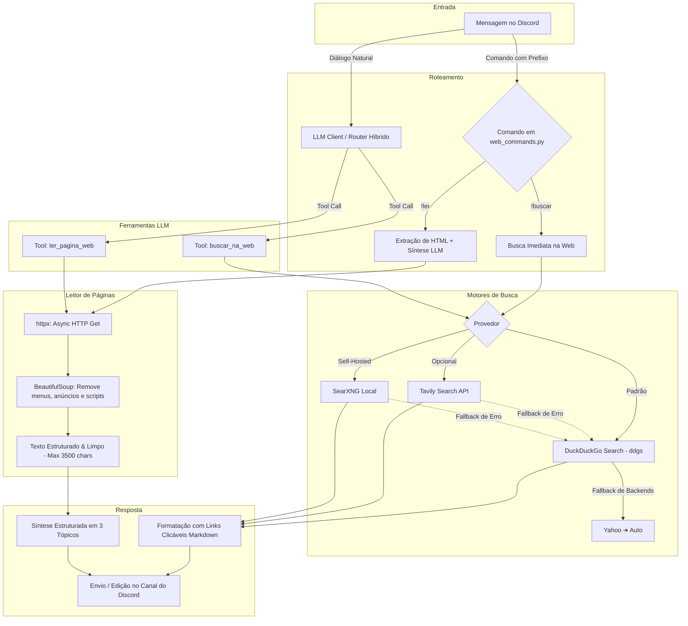

# Módulo 11: Pesquisa na Web em Tempo Real & Browsing (Web Search & Page Reading)

**Versão do Módulo:** 1.1.0 (Auditado e Estabilizado no Bot v3.6.0)  
**Status Operacional:** ✅ **ATIVO EM PRODUÇÃO (100% Cobertura de Testes)**  
**Arquivos de Implementação:** [`web_search_manager.py`](file:///Users/rodrigomodel/antigravity/discord/web_search_manager.py), [`tools/web_tools.py`](file:///Users/rodrigomodel/antigravity/discord/tools/web_tools.py), [`commands/web_commands.py`](file:///Users/rodrigomodel/antigravity/discord/commands/web_commands.py), [`config.py`](file:///Users/rodrigomodel/antigravity/discord/config.py)  
**Dependências Principais:** `ddgs` (DuckDuckGo Search), `httpx` (HTTP assíncrono), `beautifulsoup4` (limpeza e extração de HTML)

---

## 1. Visão Geral e Justificativa

Modelos de linguagem possuem dados restritos à data de corte do seu treinamento (*knowledge cutoff*). Para que o assistente responda com precisão factual a perguntas sobre fatos do dia, cotações financeiras, resultados esportivos, previsões do tempo ou documentações recém-lançadas, o bot conta com um motor completo de **Pesquisa na Web e Extração Textual Limpa de Páginas**.

O módulo opera em duas modalidades integradas:
1. **Invocação Autônoma pela IA (Tool Calling):** A LLM (LM Studio local ou Google Gemini) identifica a necessidade de dados em tempo real e aciona as ferramentas `buscar_na_web` e `ler_pagina_web` automaticamente durante a conversa.
2. **Comandos Diretos pelo Usuário:** Comandos explícitos com prefixo (`!buscar`, `!ler`) para consultas instantâneas e resumos executivos de artigos com links diretos.

---

## 2. Arquitetura do Módulo



---

## 3. Comandos de Usuário

Os comandos do módulo estão centralizados em [`discord/commands/web_commands.py`](file:///Users/rodrigomodel/antigravity/discord/commands/web_commands.py#L12-L137):

### 3.1 `!buscar <termo de pesquisa>`
* **Aliases:** `!pesquisar`, `!busca`, `!search`, `!web`
* **Descrição:** Pesquisa informações na internet em tempo real e retorna os resultados mais relevantes formatados com títulos em negrito, links clicáveis e resumos curtos:
```bash
!buscar cotação do dólar hoje comercial
!buscar previsão do tempo são paulo fim de semana
!buscar últimas notícias inteligência artificial
```

### 3.2 `!ler <url>`
* **Aliases:** `!ler_artigo`, `!ler_pagina`, `!browse`, `!extrair`, `!resumir_link`
* **Descrição:** Acessa uma página web ou artigo de notícia, extrai o texto principal descartando menus de navegação, rodapés e banners de publicidade, e aciona a IA para redigir uma síntese executiva estruturada:
  - **Resumo Executivo** (1 a 2 parágrafos objetivos).
  - **Principais Destaques** (3 a 5 tópicos em bullet points).
  - **Conclusão ou Impacto**.
  - Link original preservado para referência.

> 💡 **Nota sobre Deep Research:** O arquivo `web_commands.py` acolhe também os comandos do Agente de Pesquisa Profunda (`!pesquisa_profunda` e `!pesquisas` — IDEA-17), que utiliza o `web_search_manager.py` para investigações multi-eixo com cruzamento de 8 a 12 artigos em paralelo.

---

## 4. Ferramentas da LLM (Function Calling)

Registradas em [`discord/tools/web_tools.py`](file:///Users/rodrigomodel/antigravity/discord/tools/web_tools.py#L13-L86):

### 4.1 `buscar_na_web(query: str, max_resultados: Optional[int] = 4)`
* **Descrição:** Busca na internet fatos em tempo real, notícias, clima e cotações.
* **Parâmetros:**
  - `query` (str, obrigatório): Termo de busca na internet.
  - `max_resultados` (int, opcional): Quantidade desejada (padrão: 4, limite rígido: 6).
* **Retorno:** Títulos, links de origem, snippets e resumo formatado em texto para a LLM.

### 4.2 `ler_pagina_web(url: str)`
* **Descrição:** Acessa uma URL específica e retorna até 3.500 caracteres de texto legível limpo.
* **Higienização:** Decompõe tags `<script>`, `<style>`, `<noscript>`, `<nav>`, `<header>`, `<footer>`, `<aside>`, `<form>`, `<svg>`, `<iframe>`, `<button>`, `<input>`, banners e popups de cookies via BeautifulSoup.
* **Truncamento Defensivo:** Se o texto extraído exceder 3.500 caracteres, trunca adicionando a marca `... [Conteúdo truncado para síntese de leitura]`.

---

## 5. Resiliência de Rede & Configurações de Ambiente (`.env`)

Mapeadas em [`discord/config.py`](file:///Users/rodrigomodel/antigravity/discord/config.py#L90-L95):

```ini
# Habilita o motor de pesquisa web
WEB_SEARCH_ENABLED=true

# Provedor padrão: duckduckgo (gratuito e sem chave), tavily ou searxng
WEB_SEARCH_PROVIDER=duckduckgo

# Número máximo de resultados retornados por busca
WEB_SEARCH_MAX_RESULTS=4

# Timeout em segundos para requisições web (calibrado para evitar falsos cancelamentos)
WEB_SEARCH_TIMEOUT=18.0

# (Opcional) Chave da API do Tavily (https://tavily.com)
TAVILY_API_KEY=

# (Opcional) URL de instância privada do SearXNG
SEARXNG_URL=
```

### Mecanismo de Fallback e Retentativas
1. **Multi-Provedor:** Tentativa no provedor preferencial (`tavily` ou `searxng`); caso ocorra timeout ou erro HTTP, transborda automaticamente para o `duckduckgo`.
2. **Backends DuckDuckGo:** Alternância automática entre `yahoo` e `auto` no wrapper `ddgs`, mitigando bloqueios temporários de IP e rate limits sem falhar a requisição.
3. **Isolamento de Concorrência:** Todas as operações síncronas de scraping e chamadas de biblioteca externa rodam encapsuladas via `asyncio.to_thread` e `asyncio.wait_for`.

---

## 6. 📋 Matriz de Rastreabilidade & Aderência (Auditada em 2026-11-14)

| Requisito / Componente | Arquivo de Implementação | Símbolos / Classes / Funções | Linhas Auditadas | Status |
| :--- | :--- | :--- | :--- | :---: |
| **Gerenciador Central de Busca** | [`discord/web_search_manager.py`](file:///Users/rodrigomodel/antigravity/discord/web_search_manager.py) | `WebSearchManager.__init__`, `buscar_na_web` | [L36-L101](file:///Users/rodrigomodel/antigravity/discord/web_search_manager.py#L36-L101) | 🟢 Aderente |
| **Busca Resiliente DuckDuckGo** | [`discord/web_search_manager.py`](file:///Users/rodrigomodel/antigravity/discord/web_search_manager.py) | `_buscar_duckduckgo` (Backends `yahoo` e `auto`) | [L102-L144](file:///Users/rodrigomodel/antigravity/discord/web_search_manager.py#L102-L144) | 🟢 Aderente |
| **Busca via Tavily API** | [`discord/web_search_manager.py`](file:///Users/rodrigomodel/antigravity/discord/web_search_manager.py) | `_buscar_tavily` | [L145-L168](file:///Users/rodrigomodel/antigravity/discord/web_search_manager.py#L145-L168) | 🟢 Aderente |
| **Busca via SearXNG** | [`discord/web_search_manager.py`](file:///Users/rodrigomodel/antigravity/discord/web_search_manager.py) | `_buscar_searxng` | [L169-L190](file:///Users/rodrigomodel/antigravity/discord/web_search_manager.py#L169-L190) | 🟢 Aderente |
| **Web Scraping & Sanitização HTML** | [`discord/web_search_manager.py`](file:///Users/rodrigomodel/antigravity/discord/web_search_manager.py) | `ler_pagina_web` (BeautifulSoup, decomposição de tags e truncamento) | [L194-L323](file:///Users/rodrigomodel/antigravity/discord/web_search_manager.py#L194-L323) | 🟢 Aderente |
| **Formatadores LLM e Discord** | [`discord/web_search_manager.py`](file:///Users/rodrigomodel/antigravity/discord/web_search_manager.py) | `formatar_para_llm`, `formatar_para_discord` | [L327-L358](file:///Users/rodrigomodel/antigravity/discord/web_search_manager.py#L327-L358) | 🟢 Aderente |
| **Comando CLI `!buscar`** | [`discord/commands/web_commands.py`](file:///Users/rodrigomodel/antigravity/discord/commands/web_commands.py) | `cmd_buscar` (aliases: `pesquisar`, `busca`, `search`, `web`) | [L12-L52](file:///Users/rodrigomodel/antigravity/discord/commands/web_commands.py#L12-L52) | 🟢 Aderente |
| **Comando CLI `!ler`** | [`discord/commands/web_commands.py`](file:///Users/rodrigomodel/antigravity/discord/commands/web_commands.py) | `cmd_ler` (aliases: `ler_artigo`, `ler_pagina`, `browse`, `extrair`) | [L54-L137](file:///Users/rodrigomodel/antigravity/discord/commands/web_commands.py#L54-L137) | 🟢 Aderente |
| **Tool Function Calling: `buscar_na_web`** | [`discord/tools/web_tools.py`](file:///Users/rodrigomodel/antigravity/discord/tools/web_tools.py) | `tool_buscar_na_web` | [L13-L48](file:///Users/rodrigomodel/antigravity/discord/tools/web_tools.py#L13-L48) | 🟢 Aderente |
| **Tool Function Calling: `ler_pagina_web`** | [`discord/tools/web_tools.py`](file:///Users/rodrigomodel/antigravity/discord/tools/web_tools.py) | `tool_ler_pagina_web` | [L51-L86](file:///Users/rodrigomodel/antigravity/discord/tools/web_tools.py#L51-L86) | 🟢 Aderente |
| **Configurações & Timeout Calibrado** | [`discord/config.py`](file:///Users/rodrigomodel/antigravity/discord/config.py) | `WEB_SEARCH_ENABLED`, `WEB_SEARCH_TIMEOUT` (18.0s) | [L90-L95](file:///Users/rodrigomodel/antigravity/discord/config.py#L90-L95) | 🟢 Aderente |
