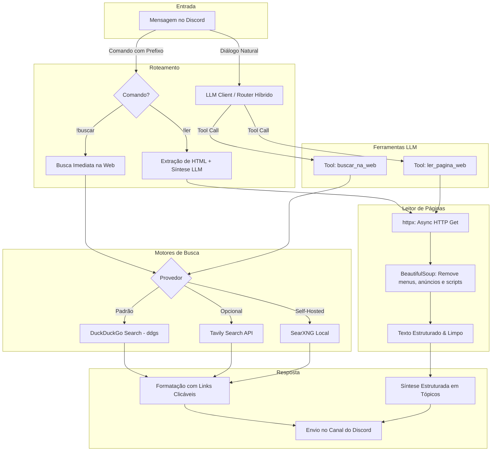

# Módulo 11: Pesquisa na Web em Tempo Real & Browsing (Web Search & Page Reading)

**Status:** ✅ Produção (`v2.8.0`)  
**Arquivos de Implementação:** [web_search_manager.py](file:///Users/rodrigomodel/antigravity/discord/web_search_manager.py), [tools/web_tools.py](file:///Users/rodrigomodel/antigravity/discord/tools/web_tools.py), [commands/builtins.py](file:///Users/rodrigomodel/antigravity/discord/commands/builtins.py)  
**Dependências Principais:** `ddgs` (DuckDuckGo Search), `httpx` (HTTP assíncrono), `beautifulsoup4` (limpeza e extração de HTML)

---

## 1. Visão Geral e Justificativa

Modelos de linguagem possuem dados restritos à data de corte do seu treinamento (*knowledge cutoff*). Para que o assistente responda com precisão factual a perguntas sobre fatos do dia, cotações financeiras, resultados esportivos, previsões do tempo ou documentações recém-lançadas, o bot agora conta com um motor completo de **Pesquisa na Web e Extração Textual Limpa de Páginas**.

O módulo opera em duas modalidades integradas:
1. **Invocação Autônoma pela IA (Tool Calling):** A LLM (LM Studio ou Google Gemini) identifica a necessidade de dados em tempo real e aciona as ferramentas `buscar_na_web` e `ler_pagina_web` automaticamente durante a conversa.
2. **Comandos Diretos pelo Usuário:** Comandos explícitos com prefixo (`!buscar`, `!pesquisar`, `!ler`) para consultas instantâneas e resumos executivos de artigos com links diretos.

---

## 2. Arquitetura do Módulo



---

## 3. Comandos de Usuário

### 3.1 `!buscar <termo de pesquisa>` (ou `!pesquisar`, `!busca`, `!web`)
Pesquisa informações na internet em tempo real e retorna os resultados mais relevantes formatados com títulos em negrito, links clicáveis e resumos curtos:
```bash
!buscar cotação do dólar hoje comercial
!buscar previsão do tempo são paulo fim de semana
!buscar últimas notícias inteligência artificial
```

### 3.2 `!ler <url>` (ou `!ler_artigo`, `!browse`, `!extrair`)
Acessa uma página web ou artigo de notícia, extrai o texto principal descartando menus de navegação, rodapés e banners de publicidade, e aciona a IA para redigir uma síntese executiva estruturada:
- **Resumo Executivo** (1 a 2 parágrafos).
- **Principais Destaques** (bullet points com dados essenciais).
- **Conclusão / Impacto**.
- Link original preservado para referência.

---

## 4. Ferramentas da LLM (Function Calling)

### 4.1 `buscar_na_web(query: str, max_resultados: int = 4)`
- **Descrição:** Busca na internet fatos em tempo real, notícias, clima e cotações.
- **Retorno:** Títulos, links de origem e snippets do conteúdo.

### 4.2 `ler_pagina_web(url: str)`
- **Descrição:** Acessa uma URL específica e retorna até 3.500 caracteres de texto legível limpo.
- **Higienização:** Decompõe tags `<script>`, `<style>`, `<nav>`, `<header>`, `<footer>`, `<aside>`, `<iframe>`, banners e cookies.

---

## 5. Configurações de Ambiente (`.env`)

```ini
# Habilita o motor de pesquisa web
WEB_SEARCH_ENABLED=true

# Provedor padrão: duckduckgo (gratuito e sem chave), tavily ou searxng
WEB_SEARCH_PROVIDER=duckduckgo

# Número máximo de resultados retornados por busca
WEB_SEARCH_MAX_RESULTS=4

# Timeout em segundos para requisições web
WEB_SEARCH_TIMEOUT=12.0

# (Opcional) Chave da API do Tavily (https://tavily.com)
TAVILY_API_KEY=

# (Opcional) URL de instância privada do SearXNG
SEARXNG_URL=
```
