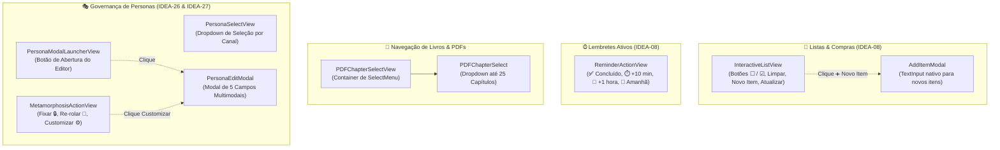

# Módulo 12: Interface Interativa com Botões, Modais e Menus (UI Components)

**Versão do Módulo:** 1.1.0 (Auditado e Estabilizado no Bot v3.6.0)  
**Status Operacional:** ✅ **ATIVO EM PRODUÇÃO (100% Cobertura de Testes)**  
**Escopo:** Componentes Visuais do Discord (`discord.ui.View`, `Button`, `Modal`, `Select`) para Interações sem Digitação  
**Arquivos de Implementação:** [`ui_components.py`](file:///Users/rodrigomodel/antigravity/discord/ui_components.py), [`commands/productivity_commands.py`](file:///Users/rodrigomodel/antigravity/discord/commands/productivity_commands.py), [`reminder_worker.py`](file:///Users/rodrigomodel/antigravity/discord/reminder_worker.py), [`commands/knowledge_commands.py`](file:///Users/rodrigomodel/antigravity/discord/commands/knowledge_commands.py), [`commands/ai_commands.py`](file:///Users/rodrigomodel/antigravity/discord/commands/ai_commands.py), [`config.py`](file:///Users/rodrigomodel/antigravity/discord/config.py)  

---

## 1. Visão Geral e Propósito

O módulo de **UI Interativa** substitui a necessidade de digitação contínua de comandos por uma experiência visual moderna e intuitiva no Discord através do uso dos componentes nativos da Discord API (`discord.ui`).

A interação sem digitação elimina atrito cognitivo em rotinas cotidianas:
1. **Marcar e desmarcar itens em listas** com um único toque.
2. **Adicionar novos itens** via formulário pop-up nativo (*Modal*) sem comandos de terminal.
3. **Adiar ou concluir lembretes** diretamente da notificação disparada pelo bot.
4. **Navegar por capítulos de livros longos** através de menus suspensos (*Select Menu Dropdown*).
5. **Alternar e editar personas cognitivas** com seletores visuais e formulários de identidade multimodal.

---

## 2. Catálogo Completo de Componentes de UI



### 2.1 Gestão de Listas: `InteractiveListView` & `AddItemModal`
* **Implementação:** [`ui_components.py`](file:///Users/rodrigomodel/antigravity/discord/ui_components.py#L25-L188)
* **Funcionalidades:**
  - Renderiza botões individuais para até 10 itens pendentes (`☐ texto`), particionados nas rows 0 e 1.
  - Botão `🧹 Limpar Concluídos` (habilitado apenas se houver itens marcados).
  - Botão `➕ Novo Item`: Abre o modal nativo `AddItemModal` com campo `TextInput`.
  - Botão `🔄 Atualizar`: Força a releitura do banco SQLite.
  - Atualização in-place da mensagem original (`interaction.response.edit_message`), sem gerar mensagens duplicadas no canal.
  - Proteção de permissão: tentativas de interação por outros usuários recebem resposta efêmera (`ephemeral=True`).

### 2.2 Notificações de Lembretes: `ReminderActionView`
* **Implementação:** [`ui_components.py`](file:///Users/rodrigomodel/antigravity/discord/ui_components.py#L194-L261)
* **Funcionalidades:**
  - Anexada às mensagens de notificação geradas pelo `reminder_worker.py`.
  - Quatro botões com 1 clique: `✅ Concluído`, `⏱️ +10 min`, `🔁 +1 hora`, `📅 Amanhã`.
  - Ao clicar, desativa todos os botões e atualiza a mensagem original no Discord confirmando o novo agendamento.
  - Validação estrita via `interaction_check`: apenas o usuário alvo do lembrete pode acioná-lo.

### 2.3 Navegação de Livros: `PDFChapterSelectView` & `PDFChapterSelect`
* **Implementação:** [`ui_components.py`](file:///Users/rodrigomodel/antigravity/discord/ui_components.py#L267-L347)
* **Funcionalidades:**
  - Select Menu dropdown nativo anexado ao comando `!pdf sumario <livro>`.
  - Lista até 25 capítulos com emojis temáticos e número da página de início.
  - Ao selecionar um capítulo, o bot aciona assincronamente `resumir_capitulo_documento` e divide a resposta caso exceda 1.900 caracteres.

### 2.4 Seleção de Personas: `PersonaSelectView` & `PersonaSelect`
* **Implementação:** [`ui_components.py`](file:///Users/rodrigomodel/antigravity/discord/ui_components.py#L353-L555)
* **Funcionalidades:**
  - Dropdown com até 24 personas do catálogo e opção para restaurar o assistente padrão (`__reset__`).
  - Emojis dedicados por especialidade (ex: `dev` 💻, `cfo` 📊, `socrates` 🏛️).
  - Verificação de permissões: apenas administradores ou usuários autorizados podem trocar a persona do canal.

### 2.5 Identidade Multimodal: `PersonaEditModal` & `PersonaModalLauncherView`
* **Implementação:** [`ui_components.py`](file:///Users/rodrigomodel/antigravity/discord/ui_components.py#L561-L689)
* **Funcionalidades:**
  - Modal nativo de formulário com 5 campos:
    1. *Nome de Exibição do Personagem* (max 32 chars).
    2. *Idade ou Maturação* (max 30 chars).
    3. *URL da Imagem do Avatar* (max 255 chars).
    4. *Semente DiceBear* (max 50 chars, alternativa a URLs externas).
    5. *Biografia / Contexto de Fundo* (estilo parágrafo, max 300 chars).
  - Atualiza imediatamente as propriedades do canal e gera um embed de confirmação com thumbnail do avatar ativo.

### 2.6 Governança de Metamorfose Semanal: `MetamorphosisActionView`
* **Implementação:** [`ui_components.py`](file:///Users/rodrigomodel/antigravity/discord/ui_components.py#L695-L745)
* **Funcionalidades:**
  - Barra de 3 botões anexada aos anúncios automáticos de metamorfose semanal:
    - `🔒 Fixar Persona`: Trava o personagem atual contra futuras mutações automáticas.
    - `🎲 Re-rolar`: Executa imediatamente um novo sorteio de identidade no canal.
    - `⚙️ Customizar`: Abre o modal `PersonaEditModal` para ajuste fino do personagem.

---

## 3. Princípios de Engenharia & Heurísticas de Nielsen

1. **Visibilidade do Estado do Sistema (Nielsen #1):** O estado da lista e dos lembretes é atualizado in-place via `edit_message`, sem poluição do chat.
2. **Correspondência entre o Sistema e o Mundo Real (Nielsen #2):** Checkboxes visuais (`☐` e `☑`) simulam listas de papel reais.
3. **Controle do Usuário e Liberdade (Nielsen #3):** Qualquer item marcado pode ser desmarcado a qualquer instante; lembretes podem ser adiados em múltiplos intervalos.
4. **Prevenção de Erros (Nielsen #5):** O botão `🧹 Limpar Concluídos` é automaticamente desabilitado (`disabled=True`) quando não há itens concluídos na lista.
5. **Particionamento em Action Rows:** Divisão estrita em rows para não exceder o limite de 5 botões por linha da Discord API.
6. **Gestão de Ciclo de Vida e Expiração Graciosa (`on_timeout`):** Todas as views herdam o timeout configurado em `DISCORD_UI_TIMEOUT_SECONDS` (180s) e desabilitam todos os componentes automaticamente para evitar instâncias órfãs em memória.

---

## 4. Configurações de Ambiente (`.env`)

Mapeadas em [`discord/config.py`](file:///Users/rodrigomodel/antigravity/discord/config.py#L128-L129):

```ini
# Habilita componentes interativos do Discord UI (Buttons, Modals, Selects)
DISCORD_UI_COMPONENTS_ENABLED=true

# Tempo de vida em segundos para expiração de Views inativas (padrão: 180s = 3 minutos)
DISCORD_UI_TIMEOUT_SECONDS=180
```

---

## 5. 📋 Matriz de Rastreabilidade & Aderência (Auditada em 2026-11-14)

| Requisito / Componente | Arquivo de Implementação | Símbolos / Classes / Métodos | Linhas Auditadas | Status |
| :--- | :--- | :--- | :--- | :---: |
| **Modal de Adição de Itens** | [`discord/ui_components.py`](file:///Users/rodrigomodel/antigravity/discord/ui_components.py) | `AddItemModal`, `on_submit` | [L25-L55](file:///Users/rodrigomodel/antigravity/discord/ui_components.py#L25-L55) | 🟢 Aderente |
| **View Interativa de Listas** | [`discord/ui_components.py`](file:///Users/rodrigomodel/antigravity/discord/ui_components.py) | `InteractiveListView`, `_reconstruir_componentes` | [L61-L134](file:///Users/rodrigomodel/antigravity/discord/ui_components.py#L61-L134) | 🟢 Aderente |
| **Callbacks & Permissões de Listas** | [`discord/ui_components.py`](file:///Users/rodrigomodel/antigravity/discord/ui_components.py) | `_criar_callback_toggle`, `_callback_limpar`, `_callback_add` | [L135-L160](file:///Users/rodrigomodel/antigravity/discord/ui_components.py#L135-L160) | 🟢 Aderente |
| **Atualização In-Place de Mensagens** | [`discord/ui_components.py`](file:///Users/rodrigomodel/antigravity/discord/ui_components.py) | `InteractiveListView.atualizar_mensagem` | [L161-L178](file:///Users/rodrigomodel/antigravity/discord/ui_components.py#L161-L178) | 🟢 Aderente |
| **Timeout e Desativação de Listas** | [`discord/ui_components.py`](file:///Users/rodrigomodel/antigravity/discord/ui_components.py) | `InteractiveListView.on_timeout` | [L179-L188](file:///Users/rodrigomodel/antigravity/discord/ui_components.py#L179-L188) | 🟢 Aderente |
| **View de Resolução de Lembretes** | [`discord/ui_components.py`](file:///Users/rodrigomodel/antigravity/discord/ui_components.py) | `ReminderActionView`, `btn_concluido`, `btn_adiar_*` | [L194-L261](file:///Users/rodrigomodel/antigravity/discord/ui_components.py#L194-L261) | 🟢 Aderente |
| **SelectMenu de Capítulos de Livros** | [`discord/ui_components.py`](file:///Users/rodrigomodel/antigravity/discord/ui_components.py) | `PDFChapterSelect`, `PDFChapterSelectView` | [L267-L347](file:///Users/rodrigomodel/antigravity/discord/ui_components.py#L267-L347) | 🟢 Aderente |
| **Dropdown de Seleção de Personas** | [`discord/ui_components.py`](file:///Users/rodrigomodel/antigravity/discord/ui_components.py) | `PersonaSelect`, `PersonaSelectView`, `criar_view_selecao_persona` | [L353-L555](file:///Users/rodrigomodel/antigravity/discord/ui_components.py#L353-L555) | 🟢 Aderente |
| **Modal de Identidade Multimodal** | [`discord/ui_components.py`](file:///Users/rodrigomodel/antigravity/discord/ui_components.py) | `PersonaEditModal`, `OpenPersonaModalButton`, `criar_view_modal_persona` | [L561-L689](file:///Users/rodrigomodel/antigravity/discord/ui_components.py#L561-L689) | 🟢 Aderente |
| **View de Governança de Metamorfose** | [`discord/ui_components.py`](file:///Users/rodrigomodel/antigravity/discord/ui_components.py) | `MetamorphosisActionView`, `criar_view_metamorfose` | [L695-L745](file:///Users/rodrigomodel/antigravity/discord/ui_components.py#L695-L745) | 🟢 Aderente |
| **Configurações Centralizadas de UI** | [`discord/config.py`](file:///Users/rodrigomodel/antigravity/discord/config.py) | `DISCORD_UI_COMPONENTS_ENABLED`, `DISCORD_UI_TIMEOUT_SECONDS` | [L128-L129](file:///Users/rodrigomodel/antigravity/discord/config.py#L128-L129) | 🟢 Aderente |
| **Consumo em Comandos de Produtividade** | [`productivity_commands.py`](file:///Users/rodrigomodel/antigravity/discord/commands/productivity_commands.py) | `InteractiveListView` no `cmd_lista` | [L78](file:///Users/rodrigomodel/antigravity/discord/commands/productivity_commands.py#L78) | 🟢 Aderente |
| **Consumo em Comandos de IA e Personas** | [`ai_commands.py`](file:///Users/rodrigomodel/antigravity/discord/commands/ai_commands.py) | `criar_view_selecao_persona`, `criar_view_modal_persona` | [L36](file:///Users/rodrigomodel/antigravity/discord/commands/ai_commands.py#L36) | 🟢 Aderente |
| **Consumo no Worker de Lembretes** | [`reminder_worker.py`](file:///Users/rodrigomodel/antigravity/discord/reminder_worker.py) | `ReminderActionView` nas notificações | [L135-L145](file:///Users/rodrigomodel/antigravity/discord/reminder_worker.py#L135-L145) | 🟢 Aderente |
