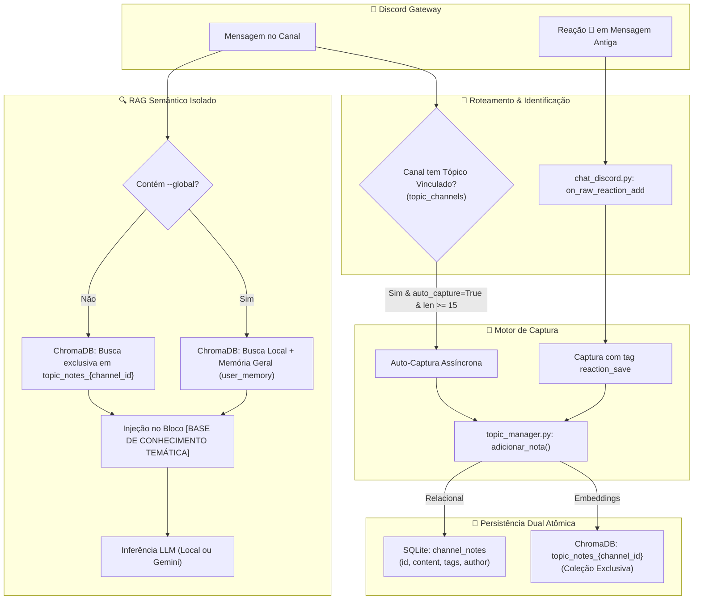

# Módulo 14: Knowledge Hub Temático e RAG Isolado por Canal

**Versão do Módulo:** 1.1.0 (Auditado e Estabilizado no Bot v3.6.0)  
**Status Operacional:** ✅ **ATIVO EM PRODUÇÃO (100% Cobertura de Testes)**  
**Escopo:** Gestão de Conhecimento, Anotações Estruturadas e Coleções RAG Multi-Tenant Isoladas por Canal (IDEA-25)  
**Arquivos de Implementação:** [`topic_manager.py`](file:///Users/rodrigomodel/antigravity/discord/topic_manager.py), [`vector_db.py`](file:///Users/rodrigomodel/antigravity/discord/vector_db.py), [`commands/knowledge_commands.py`](file:///Users/rodrigomodel/antigravity/discord/commands/knowledge_commands.py), [`tools/topic_tools.py`](file:///Users/rodrigomodel/antigravity/discord/tools/topic_tools.py), [`message_handler.py`](file:///Users/rodrigomodel/antigravity/discord/message_handler.py), [`chat_discord.py`](file:///Users/rodrigomodel/antigravity/discord/chat_discord.py)  

---

## 1. Visão Geral e Propósito

O módulo **Knowledge Hub Temático** transforma canais e threads do Discord em silos autônomos de conhecimento estruturado. Permite que um canal específico (ex: `#projeto-backend` ou `#reforma-tributaria`) concentre notas técnicas, fatos e contexto dedicados, sem misturar ou contaminar a memória geral das conversas cotidianas do usuário.

A arquitetura garante:
1. **Isolamento de Memória (Multi-Tenant Context):** Cada canal vinculado a um tópico tem sua própria coleção vetorial no ChromaDB (`topic_notes_{channel_id}`) e isolamento de histórico recente no SQLite.
2. **Auto-Captura Reativa:** Captura automática de mensagens informativas no chat (Modo Livre) ou sob demanda através da adição da reação `📝`.
3. **RAG Semântico Isolado:** Durante os diálogos no canal temático, o bot busca notas relevantes exclusivamente no repositório do canal, com suporte a escape global via `--global`.

---

## 2. Arquitetura do Knowledge Hub



---

## 3. Persistência de Dados no SQLite

Inicializada por `init_topic_db` em `chat_memory.db`:

```sql
CREATE TABLE IF NOT EXISTS topic_channels (
    channel_id TEXT PRIMARY KEY,
    topic_slug TEXT NOT NULL,
    topic_name TEXT NOT NULL,
    description TEXT,
    auto_capture_mode INTEGER NOT NULL DEFAULT 0,
    created_at DATETIME DEFAULT CURRENT_TIMESTAMP,
    updated_at DATETIME DEFAULT CURRENT_TIMESTAMP
);

CREATE INDEX IF NOT EXISTS idx_topic_channels_slug ON topic_channels(topic_slug);

CREATE TABLE IF NOT EXISTS channel_notes (
    id TEXT PRIMARY KEY,
    channel_id TEXT NOT NULL,
    topic_slug TEXT NOT NULL,
    user_id TEXT NOT NULL,
    content TEXT NOT NULL,
    tags TEXT,
    source_message_id TEXT,
    created_at DATETIME DEFAULT CURRENT_TIMESTAMP,
    updated_at DATETIME DEFAULT CURRENT_TIMESTAMP,
    FOREIGN KEY (channel_id) REFERENCES topic_channels(channel_id) ON DELETE CASCADE
);

CREATE INDEX IF NOT EXISTS idx_channel_notes_topic ON channel_notes(topic_slug, channel_id);
CREATE INDEX IF NOT EXISTS idx_channel_notes_created ON channel_notes(created_at DESC);
```

### Detalhes Estruturais:
- **IDs de Notas Curtos e Legíveis:** Gerados como `uuid.uuid4().hex[:8]` (ex: `1a2b3c4d`), facilitando comandos de inspeção e remoção no chat.
- **Normalização de Tags:** Hashtags no texto (ex: `#cbs #reforma`) são extraídas automaticamente por regex e serializadas em JSON.
- **Cascata Referencial:** A exclusão de um canal expurga automaticamente as notas associadas via `ON DELETE CASCADE`.

---

## 4. Ciclo de Vida Vetorial no ChromaDB

Implementado em [`discord/vector_db.py`](file:///Users/rodrigomodel/antigravity/discord/vector_db.py#L219-L290):
- **Sanitização de Coleções:** `sanitizar_nome_colecao_topico(channel_id)` garante nomes no padrão `topic_notes_{channel_id}` com limite rígido de 63 caracteres.
- **Indexação Vetorial:** `salvar_nota_vetorial(channel_id, note_id, content, metadata_extra)` gera embeddings do texto da nota e persiste com metadados de tags e autor.
- **Exclusão Atômica:** `remover_nota_vetorial` remove o vetor correspondente no ChromaDB no momento em que a nota é deletada do SQLite.
- **Purga de Tópico:** `limpar_colecao_topico(channel_id)` redefine ou esvazia a coleção quando o usuário comanda a limpeza total.

---

## 5. Auto-Captura Inteligente e Captura Reativa

1. **Modo Livre (`auto_capture_mode`):**  
   Quando ativado via `!topico modo_livre on`, qualquer mensagem no canal que:
   - Tenha comprimento $\ge 15$ caracteres;
   - Não termine com ponto de interrogação `?` (evitando salvar perguntas);
   - Não se inicie com o prefixo de comandos `!`;  
   é registrada automaticamente no SQLite e no ChromaDB, recebendo a reação `📝` como confirmação visual.
2. **Captura Manual por Reação (`on_raw_reaction_add`):**  
   Adicionar a reação `📝` a qualquer mensagem histórica do canal dispara a captura assíncrona daquele texto com a tag `reaction_save`.

---

## 6. Comandos de Usuário (`knowledge_commands.py`)

Registrados em [`discord/commands/knowledge_commands.py`](file:///Users/rodrigomodel/antigravity/discord/commands/knowledge_commands.py#L340-L546):

### 6.1 `!topico [vincular | status | desvincular | modo_livre]`
* **Aliases:** `!tema`, `!hub`
* **Exemplos:**
  - `!topico vincular cbs "Reforma Tributária e CBS"`
  - `!topico status` — Exibe nome, status do modo livre e total de notas indexadas.
  - `!topico modo_livre on` — Ativa captura automática.
  - `!topico desvincular` — Remove o vínculo do canal mantendo as notas preservadas.

### 6.2 `!nota [add | buscar | ver | remover | limpar]`
* **Aliases:** `!notas_cmd`, `!anotacao`, `!ideia`
* **Exemplos:**
  - `!nota add Alíquota padrão do CBS estimada em 8.8% #cbs #reforma`
  - `!nota buscar alíquotas do CBS` — Busca semântica RAG isolada no canal.
  - `!nota ver 1a2b3c4d` — Exibe conteúdo completo e tags da nota.
  - `!nota remover 1a2b3c4d` — Exclui a nota do SQLite e do ChromaDB.
  - `!nota limpar confirmar` — Purga todas as notas do canal (exige `confirmar` por segurança).

### 6.3 `!notas [#tag] [limite]`
* **Aliases:** `!listanotas`, `!minhasnotas`
* **Exemplo:** `!notas #cbs` — Lista até 10 notas recentes filtradas pela hashtag.

---

## 7. Ferramentas da LLM (Function Calling)

Registradas em [`discord/tools/topic_tools.py`](file:///Users/rodrigomodel/antigravity/discord/tools/topic_tools.py#L1-L157):

1. **`adicionar_nota_canal(conteudo: str, tags: Optional[List[str]])`**:  
   Permite à LLM salvar fatos, diretrizes ou ideias durante a conversa com categorização por tags.
2. **`buscar_notas_canal(consulta_semantica: str, top_k: int = 4)`**:  
   Permite à LLM consultar semanticamente o acervo do canal temático sem contaminar com memórias gerais.
3. **`listar_notas_canal(tag_filtro: Optional[str], limite: int = 10)`**:  
   Permite à LLM listar as notas mais recentes do canal com opção de filtro por tag.

---

## 8. 📋 Matriz de Rastreabilidade & Aderência (Auditada em 2026-11-14)

| Requisito / Componente | Arquivo de Implementação | Símbolos / Classes / Métodos | Linhas Auditadas | Status |
| :--- | :--- | :--- | :--- | :---: |
| **Vinculação de Tópicos no SQLite** | [`discord/topic_manager.py`](file:///Users/rodrigomodel/antigravity/discord/topic_manager.py) | `vincular_topico`, `obter_topico_canal`, `desvincular_topico` | [L83-L165](file:///Users/rodrigomodel/antigravity/discord/topic_manager.py#L83-L165) | 🟢 Aderente |
| **DDL das Tabelas & Índices** | [`discord/topic_manager.py`](file:///Users/rodrigomodel/antigravity/discord/topic_manager.py) | `init_topic_db` (`topic_channels`, `channel_notes`) | [L34-L73](file:///Users/rodrigomodel/antigravity/discord/topic_manager.py#L34-L73) | 🟢 Aderente |
| **Persistência de Notas & Hashtags** | [`discord/topic_manager.py`](file:///Users/rodrigomodel/antigravity/discord/topic_manager.py) | `adicionar_nota`, `extrair_tags` | [L75-L81](file:///Users/rodrigomodel/antigravity/discord/topic_manager.py#L75-L81), [L186-L254](file:///Users/rodrigomodel/antigravity/discord/topic_manager.py#L186-L254) | 🟢 Aderente |
| **Listagem, Consulta e Exclusão** | [`discord/topic_manager.py`](file:///Users/rodrigomodel/antigravity/discord/topic_manager.py) | `listar_notas`, `obter_nota`, `remover_nota`, `limpar_notas_topico` | [L256-L382](file:///Users/rodrigomodel/antigravity/discord/topic_manager.py#L256-L382) | 🟢 Aderente |
| **Coleções Particionadas ChromaDB** | [`discord/vector_db.py`](file:///Users/rodrigomodel/antigravity/discord/vector_db.py) | `sanitizar_nome_colecao_topico`, `salvar_nota_vetorial`, `buscar_notas_canal_vetorial` | [L219-L290](file:///Users/rodrigomodel/antigravity/discord/vector_db.py#L219-L290) | 🟢 Aderente |
| **Auto-Captura com Reação `📝`** | [`discord/message_handler.py`](file:///Users/rodrigomodel/antigravity/discord/message_handler.py) | Condição `auto_capture_mode` e `add_reaction("📝")` | [L418-L435](file:///Users/rodrigomodel/antigravity/discord/message_handler.py#L418-L435) | 🟢 Aderente |
| **Captura Manual por Reação** | [`discord/chat_discord.py`](file:///Users/rodrigomodel/antigravity/discord/chat_discord.py) | `on_raw_reaction_add` | [L140-L180](file:///Users/rodrigomodel/antigravity/discord/chat_discord.py#L140-L180) | 🟢 Aderente |
| **RAG Isolado e Injeção no Prompt** | [`discord/message_handler.py`](file:///Users/rodrigomodel/antigravity/discord/message_handler.py) | `buscar_notas_rag`, injeção `[BASE DE CONHECIMENTO TEMÁTICA]` | [L440-L442](file:///Users/rodrigomodel/antigravity/discord/message_handler.py#L440-L442), [L494-L506](file:///Users/rodrigomodel/antigravity/discord/message_handler.py#L494-L506) | 🟢 Aderente |
| **Escape Global com `--global`** | [`discord/message_handler.py`](file:///Users/rodrigomodel/antigravity/discord/message_handler.py) | Purga de `--global` e consulta ao `buscar_memorias_relevantes` | [L414-L416](file:///Users/rodrigomodel/antigravity/discord/message_handler.py#L414-L416), [L443-L445](file:///Users/rodrigomodel/antigravity/discord/message_handler.py#L443-L445) | 🟢 Aderente |
| **Isolamento de Histórico no SQLite** | [`discord/message_handler.py`](file:///Users/rodrigomodel/antigravity/discord/message_handler.py) | `salvar_mensagem(channel_id=...)`, `obter_historico(channel_id=...)` | [L452-L457](file:///Users/rodrigomodel/antigravity/discord/message_handler.py#L452-L457), [L470](file:///Users/rodrigomodel/antigravity/discord/message_handler.py#L470) | 🟢 Aderente |
| **Comando CLI `!topico`** | [`discord/commands/knowledge_commands.py`](file:///Users/rodrigomodel/antigravity/discord/commands/knowledge_commands.py) | `cmd_topico` | [L345-L414](file:///Users/rodrigomodel/antigravity/discord/commands/knowledge_commands.py#L345-L414) | 🟢 Aderente |
| **Comando CLI `!nota`** | [`discord/commands/knowledge_commands.py`](file:///Users/rodrigomodel/antigravity/discord/commands/knowledge_commands.py) | `cmd_nota` (add, buscar, ver, remover, limpar) | [L417-L508](file:///Users/rodrigomodel/antigravity/discord/commands/knowledge_commands.py#L417-L508) | 🟢 Aderente |
| **Comando CLI `!notas`** | [`discord/commands/knowledge_commands.py`](file:///Users/rodrigomodel/antigravity/discord/commands/knowledge_commands.py) | `cmd_notas` | [L511-L546](file:///Users/rodrigomodel/antigravity/discord/commands/knowledge_commands.py#L511-L546) | 🟢 Aderente |
| **Tool LLM: `adicionar_nota_canal`** | [`discord/tools/topic_tools.py`](file:///Users/rodrigomodel/antigravity/discord/tools/topic_tools.py) | `tool_adicionar_nota_canal` | [L11-L44](file:///Users/rodrigomodel/antigravity/discord/tools/topic_tools.py#L11-L44) | 🟢 Aderente |
| **Tool LLM: `buscar_notas_canal`** | [`discord/tools/topic_tools.py`](file:///Users/rodrigomodel/antigravity/discord/tools/topic_tools.py) | `tool_buscar_notas_canal` | [L46-L101](file:///Users/rodrigomodel/antigravity/discord/tools/topic_tools.py#L46-L101) | 🟢 Aderente |
| **Tool LLM: `listar_notas_canal`** | [`discord/tools/topic_tools.py`](file:///Users/rodrigomodel/antigravity/discord/tools/topic_tools.py) | `tool_listar_notas_canal` | [L103-L157](file:///Users/rodrigomodel/antigravity/discord/tools/topic_tools.py#L103-L157) | 🟢 Aderente |
