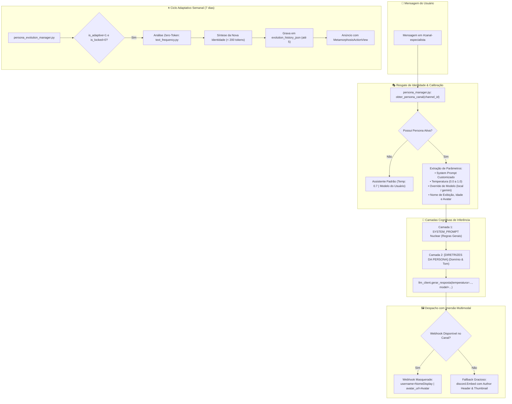

# Módulo 15: Personas e Overrides Cognitivos por Canal

**Versão do Módulo:** 1.1.0 (Auditado e Estabilizado no Bot v3.6.0)  
**Status Operacional:** ✅ **ATIVO EM PRODUÇÃO (100% Cobertura de Testes)**  
**Escopo:** Especialização Cognitiva de Canais, Identidade Multimodal, Overrides de Temperatura/Modelo e Metamorfose Semanal (IDEA-26 & IDEA-27)  
**Arquivos de Implementação:** [`persona_manager.py`](file:///Users/rodrigomodel/antigravity/discord/persona_manager.py), [`persona_evolution_manager.py`](file:///Users/rodrigomodel/antigravity/discord/persona_evolution_manager.py), [`commands/ai_commands.py`](file:///Users/rodrigomodel/antigravity/discord/commands/ai_commands.py), [`tools/persona_tools.py`](file:///Users/rodrigomodel/antigravity/discord/tools/persona_tools.py), [`message_handler.py`](file:///Users/rodrigomodel/antigravity/discord/message_handler.py), [`ui_components.py`](file:///Users/rodrigomodel/antigravity/discord/ui_components.py)  

---

## 1. Visão Geral e Justificativa

O módulo de **Personas por Canal** permite transformar cada canal ou thread do servidor do Discord em um agente especialista autônomo com diretrizes operacionais, estilo de comunicação, temperatura de amostragem, provedor de LLM, nome de exibição, avatar exclusivo e capacidade evolutiva contínua.

A experiência combina:
1. **Injeção Cognitiva em Duas Camadas:** O `SYSTEM_PROMPT` padrão do bot estabelece as regras nucleares de segurança, concisão e bom senso, enquanto as diretrizes específicas da persona injetam o domínio técnico e tom de voz.
2. **Identidade Multimodal (IDEA-27):** Cada canal possui identidade visual e biográfica completa (*Nome*, *Idade*, *Bio*, *Avatar DiceBear* ou URL customizada).
3. **Webhook Masquerade (Imersão Total):** O bot envia mensagens utilizando webhooks nativos do Discord com o nome e imagem do personagem, criando a impressão de múltiplos bots convivendo no mesmo servidor.
4. **Metamorfose Semanal Adaptativa:** Canais em modo adaptativo analisam as conversas dos últimos 7 dias via Bag-of-Words zero-token e evoluem periodicamente, mantendo um álbum histórico de encarnações passadas.

---

## 2. Arquitetura do Subsistema de Personas



---

## 3. Identidade Multimodal & Webhook Masquerade

### 3.1 Propriedades Biográficas e Visuais
* **Nome de Exibição (`display_name`):** Nome fictício ou título do personagem (ex: `Dra. Neusa`, `Cadu Hacker`, `Prof. Silas`).
* **Idade / Maturação (`age`):** Indicador de contexto temporal (ex: `54 anos`, `28 anos`, `Ancestral`).
* **Biografia (`bio`):** Breve síntese de personalidade e especialidade (até 300 caracteres).
* **Avatar Dinâmico (`avatar_url` ou `avatar_seed`):**
  - Se fornecida uma URL direta (`http://...`), utiliza a imagem informada.
  - Se informada uma semente textual (`avatar_seed`), renderiza um avatar determinístico da coleção DiceBear Bottts (`https://api.dicebear.com/7.x/bottts/png?seed={seed}`).

### 3.2 Despacho via Webhook Masquerade
Implementado em [`discord/message_handler.py`](file:///Users/rodrigomodel/antigravity/discord/message_handler.py#L130-L162):
- O bot busca um webhook existente gerenciado por ele ou cria um novo no canal.
- Dispara `await webhook.send(content=..., username=nome_display, avatar_url=avatar_url)`.
- **Fallback Gracioso:** Se o webhook falhar por restrições de permissão do Discord, encapsula o conteúdo em um `discord.Embed` com header de autor (`embed.set_author(name=f"{nome_display} • {age}", icon_url=avatar_url)`).

---

## 4. Motor de Metamorfose Semanal & Evolução Adaptativa

Gerenciado por [`discord/persona_evolution_manager.py`](file:///Users/rodrigomodel/antigravity/discord/persona_evolution_manager.py#L1-L100):
1. **Elegibilidade:** Canais com `is_adaptive = 1`, `is_locked = 0` e intervalo $\ge 7$ dias desde a última evolução.
2. **Análise Zero-Token:** O módulo [`text_frequency.py`](file:///Users/rodrigomodel/antigravity/discord/text_frequency.py) processa as mensagens textuais recentes do SQLite sem enviar dados à LLM, extraindo os substantivos e tópicos mais frequentes.
3. **Síntese da Nova Identidade:** A LLM recebe os termos frequentes em um prompt ultracompacto (< 200 tokens) e gera o novo nome, idade, bio e anúncio cerimonial.
4. **Preservação Histórica:** As encarnações passadas são arquivadas em formato JSON na coluna `evolution_history_json` (mantendo até 5 registros consultáveis via `!persona historico`).
5. **Ações Imediatas:** O anúncio anexa a barra de botões `MetamorphosisActionView`:
   - `🔒 Fixar Persona`: Trava o personagem atual contra novas mutações semanais.
   - `🎲 Re-rolar`: Executa imediatamente um novo sorteio de identidade.
   - `⚙️ Customizar`: Abre o modal nativo `PersonaEditModal`.

---

## 5. Persistência de Dados no SQLite

Tabela `channel_personas` inicializada em `chat_memory.db`:

```sql
CREATE TABLE IF NOT EXISTS channel_personas (
    channel_id TEXT PRIMARY KEY,
    guild_id TEXT,
    channel_name TEXT,
    system_prompt TEXT NOT NULL,
    temperature REAL DEFAULT 0.7,
    model_override TEXT,
    created_by_user_id TEXT NOT NULL,
    persona_slug TEXT,
    display_name TEXT,
    avatar_url TEXT,
    avatar_seed TEXT,
    age TEXT,
    bio TEXT,
    is_adaptive INTEGER DEFAULT 1,
    is_locked INTEGER DEFAULT 0,
    last_evolved_at DATETIME DEFAULT CURRENT_TIMESTAMP,
    evolution_history_json TEXT DEFAULT '[]',
    created_at DATETIME DEFAULT CURRENT_TIMESTAMP,
    updated_at DATETIME DEFAULT CURRENT_TIMESTAMP
);

CREATE INDEX IF NOT EXISTS idx_channel_personas_guild ON channel_personas(guild_id);
```

---

## 6. Comandos de Usuário (`ai_commands.py`)

Registrados em [`discord/commands/ai_commands.py`](file:///Users/rodrigomodel/antigravity/discord/commands/ai_commands.py#L263-L756):

### 6.1 Gestão e Inspecção de Identidade
* `!persona`: Exibe o dashboard geral do canal com Card Embed e dropdown interativo `PersonaSelectView`.
* `!persona ver` (ou `status`): Exibe o card completo com avatar, nome, idade, bio, temperatura e prompt.
* `!persona editar`: Dispara botão que abre o formulário nativo do Discord (`PersonaEditModal`).
* `!persona avatar <url | semente>`: Define a imagem ou semente DiceBear da persona.
* `!persona identidade <nome> | <idade> | <bio>`: Configura o perfil biográfico completo.
* `!persona fixar` / `!persona destravar`: Trava ou libera o canal para metamorfose semanal de 7 dias.
* `!persona metamorfose`: Força uma evolução adaptativa imediata baseada nas conversas recentes.
* `!persona historico` (ou `album`): Exibe o álbum genealógico das encarnações passadas do canal.

### 6.2 Gestão de Catálogo e Especialização de Canal
* `!persona lista`: Lista todas as personas do catálogo com dropdown de troca rápida.
* `!persona salvar <id> <prompt>`: Cadastra nova persona reutilizável no catálogo.
* `!persona remover <id>`: Exclui persona customizada do catálogo.
* `!persona canais`: Lista todos os canais do servidor que possuem personas ativas.
* `!persona canal aplicar <preset>`: Vincula um preset do catálogo ao canal atual.
* `!persona canal temp <0.0-1.0>`: Ajusta a temperatura de amostragem da LLM no canal.
* `!persona canal modelo <local|gemini-flash|gemini-pro|reset>`: Define override de modelo.
* `!persona canal reset`: Restaura o assistente padrão sem overrides cognitivos.

---

## 7. Ferramentas da LLM (Function Calling)

Disponíveis em [`discord/tools/persona_tools.py`](file:///Users/rodrigomodel/antigravity/discord/tools/persona_tools.py#L1-L298):

1. **`consultar_persona_canal()`**: Permite à IA inspecionar as diretrizes e temperatura do canal atual.
2. **`configurar_persona_canal(prompt_persona: str, temperatura: Optional[float])`**: Permite à IA customizar o prompt e temperatura do canal.
3. **`aplicar_preset_persona_canal(nome_preset: str)`**: Permite à IA aplicar presets do catálogo (`dev`, `cfo`, etc.) ao canal.
4. **`listar_personas_disponiveis(categoria: Optional[str])`**: Retorna todas as personas cadastradas com especialidades e temperaturas.
5. **`cadastrar_nova_persona(identificador: str, prompt_diretrizes: str, ...)`**: Permite à IA criar novos perfis sob demanda.

> 💡 Todas as tools de personas invocam `add_pending_view(criar_view_selecao_persona(...))` para enriquecer a resposta com componentes interativos no chat.

---

## 8. 📋 Matriz de Rastreabilidade & Aderência (Auditada em 2026-11-14)

| Requisito / Componente | Arquivo de Implementação | Símbolos / Classes / Métodos | Linhas Auditadas | Status |
| :--- | :--- | :--- | :--- | :---: |
| **Injeção Hierárquica em Duas Camadas** | [`discord/message_handler.py`](file:///Users/rodrigomodel/antigravity/discord/message_handler.py) | Injeção `SYSTEM_PROMPT` + `[DIRETRIZES DA PERSONA]` | [L473-L492](file:///Users/rodrigomodel/antigravity/discord/message_handler.py#L473-L492) | 🟢 Aderente |
| **Overrides de Temperatura e Modelo** | [`discord/message_handler.py`](file:///Users/rodrigomodel/antigravity/discord/message_handler.py) | `persona_canal.get('temperature')`, `model_override` | [L551-L577](file:///Users/rodrigomodel/antigravity/discord/message_handler.py#L551-L577) | 🟢 Aderente |
| **Identidade Multimodal & Avatares** | [`discord/persona_manager.py`](file:///Users/rodrigomodel/antigravity/discord/persona_manager.py) | `obter_avatar_persona`, `definir_avatar_canal`, `definir_identidade_canal` | [L234-L335](file:///Users/rodrigomodel/antigravity/discord/persona_manager.py#L234-L335) | 🟢 Aderente |
| **Trava de Evolução (`is_locked`)** | [`discord/persona_manager.py`](file:///Users/rodrigomodel/antigravity/discord/persona_manager.py) | `definir_trava_persona_canal` | [L338-L372](file:///Users/rodrigomodel/antigravity/discord/persona_manager.py#L338-L372) | 🟢 Aderente |
| **Aplicação de Presets do Prompt Hub** | [`discord/persona_manager.py`](file:///Users/rodrigomodel/antigravity/discord/persona_manager.py) | `aplicar_preset_canal` | [L374-L405](file:///Users/rodrigomodel/antigravity/discord/persona_manager.py#L374-L405) | 🟢 Aderente |
| **Definição de Temperatura e Modelo** | [`discord/persona_manager.py`](file:///Users/rodrigomodel/antigravity/discord/persona_manager.py) | `definir_temperatura_canal`, `definir_modelo_canal`, `resetar_persona_canal` | [L407-L464](file:///Users/rodrigomodel/antigravity/discord/persona_manager.py#L407-L464) | 🟢 Aderente |
| **DDL SQLite `channel_personas`** | [`discord/persona_manager.py`](file:///Users/rodrigomodel/antigravity/discord/persona_manager.py) | `init_persona_db`, `_ensure_persona_slug_column` | [L29-L91](file:///Users/rodrigomodel/antigravity/discord/persona_manager.py#L29-L91) | 🟢 Aderente |
| **Webhook Masquerade & Fallback** | [`discord/message_handler.py`](file:///Users/rodrigomodel/antigravity/discord/message_handler.py) | `_obter_webhook_canal`, envio com `username` e `avatar_url` | [L130-L162](file:///Users/rodrigomodel/antigravity/discord/message_handler.py#L130-L162) | 🟢 Aderente |
| **Motor de Metamorfose Semanal** | [`discord/persona_evolution_manager.py`](file:///Users/rodrigomodel/antigravity/discord/persona_evolution_manager.py) | `verificar_canais_para_metamorfose`, `executar_metamorfose_canal` | [L50-L100](file:///Users/rodrigomodel/antigravity/discord/persona_evolution_manager.py#L50-L100) | 🟢 Aderente |
| **Álbum Histórico de Encarnações** | [`discord/persona_evolution_manager.py`](file:///Users/rodrigomodel/antigravity/discord/persona_evolution_manager.py) | `obter_historico_metamorfoses` | [L230-L260](file:///Users/rodrigomodel/antigravity/discord/persona_evolution_manager.py#L230-L260) | 🟢 Aderente |
| **Comando CLI `!persona` (Dashboard & Subcomandos)** | [`discord/commands/ai_commands.py`](file:///Users/rodrigomodel/antigravity/discord/commands/ai_commands.py) | `cmd_persona` (`ver`, `editar`, `avatar`, `identidade`, `metamorfose`, `historico`, `canal`) | [L263-L756](file:///Users/rodrigomodel/antigravity/discord/commands/ai_commands.py#L263-L756) | 🟢 Aderente |
| **Tool LLM: `consultar_persona_canal`** | [`discord/tools/persona_tools.py`](file:///Users/rodrigomodel/antigravity/discord/tools/persona_tools.py) | `tool_consultar_persona_canal` | [L25-L76](file:///Users/rodrigomodel/antigravity/discord/tools/persona_tools.py#L25-L76) | 🟢 Aderente |
| **Tool LLM: `configurar_persona_canal`** | [`discord/tools/persona_tools.py`](file:///Users/rodrigomodel/antigravity/discord/tools/persona_tools.py) | `tool_configurar_persona_canal` | [L78-L118](file:///Users/rodrigomodel/antigravity/discord/tools/persona_tools.py#L78-L118) | 🟢 Aderente |
| **Tool LLM: `aplicar_preset_persona_canal`** | [`discord/tools/persona_tools.py`](file:///Users/rodrigomodel/antigravity/discord/tools/persona_tools.py) | `tool_aplicar_preset_persona_canal` | [L120-L167](file:///Users/rodrigomodel/antigravity/discord/tools/persona_tools.py#L120-L167) | 🟢 Aderente |
| **Tool LLM: `listar_personas_disponiveis`** | [`discord/tools/persona_tools.py`](file:///Users/rodrigomodel/antigravity/discord/tools/persona_tools.py) | `tool_listar_personas_disponiveis` | [L169-L228](file:///Users/rodrigomodel/antigravity/discord/tools/persona_tools.py#L169-L228) | 🟢 Aderente |
| **Tool LLM: `cadastrar_nova_persona`** | [`discord/tools/persona_tools.py`](file:///Users/rodrigomodel/antigravity/discord/tools/persona_tools.py) | `tool_cadastrar_nova_persona` | [L230-L298](file:///Users/rodrigomodel/antigravity/discord/tools/persona_tools.py#L230-L298) | 🟢 Aderente |
| **Componentes Visuais de Persona** | [`discord/ui_components.py`](file:///Users/rodrigomodel/antigravity/discord/ui_components.py) | `PersonaSelectView`, `PersonaModalLauncherView`, `MetamorphosisActionView` | [L353-L745](file:///Users/rodrigomodel/antigravity/discord/ui_components.py#L353-L745) | 🟢 Aderente |
