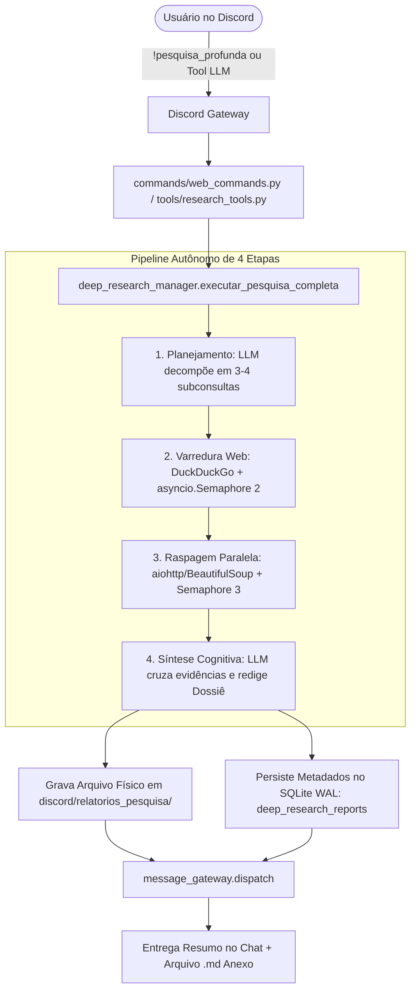

# Módulo 16: Pesquisa Profunda & Dossiês Analíticos (Deep Research)

O subsistema **Deep Research** (originado na `IDEA-17` e formalizado na `OS-006`) atua como um agente autônomo de inteligência investigativa no Discord. Ele decompõe temas complexos em múltiplos eixos de busca, varre a internet em paralelo com controle fino de concorrência, raspa o conteúdo textual de dezenas de páginas, cruza evidências, descarta contradições e redige Dossiês Técnicos exaustivos em Markdown, entregues diretamente no chat com anexo físico.

---

## 1. Visão Geral e Propósito

Enquanto o módulo de pesquisa web tradicional (`MOD-VIS-11`) realiza buscas pontuais para responder a dúvidas imediatas, o **Deep Research** é projetado para demandas de alta densidade cognitiva (ex: análises de viabilidade arquitetural, comparações de mercado, due diligence regulatória e benchmarking de hardware/LLMs).

### 1.1 Objetivos Centrais
1. **Decomposição Analítica:** Utilizar a LLM como planejador para transformar uma pergunta ampla em 3 a 4 subconsultas de pesquisa ortogonais no DuckDuckGo.
2. **Varredura Web Concorrente & Resiliente:** Executar varreduras simultâneas limitadas por semáforos assíncronos (`asyncio.Semaphore(2)` para buscas e `asyncio.Semaphore(3)` para raspagem de páginas), evitando bloqueios de IP e sobrecarga de rede.
3. **Cruzamento de Evidências & Síntese Formal:** Redigir relatórios estruturados com introdução, contexto, análise comparativa, riscos e referências com links originais.
4. **Persistência Relacional & Entrega Multimodal:** Gravar os metadados e o resumo no SQLite WAL (`deep_research_reports`), salvar o dossiê completo em `discord/relatorios_pesquisa/` e despachar o resumo executivo acompanhado do arquivo `.md` como anexo no canal do Discord via Message Gateway Outbox.

---

## 2. Arquitetura e Ciclo de Vida do Deep Research



---

## 3. Esquema Relacional no SQLite WAL

O módulo gerencia a tabela `deep_research_reports` inicializada compulsoriamente via `init_deep_research_db`:

```sql
CREATE TABLE IF NOT EXISTS deep_research_reports (
    id TEXT PRIMARY KEY,
    user_id TEXT NOT NULL,
    topic TEXT NOT NULL,
    summary TEXT NOT NULL,
    file_path TEXT NOT NULL,
    sources_json TEXT NOT NULL,
    status TEXT NOT NULL DEFAULT 'concluido',
    created_at DATETIME DEFAULT CURRENT_TIMESTAMP
);

CREATE INDEX IF NOT EXISTS idx_research_user ON deep_research_reports(user_id);
CREATE INDEX IF NOT EXISTS idx_research_created ON deep_research_reports(created_at DESC);
```

---

## 4. Catálogo de Comandos de Chat

Registrados em [`discord/commands/web_commands.py`](file:///Users/rodrigomodel/antigravity/discord/commands/web_commands.py) com a anotação `@register_command`:

| Comando | Aliases | Categoria | Descrição e Sintaxe |
| :--- | :--- | :--- | :--- |
| `!pesquisa_profunda <tema>` | `!pesquisa`, `!deepresearch` | Web | Dispara o agente de pesquisa profunda, realiza a varredura e anexa o dossiê em Markdown no chat. |
| `!pesquisas [limite]` | `!meus_relatorios` | Web | Lista os relatórios de pesquisa profunda já elaborados anteriormente para o usuário. |

---

## 5. Catálogo de Ferramentas da LLM (Function Calling)

Registradas em [`discord/tools/research_tools.py`](file:///Users/rodrigomodel/antigravity/discord/tools/research_tools.py) com `@register_tool`:

1. **`executar_pesquisa_profunda(tema: str) -> Dict[str, Any]`:**
   - **Descrição:** Conduz uma investigação e pesquisa profunda autônoma na internet sobre tema complexo. Aciona o `deep_research_manager.executar_pesquisa_completa`, agenda o arquivo físico via `context_manager.add_pending_file` e retorna o resumo executivo.
2. **`listar_relatorios_pesquisa(limite: int = 5) -> Dict[str, Any]`:**
   - **Descrição:** Lista o histórico de dossiês e relatórios de pesquisa já elaborados para o usuário chamador.

---

## 6. Controle de Concorrência e Armazenamento

1. **Semáforos Assíncronos:**
   - `semaphore_busca = asyncio.Semaphore(2)`: Limita buscas simultâneas para evitar bloqueios no DuckDuckGo.
   - `semaphore = asyncio.Semaphore(3)`: Limita conexões concorrentes de scraping de páginas HTML.
2. **Diretório Persistente:**
   - Os arquivos de dossiê são gravados no diretório `discord/relatorios_pesquisa/` com nomes padronizados `dossie_{report_id}_{slug_tema}.md`.
3. **Resiliência e Fallback de Fontes:**
   - Se a raspagem completa de uma página falhar por bloqueio de Cloudflare ou HTTP 403, o sistema utiliza o snippet capturado pelo buscador para preservar a evidência.

---

## 📋 Matriz de Rastreabilidade & Aderência (Auditada em 2026-11-14)

| ID | Requisito da Spec | Status | Implementação no Código | Notas de Auditoria |
| :---: | :--- | :---: | :--- | :--- |
| **REQ-01** | Decomposição recursiva de subconsultas via LLM | 🟢 Aderente | [`deep_research_manager.py:L77-L111`](file:///Users/rodrigomodel/antigravity/discord/deep_research_manager.py#L77-L111) | `planejar_subconsultas` com fallback determinístico |
| **REQ-02** | Coleta de URLs com Semáforo de Busca (2) | 🟢 Aderente | [`deep_research_manager.py:L113-L159`](file:///Users/rodrigomodel/antigravity/discord/deep_research_manager.py#L113-L159) | `coletar_e_ler_fontes`, busca paralela e deduplicação |
| **REQ-03** | Raspagem Concorrente com Semáforo (3) | 🟢 Aderente | [`deep_research_manager.py:L160-L201`](file:///Users/rodrigomodel/antigravity/discord/deep_research_manager.py#L160-L201) | `_ler_com_limite` com fallback de snippets |
| **REQ-04** | Síntese de Dossiê Estruturado com Citações | 🟢 Aderente | [`deep_research_manager.py:L203-L257`](file:///Users/rodrigomodel/antigravity/discord/deep_research_manager.py#L203-L257) | `sintetizar_dossie` com 6 seções formais |
| **REQ-05** | Persistência Relacional em SQLite WAL | 🟢 Aderente | [`deep_research_manager.py:L46-L68`](file:///Users/rodrigomodel/antigravity/discord/deep_research_manager.py#L46-L68) | Tabela `deep_research_reports` e índices |
| **REQ-06** | Armazenamento de Arquivos Markdown em Disco | 🟢 Aderente | [`deep_research_manager.py:L301-L309`](file:///Users/rodrigomodel/antigravity/discord/deep_research_manager.py#L301-L309) | `REPORTS_DIR / nome_arquivo` via thread pool |
| **REQ-07** | Comando de Chat `!pesquisa_profunda` | 🟢 Aderente | [`commands/web_commands.py:L147-L215`](file:///Users/rodrigomodel/antigravity/discord/commands/web_commands.py#L147-L215) | `cmd_pesquisa_profunda` com feedback de progresso |
| **REQ-08** | Comando de Chat `!pesquisas` | 🟢 Aderente | [`commands/web_commands.py:L218-L245`](file:///Users/rodrigomodel/antigravity/discord/commands/web_commands.py#L218-L245) | `cmd_pesquisas` com listagem formatada |
| **REQ-09** | Tool LLM `executar_pesquisa_profunda` | 🟢 Aderente | [`tools/research_tools.py:L14-L63`](file:///Users/rodrigomodel/antigravity/discord/tools/research_tools.py#L14-L63) | `tool_executar_pesquisa_profunda` com `add_pending_file` |
| **REQ-10** | Tool LLM `listar_relatorios_pesquisa` | 🟢 Aderente | [`tools/research_tools.py:L65-L105`](file:///Users/rodrigomodel/antigravity/discord/tools/research_tools.py#L65-L105) | `tool_listar_relatorios_pesquisa` |
| **REQ-11** | Feedback de Progresso Visual no Discord | 🟢 Aderente | [`deep_research_manager.py:L279-L329`](file:///Users/rodrigomodel/antigravity/discord/deep_research_manager.py#L279-L329) | `progress_callback` com 4 etapas atualizadas |

