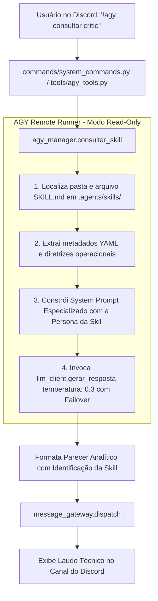

# Módulo 17: Antigravity Remote Runner & Telemetria Segura (AGY Manager)

O subsistema **Antigravity Remote Runner** (originado na `IDEA-23` e formalizado na `OS-007`) transforma o Discord Bot em uma ponte segura de telemetria e consulta analítica ao ecossistema local de agentes e skills do **Google Antigravity** (`.agents/skills/`). Operando sob um modelo estritamente **Read-Only**, ele permite inspecionar o status operacional da máquina host, verificar o catálogo de skills e solicitar pareceres consultivos de especialistas (como `/critic`, `/architect` ou `/oraculo`) diretamente pelo chat do Discord a partir de qualquer dispositivo.

---

## 1. Visão Geral e Propósito

Para possibilitar o monitoramento e consultas técnicas fora da estação de trabalho sem incorrer em riscos de segurança ou execução arbitrária de código, o **AGY Manager** isola completamente a leitura de metadados das skills e a inferência consultiva, com **tolerância zero para escrita em código de produção**.

> ⚠️ **Desacoplamento Arquitetural:**  
> O modo de **Edição e Implementação de Código** foi desacoplado para a [`IDEA-24`](file:///Users/rodrigomodel/antigravity/discord/SPECs/SPECS_IDEIAS/24_AGY_CODE_SANDBOX_WORKTREE.md) (Git Worktree Sandbox com Aprovação Humana). O presente módulo restringe-se estritamente à leitura, inspeção, telemetria e consultas consultivas.

### 1.1 Objetivos Centrais
1. **Inspeção de Catálogo Local:** Varrer o diretório `.agents/skills/`, ler os arquivos `SKILL.md`, extrair o frontmatter YAML (nome, pasta, descrição) e expor o inventário de especialistas.
2. **Telemetria do Host em Tempo Real:** Coletar métricas reais de runtime: uptime do processo, consumo de memória RSS (`resource.getrusage`), tarefas assíncronas ativas no event loop (`asyncio.all_tasks()`), PID e contagem de skills.
3. **Consultas Analíticas sob Persona Especializada:** Permitir que o usuário ou a própria LLM invoque a perspectiva de uma skill específica (injetando as primeiras 3500 caracteres das diretrizes da skill no `system_prompt`) com temperatura reduzida (`0.3`) e failover automático ativado.
4. **Blindagem Contra Execução Arbitrária:** Operações restritas a leitura (`open` / `read_text`) e chamadas de inferência de LLM. Zero comandos shell arbitrários e zero modificação de arquivos de código.

---

## 2. Arquitetura e Fluxo de Execução Read-Only



---

## 3. Coleta de Telemetria de Runtime

O método `obter_status_telemetria` extrai métricas determinísticas do processo em execução:

```python
# Uptime calculado a partir do início do processo
uptime_segundos = int(time.time() - _INICIO_PROCESSO)

# Consumo de memória RSS dependente do SO
if platform.system() == "Darwin":
    mem_mb = round(ru_maxrss / (1024 * 1024), 2)  # macOS: bytes
else:
    mem_mb = round(ru_maxrss / 1024, 2)          # Linux: kilobytes

# Tarefas ativas no event loop do asyncio
tarefas_ativas = len([t for t in asyncio.all_tasks() if not t.done()])
```

---

## 4. Catálogo de Comandos de Chat

Registrados em [`discord/commands/system_commands.py`](file:///Users/rodrigomodel/antigravity/discord/commands/system_commands.py) com `@register_command`:

| Comando | Aliases | Categoria | Descrição e Sintaxe |
| :--- | :--- | :--- | :--- |
| `!agy skills` | `!skills_locais`, `!agentes` | Sistema | Lista todas as skills e agentes locais cadastrados em `.agents/skills/`. |
| `!agy info <skill>` | `!detalhes_skill` | Sistema | Exibe as regras, persona e manifesto detalhado da skill solicitada. |
| `!agy status` | `!telemetria_agy` | Sistema | Exibe a telemetria do processo local (uptime, RAM, tarefas assíncronas e plataforma). |
| `!agy consultar <skill> <dúvida>` | `!consultar_skill` | Sistema | Executa uma consulta analítica no modo Read-Only injetando a persona e regras da skill. |

---

## 5. Catálogo de Ferramentas da LLM (Function Calling)

Registradas em [`discord/tools/agy_tools.py`](file:///Users/rodrigomodel/antigravity/discord/tools/agy_tools.py) com `@register_tool`:

1. **`listar_skills_antigravity() -> Dict[str, Any]`:**
   - **Descrição:** Lista todas as skills e agentes especialistas locais cadastrados no ecossistema Antigravity (`.agents/skills/`), retornando nomes, slugs e descrições.
2. **`consultar_skill_antigravity(nome_skill: str, consulta: str) -> Dict[str, Any]`:**
   - **Descrição:** Consulta um especialista local (ex: `'critic'`, `'architect'`, `'oraculo'`, `'ux_designer'`) sobre um dilema, arquitetura ou decisão técnica em modo estritamente consultivo.

---

## 6. Diretrizes de Blindagem e Segurança (Hardening)

1. **Zero Escrita em Código:** Nenhuma instrução de criação ou alteração de código `.py` é suportada pelo AGY Manager.
2. **Isolamento de Processo:** Apenas leitura de texto e requisições HTTP seguras à LLM via `llm_client`. Proibido `shell=True` ou execução de binários arbitrários.
3. **Timeout com *Graceful Fallback*:** Consultas que excedam o timeout da LLM abortam suavemente sem congelar o bot ou o Discord Gateway.

---

## 📋 Matriz de Rastreabilidade & Aderência (Auditada em 2026-11-14)

| ID | Requisito da Spec | Status | Implementação no Código | Notas de Auditoria |
| :---: | :--- | :---: | :--- | :--- |
| **REQ-01** | Varredura e Parser de `.agents/skills/` | 🟢 Aderente | [`agy_manager.py:L47-L100`](file:///Users/rodrigomodel/antigravity/discord/agy_manager.py#L47-L100) | `listar_skills` e `_fazer_parse_skill_file` |
| **REQ-02** | Telemetria de Runtime (Uptime, RAM, Tasks) | 🟢 Aderente | [`agy_manager.py:L102-L139`](file:///Users/rodrigomodel/antigravity/discord/agy_manager.py#L102-L139) | `obter_status_telemetria` com `resource.getrusage` |
| **REQ-03** | Consulta Analítica Read-Only sob Persona | 🟢 Aderente | [`agy_manager.py:L140-L207`](file:///Users/rodrigomodel/antigravity/discord/agy_manager.py#L140-L207) | `consultar_skill` com injeção de diretrizes |
| **REQ-04** | Comando `!agy skills` (Listagem) | 🟢 Aderente | [`commands/system_commands.py:L746-L761`](file:///Users/rodrigomodel/antigravity/discord/commands/system_commands.py#L746-L761) | `cmd_agy` subcomando `skills` |
| **REQ-05** | Comando `!agy info <skill>` | 🟢 Aderente | [`commands/system_commands.py:L763-L782`](file:///Users/rodrigomodel/antigravity/discord/commands/system_commands.py#L763-L782) | `cmd_agy` subcomando `info` com descrição |
| **REQ-06** | Comando `!agy status` (Painel) | 🟢 Aderente | [`commands/system_commands.py:L784-L806`](file:///Users/rodrigomodel/antigravity/discord/commands/system_commands.py#L784-L806) | `cmd_agy` subcomando `status` com telemetria formatada |
| **REQ-07** | Comando `!agy consultar <skill> <dúvida>` | 🟢 Aderente | [`commands/system_commands.py:L808-L840`](file:///Users/rodrigomodel/antigravity/discord/commands/system_commands.py#L808-L840) | `cmd_agy` subcomando `consultar` |
| **REQ-08** | Tool LLM `listar_skills_antigravity` | 🟢 Aderente | [`tools/agy_tools.py:L16-L46`](file:///Users/rodrigomodel/antigravity/discord/tools/agy_tools.py#L16-L46) | `tool_listar_skills_antigravity` registrada |
| **REQ-09** | Tool LLM `consultar_skill_antigravity` | 🟢 Aderente | [`tools/agy_tools.py:L48-L78`](file:///Users/rodrigomodel/antigravity/discord/tools/agy_tools.py#L48-L78) | `tool_consultar_skill_antigravity` registrada |
| **REQ-10** | Blindagem e Isolamento Estrito Read-Only | 🟢 Aderente | [`agy_manager.py:L140-L207`](file:///Users/rodrigomodel/antigravity/discord/agy_manager.py#L140-L207) | Zero operações destrutivas ou de escrita |

